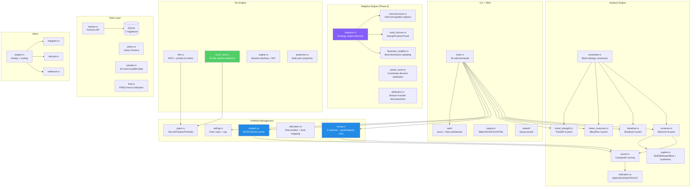
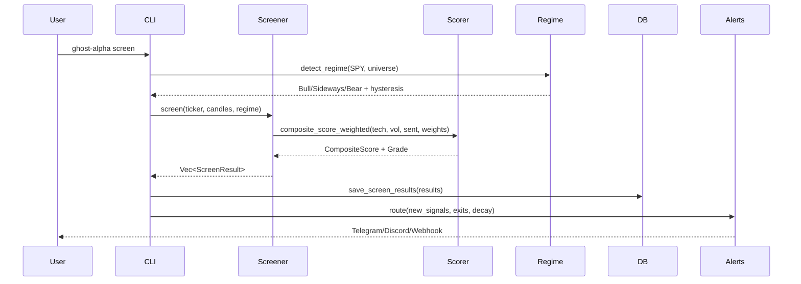

# Ghost Alpha — Architecture Reference

> 112 source files | 48,200+ LOC | 1,588 tests | Single binary (~6.9MB)

---

## Module Map



## Directory Structure

```
src/
├── main.rs                     # CLI entry point (19 subcommands via clap)
├── lib.rs                      # Library crate root
├── config.rs                   # TOML config parsing
├── error.rs                    # Per-module error types (thiserror)
├── output.rs                   # Renderable trait, Table/JSON/CSV/HTML output
├── wizard/                     # Guided setup wizard
│
├── analysis/                   # Screening + scoring engine
│   ├── mod.rs
│   ├── screener.rs             # Minervini 8-point template (ScreenResult)
│   ├── breakout.rs             # Breakout 5-point screen
│   ├── mean_reversion.rs       # Mean reversion 5-point screen
│   ├── trend_strength.rs       # Trend strength 5-point screen
│   ├── scorer.rs               # Composite scoring (regime-adaptive weights)
│   ├── indicators.rs           # SMA, ADX, RSI, ATR, VCP, RS, volume z-score,
│   │                           #   slippage model, data quality validation
│   ├── regime.rs               # Market regime detection + hysteresis
│   ├── ensemble.rs             # Multi-strategy consensus scoring
│   ├── correlation.rs          # Pearson correlation
│   ├── correlation_matrix.rs   # Pairwise correlation matrix
│   ├── sentiment.rs            # Sentiment aggregation
│   ├── onnx_scorer.rs          # ONNX Runtime + FinBERT
│   ├── macro_risk.rs           # VIX, credit, yield curve
│   ├── geopolitical.rs         # Geopolitical risk (oil, gold, DXY)
│   ├── fundamental_scorer.rs   # Earnings/revenue scoring
│   │
│   │  # Phase 6: Adaptive Engine
│   ├── microstructure.rs       # Vol/Corr/Liquidity regime classification
│   ├── multi_horizon.rs        # Swing/Position/Trend scoring + sizing params
│   ├── adaptive.rs             # Strategy weight selection (affinity × regime × vol)
│   ├── param_tuner.rs          # Coordinate descent calibration with guardrails
│   ├── bayesian_weights.rs     # Beta(α,β) strategy beliefs + exponential decay
│   └── attribution.rs          # Brinson-Fachler performance decomposition
│
├── portfolio/                  # Portfolio management
│   ├── mod.rs
│   ├── types.rs                # TaxLot, Position, Portfolio, Disposal
│   ├── symbol_map.rs           # Ticker → AssetClass lookup (23 tickers) [Gap 1]
│   ├── vesting.rs              # VestingEvent + DistributionSchedule [Gap 2]
│   ├── concentration.rs        # compute_k_max single-name floor solver [Gap 4]
│   ├── sequencer.rs            # route_cash (Greedy + ProRata) [Gap 9]
│   ├── sizing.rs               # VolatilityTarget, EqualWeight, HalfKelly, FixedFractional
│   ├── rotation.rs             # SPS (sell pressure), CDS (deployment), US (upgrade)
│   ├── selling.rs              # Selling programmes with pace rules (capped 0.25-4.0x)
│   ├── allocation.rs           # Risk profiles, brokerage catalogs, fund mapping
│   ├── decision.rs             # Decision log entries
│   ├── import.rs               # CSV/brokerage import + Fidelity ETL [Gap 6]
│   ├── ips.rs                  # Investment policy statement
│   ├── lookthrough.rs          # Position valuation, effective N, ETF look-through, weight after buy
│   ├── unwind.rs               # HIFO unwind schedule with tax, seeded fan-chart projection
│   ├── prepare.rs              # Portfolio preparation
│   └── snapshot.rs             # Point-in-time snapshots
│
├── tax/                        # Tax-aware lot selection
│   ├── mod.rs
│   ├── hifo.rs                 # HIFO + 3-tier priority selection
│   ├── wash_sale.rs            # 30-day wash sale detection (buy + sell side)
│   ├── engine.rs               # Bracket stacking, NIIT, state tax
│   ├── brackets.rs             # Federal + state brackets (MFJ, Single, WA tiered)
│   ├── harvest.rs              # Tax-loss harvesting opportunities
│   └── projection.rs           # Multi-year tax projection + scenario comparison
│
├── backtest/                   # Walk-forward backtesting
│   ├── mod.rs
│   ├── engine.rs               # Sharpe (daily + adjusted), hit rate, alpha, KPIs
│   ├── types.rs                # BacktestSignal, BacktestKpis, BacktestParams
│   ├── monte_carlo.rs          # Bootstrap CI with seeded RNG
│   ├── drawdown.rs             # Max drawdown depth + duration
│   ├── report.rs               # Text report generation
│   └── html_report.rs          # Self-contained HTML backtest report
│
├── data/                       # Data providers + models
│   ├── mod.rs
│   ├── models.rs               # Candle, Stock, FlaggedStock, MarketRegime, etc.
│   ├── fetcher.rs              # Finnhub API client
│   ├── yahoo.rs                # Yahoo Finance (zero-signup)
│   ├── sample.rs               # 50-stock bundled sample data
│   ├── fred.rs                 # FRED macro indicators
│   ├── fundamentals.rs         # Earnings, revenue, EPS data
│   ├── etf.rs                  # ETF screening data
│   ├── asset_data.rs           # Asset-level data aggregation
│   ├── cache.rs                # HTTP response caching
│   ├── provider.rs             # DataProvider trait
│   └── universes.rs            # Stock universe definitions
│
├── storage/                    # SQLite persistence
│   ├── mod.rs
│   ├── db.rs                   # Repository trait + SqliteRepository (7 migrations)
│   └── migrations.rs           # Schema migration runner
│
├── alerts/                     # Alert routing
│   ├── mod.rs
│   ├── engine.rs               # Alert engine + dedup
│   ├── channel.rs              # AlertChannel trait
│   ├── telegram.rs             # Telegram bot integration
│   ├── discord.rs              # Discord webhook
│   ├── webhook.rs              # Generic webhook
│   ├── narrative.rs            # Plain-English alert formatting
│   ├── exit_signals.rs         # Stage 2 breakdown, RS deterioration, MA cross
│   └── rebalance.rs            # Rebalance alerts
│
├── web/                        # Embedded web dashboard
│   ├── mod.rs                  # Router + AppState
│   ├── routes.rs               # Page handlers (htmx + pico.css)
│   ├── dashboard_routes.rs     # Portfolio, tax, selling pages
│   ├── concentration.rs        # /portfolio/concentration page + ETF overlap fragment
│   ├── unwind.rs               # /partials/unwind schedule + projection fragment
│   ├── diversification_report.rs # Sector, geo, concentration analysis
│   ├── charts.rs               # SVG chart generation (inline, no JS deps)
│   ├── quarterly_report.rs     # Quarterly performance reports
│   └── assets.rs               # Static asset serving
│
├── optimize/                   # Portfolio optimization
│   ├── mod.rs
│   ├── mvo.rs                  # Mean-variance optimization
│   ├── risk_parity.rs          # Risk parity allocation
│   ├── frontier.rs             # Efficient frontier
│   └── models.rs               # Optimization types
│
├── valuation/                  # Stock valuation models
│   ├── mod.rs
│   ├── dcf.rs                  # Discounted cash flow
│   ├── reverse_dcf.rs          # Implied growth rates
│   └── scenario.rs             # Bull/base/bear scenarios
│
├── projection/                 # Forward portfolio NAV projection [Gaps 1, 7, 8a]
│   ├── mod.rs
│   ├── monte_carlo.rs          # Lognormal MC + block-correlation Σ + percentiles [Gap 8a]
│   ├── asset_class_library.rs  # TOML-loaded μ/σ library [Gap 7]
│   ├── scenario.rs             # ScenarioPath + walk_price helpers [Gap 8a]
│   ├── portfolio_nav.rs        # project_path — Hold/SellReinvest/OptionBUnwind [Gap 1, OptionBUnwind branch in Gap 4]
│   └── output.rs               # CSV + audit JSON emitters [Gap 8a]
│
├── plans/                      # Trading plan generators [Gap 3]
│   └── rule_10b5_1.rs          # SEC Rule 10b5-1(c)(1) plan: cooling-off + executions + sizing
│
├── output/                     # CONVERTED from src/output.rs (single file → directory) [Gap 5]
│   ├── mod.rs                  # (former src/output.rs content)
│   ├── mermaid.rs              # quote_label_if_needed for strict renderers [Gap 5a]
│   └── plan_10b5_1_md.rs       # Markdown rendering for Plan10b5_1 [Gap 5b]
│
├── cli/                        # CLI subcommands [Gap 10]
│   └── plan.rs                 # run_plan_pipeline orchestrator
│
├── mcp/                        # MCP server for AI agents
│   ├── mod.rs
│   ├── server.rs               # JSON-RPC 2.0 over stdio
│   └── tools.rs                # 5 tools: screen, regime, alerts, config, plugins
│
├── plugins/                    # Plugin registry
│   ├── mod.rs
│   └── registry.rs             # BYOA providers, screeners, channels
│
├── config/
│   └── asset_classes.toml      # Canonical per-class μ/σ library (19 asset classes) [Gap 7]
│
└── bin/
    └── ghost-alpha-mcp.rs      # MCP binary entry point
```

## Key Design Patterns

| Pattern | Where | Why |
|---------|-------|-----|
| **Per-module error types** | `thiserror` in each module; `anyhow` only in `main.rs` | Structured errors for library code, ergonomic for CLI |
| **Regime-adaptive weights** | `RegimeWeights::for_regime()` | Different scoring emphasis per market condition |
| **Trait-based extensibility** | `DataProvider`, `AlertChannel`, `Repository` | Plugin system for custom providers/channels |
| **Async + blocking bridge** | `tokio::task::spawn_blocking` for SQLite | SQLite is sync; wrapped for async compat |
| **Feature-gated sentiment** | `--features sentiment` | Avoids 40MB ONNX dep for technical-only users |
| **Zero-config demo** | `ghost-alpha demo` uses `sample.rs` | Instant first experience with bundled data |
| **Guardrailed adaptation** | Max step, 5%/60% bounds, regime reset | Prevents overfitting in adaptive engine |
| **TDD throughout** | 1,306 inline `#[cfg(test)]` tests | Every module tested; boundary values covered |

## Data Flow



## Phase Summary

| Phase | Focus | Key Modules | Status |
|-------|-------|------------|--------|
| 1-4 | Core engine, alerts, sentiment, backtesting | screener, scorer, indicators, regime, engine | ✅ Complete |
| 5 | Quant rigor fixes | scorer (volume bias), sizing, wash_sale, ensemble, indicators (slippage) | ✅ Complete |
| 5.5 | Capital rotation | rotation (SPS/CDS/US), selling (pace cap) | ✅ Complete |
| 6 | Adaptive engine | microstructure, multi_horizon, adaptive, param_tuner, bayesian_weights, attribution | ✅ Complete |
| 7 | Portfolio Plan Pipeline | 11 gaps, portfolio projection, 10b5-1 generator, Fidelity ETL, MC engine | ✅ Complete |
| 8 | Broker integration | (planned) Alpaca paper trading | Planned |
