# Ghost Alpha — Product Requirements Document

> *"Ghostface Killah with the market alpha"*
> Finding alpha before others see it — elusive, precise, relentless.

**Version:** 2.0
**Date:** March 2026
**Status:** Phase 5 Complete, Phases 5.5-6 Designed — Capital Rotation & Adaptive Engine (Phases 1-5: 1,181 unit + 25 integration tests passing)
**Language:** Rust
**Codename:** `ghost-alpha`

---

## Table of Contents

1. [Executive Summary](#1-executive-summary)
2. [Problem Statement](#2-problem-statement)
3. [Goals & Success Metrics](#3-goals--success-metrics)
4. [User Personas](#4-user-personas)
5. [Scope Definition](#5-scope-definition)
6. [User Journey](#6-user-journey)
7. [System Architecture](#7-system-architecture)
8. [Feature Requirements](#8-feature-requirements)
9. [Data Architecture](#9-data-architecture)
10. [Core Algorithms](#10-core-algorithms)
11. [API & Interface Specifications](#11-api--interface-specifications)
12. [Technical Requirements](#12-technical-requirements)
13. [Security & Compliance](#13-security--compliance)
14. [Testing Strategy](#14-testing-strategy)
15. [Deployment & Operations](#15-deployment--operations)
16. [Roadmap & Milestones](#16-roadmap--milestones)
17. [Risks & Mitigations](#17-risks--mitigations)
18. [Appendices](#18-appendices)

---

## 1. Executive Summary

### 1.1 Vision

Ghost Alpha is a high-performance, Rust-based market intelligence agent that autonomously surfaces high-growth US equity opportunities before they become widely recognized. Operating like a ghost in the machine, it continuously monitors markets, detects emerging patterns, and delivers actionable alerts — all while remaining lightweight, fast, and resource-efficient.

### 1.2 Mission

Eliminate the "I wish I had known about that stock months ago" problem through systematic, real-time detection of established growth patterns using institutional-grade methodologies.

### 1.3 Why Rust?

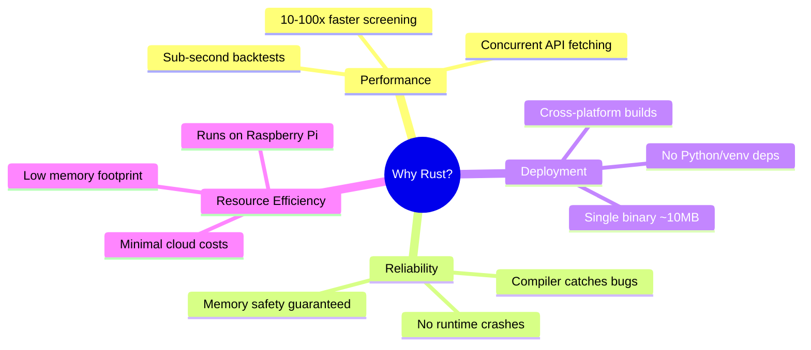

### 1.4 Key Value Propositions

| Value | Description |
|-------|-------------|
| **Proactive Discovery** | Alerts find you — no manual screening required |
| **Multi-Signal Fusion** | Combines technical, sentiment, volume, and momentum signals |
| **Low Noise** | Intelligent deduplication prevents alert fatigue |
| **Blazing Fast** | Screen 1000+ stocks in under 5 seconds |
| **Single Binary** | Deploy anywhere with zero dependencies |
| **Institutional Methods** | Minervini trend template, FinBERT sentiment, RS rankings |

---

## 1.5 Implementation Status (as of March 2026)

> Phases 1-4 are **complete** and production-ready. Phase 5 is **in progress**.

| Metric | Value |
|--------|-------|
| **Source files** | 54 Rust modules, 23,989 lines |
| **Unit tests** | 624 passing |
| **Integration / E2E tests** | 25 passing |
| **Test pass rate** | 100% |
| **Release binary** | 6.0 MB (LTO, stripped) |
| **DB migrations** | 7 (initial schema → news cache) |
| **Alert channels** | Telegram, Discord, Generic Webhook |
| **CLI subcommands** | screen, regime, alerts, backtest, mcp, plugins, migrate, setup, show-config |

| Phase | Status |
|-------|--------|
| **Phase 1: Core Engine** | ✅ Complete — Minervini screening, composite scoring, Finnhub fetcher, CLI, config |
| **Phase 2: Alerts & Storage** | ✅ Complete — SQLite, Telegram, alert engine, dedup, exit signals, flagged watchlist |
| **Phase 2.5: Signal Quality** | ✅ Complete — Weighted RS, regime-adaptive weights, ATR/R:R/liquidity, VCP detection, macro risk (FRED), correlation alerting, conviction decay |
| **Phase 3: Sentiment** | ✅ Complete — ONNX Runtime + FinBERT (feature-gated), news fetcher, time-decay aggregation, sentiment → composite pipeline |
| **Phase 4: Validation & Polish** | ✅ Complete — Walk-forward backtesting, Monte Carlo CI, drawdown analysis, MCP server, plugin registry, Discord webhooks, documentation |
| **Phase 5: Quantitative Rigor & Portfolio Integration** | ✅ Complete — 11/11 features: volume bias fix, conditions normalization, sentiment redistribution, Sharpe fix, position sizing, wash sale, slippage model, data quality, regime hysteresis, ensemble, selling pace cap |
| **Phase 5.5: Capital Rotation Engine** | 📋 Designed — SPS (sell pressure), CDS (cash deployment), US (upgrade score), rotation CLI, anti-churn safeguards |
| **Phase 6: Adaptive Market Engine** | 📋 Designed — Multi-timeframe strategy selection, adaptive param tuning, market microstructure, multi-horizon scoring, Bayesian weights, performance attribution |

**Beyond PRD scope (bonus):**
- MCP server (JSON-RPC 2.0 over stdio) for AI agent integration
- Plugin registry — BYOA data providers, screeners, alert channels
- Generic webhook alert channel for arbitrary integrations
- Discord webhook alerts with rich embeds
- Web dashboard (axum + htmx + pico.css) with portfolio tracking, tax engine, diversification analysis, geopolitical risk assessment

---

## 2. Problem Statement

### 2.1 The Core Problem

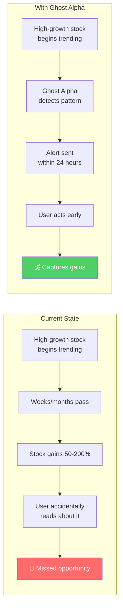

### 2.2 Why Existing Solutions Fail

| Solution | Limitation |
|----------|------------|
| **Manual screeners** (Finviz, TradingView) | Requires daily active engagement; easy to miss signals |
| **Brokerage alerts** | Limited to price-only; no multi-factor analysis |
| **Newsletter picks** | Delayed; often crowded by the time you see them |
| **Social media** (Reddit, Twitter) | Noisy; dominated by memes and pump-and-dumps |
| **Expensive terminals** (Bloomberg) | $20k+/year; overkill for personal use |

### 2.3 User Pain Points

1. **Time poverty** — Can't monitor markets daily
2. **Information overload** — Too many signals, no prioritization
3. **Late discovery** — Find opportunities after the big move
4. **Alert fatigue** — Existing tools send too many useless notifications
5. **Complexity** — Building a custom solution requires significant expertise

---

## 3. Goals & Success Metrics

### 3.1 Primary Goals

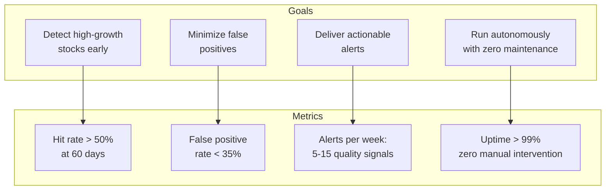

### 3.2 Success Metrics (KPIs)

| Metric | Definition | Target | Measurement |
|--------|------------|--------|-------------|
| **Hit Rate** | % of flagged stocks that gain >5% within 60 days | >50% | Weekly backtest validation |
| **Regime-Adjusted Hit Rate** | Hit rate separated by bull/bear/sideways market regime | >60% bull, >35% bear | Weekly backtest with regime labels |
| **Alpha** | Average return of flagged stocks minus S&P 500 return | >1.5% at 60d (regime-adjusted) | Monthly performance report |
| **False Positive Rate** | % of flagged stocks that decline >5% within 60 days | <35% | Weekly backtest |
| **Max Drawdown** | Worst peak-to-trough decline of flagged stocks within 60d | < -15% | Weekly backtest |
| **Win/Loss Ratio** | Average gain on winners / average loss on losers | >1.5 | Monthly performance report |
| **Profit Factor** | Gross profit / gross loss of flagged stocks | >1.3 | Monthly performance report |
| **Time to Peak** | Median days from flag to maximum gain | Informational | Monthly performance report |
| **Signal Quality** | User-rated usefulness of alerts (1-5 scale) | >4.0 | Manual review |
| **Alert Volume** | Number of alerts per week | Adaptive: 5-15 normal, 0-5 in bear regimes | System metrics |
| **Latency** | Time from market close to alert delivery | <30 min | System metrics |
| **Uptime** | System availability | >99% | Monitoring |

### 3.3 Non-Goals (Out of Scope)

- Automated trade execution (order placement, broker integration)
- Real-time intraday trading signals
- Options or derivatives analysis
- International markets
- Multi-user / SaaS deployment

> **Scope evolution (v2.0):** Portfolio management and tax optimization were previously out of scope. As of Phase 5, the following are now **in scope**: position sizing engine, ATR-based stop management, tax-aware lot selection (HIFO/priority), wash sale rule enforcement, selling programme with pace rules, and portfolio-level diversification analysis. These remain *decision-support tools* — Ghost Alpha recommends actions but does not execute trades.

---

## 4. User Personas

### 4.1 Primary Persona: "The Busy Professional"

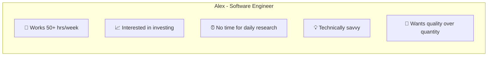

**Demographics:**
- Age: 30-45
- Income: $150k-400k
- Portfolio: $50k-500k in equities
- Time for investing: 1-2 hours/week

**Goals:**
- Catch high-growth stocks early without daily monitoring
- Reduce FOMO by having systematic coverage
- Make informed decisions with synthesized data

**Frustrations:**
- Missed NVDA's run from $200 to $800
- Too busy to read financial news daily
- Overwhelmed by noise on Reddit/Twitter

### 4.2 Secondary Persona: "The Systematic Trader"

**Demographics:**
- Age: 25-40
- Background: Quantitative or technical
- Portfolio: $100k-1M
- Approach: Rule-based, data-driven

**Goals:**
- Augment their existing strategy with new signal sources
- Backtest and validate signals before acting
- Integrate alerts into existing workflow

---

## 5. Scope Definition

### 5.1 Phase Overview

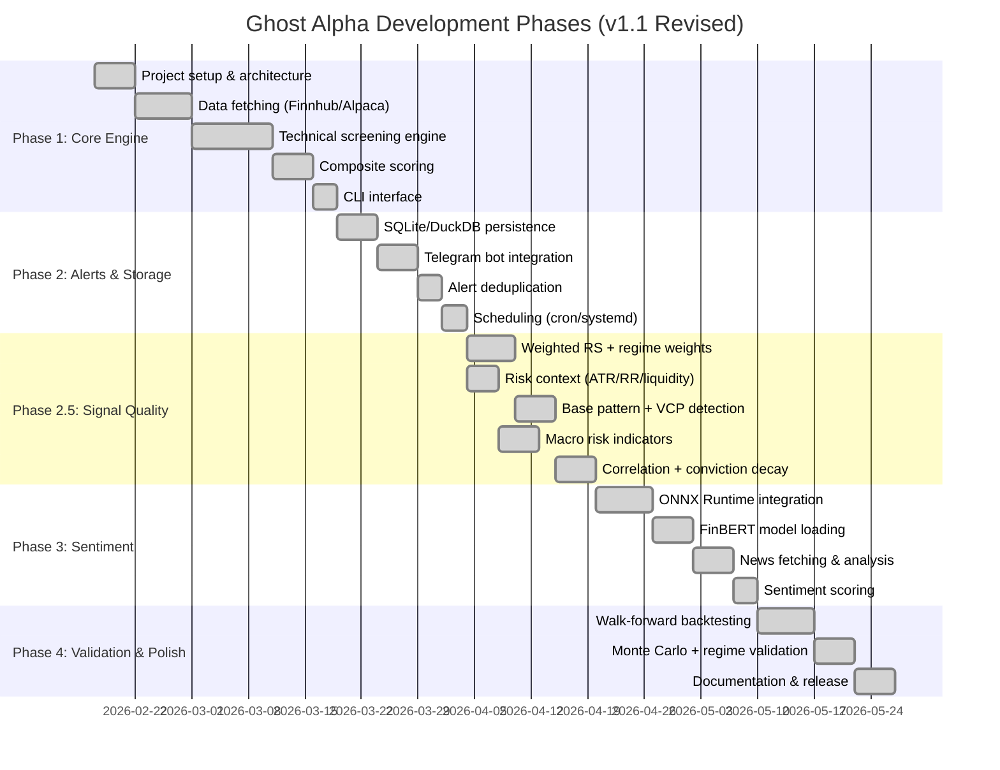

### 5.2 Phase 1: Core Engine (Weeks 1-4)

**Objective:** Build the foundational screening engine that detects Minervini Stage 2 uptrends.

| Feature | Priority | Description |
|---------|----------|-------------|
| Data Fetcher | P0 | Async Finnhub/Alpaca client with rate limiting |
| Price Storage | P0 | In-memory + file-based caching for historical data |
| Minervini Screen | P0 | 8-point trend template implementation |
| Volume Analysis | P0 | Z-score anomaly detection |
| Relative Strength | P1 | Cross-sectional RS percentile ranking |
| ADX Calculation | P0 | Trend strength indicator (required for score quality) |
| Market Regime Filter | P0 | Bull/bear/sideways detection via SPY 200-day MA + breadth |
| Earnings Proximity Check | P0 | Flag stocks reporting within 7 trading days |
| Composite Scorer | P0 | Multi-factor scoring (0-100) |
| CLI Interface | P0 | `ghost-alpha screen`, `ghost-alpha watch` |
| Config System | P0 | TOML-based configuration |

**Deliverable:** Working CLI that screens S&P 500 and outputs ranked results. ✅ **Delivered.**

### 5.3 Phase 2: Alerts & Persistence (Weeks 5-7)

**Objective:** Enable autonomous operation with persistent storage and push notifications.

| Feature | Priority | Description |
|---------|----------|-------------|
| SQLite Storage | P0 | Historical screens, alerts, prices |
| Telegram Bot | P0 | Push notifications with rich formatting |
| Alert Engine | P0 | Rule evaluation, severity routing |
| Deduplication | P0 | Suppress repeated alerts (cooldown windows) |
| Quiet Hours | P1 | Time-based alert suppression |
| Exit/Breakdown Alerts | P0 | Notify when previously-flagged stocks fail conditions |
| Watchlist | P1 | Custom ticker lists |
| Scheduler | P0 | Systemd timer / cron integration |
| Health Checks | P1 | Self-monitoring, error reporting |

**Deliverable:** System runs unattended, sends daily alerts via Telegram, Discord, and/or webhooks. ✅ **Delivered.**

### 5.3.5 Phase 2.5: Signal Quality Enhancement (Weeks 6-8) — NEW

**Objective:** Elevate signal quality from "functional screener" to "institutional-grade signal generation" by adding risk context, regime-adaptive scoring, base pattern detection, and macro risk indicators.

| Feature | Priority | Description |
|---------|----------|-------------|
| Weighted Multi-TF RS | P0 | Replace single 252-day RS with 40/20/20/20 weighted composite (F3.1) |
| Regime-Adaptive Weights | P0 | Scoring weights adjust by market regime: 55/30/15 Bull, 60/20/20 Sideways, 70/10/20 Bear (F5.1-F5.3) |
| ATR + R:R + Liquidity | P0 | Risk context in every alert: ATR(14), stop-based R:R ratio, liquidity classification (F5.8, F7.10) |
| Base Pattern Detection | P1 | VCP detection, base depth/count, pivot proximity (F12) |
| Macro Risk Indicators | P1 | VIX term structure, credit spreads, yield curve from FRED/CBOE (F13) |
| Correlation Alerting | P1 | Pairwise return correlation check for concentration risk (F7.9) |
| Conviction Decay | P1 | Weekly re-scoring of flagged stocks with WEAKENING alerts (F10.8) |

**Deliverable:** Alerts include risk context (ATR, R:R, liquidity). Regime-conditional backtests show measurable improvement in bear-market signal quality. ✅ **Delivered.**

### 5.4 Phase 3: Sentiment Analysis (Weeks 9-12)

**Objective:** Add NLP-based sentiment scoring using FinBERT via ONNX.

| Feature | Priority | Description |
|---------|----------|-------------|
| ONNX Runtime | P0 | Rust bindings for model inference |
| FinBERT Model | P0 | Export and load FinBERT ONNX |
| Tokenizer | P0 | HuggingFace tokenizers in Rust |
| News Fetcher | P0 | Finnhub company news integration |
| Batch Inference | P1 | Process multiple articles efficiently |
| Sentiment Aggregation | P0 | Time-weighted averaging |
| Sentiment Momentum | P1 | Rate of change detection |

**Deliverable:** Sentiment score integrated into composite ranking. ✅ **Delivered.** (Feature-gated via `--features sentiment`)

### 5.5 Phase 4: Validation & Polish (Weeks 13-16)

**Objective:** Production-ready release with walk-forward validated signal quality and comprehensive documentation.

| Feature | Priority | Description |
|---------|----------|-------------|
| Walk-Forward Backtesting | P0 | Rolling-window validation with 6+ periods (BT.7) |
| Monte Carlo Validation | P0 | Confidence intervals for all KPIs; reject if CI includes null (BT.8) |
| Regime-Conditional Reports | P0 | Mandatory per-regime KPI disaggregation (BT.10) |
| Drawdown Duration Analysis | P1 | Track depth, duration, and recovery time (BT.9) |
| Performance Report | P1 | Weekly/monthly signal quality metrics |
| Binary Optimization | P2 | Strip symbols, LTO, minimize size |
| Cross-Compilation | P2 | Linux ARM (Raspberry Pi), macOS |
| Documentation | P0 | README, architecture docs, user guide |
| Docker Image | P2 | Optional containerized deployment |

**Deliverable:** v1.2 release with walk-forward validated signal quality and Monte Carlo confidence intervals. ✅ **Delivered.**

### 5.6 Phase 5: Quantitative Rigor & Portfolio Integration (Current)

**Objective:** Close the gap between "screening tool" and "actionable investment system" by fixing structural scoring biases, correcting backtesting methodology, adding position sizing, enforcing tax rules, and enabling multi-strategy signal fusion.

> This phase was informed by a comprehensive quantitative audit of the codebase (March 2026) that identified 10 prioritized improvements across scoring, backtesting, risk management, tax, and architecture.

| Feature | Priority | Description | Impact |
|---------|----------|-------------|--------|
| Position Sizing Engine | P0 | Volatility-target, equal-weight, half-Kelly, and fixed-fractional methods. Converts screen output to actionable trade sizes. | Converts screening output to actionable trades |
| Volume Score Bias Correction | P0 | Fix +15 bias where z=0 scores 15/30. Only reward accumulation (z>0). | Improves signal quality across all strategies |
| Sharpe Ratio Methodology Fix | P0 | Compute from daily portfolio return series, not overlapping 60-day cross-sectional returns. | Prevents misleading backtest performance |
| Wash Sale Rule Enforcement | P0 | Cross-reference recent purchases against proposed sales within +-30 day window. | Prevents illegal tax positions |
| Screener Conditions Normalization | P1 | Add `max_conditions` to `TechnicalInputs` so all screeners score on 0-100% of their criteria. | Levels playing field across strategies |
| Sentiment Weight Redistribution | P1 | When no sentiment data available, redistribute weight to technical (70%) and volume (30%). | Recovers 15% of wasted composite score |
| Regime Transition Hysteresis | P1 | Require new regime conditions to hold for N consecutive days before transitioning. Track `RegimeTransition` state. | Smoother portfolio adjustments, prevents whipsaw |
| Liquidity-Adjusted Slippage Model | P1 | Scale transaction costs by liquidity class (1x High, 1.5x Medium, 3x Low, 5x Illiquid). | More realistic backtest returns |
| Multi-Strategy Ensemble | P2 | Combine scores when a stock passes multiple screeners. Require at least 2 strategies passing for highest-conviction tier. | Higher-conviction signals |
| Data Quality Validation | P2 | Detect suspicious daily moves (>50%) that indicate split/data errors. Validate adjusted prices. | Prevents spurious signals from bad data |
| Selling Programme Pace Cap | P1 | Cap combined pace multiplier at 4.0x to prevent pathological compounding in crash scenarios. | Prevents over-selling in extreme conditions |
| Tax-Optimal Lot Selection | P2 | Unified optimizer that considers lot selection, holding period, and NIIT threshold interaction. | Better after-tax outcomes |

**Deliverable:** Position sizing engine integrated with screening output, corrected backtesting KPIs, wash sale enforcement in tax engine, regime hysteresis preventing whipsaw. ✅ **Core logic delivered** (11/11 features implemented, 67 new tests).

### 5.7 Phase 5.5: Capital Rotation Engine (Planned)

**Objective:** Close the "when to swap" gap — tell the user not just what to buy and when to exit, but when to replace a weakening position with a stronger candidate, and whether to deploy freed capital or hold cash.

> Informed by the rotation framework analysis (March 2026). Bridges the gap between exit signals (binary) and a continuous sell-pressure evaluation.

| Feature | Priority | Description | Impact |
|---------|----------|-------------|--------|
| Sell Pressure Score (SPS) | P0 | 8-component 0-100 score per position: TrendDecay, MomentumFade, VolumeAbandonment, RelativeWeakness, FundamentalDrift, DrawdownPenalty, TimeDecay, ConcentrationPenalty. Regime-adaptive weights. Thresholds: Green (0-25), Yellow (26-45), Orange (46-65), Red (66-80), Critical (81-100). | Converts binary hold/sell into graded pressure levels |
| Cash Deployment Score (CDS) | P1 | 4-component score: OpportunityRichness, RegimeScore, CashDragCost, DrawdownRisk. Determines whether to deploy freed capital or hold cash. | Prevents premature deployment in poor environments |
| Upgrade Score (US) | P1 | Head-to-head candidate vs incumbent comparison: AlphaAdvantage, MomentumEdge, RiskImprovement, CostFriction. Threshold: US > +15 to justify swap. | Quantifies opportunity cost of holding vs swapping |
| Tier-Adjusted Thresholds | P1 | A+ positions get wider room (SPS Orange at 55, US > 25). Grandfathered B positions face shorter leash (SPS Orange at 40, US > 10). | Reflects conviction levels in rotation decisions |
| Anti-Churn Safeguards | P1 | Min 10-session holding period, max 2 swaps/week, 20-session swap cooldown, quarterly tax budget. | Prevents hyperactive churning at small portfolio sizes |
| Weekly Rotation CLI | P1 | `ghost-alpha rotate` outputs SPS table, upgrade candidates, CDS, and recommended actions. | Actionable weekly workflow |
| Rotation Dashboard Tab | P2 | Color-coded SPS table, upgrade comparison cards, CDS gauge, action items panel. | Visual decision support |
| Rotation History & Persistence | P2 | SQLite tables for `rotation_history` and `upgrade_history`. Track decisions over time. | Enables rotation performance measurement |

**Deliverable:** `ghost-alpha rotate` command producing weekly rotation reports with SPS, CDS, and upgrade comparisons. Dashboard integration.

### 5.8 Phase 6: Adaptive Market Engine (Planned)

**Objective:** Transform GhostAlpha from a fixed-parameter screening system into a self-calibrating engine that adapts strategy selection, parameter tuning, and signal presentation based on market microstructure and realized performance across multiple time horizons.

> Core principle: **adapt slowly and conservatively, with guardrails to prevent overfitting, while retaining full auditability and determinism.**

> Detailed design: `docs/planning/phase-6-adaptive-market-engine.md` (1,244 lines, complete algorithm specifications)

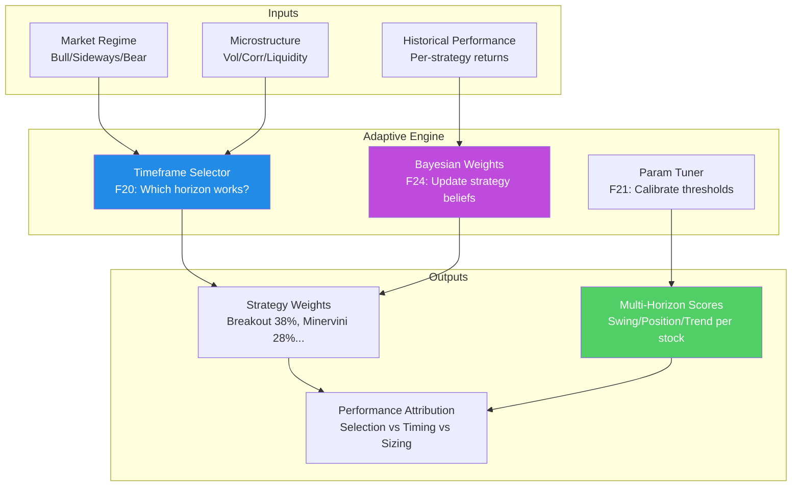

| Feature | Priority | Description | Impact |
|---------|----------|-------------|--------|
| **F20: Multi-Timeframe Strategy Selection** | P1 | Automatically weight screeners based on: (1) strategy-horizon affinity matrix, (2) timeframe effectiveness via rolling Sharpe with softmax, (3) regime + volatility modifiers. Output: blended strategy weight vector. | Emphasizes strategies that work in current conditions |
| **F21: Adaptive Parameter Tuning** | P1 | Rolling calibration of RS threshold (60-85), ADX thresholds, volume surge ratio, consolidation depth. Coordinate descent on 5-point grid with walk-forward IS/OOS. Max step limits, regime-reset, staleness warnings. | Tightens parameters in bull, loosens in bear |
| **F22: Market Microstructure Awareness** | P0 | Three new regime classifications: volatility regime (Low/Normal/High from VIX + realized vol), correlation regime (Low/Normal/High from sector ETF correlations), liquidity calendar (Normal/FOMC/QuadWitching/EarningsSeason). Geometric mean favorability score. | Adds market structure context beyond simple Bull/Bear |
| **F23: Multi-Horizon Scoring** | P0 | Each stock scored for Swing (2-4 weeks), Position (2-6 months), Trend (6-12 months). Horizon-specific weights: Swing 40/45/15, Position 55/30/15, Trend 70/15/15. Horizon-specific sizing: Swing max 3% with 1.5x ATR stop, Trend max 12% with 3x ATR stop. | Matches recommendation to user's intended holding period |
| **F24: Bayesian Strategy Weight Updating** | P2 | Each strategy-regime pair maintains Beta(α,β) distribution. Wins/losses from 60-day forward returns update posterior. Exponential decay (half-life ~138 observations). Blended with regime prior at 40/60. Guardrails: 5% floor, 60% ceiling. Reset on regime transition. | Engine learns from its own performance |
| **F25: Performance Attribution** | P2 | Brinson-Fachler decomposition: stock selection, market timing, position sizing, strategy weighting, interaction. Waterfall chart on dashboard. Stored in SQLite. | Answers "where did alpha come from?" |

**Key design decisions:**
- **Never adapt** (structural): Minervini condition count (8), SMA periods, ADX period
- **Regime-switch only** (discrete): Scoring weight profiles (already done in Phase 2.5)
- **Rolling calibration** (continuous): RS threshold, ADX threshold, volume Z-score, consolidation depth
- All adaptive features can be disabled via `--fixed-weights` CLI flag or `[adaptive] enabled = false` in config
- Full determinism: coordinate descent with fixed grid, no randomness in calibration

**Implementation order:** F22 → F23 → F20 → F21 → F24 → F25 → Dashboard

**Estimated scope:** ~3,500 LOC across 6 new modules + extensions to 4 existing modules.

**Deliverable:** Self-calibrating screening engine that adapts strategy emphasis, parameter tuning, and time horizon to prevailing market conditions. Full audit trail and `--fixed-weights` escape hatch.

### 5.9 Feature Matrix: In Scope vs Out of Scope

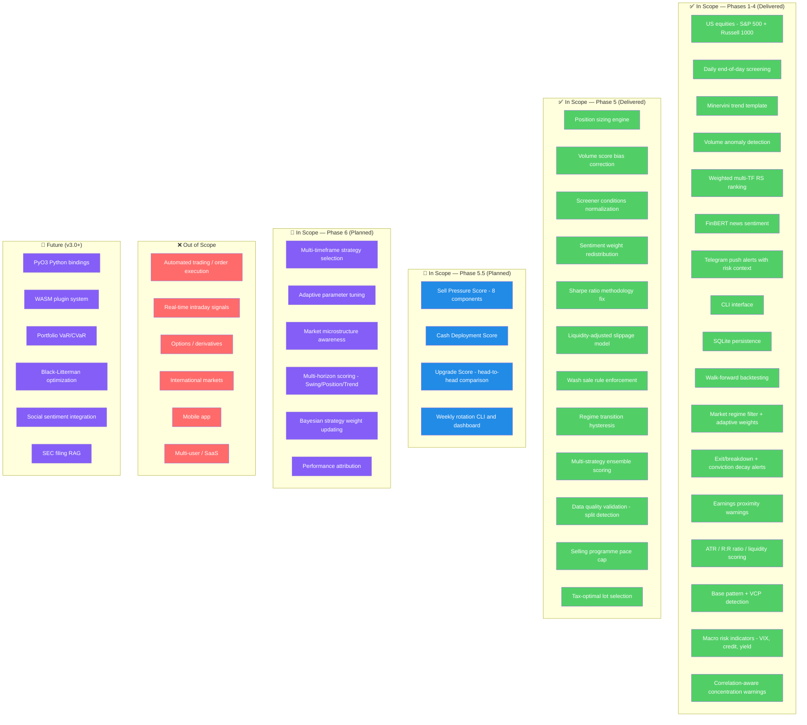

---

## 6. User Journey

> This section maps the complete user experience from first screen to ongoing portfolio management. Each step references the feature requirements and algorithms that power it, showing how Ghost Alpha's components connect into a cohesive investment workflow.

### 6.1 Journey Overview

```mermaid
graph LR
    subgraph "Phase A: Discovery"
        A1[Run Screen] --> A2[Review Ranked Results]
        A2 --> A3[Evaluate Risk Context]
    end

    subgraph "Phase B: Decision"
        A3 --> B1[Check Regime & Macro]
        B1 --> B2[Compute Position Size]
        B2 --> B3[Validate Wash Sale Rules]
        B3 --> B4[Execute Entry]
    end

    subgraph "Phase C: Monitoring"
        B4 --> C1[Daily Exit Signal Check]
        C1 --> C2[Weekly Conviction Rescore]
        C2 --> C3[Regime Transition Watch]
    end

    subgraph "Phase D: Exit"
        C1 --> D1[Exit Signal Triggered]
        C2 --> D1
        C3 --> D1
        D1 --> D2[Tax-Optimal Lot Selection]
        D2 --> D3[Selling Programme Execution]
        D3 --> D4[Capital Recycled to Phase A]
    end

    D4 --> A1

    style A1 fill:#228be6,color:#fff
    style B2 fill:#fab005,color:#000
    style D1 fill:#ff6b6b,color:#fff
    style D4 fill:#51cf66,color:#fff
```

### 6.2 Phase A: Discovery — Screening & Signal Generation

**Trigger:** Daily at market close (automated via cron/systemd) or manual `ghost-alpha screen`

| Step | User Action | System Action | Features Used |
|------|-------------|---------------|---------------|
| A1 | Runs `ghost-alpha screen --provider yahoo` | Fetches OHLCV for universe, validates data quality (split detection), computes all indicators | F1, F2, F3, F4, F17 |
| A2 | Reviews ranked table of passing stocks | Applies Minervini 8-point filter, computes composite score with regime-adaptive weights, assigns percentile grades | F5, F9, F12 |
| A3 | Examines risk context for top candidates | Displays ATR, R:R ratio, liquidity class, VCP status, base count, RS momentum | F5.8, F12, F3.4 |

**Key decision point:** Does the stock meet the regime-minimum grade? (Bull: B+, Sideways: A, Bear: A+ only)

**Multi-strategy signal (Phase 5):** If the stock passes multiple screeners (Minervini + TrendStrength + Breakout), the ensemble score provides higher conviction. Stocks passing 2+ strategies are flagged as "Consensus Pick" with an averaged composite and strategy count badge. *(F16)*

### 6.3 Phase B: Decision — Sizing & Entry

**Trigger:** User identifies a candidate from screening results

| Step | User Action | System Action | Features Used |
|------|-------------|---------------|---------------|
| B1 | Checks current regime and macro risk level | Displays regime (Bull/Sideways/Bear) with hysteresis state, macro dashboard (VIX, credit, yield curve) | F9, F13, F18 |
| B2 | Requests position size recommendation | Computes shares based on sizing method (volatility-target default), applies grade multiplier and regime multiplier, enforces max position % cap | F14 |
| B3 | Reviews tax implications before buying | Checks for wash sale conflicts with recent sales in the same ticker within 30-day window | F15 |
| B4 | Executes trade (external broker) | Logs entry in flagged_stocks with initial score, price, RS, and sizing metadata | F10.1 |

**Position sizing example (Sideways regime, A-grade stock, $10K portfolio):**

```
Method:          Volatility Target (default)
Risk budget:     $100 × 1.0 (A grade) × 0.8 (Sideways) = $80
ATR(14):         $2.15
Stop distance:   2 × ATR = $4.30
Position size:   $80 / $4.30 = 18.6 shares ≈ 18 shares
Dollar amount:   18 × $190 = $3,420
Portfolio %:     34.2% → CAPPED at 15% max → 7.9 shares ≈ 7 shares ($1,330)
```

### 6.4 Phase C: Monitoring — Active Position Management

**Trigger:** Daily automated screening + weekly manual review

| Step | User Action | System Action | Features Used |
|------|-------------|---------------|---------------|
| C1 | Reviews daily alerts (Telegram/Discord) | Checks all ACTIVE flagged stocks for exit signals: Stage 2 breakdown, RS deterioration, MA death cross | F10.2-F10.4 |
| C2 | Reviews weekly dashboard | Re-scores all flagged stocks, sends WEAKENING alerts if composite drops >15 points, RECOVERED if it bounces back | F10.8, F10.9 |
| C3 | Monitors regime transitions | Tracks regime state with hysteresis (requires N consecutive days in new regime before transitioning), shows Deteriorating/Improving transition status | F9, F18 |

**Regime transition example:**
```
Day 1:  Breadth drops from 62% to 58% → Regime: Bull (DETERIORATING → Sideways)
Day 2:  Breadth at 57% → Still Bull (DETERIORATING, day 2 of 3 required)
Day 3:  Breadth at 55% → Regime officially shifts to Sideways
        → All sub-A positions flagged for review
        → Position sizing multiplier drops from 1.0x to 0.8x
        → Alert: "REGIME SHIFT: Bull → Sideways (confirmed after 3-day hold)"
```

### 6.5 Phase D: Exit — Tax-Aware Position Unwinding

**Trigger:** Exit signal fires, or user initiates selling programme

| Step | User Action | System Action | Features Used |
|------|-------------|---------------|---------------|
| D1 | Receives exit alert with context | Identifies exit type (breakdown/RS/MA cross), shows original entry score vs current, current P&L, holding period | F10 |
| D2 | Reviews tax implications | Selects lots using priority system: (1) short-term losses, (2) long-term losses, (3) long-term gains, (4) short-term gains. Checks wash sale window. | F15, Tax Engine |
| D3 | Executes via selling programme | Applies pace rules with regime/condition multipliers (capped at 4.0x), computes quarterly target shares, adjusts for liquidity class | Selling Programme |
| D4 | Capital returns to cash reserve | Updates portfolio allocation, recalculates regime exposure limits, freed capital available for next A+ discovery | Portfolio Module |

**Selling programme pace example (Bear regime, stock below 200-SMA):**
```
Base quarterly pace:    25% of remaining shares
Regime multiplier:      2.0x (Bear)
Below 200-SMA:          1.5x
Combined:               2.0 × 1.5 = 3.0x → CAPPED at 4.0x → 3.0x applied
Adjusted pace:          25% × 3.0 = 75% of remaining shares this quarter
Slippage adjustment:    10 bps × 3.0 (Low liquidity) = 30 bps estimated cost
```

### 6.6 User Journey: Weekly Workflow Summary

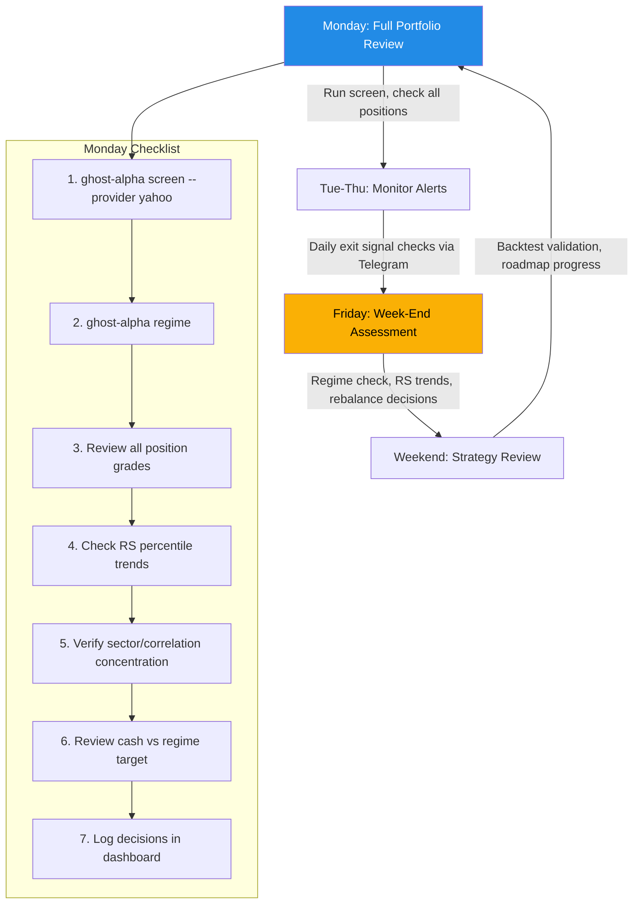

---

## 7. System Architecture

### 7.1 High-Level Architecture

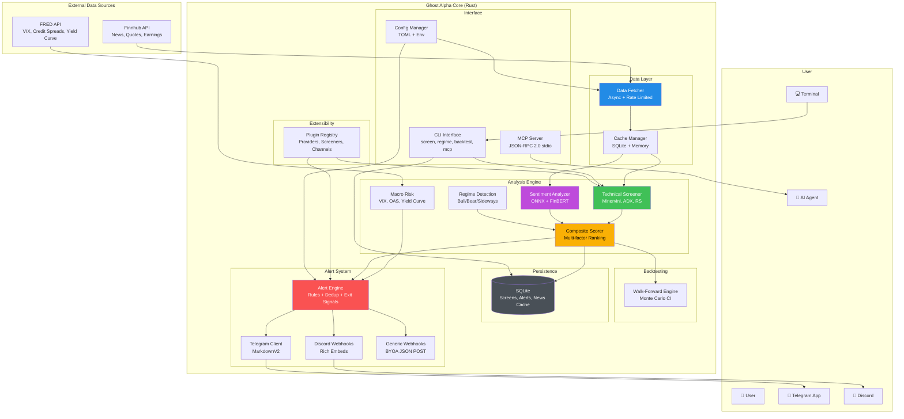

### 7.2 Component Architecture

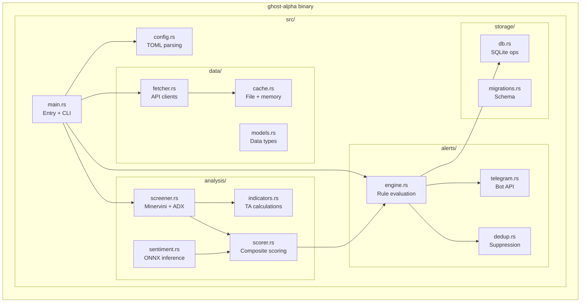

### 7.3 Data Flow Architecture

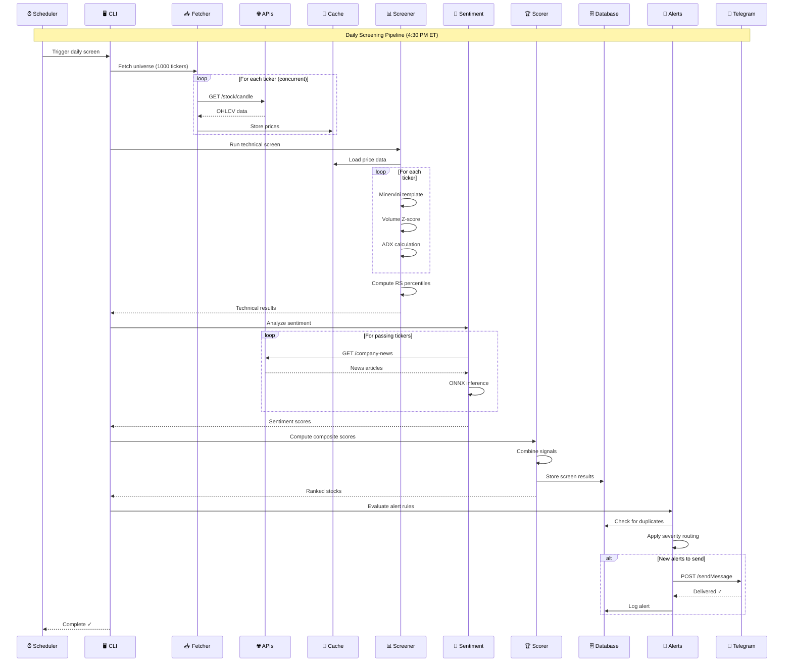

### 7.4 Deployment Architecture

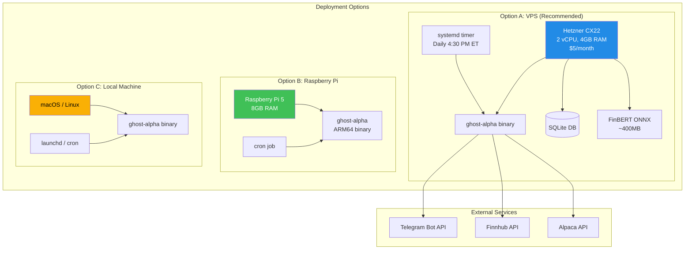

---

## 8. Feature Requirements

### 8.1 Core Features (Phases 1-4 — Delivered)

#### F1: Technical Screening Engine

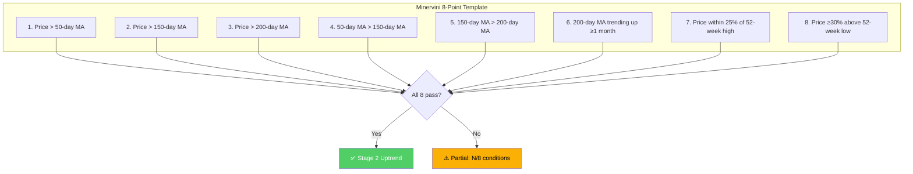

**Requirements:**

| ID | Requirement | Priority |
|----|-------------|----------|
| F1.1 | Calculate SMA(50), SMA(150), SMA(200) with configurable smoothing | P0 |
| F1.2 | Implement all 8 Minervini conditions | P0 |
| F1.3 | Return both pass/fail boolean and conditions_met count | P0 |
| F1.4 | Support minimum data length validation (≥252 days) | P0 |
| F1.5 | Calculate 52-week high/low rolling windows | P0 |

#### F2: Volume Anomaly Detection

**Requirements:**

| ID | Requirement | Priority |
|----|-------------|----------|
| F2.1 | Calculate rolling mean and std of volume (configurable window, **default 50 days**, excluding current day). Note: unit tests may use a shorter window (e.g., 20) for fixture manageability; production default is 50. | P0 |
| F2.2 | Compute Z-score: `(current - mean) / std` (current day excluded from window to avoid look-ahead bias) | P0 |
| F2.3 | Flag volume spikes where Z > 2.0 | P0 |
| F2.4 | Handle edge cases: insufficient data, zero std | P0 |
| F2.5 | Directional volume scoring: `directed_zscore = if close > open { zscore } else { -zscore }` — positive on up-closes, negative on down-closes | P0 |
| F2.6 | **Volume context normalization:** Include volume as % of float (via Finnhub `/stock/profile2`), dollar volume threshold (flag when avg daily dollar volume < $1M), and comparison against sector/industry average volume profiles. This filters micro-cap noise and distinguishes genuine institutional accumulation from retail/options-driven spikes. | P1 |

#### F3: Relative Strength Ranking

**Requirements:**

| ID | Requirement | Priority |
|----|-------------|----------|
| F3.1 | ~~Calculate 252-day price change for each stock~~ **Weighted multi-timeframe RS composite:** `RS = 0.40 × (63d return) + 0.20 × (126d return) + 0.20 × (189d return) + 0.20 × (252d return)`. This favors recent price acceleration while still requiring sustained strength, closely aligned with O'Neil/IBD methodology. Single-timeframe RS creates false equivalence between a stock that gained 100% in January and was flat for 11 months vs. one that climbed steadily all year. | P0 |
| F3.2 | Rank all stocks by weighted RS composite and compute percentile (0-100) | P0 |
| F3.3 | RS > 70 = market leader, RS > 90 = top decile | P0 |
| F3.4 | **RS momentum:** Track 21-day rate of change in RS percentile. Flag stocks where RS is accelerating (rising >5 percentile points in 21 days) as higher-conviction entries, and decelerating RS as early warning for flagged stocks. | P1 |

#### F4: ADX Trend Strength

**Requirements:**

| ID | Requirement | Priority |
|----|-------------|----------|
| F4.1 | Implement Wilder's ADX calculation (14-period default) | P0 |
| F4.2 | Include +DI and -DI for trend direction | P0 |
| F4.3 | ADX > 25 = strong trend, > 40 = very strong | P0 |

#### F5: Composite Scoring

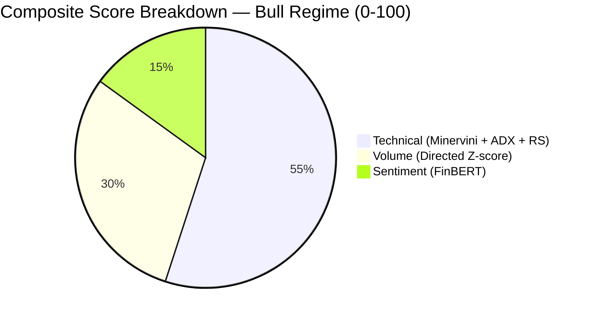

> **Rationale for 55/30/15 split (Bull regime default):** Technical signals (Minervini, ADX, RS) have the strongest empirical backing for trend-following. Volume with directional context is a reliable confirmation signal. FinBERT headline sentiment has weaker predictive power (~2-3% edge in literature) and should carry less weight until validated by backtesting on this system's specific universe and timeframe.

**Regime-Adaptive Weights:**

| Regime | Technical | Volume | Sentiment | Rationale |
|--------|-----------|--------|-----------|-----------|
| **Bull** | 55% | 30% | 15% | Standard weights; volume confirmation is reliable |
| **Sideways** | 60% | 20% | 20% | Tighten technical filter; reduce volume noise; sentiment divergence becomes more informative |
| **Bear** | 70% | 10% | 20% | Heavily favor technical quality; volume spikes are often capitulation/short-covering traps; sentiment divergence (positive in fearful market) is a meaningful signal |

> **Why regime-adaptive weights matter:** In bear markets, volume spikes frequently represent capitulation events or short-covering rallies — exactly the kind of false signals that generate losing trades. Meanwhile, positive sentiment emerging during market-wide fear is a stronger contrarian indicator than positive sentiment during a bull market when everything is positive. Static weights across all regimes systematically degrade signal quality during the market conditions where capital preservation matters most.

**Requirements:**

| ID | Requirement | Priority |
|----|-------------|----------|
| F5.1 | Technical sub-score: 0-55 points in Bull, 0-60 in Sideways, 0-70 in Bear (Minervini base + ADX bonus + RS bonus, scaled to regime max) | P0 |
| F5.2 | Volume sub-score: 0-30 points in Bull, 0-20 in Sideways, 0-10 in Bear (directed Z-score mapped, scaled to regime max) | P0 |
| F5.3 | Sentiment sub-score: 0-15 points in Bull, 0-20 in Sideways/Bear (-1 to +1 mapped, scaled to regime max) | P0 |
| F5.4 | Composite = technical + volume + sentiment (always sums to 100-point scale regardless of regime) | P0 |
| F5.5 | Assign letter grade using **percentile-based thresholds** relative to current screening universe (not fixed cutoffs) — top 5% = A+, top 15% = A, top 30% = B, etc. | P1 |
| F5.6 | Empirical weight calibration: run sensitivity analysis across weight configurations during backtesting; document optimal weights per regime | P1 |
| F5.7 | Log sub-score distributions per screening run to detect drift or skew over time | P2 |
| F5.8 | **Risk context fields** in ScreenResult: include ATR(14), implied stop distance (below 50-day MA or 2x ATR), risk/reward ratio (stop-to-52w-high), and liquidity score (average daily dollar volume classification: `HIGH` >$50M, `MEDIUM` $5M-$50M, `LOW` $1M-$5M, `ILLIQUID` <$1M) | P0 |

#### F6: Sentiment Analysis (ONNX)

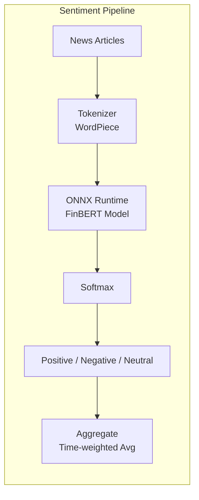

**Requirements:**

| ID | Requirement | Priority |
|----|-------------|----------|
| F6.1 | Load FinBERT ONNX model at startup | P0 |
| F6.2 | Implement WordPiece tokenizer (HuggingFace tokenizers crate) | P0 |
| F6.3 | Batch inference for efficiency | P1 |
| F6.4 | Return probability distribution: [positive, negative, neutral] | P0 |
| F6.5 | Compound score: positive - negative (-1 to +1) | P0 |
| F6.6 | Aggregate with time decay: recent articles weighted higher | P1 |

#### F7: Alert System

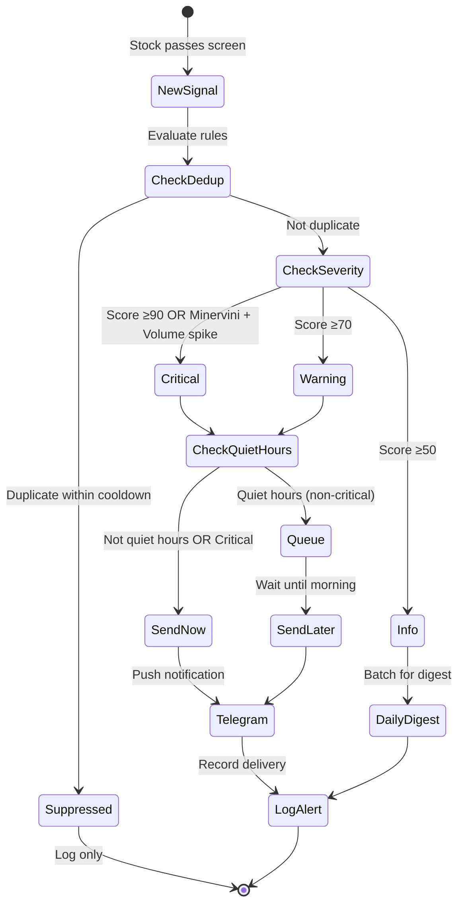

**Requirements:**

| ID | Requirement | Priority |
|----|-------------|----------|
| F7.1 | Severity levels: CRITICAL, WARNING, INFO | P0 |
| F7.2 | Telegram Bot API integration | P0 |
| F7.3 | MarkdownV2 formatting with fallback to plain text | P0 |
| F7.4 | Deduplication by (ticker, alert_type) with **7-day default cooldown** — Minervini conditions persist for weeks; shorter windows cause daily spam for the same stock | P0 |
| F7.5 | Quiet hours: suppress non-critical 10 PM - 7 AM | P1 |
| F7.6 | Daily digest: batch INFO-level alerts | P1 |
| F7.7 | Rate limiting: max 50 alerts/day (consistent with config `max_daily_alerts`) | P1 |
| F7.8 | Sector concentration warning: flag when ≥3 alerts in same GICS sector in a single screening run | P1 |
| F7.9 | **Correlation-aware concentration warning:** When 3+ flagged stocks have trailing 60-day pairwise return correlations > 0.7, flag as concentration risk. This supplements sector classification (F7.8) — NVDA and INTC are both "Technology" but have near-zero return correlation, while SHOP and MELI are different sectors but highly correlated. | P1 |
| F7.10 | **Risk context in alert messages:** Include ATR(14), R:R ratio, and liquidity classification in every CRITICAL and WARNING alert message. Format: `ATR $2.15 | R:R 3.2:1 | Liquidity: HIGH`. This transforms alerts from "interesting" to "actionable" without requiring portfolio management. | P0 |

#### F8: CLI Interface

```
ghost-alpha 1.0.0
Ghostface Killah with the market alpha

USAGE:
    ghost-alpha <COMMAND>

COMMANDS:
    screen      Run screening pipeline on universe
    watch       Continuous monitoring mode (daemon)
    backtest    Run historical signal validation
    alerts      View recent alert history
    config      Show/edit configuration
    export      Export results to CSV/JSON
    help        Show help for a command

OPTIONS:
    -c, --config <FILE>    Config file path [default: ~/.config/ghost-alpha/config.toml]
    -v, --verbose          Increase verbosity (-v, -vv, -vvv)
    -q, --quiet            Suppress non-essential output
    --no-color             Disable colored output
    -h, --help             Print help
    -V, --version          Print version
```

**Requirements:**

| ID | Requirement | Priority |
|----|-------------|----------|
| F8.1 | `screen` — Run full pipeline, output ranked results | P0 |
| F8.2 | `screen --top N` — Limit output to top N stocks | P0 |
| F8.3 | `screen --skip-sentiment` — Fast mode without NLP | P0 |
| F8.4 | `screen --format json|csv|table` — Output format | P1 |
| F8.5 | `watch` — Daemon mode with scheduler | P1 |
| F8.6 | `backtest --from DATE --to DATE` — Historical validation | P1 |
| F8.7 | `alerts --last N` — View recent alerts | P1 |
| F8.8 | Colored terminal output with `--no-color` option | P0 |
| F8.9 | Progress bars for long operations | P1 |

#### F9: Market Regime Filter

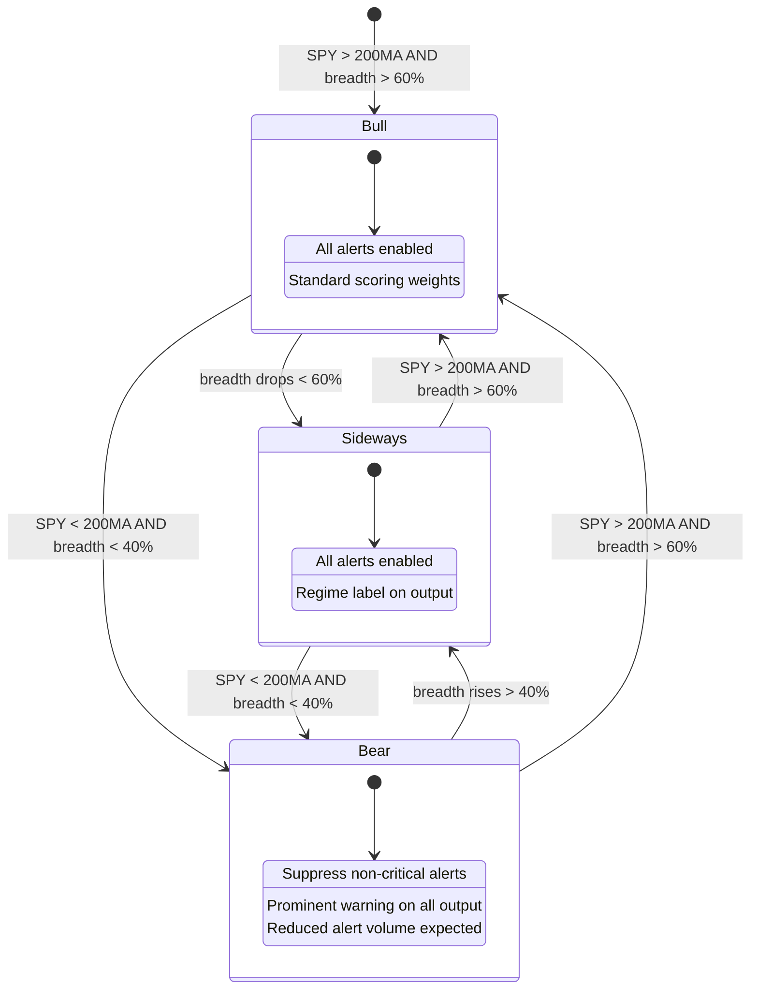

> **Why this matters:** The Minervini template is designed for bull-market conditions. During bear markets, even stocks passing all 8 conditions are "relative strength survivors" that tend to give back gains when the broader sell-off catches up. A regime filter prevents the system from generating systematically losing signals in unfavorable conditions.

**Requirements:**

| ID | Requirement | Priority |
|----|-------------|----------|
| F9.1 | Calculate SPY/SPX closing price relative to its 200-day SMA daily | P0 |
| F9.2 | Calculate market breadth: % of screening universe with price > 50-day SMA | P0 |
| F9.3 | Classify regime: **Bull** (SPY > 200MA AND breadth > 60%), **Bear** (SPY < 200MA AND breadth < 40%), **Sideways** (all other combinations) | P0 |
| F9.4 | In Bear regime: suppress non-critical alerts, add prominent `⚠️ BEAR REGIME` warning to all output | P0 |
| F9.5 | Include regime label (`BULL` / `SIDEWAYS` / `BEAR`) in every alert message and screen output | P0 |
| F9.6 | Persist daily regime state to database for backtesting and historical analysis | P1 |
| F9.7 | Configurable: allow user to override regime filter via `--ignore-regime` CLI flag | P1 |

#### F10: Exit / Breakdown Alerts

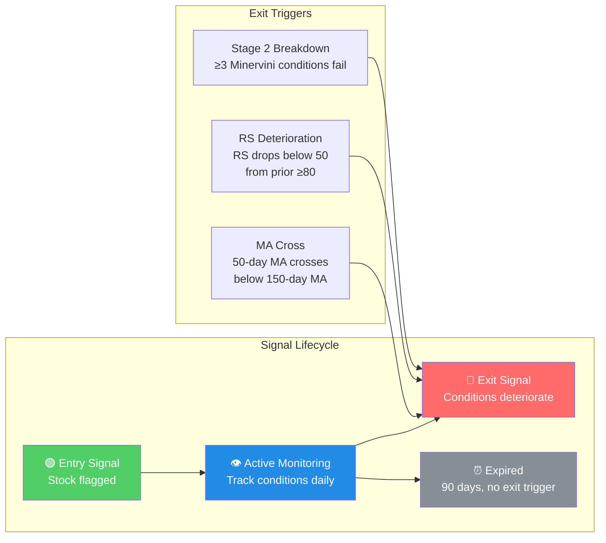

> **Why exit signals matter:** Telling a user when to enter but never when conditions deteriorate is more dangerous than having no tool at all — it creates a false sense of ongoing coverage. Exit alerts protect capital and complete the signal lifecycle.

**Requirements:**

| ID | Requirement | Priority |
|----|-------------|----------|
| F10.1 | Automatically track all stocks that trigger entry alerts in a `flagged_stocks` watchlist | P0 |
| F10.2 | **Stage 2 breakdown** alert: trigger when a flagged stock fails ≥3 Minervini conditions that it previously passed | P0 |
| F10.3 | **RS deterioration** alert: trigger when RS percentile drops below 50 from a prior reading ≥80 | P0 |
| F10.4 | **MA cross** alert: trigger when 50-day MA crosses below 150-day MA on a flagged stock (death cross analog) | P1 |
| F10.5 | Configurable exit alert severity (default: `WARNING`) | P1 |
| F10.6 | Expire flagged stocks after 90 days with no exit trigger (configurable) | P1 |
| F10.7 | Include original entry score and entry price in exit alert for context (e.g., "AAPL flagged at $185, score 82 — now failing 5/8 conditions") | P0 |
| F10.8 | **Conviction decay monitoring:** Weekly re-score all ACTIVE flagged stocks. Send a "WEAKENING" alert (severity: INFO) when composite score drops more than 15 points from entry score, even if no formal exit trigger (F10.2-F10.4) has fired. This bridges the gap between "all systems go" and "hard exit" — a stock flagged at 92 that drops to 65 hasn't technically broken down, but is a fundamentally weaker setup the user should be aware of. | P1 |
| F10.9 | **Conviction re-strengthening:** If a flagged stock's composite score recovers to within 5 points of entry score after a WEAKENING alert, send a "RECOVERED" INFO alert. This prevents unnecessary panic from temporary dips. | P2 |

#### F11: Earnings Proximity Warning

**Requirements:**

| ID | Requirement | Priority |
|----|-------------|----------|
| F11.1 | Fetch upcoming earnings dates from Finnhub `/calendar/earnings` endpoint | P0 |
| F11.2 | Flag stocks with earnings scheduled within 7 trading days of screening date | P0 |
| F11.3 | Add `⚡ EARNINGS SOON` badge to alerts for stocks with pending earnings reports | P0 |
| F11.4 | Configurable behavior: `annotate` (default — badge only) or `suppress` (hide stocks with imminent earnings from alerts) | P1 |
| F11.5 | Cache earnings calendar with 24-hour TTL to minimize API calls | P1 |

> **Why this matters:** Earnings reports are binary events that can cause 10-30% overnight moves regardless of technical setup. A stock passing all 8 Minervini conditions can collapse on a disappointing quarter. Users deserve to know when they're looking at a stock days before a high-volatility event.

#### F12: Base Pattern Detection

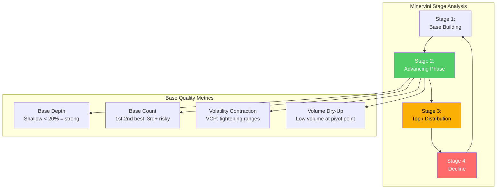

> **Why this matters:** The Minervini 8-point template is a *filter* that confirms Stage 2, not a *trigger*. A stock can pass all 8 conditions for months while offering no actionable entry point. The highest-probability entries occur at specific price patterns — volatility contraction patterns (VCPs), cup-with-handle breakouts, and flat bases — forming *after* the template confirms Stage 2. Without base pattern detection, Ghost Alpha flags stocks in the middle of extended runs where risk/reward is poor. First- and second-stage bases have the highest success rates; third, fourth, and fifth bases have progressively worse failure rates.

**Requirements:**

| ID | Requirement | Priority |
|----|-------------|----------|
| F12.1 | **Base depth measurement:** Calculate the percentage decline from the base's left-side high to the base's low. Shallow bases (<20% depth) are higher quality; deep corrections (>35%) signal institutional selling and lower probability setups. | P1 |
| F12.2 | **Base count tracking:** Count the number of Stage 2 consolidation bases since the stock's most recent Stage 1 (accumulation) phase. Flag stocks on their 3rd+ base with a `LATE_STAGE_BASE` warning — these have progressively higher failure rates. | P1 |
| F12.3 | **Volatility contraction detection (VCP):** Detect when price range contractions (measured by ATR ratio: `ATR(5)/ATR(20)`) form a tightening pattern with at least 2 contractions, each shallower than the prior. This is the hallmark of supply absorption that precedes breakout moves. | P1 |
| F12.4 | **Pivot point proximity:** Flag when price is within 5% of the base's pivot point (right-side high). Entries at the pivot with volume confirmation have the highest historical success rates. Combine with F2 volume spike detection. | P1 |
| F12.5 | **Volume dry-up at pivot:** Confirm that volume contracts to below 50% of the 50-day average during the right side of the base, indicating supply exhaustion. Breakouts on volume >150% of average from a dry-up base are the highest-conviction entries. | P2 |

#### F13: Macro Risk Indicators (Market-Level Context)

```mermaid
graph TB
    subgraph "Tier 1 — Free Data, High Signal Value"
        VIX[VIX Term Structure<br/>Backwardation = acute stress]
        CREDIT[Credit Spreads<br/>HY OAS > 500bps = warning]
        BREADTH[Breadth Divergence<br/>Index highs + narrow participation]
        YIELD[Yield Curve<br/>Un-inversion = recession lead]
        PCALL[Put/Call Ratio<br/>Extremes = contrarian signal]
    end

    subgraph "Risk Dashboard Output"
        GREEN[🟢 Normal<br/>All clear]
        YELLOW[🟡 Elevated<br/>1-2 indicators warning]
        RED[🔴 High Risk<br/>3+ indicators warning]
    end

    VIX --> YELLOW
    CREDIT --> YELLOW
    BREADTH --> YELLOW
    YIELD --> RED
    PCALL --> GREEN

    style GREEN fill:#51cf66,color:#fff
    style YELLOW fill:#fab005,color:#000
    style RED fill:#ff6b6b,color:#fff
```

> **Why this matters:** Ghost Alpha's current regime detection (F9) uses only SPY/200MA + breadth. Tier 1 macro indicators — VIX term structure, credit spreads, yield curve, and put/call ratio — are proven leading indicators that distinguish between "this stock looks good in a healthy market" and "this stock looks good but the market is about to fall apart." Credit spreads (ICE BofA HY OAS) consistently lead equity declines because corporate borrowing costs directly affect economic activity. VIX term structure backwardation occurs only ~16% of the time but reliably signals acute near-term stress. All five indicators use free data from FRED, CBOE, and Yahoo Finance.

**Requirements:**

| ID | Requirement | Priority |
|----|-------------|----------|
| F13.1 | **VIX level and term structure:** Fetch VIX from CBOE/Yahoo Finance. Classify: normal (<20), elevated (20-25), high (25-30), crisis (>30). Detect backwardation (near-term > longer-dated) as acute stress signal. | P1 |
| F13.2 | **Credit spreads:** Fetch ICE BofA US High Yield OAS from FRED (series `BAMLH0A0HYM2`). Classify: normal (<450bps), elevated (450-500bps), warning (500-800bps), crisis (>800bps). | P1 |
| F13.3 | **Yield curve:** Fetch 2s10s spread from FRED (series `T10Y2Y`). Track inversion status and, critically, **un-inversion** (re-steepening after inversion is the more immediate recession warning). | P1 |
| F13.4 | **Put/call ratio:** Fetch CBOE total P/C ratio. Compute 10-day SMA. Classify: extreme greed (<0.72, bottom 5th percentile — contrarian bearish), extreme fear (>1.23 — contrarian bullish). | P2 |
| F13.5 | **Macro risk dashboard:** Aggregate all Tier 1 indicators into a composite risk level: `NORMAL` (0-1 warnings), `ELEVATED` (2 warnings), `HIGH_RISK` (3+ warnings). Include in screening output header and alert messages. | P1 |
| F13.6 | **Risk-regime interaction:** When macro risk level is `HIGH_RISK`, automatically suppress INFO-level alerts regardless of market regime, and add prominent `MACRO RISK: ELEVATED` badge to all WARNING/CRITICAL alerts. | P1 |

### 8.2 Phase 5 Features (Quantitative Rigor & Portfolio Integration)

#### F14: Position Sizing Engine

> **Why this is the #1 priority:** Ghost Alpha screens and scores stocks but has no bridge from "stock X scored 85" to "buy N shares of X." Without position sizing, the tool generates signals that users cannot systematically act on. This is the single most impactful missing piece for making Ghost Alpha an actionable investment tool.

```mermaid
graph TD
    subgraph "Position Sizing Pipeline"
        SCREEN[Screen Result<br/>Grade, ATR, Liquidity] --> METHOD{Sizing Method}
        PORTFOLIO[Portfolio State<br/>Value, Cash, Positions] --> METHOD
        REGIME[Regime State<br/>Bull/Sideways/Bear] --> METHOD

        METHOD --> EW[Equal Weight<br/>1/N allocation]
        METHOD --> VT[Volatility Target<br/>ATR-based sizing]
        METHOD --> HK[Half-Kelly<br/>Win rate + payoff ratio]
        METHOD --> FF[Fixed Fractional<br/>Risk X% per trade]

        EW --> CAP[Position Cap<br/>Max % of portfolio]
        VT --> CAP
        HK --> CAP
        FF --> CAP

        CAP --> OUTPUT[Position Size<br/>Shares, Dollar Amount, Stop, Risk]
    end

    style VT fill:#51cf66,color:#fff
    style OUTPUT fill:#228be6,color:#fff
```

**Requirements:**

| ID | Requirement | Priority |
|----|-------------|----------|
| F14.1 | **Volatility-target sizing (default):** `shares = risk_budget / (ATR × stop_multiplier)`. Naturally sizes smaller positions in volatile stocks. | P0 |
| F14.2 | **Risk budget computation:** `portfolio_value × risk_pct × grade_multiplier × regime_multiplier`. Grade multipliers: A+ = 1.5x, A = 1.0x, B = 0.7x. Regime multipliers: Bull = 1.0x, Sideways = 0.8x, Bear = 0.5x. | P0 |
| F14.3 | **Position cap enforcement:** Hard cap at configurable max_position_pct (default 15%) of portfolio value, regardless of sizing method output. | P0 |
| F14.4 | **Equal-weight sizing:** Simple 1/N allocation across target number of positions (configurable, default 8). | P1 |
| F14.5 | **Half-Kelly sizing:** Uses backtest win rate and average win/loss ratio: `f* = (p × b - q) / b`, then halved for safety. Requires minimum 30 historical signals. | P2 |
| F14.6 | **Fixed-fractional sizing:** Risk a fixed percentage (default 1%) of portfolio per trade. Stop distance determines share count. | P1 |
| F14.7 | **CLI integration:** `ghost-alpha size --ticker AAPL --portfolio 10000 --method volatility-target` outputs recommended shares, dollar amount, stop price, and risk amount. | P0 |
| F14.8 | **Web dashboard integration:** Position sizing recommendation displayed alongside screening results on the dashboard. | P1 |

#### F15: Wash Sale Rule Enforcement

> **Why this matters:** Neither HIFO nor priority lot selection currently checks for wash sale violations. Selling lot A at a loss and re-buying (or the screener recommending buying) within 30 days before/after disallows the loss for tax purposes. This is a legal requirement, not an optimization.

**Requirements:**

| ID | Requirement | Priority |
|----|-------------|----------|
| F15.1 | **Wash sale detection:** Cross-reference proposed sales against all purchases of the same ticker within a +-30 calendar day window. | P0 |
| F15.2 | **Proactive warning on buy:** When the screener recommends a ticker that was sold at a loss within the past 30 days, display a `WASH SALE RISK` warning badge. | P0 |
| F15.3 | **Proactive warning on sell:** When a tax-loss sale is proposed and the ticker has a recent or pending buy within the 30-day window, warn before execution. | P0 |
| F15.4 | **Substantially identical tracking:** Track the underlying ticker only (not options or related instruments — out of scope for v2.0). | P1 |
| F15.5 | **Wash sale basis adjustment:** When a wash sale is detected and confirmed, adjust the replacement lot's cost basis by the disallowed loss amount. | P2 |

#### F16: Multi-Strategy Ensemble Scoring

> **Why this matters:** Currently each screener (Minervini, Breakout, MeanReversion, TrendStrength) runs independently. A stock passing both Minervini AND TrendStrength criteria is a stronger signal than either alone, but there is no mechanism to combine them. Ensemble methods consistently outperform single-model approaches in quantitative finance.

**Requirements:**

| ID | Requirement | Priority |
|----|-------------|----------|
| F16.1 | **Cross-strategy evaluation:** Run all enabled screeners against each ticker and collect results. | P1 |
| F16.2 | **Consensus scoring:** When a stock passes 2+ strategies, compute average composite score across passing strategies. Tag as "Consensus Pick" with strategy count. | P1 |
| F16.3 | **Conviction tiers:** 1 strategy = Standard conviction, 2 strategies = High conviction, 3+ strategies = Highest conviction. Display in alerts and dashboard. | P1 |
| F16.4 | **Grade boost:** Consensus picks receive a +1 grade boost (e.g., A → A+) when 3+ strategies agree, reflecting the higher statistical confidence. | P2 |
| F16.5 | **Ensemble backtest:** Walk-forward validation of ensemble signals vs single-strategy signals. Report improvement in hit rate, alpha, and false positive rate. | P2 |

#### F17: Data Quality Validation

> **Why this matters:** Yahoo Finance occasionally returns unadjusted data for recent splits, causing spurious signals (a sudden 50% "decline" that is actually a 2:1 split). Without validation, these data errors propagate through the screening pipeline and generate false exit signals.

**Requirements:**

| ID | Requirement | Priority |
|----|-------------|----------|
| F17.1 | **Suspicious move detection:** Flag any daily return exceeding +-50% for manual review. Log warning with ticker, date, and magnitude. | P1 |
| F17.2 | **Split detection heuristic:** When a >40% daily decline coincides with a proportional volume increase (2x+), flag as likely split rather than price move. | P1 |
| F17.3 | **Gap validation:** Compare adj_close continuity across the split boundary. If adj_close shows no discontinuity but close does, data is correctly adjusted. | P2 |
| F17.4 | **Quarantine mode:** Tickers with suspected data quality issues are excluded from screening for 3 business days (configurable) until data stabilizes. | P2 |

#### F18: Regime Transition Hysteresis

> **Why this matters:** The current regime classifier snaps between Bull/Sideways/Bear with no transition buffer. A portfolio at 100% risk-on in Bull doesn't gradually de-risk as breadth deteriorates — it changes instantly when breadth crosses 60%. This causes whipsaw in choppy markets near threshold boundaries.

```mermaid
stateDiagram-v2
    [*] --> Bull

    Bull --> Deteriorating_BS: breadth < 60% (day 1)
    Deteriorating_BS --> Sideways: breadth < 60% for N days
    Deteriorating_BS --> Bull: breadth recovers > 60%

    Sideways --> Deteriorating_SB: SPY < 200MA AND breadth < 40% (day 1)
    Deteriorating_SB --> Bear: conditions hold for N days
    Deteriorating_SB --> Sideways: conditions recover

    Bear --> Improving_BS: breadth > 40% (day 1)
    Improving_BS --> Sideways: breadth > 40% for N days
    Improving_BS --> Bear: breadth drops back < 40%

    Sideways --> Improving_SBull: SPY > 200MA AND breadth > 60% (day 1)
    Improving_SBull --> Bull: conditions hold for N days
    Improving_SBull --> Sideways: conditions don't hold

    state Deteriorating_BS {
        [*] --> Counting_D1
        Counting_D1: Day count toward transition
    }

    state Improving_BS {
        [*] --> Counting_I1
        Counting_I1: Day count toward transition
    }
```

**Requirements:**

| ID | Requirement | Priority |
|----|-------------|----------|
| F18.1 | **Hysteresis window:** Require new regime conditions to hold for N consecutive trading days (configurable, default 3) before officially transitioning. | P1 |
| F18.2 | **Transition state tracking:** Expose `RegimeTransition` enum: `Stable(regime)`, `Deteriorating { from, to, days_held }`, `Improving { from, to, days_held }`. | P1 |
| F18.3 | **Transition alerts:** Send alert when transition begins (day 1) with severity INFO, and when transition confirms (day N) with severity WARNING. | P1 |
| F18.4 | **Gradual exposure adjustment:** During Deteriorating transitions, reduce max invested % linearly between the from-regime and to-regime targets over the hysteresis window. | P2 |
| F18.5 | **Persist transition state:** Store current transition state in regime_state table for backtest analysis. | P1 |

#### F19: Liquidity-Adjusted Slippage Model

> **Why this matters:** The backtest uses a flat 10 bps round-trip transaction cost, which underestimates real-world costs for small-cap and mid-cap stocks where GhostAlpha's momentum screens are most useful. A flat cost assumption systematically overstates backtest alpha for illiquid names.

**Requirements:**

| ID | Requirement | Priority |
|----|-------------|----------|
| F19.1 | **Liquidity-scaled costs:** Scale base transaction cost by liquidity class: High = 1.0x, Medium = 1.5x, Low = 3.0x, Illiquid = 5.0x. | P1 |
| F19.2 | **Backtest integration:** Apply liquidity-adjusted costs in walk-forward and standard backtest return calculations. | P1 |
| F19.3 | **Market impact estimate:** For positions exceeding 1% of average daily volume, add additional market impact cost: `impact_bps = base_bps × (position_volume / adv)^0.5`. | P2 |
| F19.4 | **Dashboard display:** Show estimated round-trip cost alongside each screening result and position size recommendation. | P2 |

#### F5 Amendment: Volume Score Bias Correction

> **Audit finding:** When volume z-score = 0 (perfectly average volume), the score is 15/30 — half the maximum. Every stock gets a free +15 points for existing. This compresses the discriminative power of the composite score and inflates all scores by ~15% of the volume weight allocation.

| ID | Requirement | Priority |
|----|-------------|----------|
| F5.9 | **Zero-centered volume scoring:** A z-score of 0 (average volume) must produce a volume score of 0, not 15. Only reward above-average directional volume (z > 0). Negative z-scores (distribution days) produce 0. | P0 |
| F5.10 | **Scoring formula change:** `volume_score = (z.clamp(0.0, 3.0) / 3.0) * volume_max` replacing `((z + 3.0) / 6.0) * volume_max`. | P0 |

#### F5 Amendment: Screener Conditions Normalization

> **Audit finding:** All screeners use `conditions_met / 8` in the technical score, but Breakout, MeanReversion, and TrendStrength screeners have 5 conditions, not 8. A stock meeting all 5 breakout conditions scores 21.9/35 — only 63% of Minervini's maximum — creating an inherent scoring handicap.

| ID | Requirement | Priority |
|----|-------------|----------|
| F5.11 | **Dynamic denominator:** Add `max_conditions: u8` field to `TechnicalInputs`. Each screener sets this to its actual number of conditions. | P1 |
| F5.12 | **Normalized technical base:** Technical base score uses `conditions_met / max_conditions` instead of `conditions_met / 8`. All screeners score 0-100% of the technical base allocation. | P1 |

#### F5 Amendment: Sentiment Weight Redistribution

> **Audit finding:** All four screeners hardcode `SentimentInputs { score: 0.0, article_count: 0 }`. With `article_count: 0`, the sentiment score is always 0. This means 15% of the composite score (up to 20% in Bear/Sideways) is dead weight.

| ID | Requirement | Priority |
|----|-------------|----------|
| F5.13 | **Dynamic weight redistribution:** When `article_count == 0` (no sentiment data), redistribute sentiment weight: 70% to technical, 30% to volume. Weights must still sum to 100. | P1 |
| F5.14 | **Sentinel detection:** Treat `article_count == 0` as "no data available" rather than "neutral sentiment". Log when redistribution occurs for drift monitoring. | P1 |

#### Selling Programme Amendment: Pace Cap

> **Audit finding:** The selling programme pace multiplier is the product of all matching rules. If Bear + Below200SMA + GeoRiskHigh + StockDrop all fire simultaneously (a realistic crash scenario), the multiplier becomes 2.0 × 1.5 × 2.0 × 3.0 = 18.0x, which could recommend selling 18x the quarterly target — exceeding total remaining shares.

| ID | Requirement | Priority |
|----|-------------|----------|
| SP.1 | **Pace multiplier cap:** Clamp the combined pace multiplier to `[0.25, 4.0]`. Maximum 4x acceleration, minimum 0.25x deceleration. | P1 |
| SP.2 | **Remaining shares guard:** Never recommend selling more than 100% of remaining shares regardless of multiplier. | P0 |

---

## 9. Data Architecture

### 9.1 Data Model

```mermaid
erDiagram
    STOCK {
        text ticker PK
        text name
        text sector
        text industry
        timestamp created_at
        timestamp updated_at
    }
    
    PRICE {
        integer id PK
        text ticker FK
        date date
        real open
        real high
        real low
        real close
        real adj_close
        integer volume
    }
    
    SCREEN_RESULT {
        integer id PK
        timestamp screened_at
        text ticker FK
        real composite_score
        real technical_score
        real volume_score
        real sentiment_score
        boolean minervini_pass
        integer conditions_met
        real volume_zscore
        real rs_percentile
        real adx
        real close_price
        real pct_from_52w_high
        real sentiment_avg
        integer sentiment_article_count
        text grade
        real atr_14
        real risk_reward_ratio
        text liquidity_class
        integer base_count
        real base_depth_pct
        boolean vcp_detected
    }
    
    ALERT {
        integer id PK
        timestamp created_at
        text ticker FK
        text alert_type
        text severity
        text message
        boolean delivered
        text channel
        timestamp delivered_at
    }
    
    NEWS_ARTICLE {
        integer id PK
        text ticker FK
        timestamp published_at
        text headline
        text summary
        text source
        text url
        real sentiment_positive
        real sentiment_negative
        real sentiment_neutral
        real sentiment_compound
    }
    
    REGIME_STATE {
        integer id PK
        date date UK
        real spy_close
        real spy_sma200
        real breadth_pct
        text regime
    }

    FLAGGED_STOCK {
        integer id PK
        text ticker FK
        timestamp flagged_at
        real initial_score
        real initial_price
        real initial_rs
        text status
        text exit_reason
        timestamp exited_at
        real latest_score
        timestamp last_rescored_at
    }

    MACRO_RISK {
        integer id PK
        date date UK
        real vix_level
        text vix_term_structure
        real hy_oas_bps
        real yield_curve_2s10s
        real put_call_ratio_10d
        text risk_level
    }

    STOCK ||--o{ PRICE : has
    STOCK ||--o{ SCREEN_RESULT : has
    STOCK ||--o{ ALERT : triggers
    STOCK ||--o{ NEWS_ARTICLE : mentions
    STOCK ||--o{ FLAGGED_STOCK : tracked_by
```

### 9.2 SQLite Schema

```sql
-- Core tables
CREATE TABLE stocks (
    ticker TEXT PRIMARY KEY,
    name TEXT,
    sector TEXT,
    industry TEXT,
    created_at TIMESTAMP DEFAULT CURRENT_TIMESTAMP,
    updated_at TIMESTAMP DEFAULT CURRENT_TIMESTAMP
);

CREATE TABLE prices (
    id INTEGER PRIMARY KEY AUTOINCREMENT,
    ticker TEXT NOT NULL REFERENCES stocks(ticker),
    date DATE NOT NULL,
    open REAL,
    high REAL,
    low REAL,
    close REAL,
    adj_close REAL,  -- Split/dividend-adjusted close; ALL MA calculations must use adj_close
    volume INTEGER,
    UNIQUE(ticker, date)
);

CREATE INDEX idx_prices_ticker_date ON prices(ticker, date DESC);

CREATE TABLE screen_results (
    id INTEGER PRIMARY KEY AUTOINCREMENT,
    screened_at TIMESTAMP DEFAULT CURRENT_TIMESTAMP,
    ticker TEXT NOT NULL REFERENCES stocks(ticker),
    composite_score REAL NOT NULL,
    technical_score REAL,
    volume_score REAL,
    sentiment_score REAL,
    minervini_pass BOOLEAN,
    conditions_met INTEGER,
    volume_zscore REAL,
    rs_percentile REAL,
    adx REAL,
    close_price REAL,
    pct_from_52w_high REAL,
    sentiment_avg REAL,
    sentiment_article_count INTEGER DEFAULT 0,
    grade TEXT,
    -- Risk context fields (v1.1)
    atr_14 REAL,              -- 14-period Average True Range
    risk_reward_ratio REAL,   -- Stop-to-target R:R estimate
    liquidity_class TEXT CHECK(liquidity_class IN ('HIGH', 'MEDIUM', 'LOW', 'ILLIQUID')),
    avg_dollar_volume REAL,   -- Average daily dollar volume
    -- Base pattern fields (v1.1)
    base_count INTEGER,       -- Number of Stage 2 bases since last Stage 1
    base_depth_pct REAL,      -- Current base depth as percentage
    vcp_detected BOOLEAN DEFAULT FALSE,  -- Volatility contraction pattern present
    pivot_proximity_pct REAL  -- Distance from pivot point as percentage
);

CREATE INDEX idx_screen_results_date ON screen_results(screened_at DESC);
CREATE INDEX idx_screen_results_ticker ON screen_results(ticker);

CREATE TABLE alerts (
    id INTEGER PRIMARY KEY AUTOINCREMENT,
    created_at TIMESTAMP DEFAULT CURRENT_TIMESTAMP,
    ticker TEXT NOT NULL REFERENCES stocks(ticker),
    alert_type TEXT NOT NULL,
    severity TEXT NOT NULL CHECK(severity IN ('CRITICAL', 'WARNING', 'INFO')),
    message TEXT,
    delivered BOOLEAN DEFAULT FALSE,
    channel TEXT,
    delivered_at TIMESTAMP
);

CREATE INDEX idx_alerts_ticker_type ON alerts(ticker, alert_type, created_at DESC);

CREATE TABLE news_articles (
    id INTEGER PRIMARY KEY AUTOINCREMENT,
    ticker TEXT NOT NULL REFERENCES stocks(ticker),
    published_at TIMESTAMP,
    headline TEXT,
    summary TEXT,
    source TEXT,
    url TEXT UNIQUE,
    sentiment_positive REAL,
    sentiment_negative REAL,
    sentiment_neutral REAL,
    sentiment_compound REAL
);

CREATE INDEX idx_news_ticker_date ON news_articles(ticker, published_at DESC);

-- Market regime tracking
CREATE TABLE regime_state (
    id INTEGER PRIMARY KEY AUTOINCREMENT,
    date DATE NOT NULL UNIQUE,
    spy_close REAL,
    spy_sma200 REAL,
    breadth_pct REAL,  -- % of universe with price > 50-day SMA
    regime TEXT NOT NULL CHECK(regime IN ('BULL', 'BEAR', 'SIDEWAYS'))
);

CREATE INDEX idx_regime_date ON regime_state(date DESC);

-- Exit signal tracking for previously-flagged stocks
CREATE TABLE flagged_stocks (
    id INTEGER PRIMARY KEY AUTOINCREMENT,
    ticker TEXT NOT NULL REFERENCES stocks(ticker),
    flagged_at TIMESTAMP DEFAULT CURRENT_TIMESTAMP,
    initial_score REAL,
    initial_price REAL,
    initial_rs REAL,          -- RS percentile at time of flagging (v1.1, for F10.3 RS deterioration check)
    status TEXT NOT NULL CHECK(status IN ('ACTIVE', 'EXITED', 'EXPIRED')) DEFAULT 'ACTIVE',
    exit_reason TEXT,  -- 'stage2_breakdown', 'rs_deterioration', 'ma_cross', 'expired', 'conviction_decay'
    exited_at TIMESTAMP,
    latest_score REAL,        -- Most recent re-scored composite (v1.1, for F10.8 conviction decay)
    last_rescored_at TIMESTAMP
);

CREATE INDEX idx_flagged_ticker ON flagged_stocks(ticker, status);
CREATE INDEX idx_flagged_active ON flagged_stocks(status) WHERE status = 'ACTIVE';

-- Macro risk indicators (v1.1, F13)
CREATE TABLE macro_risk (
    id INTEGER PRIMARY KEY AUTOINCREMENT,
    date DATE NOT NULL UNIQUE,
    vix_level REAL,
    vix_term_structure TEXT CHECK(vix_term_structure IN ('CONTANGO', 'FLAT', 'BACKWARDATION')),
    hy_oas_bps REAL,          -- ICE BofA US High Yield OAS in basis points
    yield_curve_2s10s REAL,   -- 2-year vs 10-year Treasury spread
    put_call_ratio_10d REAL,  -- 10-day SMA of CBOE total put/call ratio
    risk_level TEXT NOT NULL CHECK(risk_level IN ('NORMAL', 'ELEVATED', 'HIGH_RISK'))
);

CREATE INDEX idx_macro_risk_date ON macro_risk(date DESC);
```

### 9.3 Cache Strategy

```mermaid
graph TD
    subgraph "Cache Layers"
        L1[L1: In-Memory<br/>Current session prices<br/>TTL: Session lifetime]
        L2[L2: File Cache<br/>~/.cache/ghost-alpha/<br/>TTL: 24 hours]
        L3[L3: SQLite<br/>Permanent storage<br/>TTL: Forever]
    end
    
    REQ[Data Request] --> L1
    L1 -->|Miss| L2
    L2 -->|Miss| L3
    L3 -->|Miss| API[External API]
    API --> L3
    L3 --> L2
    L2 --> L1
    
    style L1 fill:#51cf66,color:#fff
    style L2 fill:#228be6,color:#fff
    style L3 fill:#495057,color:#fff
```

---

## 10. Core Algorithms

### 10.1 Minervini Trend Template

```rust
/// Evaluate Minervini's 8-point trend template
pub fn evaluate_minervini(prices: &[Candle]) -> MinerviniResult {
    if prices.len() < 252 {
        return MinerviniResult::insufficient_data();
    }
    
    let close = prices.last().unwrap().close;
    let sma_50 = sma(&prices, 50);
    let sma_150 = sma(&prices, 150);
    let sma_200 = sma(&prices, 200);
    let sma_200_month_ago = sma(&prices[..prices.len()-21], 200);
    
    let high_52w = prices.iter().rev().take(252).map(|c| c.high).fold(f64::MIN, f64::max);
    let low_52w = prices.iter().rev().take(252).map(|c| c.low).fold(f64::MAX, f64::min);
    
    let conditions = [
        close > sma_50,                          // 1. Price > 50-day MA
        close > sma_150,                         // 2. Price > 150-day MA
        close > sma_200,                         // 3. Price > 200-day MA
        sma_50 > sma_150,                        // 4. 50-day MA > 150-day MA
        sma_150 > sma_200,                       // 5. 150-day MA > 200-day MA
        sma_200 > sma_200_month_ago,             // 6. 200-day MA trending up
        close >= high_52w * 0.75,                // 7. Within 25% of 52-week high
        close >= low_52w * 1.30,                 // 8. At least 30% above 52-week low
        // Note: Minervini specifies 25% in earlier editions and 30% in later editions.
        // We use 30% (the stricter threshold) to filter out stocks still near lows.
    ];
    
    let conditions_met = conditions.iter().filter(|&&c| c).count();
    let all_pass = conditions_met == 8;
    
    MinerviniResult { all_pass, conditions_met, conditions }
}
```

### 10.2 Volume Z-Score (Bias-Corrected, Directional)

```rust
/// Calculate Z-score of latest volume vs trailing window.
/// IMPORTANT: Current day is EXCLUDED from the statistics window to avoid
/// look-ahead bias — the anomaly must not influence its own baseline.
pub fn volume_zscore(volumes: &[u64], window: usize) -> f64 {
    // Need at least window + 1 data points: window for baseline, +1 for current
    if volumes.len() < window + 1 {
        return 0.0;
    }

    // Baseline: window days BEFORE the current day
    let baseline: Vec<f64> = volumes[volumes.len() - 1 - window..volumes.len() - 1]
        .iter()
        .map(|&v| v as f64)
        .collect();

    let mean = baseline.iter().sum::<f64>() / baseline.len() as f64;
    let variance = baseline.iter().map(|v| (v - mean).powi(2)).sum::<f64>() / baseline.len() as f64;
    let std = variance.sqrt();

    if std == 0.0 {
        return 0.0;
    }

    let current = *volumes.last().unwrap() as f64;
    (current - mean) / std
}

/// Directional volume Z-score: positive on up-closes, negative on down-closes.
/// This distinguishes accumulation (bullish volume spikes) from distribution.
pub fn directed_volume_zscore(
    volumes: &[u64],
    opens: &[f64],
    closes: &[f64],
    window: usize,
) -> f64 {
    let zscore = volume_zscore(volumes, window);
    let last_open = opens.last().unwrap();
    let last_close = closes.last().unwrap();

    if last_close > last_open {
        zscore          // Up-close: bullish volume
    } else {
        -zscore.abs()   // Down-close: bearish volume
    }
}
```

### 10.3 Composite Scoring (Regime-Adaptive Weights)

```rust
/// Regime-adaptive weight configuration.
/// Weights always sum to 100 regardless of regime.
struct RegimeWeights {
    technical_max: f64,
    volume_max: f64,
    sentiment_max: f64,
}

impl RegimeWeights {
    fn for_regime(regime: &Regime) -> Self {
        match regime {
            Regime::Bull     => Self { technical_max: 55.0, volume_max: 30.0, sentiment_max: 15.0 },
            Regime::Sideways => Self { technical_max: 60.0, volume_max: 20.0, sentiment_max: 20.0 },
            Regime::Bear     => Self { technical_max: 70.0, volume_max: 10.0, sentiment_max: 20.0 },
        }
    }
}

/// Compute composite score combining all signals with regime-adaptive weights.
///
/// Bull:     55/30/15 — standard weights; volume confirmation is reliable
/// Sideways: 60/20/20 — tighten technical filter; reduce volume noise
/// Bear:     70/10/20 — heavily favor technical quality; volume spikes are traps
pub fn composite_score(
    screen: &ScreenResult,
    sentiment: Option<&SentimentResult>,
    regime: &Regime,
) -> CompositeScore {
    let weights = RegimeWeights::for_regime(regime);

    // Technical: 0-{weights.technical_max} points
    let technical = compute_technical_score(screen, weights.technical_max);

    // Volume: 0-{weights.volume_max} points (using directed Z-score)
    let volume = compute_volume_score(screen.directed_volume_zscore, weights.volume_max);

    // Sentiment: 0-{weights.sentiment_max} points
    let sentiment_score = sentiment
        .map(|s| compute_sentiment_score(s.compound, s.article_count, weights.sentiment_max))
        .unwrap_or(0.0);

    let composite = technical + volume + sentiment_score;

    CompositeScore { composite, technical, volume, sentiment: sentiment_score, regime: regime.clone() }
}

fn compute_technical_score(screen: &ScreenResult, max: f64) -> f64 {
    // Minervini base: 0-63.6% of max (35/55 ratio preserved)
    let base_ratio = 35.0 / 55.0;
    let base = if screen.minervini_pass {
        max * base_ratio
    } else {
        (screen.conditions_met as f64 / 8.0) * max * base_ratio
    };

    // ADX bonus: 0-18.2% of max (10/55 ratio preserved)
    let adx_ratio = 10.0 / 55.0;
    let adx_bonus = screen.adx.map_or(0.0, |adx| {
        if adx >= 50.0 { max * adx_ratio }
        else if adx >= 25.0 { ((adx - 25.0) / 25.0) * max * adx_ratio }
        else { 0.0 }
    });

    // RS bonus: 0-18.2% of max (10/55 ratio preserved)
    let rs_ratio = 10.0 / 55.0;
    let rs_bonus = screen.rs_percentile.map_or(0.0, |rs| {
        if rs >= 90.0 { max * rs_ratio }
        else if rs >= 70.0 { ((rs - 70.0) / 20.0) * max * rs_ratio }
        else { 0.0 }
    });

    (base + adx_bonus + rs_bonus).min(max)
}

/// Assign percentile-based grades after scoring the full universe.
/// This avoids arbitrary fixed thresholds that don't adapt to market conditions.
pub fn assign_grades(scores: &mut [CompositeScore]) {
    scores.sort_by(|a, b| b.composite.partial_cmp(&a.composite).unwrap());
    let n = scores.len() as f64;
    for (i, score) in scores.iter_mut().enumerate() {
        let percentile = 100.0 * (1.0 - (i as f64 / n));
        score.grade = match percentile {
            p if p >= 95.0 => Grade::APlus,
            p if p >= 85.0 => Grade::A,
            p if p >= 70.0 => Grade::B,
            p if p >= 50.0 => Grade::C,
            p if p >= 30.0 => Grade::D,
            _ => Grade::F,
        };
    }
}
```

### 10.4 Market Regime Detection

```rust
#[derive(Debug, Clone, PartialEq)]
pub enum Regime {
    Bull,
    Sideways,
    Bear,
}

/// Detect current market regime using SPY trend + market breadth.
///
/// - Bull:     SPY above 200-day SMA AND >60% of universe above 50-day SMA
/// - Bear:     SPY below 200-day SMA AND <40% of universe above 50-day SMA
/// - Sideways: Everything else
///
/// Uses adj_close for all MA calculations to handle splits correctly.
pub fn detect_regime(
    spy_prices: &[Candle],
    universe_prices: &[Vec<Candle>],
) -> RegimeState {
    let spy_close = spy_prices.last().unwrap().adj_close;
    let spy_sma200 = sma_adj(spy_prices, 200);
    let spy_above_200 = spy_close > spy_sma200;

    // Market breadth: % of stocks in universe above their 50-day SMA
    let above_50ma = universe_prices.iter().filter(|prices| {
        if prices.len() < 50 { return false; }
        let close = prices.last().unwrap().adj_close;
        let sma50 = sma_adj(prices, 50);
        close > sma50
    }).count();

    let breadth_pct = (above_50ma as f64 / universe_prices.len() as f64) * 100.0;

    let regime = if spy_above_200 && breadth_pct > 60.0 {
        Regime::Bull
    } else if !spy_above_200 && breadth_pct < 40.0 {
        Regime::Bear
    } else {
        Regime::Sideways
    };

    RegimeState { spy_close, spy_sma200, breadth_pct, regime }
}
```

### 10.5 Exit Signal Detection

```rust
#[derive(Debug)]
pub enum ExitSignal {
    /// Flagged stock now fails ≥3 Minervini conditions it previously passed
    Stage2Breakdown { conditions_met: usize, conditions_lost: usize },
    /// RS percentile dropped below 50 from a prior reading ≥80
    RsDeterioration { current_rs: f64, entry_rs: f64 },
    /// 50-day MA crossed below 150-day MA (bearish structural shift)
    MaCross { sma_50: f64, sma_150: f64 },
}

/// Check whether a previously-flagged stock has triggered any exit conditions.
/// Called daily for all stocks in the ACTIVE flagged_stocks watchlist.
pub fn check_exit_signals(
    prices: &[Candle],
    entry: &FlaggedStock,
    current_rs: f64,
) -> Vec<ExitSignal> {
    let mut signals = Vec::new();

    // 1. Stage 2 breakdown: re-evaluate Minervini, compare to entry
    let minervini = evaluate_minervini(prices);
    if minervini.conditions_met <= 5 {
        // Originally passed 8/8 at entry; now failing 3+
        signals.push(ExitSignal::Stage2Breakdown {
            conditions_met: minervini.conditions_met,
            conditions_lost: 8 - minervini.conditions_met,
        });
    }

    // 2. RS deterioration
    if current_rs < 50.0 && entry.initial_rs >= 80.0 {
        signals.push(ExitSignal::RsDeterioration {
            current_rs,
            entry_rs: entry.initial_rs,
        });
    }

    // 3. MA death cross (50 < 150)
    let sma_50 = sma_adj(prices, 50);
    let sma_150 = sma_adj(prices, 150);
    if sma_50 < sma_150 {
        signals.push(ExitSignal::MaCross { sma_50, sma_150 });
    }

    signals
}
```

### 10.6 Weighted Multi-Timeframe Relative Strength

```rust
/// Weighted RS composite favoring recent price acceleration.
/// Closely aligned with O'Neil/IBD methodology.
///
/// A stock that gained 100% in January and was flat for 11 months has the
/// same 252-day return as one climbing steadily all year. The weighted
/// composite correctly ranks the latter higher — sustained momentum is
/// more predictive than a single spike.
pub fn weighted_rs_return(prices: &[Candle]) -> Result<f64, AnalysisError> {
    if prices.len() < 252 {
        return Err(AnalysisError::InsufficientData { need: 252, got: prices.len() });
    }
    let current = prices.last().unwrap().adj_close;
    let n = prices.len();

    let ret_63d  = (current / prices[n - 63].adj_close) - 1.0;  // ~3 months
    let ret_126d = (current / prices[n - 126].adj_close) - 1.0; // ~6 months
    let ret_189d = (current / prices[n - 189].adj_close) - 1.0; // ~9 months
    let ret_252d = (current / prices[n - 252].adj_close) - 1.0; // ~12 months

    // 40% weight on most recent quarter, 20% each for older periods
    Ok(0.40 * ret_63d + 0.20 * ret_126d + 0.20 * ret_189d + 0.20 * ret_252d)
}

/// Cross-sectional percentile ranking using weighted RS composite.
pub fn rs_percentile_weighted(
    stock_return: f64,
    universe_returns: &[f64],
) -> f64 {
    if universe_returns.is_empty() { return 50.0; }
    let below = universe_returns.iter().filter(|&&r| r < stock_return).count();
    100.0 * below as f64 / universe_returns.len() as f64
}
```

### 10.7 Risk Context Calculations (ATR, R:R, Liquidity)

```rust
/// Average True Range — standard 14-period volatility measure.
/// Returns dollar-denominated ATR for position sizing context.
pub fn atr(candles: &[Candle], period: usize) -> Result<f64, AnalysisError> {
    if candles.len() < period + 1 {
        return Err(AnalysisError::InsufficientData {
            need: period + 1, got: candles.len(),
        });
    }
    let mut tr_sum = 0.0;
    for i in (candles.len() - period)..candles.len() {
        let c = &candles[i];
        let prev_close = candles[i - 1].adj_close;
        let tr = (c.high - c.low)
            .max((c.high - prev_close).abs())
            .max((c.low - prev_close).abs());
        tr_sum += tr;
    }
    Ok(tr_sum / period as f64)
}

/// Risk/Reward ratio estimate.
/// Stop: below 50-day MA or 2x ATR below current price (whichever is tighter).
/// Target: 52-week high.
pub fn risk_reward_ratio(
    current: f64,
    sma_50: f64,
    atr_14: f64,
    high_52w: f64,
) -> f64 {
    let stop_ma = sma_50;
    let stop_atr = current - (2.0 * atr_14);
    let stop = stop_ma.max(stop_atr); // tighter (higher) stop

    let risk = (current - stop).max(0.01); // avoid division by zero
    let reward = (high_52w - current).max(0.0);

    reward / risk
}

/// Liquidity classification based on average daily dollar volume.
#[derive(Debug, Clone, PartialEq)]
pub enum LiquidityClass {
    High,      // > $50M avg daily dollar volume
    Medium,    // $5M - $50M
    Low,       // $1M - $5M
    Illiquid,  // < $1M
}

pub fn classify_liquidity(candles: &[Candle], period: usize) -> LiquidityClass {
    let recent = &candles[candles.len().saturating_sub(period)..];
    let avg_dollar_vol = recent.iter()
        .map(|c| c.adj_close * c.volume as f64)
        .sum::<f64>() / recent.len() as f64;

    match avg_dollar_vol {
        v if v > 50_000_000.0 => LiquidityClass::High,
        v if v > 5_000_000.0  => LiquidityClass::Medium,
        v if v > 1_000_000.0  => LiquidityClass::Low,
        _                     => LiquidityClass::Illiquid,
    }
}
```

### 10.8 Base Pattern Detection

```rust
/// Detect volatility contraction pattern (VCP) — Minervini's primary entry trigger.
/// A VCP shows progressively tighter price contractions within a consolidation base,
/// indicating supply absorption before a breakout.
pub fn detect_vcp(candles: &[Candle], lookback: usize) -> VcpResult {
    let recent = &candles[candles.len().saturating_sub(lookback)..];

    // Find the left-side high (base start) and overall base low
    let base_high = recent.iter().map(|c| c.high).fold(f64::NEG_INFINITY, f64::max);
    let base_low = recent.iter().map(|c| c.low).fold(f64::INFINITY, f64::min);
    let base_depth_pct = ((base_high - base_low) / base_high) * 100.0;

    // Measure ATR contraction: compare short-term vs medium-term ATR
    let atr_short = atr(&candles[candles.len().saturating_sub(5)..], 5).unwrap_or(0.0);
    let atr_medium = atr(&candles[candles.len().saturating_sub(20)..], 20).unwrap_or(1.0);
    let contraction_ratio = if atr_medium > 0.0 { atr_short / atr_medium } else { 1.0 };

    // VCP detected when:
    // 1. Base depth is reasonable (5-35%)
    // 2. ATR is contracting (ratio < 0.7 = tightening volatility)
    let vcp_detected = base_depth_pct >= 5.0
        && base_depth_pct <= 35.0
        && contraction_ratio < 0.70;

    // Pivot point: right-side high of the base
    let pivot = recent.iter().rev().take(10)
        .map(|c| c.high)
        .fold(f64::NEG_INFINITY, f64::max);
    let current = candles.last().unwrap().adj_close;
    let pivot_proximity_pct = ((pivot - current) / pivot) * 100.0;

    VcpResult {
        vcp_detected,
        base_depth_pct,
        contraction_ratio,
        pivot,
        pivot_proximity_pct,
    }
}

#[derive(Debug, Clone)]
pub struct VcpResult {
    pub vcp_detected: bool,
    pub base_depth_pct: f64,
    pub contraction_ratio: f64,
    pub pivot: f64,
    pub pivot_proximity_pct: f64,
}
```

### 10.9 Phase 5 Algorithms

#### 10.9.1 Position Sizing (Volatility Target)

```rust
pub enum SizingMethod {
    /// Equal weight: 1/N allocation
    EqualWeight { target_positions: usize },
    /// Risk parity: size inversely proportional to ATR
    VolatilityTarget { daily_target_vol: f64, stop_multiplier: f64 },
    /// Kelly fraction with half-Kelly dampening
    HalfKelly { win_rate: f64, avg_win_loss_ratio: f64 },
    /// Fixed fractional: risk X% of portfolio per trade
    FixedFractional { risk_pct: f64 },
}

pub struct PositionSize {
    pub ticker: String,
    pub shares: f64,
    pub dollar_amount: f64,
    pub pct_of_portfolio: f64,
    pub stop_loss: f64,
    pub risk_amount: f64,
    pub sizing_method: String,
}

/// Compute position size using volatility-target method (default).
///
/// Risk budget = portfolio_value × risk_pct × grade_multiplier × regime_multiplier
/// Shares = risk_budget / (ATR × stop_multiplier)
/// Final size = min(computed_size, max_position_pct × portfolio_value)
pub fn compute_position_size(
    method: &SizingMethod,
    screen_result: &ScreenResult,
    portfolio_value: f64,
    risk_pct: f64,            // default 0.01 (1%)
    max_position_pct: f64,    // default 0.15 (15%)
    grade_multiplier: f64,    // A+ = 1.5, A = 1.0, B = 0.7
    regime_multiplier: f64,   // Bull = 1.0, Sideways = 0.8, Bear = 0.5
) -> PositionSize {
    let risk_budget = portfolio_value * risk_pct * grade_multiplier * regime_multiplier;

    let (shares, stop_loss) = match method {
        SizingMethod::VolatilityTarget { stop_multiplier, .. } => {
            let stop = screen_result.close_price - (screen_result.atr_14 * stop_multiplier);
            let risk_per_share = screen_result.close_price - stop;
            let shares = risk_budget / risk_per_share.max(0.01);
            (shares, stop)
        },
        SizingMethod::EqualWeight { target_positions } => {
            let alloc = portfolio_value / *target_positions as f64;
            let shares = alloc / screen_result.close_price;
            let stop = screen_result.close_price - (2.0 * screen_result.atr_14);
            (shares, stop)
        },
        SizingMethod::FixedFractional { risk_pct: frac } => {
            let risk = portfolio_value * frac;
            let stop = screen_result.close_price - (2.0 * screen_result.atr_14);
            let shares = risk / (screen_result.close_price - stop).max(0.01);
            (shares, stop)
        },
        SizingMethod::HalfKelly { win_rate, avg_win_loss_ratio } => {
            let kelly = (win_rate * avg_win_loss_ratio - (1.0 - win_rate)) / avg_win_loss_ratio;
            let half_kelly = (kelly / 2.0).clamp(0.0, 0.25); // max 25% of portfolio
            let alloc = portfolio_value * half_kelly;
            let shares = alloc / screen_result.close_price;
            let stop = screen_result.close_price - (2.0 * screen_result.atr_14);
            (shares, stop)
        },
    };

    // Enforce position cap
    let max_shares = (max_position_pct * portfolio_value) / screen_result.close_price;
    let final_shares = shares.min(max_shares).floor();
    let dollar_amount = final_shares * screen_result.close_price;

    PositionSize {
        ticker: screen_result.ticker.clone(),
        shares: final_shares,
        dollar_amount,
        pct_of_portfolio: dollar_amount / portfolio_value,
        stop_loss,
        risk_amount: final_shares * (screen_result.close_price - stop_loss),
        sizing_method: format!("{:?}", method),
    }
}
```

#### 10.9.2 Volume Score — Corrected (Zero-Centered)

```rust
/// Volume score: CORRECTED — only rewards accumulation (z > 0).
/// A z-score of 0 (average volume) produces 0 points, not 15.
///
/// Previous (biased):  ((z + 3.0) / 6.0) * max → z=0 scores 50% of max
/// Corrected:          (z.clamp(0, 3) / 3.0) * max → z=0 scores 0
pub fn volume_score(inputs: &VolumeInputs, max_points: f64) -> f64 {
    let z = inputs.zscore.clamp(0.0, 3.0);  // only reward accumulation
    (z / 3.0 * max_points).clamp(0.0, max_points)
}
```

#### 10.9.3 Sharpe Ratio — Corrected Methodology

```rust
/// Compute annualized Sharpe ratio from a DAILY portfolio return series.
///
/// IMPORTANT: Do NOT use overlapping N-day forward returns from individual signals.
/// Those are cross-sectional, auto-correlated observations that massively overstate
/// the Sharpe ratio when annualized with sqrt(252).
///
/// Correct usage:
/// 1. Construct daily portfolio P&L from signal entries/exits
/// 2. Compute daily excess returns: daily_return - risk_free_daily
/// 3. Annualize: (mean_daily / std_daily) * sqrt(252)
pub fn sharpe_ratio_daily(daily_returns: &[f64], annual_risk_free: f64) -> f64 {
    if daily_returns.len() < 30 {
        return 0.0; // insufficient data for meaningful Sharpe
    }
    let rf_daily = (1.0 + annual_risk_free).powf(1.0 / 252.0) - 1.0;
    let excess: Vec<f64> = daily_returns.iter().map(|r| r - rf_daily).collect();

    let mean = excess.iter().sum::<f64>() / excess.len() as f64;
    let variance = excess.iter().map(|r| (r - mean).powi(2)).sum::<f64>()
        / (excess.len() - 1) as f64;
    let std = variance.sqrt();

    if std < 1e-10 { return 0.0; }
    (mean / std) * (252.0_f64).sqrt()
}

/// DEPRECATED: Do not use for overlapping forward returns.
/// Kept for backward compatibility but prints a deprecation warning.
pub fn sharpe_ratio_legacy(returns: &[f64], risk_free_rate: f64) -> f64 {
    eprintln!("WARNING: sharpe_ratio_legacy uses overlapping returns — results are overstated");
    // ... original implementation
    todo!("migrate callers to sharpe_ratio_daily")
}
```

#### 10.9.4 Wash Sale Detection

```rust
/// Check whether a proposed sale would trigger wash sale rules.
/// A wash sale occurs when a security is sold at a loss and the same
/// (or substantially identical) security is purchased within 30 days
/// before or after the sale.
pub fn is_wash_sale(
    ticker: &str,
    sale_date: NaiveDate,
    recent_transactions: &[TaxLot],
) -> WashSaleResult {
    let start = sale_date - Duration::days(30);
    let end = sale_date + Duration::days(30);

    let conflicting: Vec<&TaxLot> = recent_transactions.iter()
        .filter(|lot| lot.ticker == ticker
            && lot.acquired_date >= start
            && lot.acquired_date <= end
            && lot.acquired_date != sale_date)
        .collect();

    if conflicting.is_empty() {
        WashSaleResult::Clear
    } else {
        WashSaleResult::Violation {
            conflicting_lots: conflicting.len(),
            earliest: conflicting.iter().map(|l| l.acquired_date).min().unwrap(),
            latest: conflicting.iter().map(|l| l.acquired_date).max().unwrap(),
        }
    }
}

pub enum WashSaleResult {
    Clear,
    Violation {
        conflicting_lots: usize,
        earliest: NaiveDate,
        latest: NaiveDate,
    },
}
```

#### 10.9.5 Regime Transition Hysteresis

```rust
#[derive(Debug, Clone)]
pub enum RegimeTransition {
    /// Regime is stable — no transition in progress
    Stable(MarketRegime),
    /// Conditions are deteriorating toward a worse regime
    Deteriorating {
        from: MarketRegime,
        to: MarketRegime,
        days_held: u32,
        days_required: u32,
    },
    /// Conditions are improving toward a better regime
    Improving {
        from: MarketRegime,
        to: MarketRegime,
        days_held: u32,
        days_required: u32,
    },
}

/// Detect regime with hysteresis — requires N consecutive days in new
/// regime conditions before officially transitioning.
/// Prevents whipsaw from single-day breadth fluctuations.
pub fn detect_regime_with_hysteresis(
    spy_prices: &[Candle],
    universe_prices: &[Vec<Candle>],
    prior_state: &RegimeTransition,
    hysteresis_days: u32,  // default: 3
) -> RegimeTransition {
    let raw = detect_regime(spy_prices, universe_prices);
    let current_regime = match prior_state {
        RegimeTransition::Stable(r) => r.clone(),
        RegimeTransition::Deteriorating { from, .. } => from.clone(),
        RegimeTransition::Improving { from, .. } => from.clone(),
    };

    if raw.regime == current_regime {
        // Conditions reverted — cancel any in-progress transition
        RegimeTransition::Stable(current_regime)
    } else {
        // New regime detected — count days
        let (days_held, direction) = match prior_state {
            RegimeTransition::Deteriorating { to, days_held, .. }
            | RegimeTransition::Improving { to, days_held, .. }
                if *to == raw.regime => (*days_held + 1, prior_state.clone()),
            _ => (1, prior_state.clone()), // new transition started
        };

        if days_held >= hysteresis_days {
            // Transition confirmed
            RegimeTransition::Stable(raw.regime)
        } else {
            let is_deteriorating = matches!(
                (&current_regime, &raw.regime),
                (MarketRegime::Bull, MarketRegime::Sideways) |
                (MarketRegime::Bull, MarketRegime::Bear) |
                (MarketRegime::Sideways, MarketRegime::Bear)
            );
            if is_deteriorating {
                RegimeTransition::Deteriorating {
                    from: current_regime, to: raw.regime,
                    days_held, days_required: hysteresis_days,
                }
            } else {
                RegimeTransition::Improving {
                    from: current_regime, to: raw.regime,
                    days_held, days_required: hysteresis_days,
                }
            }
        }
    }
}
```

#### 10.9.6 Multi-Strategy Ensemble

```rust
pub struct EnsembleResult {
    pub ticker: String,
    pub strategies_passing: Vec<String>,
    pub avg_composite: f64,
    pub consensus_grade: Grade,
    pub conviction_tier: ConvictionTier,
}

#[derive(Debug, Clone)]
pub enum ConvictionTier {
    Standard,  // 1 strategy
    High,      // 2 strategies
    Highest,   // 3+ strategies
}

/// Run all enabled screeners and combine results for higher-conviction signals.
/// A stock must pass at least 2 strategies to qualify as a consensus pick.
pub fn ensemble_screen(
    screeners: &[Box<dyn Screener>],
    ticker: &str,
    candles: &[Candle],
    rs_universe: &[f64],
    regime: &MarketRegime,
) -> Option<EnsembleResult> {
    let results: Vec<(String, ScreenResult)> = screeners.iter()
        .filter_map(|s| {
            s.screen(ticker, candles, rs_universe, regime)
                .ok()
                .filter(|r| r.minervini_pass || r.conditions_met as f64 / r.max_conditions as f64 > 0.8)
                .map(|r| (s.name().to_string(), r))
        })
        .collect();

    let conviction = match results.len() {
        0 | 1 => return None, // Need 2+ for ensemble
        2 => ConvictionTier::High,
        _ => ConvictionTier::Highest,
    };

    let avg_composite = results.iter().map(|(_, r)| r.composite_score).sum::<f64>()
        / results.len() as f64;
    let strategies = results.iter().map(|(name, _)| name.clone()).collect();

    Some(EnsembleResult {
        ticker: ticker.to_string(),
        strategies_passing: strategies,
        avg_composite,
        consensus_grade: assign_grade_with_boost(avg_composite, &conviction),
        conviction_tier: conviction,
    })
}
```

#### 10.9.7 Liquidity-Adjusted Slippage

```rust
/// Scale transaction costs by liquidity class.
/// Base cost (default 10 bps) is multiplied based on expected market impact.
pub fn adjusted_cost_bps(base_bps: f64, liquidity: &LiquidityClass) -> f64 {
    match liquidity {
        LiquidityClass::High     => base_bps * 1.0,
        LiquidityClass::Medium   => base_bps * 1.5,
        LiquidityClass::Low      => base_bps * 3.0,
        LiquidityClass::Illiquid => base_bps * 5.0,
    }
}

/// Additional market impact for large orders relative to average daily volume.
/// Uses square-root impact model: impact grows with sqrt of participation rate.
pub fn market_impact_bps(
    base_bps: f64,
    order_shares: f64,
    avg_daily_volume: f64,
) -> f64 {
    if avg_daily_volume <= 0.0 { return base_bps * 5.0; }
    let participation_rate = order_shares / avg_daily_volume;
    if participation_rate <= 0.01 {
        0.0  // negligible impact below 1% of ADV
    } else {
        base_bps * participation_rate.sqrt()
    }
}
```

---

## 11. API & Interface Specifications

### 11.1 External API Integration

#### Finnhub API

| Endpoint | Purpose | Rate Limit |
|----------|---------|------------|
| `GET /quote` | Current price quote | 60/min |
| `GET /stock/candle` | Historical OHLCV | 60/min |
| `GET /company-news` | News articles | 60/min |
| `GET /calendar/earnings` | Earnings calendar | 60/min |

#### Alpaca API

| Endpoint | Purpose | Rate Limit |
|----------|---------|------------|
| `GET /v2/stocks/{symbol}/bars` | Historical bars | 200/min |
| `GET /v2/stocks/bars` | Multi-symbol bars | 200/min |

#### Telegram Bot API

| Endpoint | Purpose |
|----------|---------|
| `POST /sendMessage` | Send alert notification |
| `POST /sendDocument` | Send daily report file |

#### FRED API (Federal Reserve Economic Data) — NEW (F13)

| Series | Purpose | Update Frequency |
|--------|---------|-----------------|
| `BAMLH0A0HYM2` | ICE BofA US High Yield OAS (credit spreads) | Daily |
| `T10Y2Y` | 10-Year minus 2-Year Treasury spread (yield curve) | Daily |
| `T10Y3M` | 10-Year minus 3-Month Treasury spread (alternative yield curve) | Daily |
| `VIXCLS` | VIX close (backup source) | Daily |

> **Note:** FRED API is free with registration (api.stlouisfed.org). Rate limit is generous (120 req/min). All series return JSON. Cache with 24-hour TTL since macro indicators change slowly.

### 11.2 Configuration File (TOML)

```toml
# ~/.config/ghost-alpha/config.toml

[general]
# Stock universe: "sp500", "russell1000", or path to CSV
universe = "sp500"
# Minimum composite score to trigger alerts
min_alert_score = 60
# Number of top stocks in reports
top_n = 20
# Data directory
data_dir = "~/.local/share/ghost-alpha"

[api.finnhub]
api_key = "your_finnhub_api_key"
# Requests per minute (stay under 60)
rate_limit = 30

[api.alpaca]
api_key = "your_alpaca_key"
api_secret = "your_alpaca_secret"
# Use paper trading endpoint for free data
paper = true

[alerts.telegram]
enabled = true
bot_token = "your_telegram_bot_token"
chat_id = "your_chat_id"
# Quiet hours (no non-critical alerts)
quiet_start = "22:00"
quiet_end = "07:00"

[alerts.rules]
# Cooldown between duplicate alerts (days)
dedup_cooldown_days = 7
# Maximum alerts per day (0 = unlimited)
max_daily_alerts = 50

[screening]
# Days of historical data to fetch
lookback_days = 400
# Skip sentiment analysis (faster)
skip_sentiment = false

[sentiment]
# Path to ONNX model file
model_path = "~/.local/share/ghost-alpha/models/finbert.onnx"
# Days of news to analyze
news_lookback_days = 7
# Minimum articles for confidence
min_articles = 3

[macro_risk]
# FRED API key (free from api.stlouisfed.org)
fred_api_key = "your_fred_api_key"
# Enable macro risk indicators
enabled = true
# VIX thresholds
vix_elevated = 20.0
vix_high = 25.0
vix_crisis = 30.0
# Credit spread thresholds (basis points)
hy_oas_elevated = 450
hy_oas_warning = 500
hy_oas_crisis = 800

[backtest]
# Default backtest period
default_years = 5
# Forward return windows (days)
forward_windows = [30, 60, 90]
# Walk-forward configuration
walk_forward_in_sample_months = 12
walk_forward_out_of_sample_months = 3
# Monte Carlo simulations for confidence intervals
monte_carlo_iterations = 10000
```

---

## 12. Technical Requirements

### 12.1 Rust Dependencies (Cargo.toml)

```toml
[package]
name = "ghost-alpha"
version = "1.0.0"
edition = "2021"
authors = ["Your Name"]
description = "AI-powered market intelligence agent"
license = "MIT"

[dependencies]
# Async runtime
tokio = { version = "1", features = ["full"] }

# HTTP client
reqwest = { version = "0.11", features = ["json", "gzip"] }

# Serialization
serde = { version = "1", features = ["derive"] }
serde_json = "1"
toml = "0.8"

# CLI
clap = { version = "4", features = ["derive", "color"] }

# Database
rusqlite = { version = "0.31", features = ["bundled"] }

# ONNX inference (sentiment)
ort = { version = "2", features = ["load-dynamic"] }
tokenizers = "0.15"

# Date/time
chrono = { version = "0.4", features = ["serde"] }

# Logging
tracing = "0.1"
tracing-subscriber = { version = "0.3", features = ["env-filter"] }

# Error handling
anyhow = "1"
thiserror = "1"

# Progress bars
indicatif = "0.17"

# Colored output
colored = "2"

# Rate limiting
governor = "0.6"

# Retry logic
backoff = { version = "0.4", features = ["tokio"] }

[dev-dependencies]
tokio-test = "0.4"
approx = "0.5"
criterion = "0.5"

[profile.release]
lto = true
codegen-units = 1
strip = true
panic = "abort"
```

### 12.2 System Requirements

| Requirement | Minimum | Recommended |
|-------------|---------|-------------|
| **OS** | Linux (glibc 2.31+), macOS 12+ | Ubuntu 22.04 LTS |
| **CPU** | 1 core | 2+ cores |
| **RAM** | 1 GB | 2+ GB |
| **Storage** | 2 GB (with ONNX model) | 5 GB |
| **Network** | Stable internet | Low-latency connection |

### 12.3 Build Requirements

- Rust 1.75+ (2024 edition)
- Cargo
- OpenSSL development headers (Linux)
- ONNX Runtime 1.16+ (dynamic linking)

### 12.4 Performance Targets

| Operation | Target | Notes |
|-----------|--------|-------|
| Screen 500 stocks (no sentiment) | <5 seconds | **With warm cache only** |
| Screen 500 stocks (with sentiment) | <60 seconds | With warm cache; including news fetch + inference |
| Initial data fetch (1000 tickers, empty cache) | ~60-90 min | At 30 req/min Finnhub rate limit; first run only |
| FinBERT inference (batch of 32) | <500ms | ONNX on CPU |
| Startup time (cold) | <3 seconds | Model loading |
| Memory usage (runtime) | <500 MB | Including ONNX model |
| Binary size | <15 MB | Release build with LTO |
| Regime detection overhead | <100ms | SPY SMA + breadth calculation (cached prices) |
| Exit signal check (100 flagged stocks) | <500ms | Minervini re-evaluation on cached data |

---

## 13. Security & Compliance

### 13.1 API Key Management

```mermaid
graph TD
    subgraph "Key Storage (Priority Order)"
        E1[1. Environment Variable<br/>GHOST_ALPHA_FINNHUB_KEY]
        E2[2. Config File<br/>~/.config/ghost-alpha/config.toml]
        E3[3. System Keyring<br/>libsecret / Keychain]
    end
    
    E1 --> LOAD[Load at startup]
    E2 --> LOAD
    E3 --> LOAD
    LOAD --> VALIDATE[Validate format]
    VALIDATE --> USE[Use in requests]
```

**Requirements:**

| ID | Requirement | Priority |
|----|-------------|----------|
| S1.1 | Never log API keys or tokens | P0 |
| S1.2 | Support environment variable configuration | P0 |
| S1.3 | Warn if config file has overly permissive permissions | P1 |
| S1.4 | Clear sensitive data from memory after use | P2 |

### 13.2 Data Privacy

- No user data collected or transmitted (self-hosted)
- All data stored locally
- No telemetry or analytics

### 13.3 Compliance Disclaimers

```
DISCLAIMER: Ghost Alpha provides informational analysis only and does not 
constitute financial advice. Trading involves substantial risk of loss. 
Past performance does not guarantee future results. Always conduct 
independent research before making investment decisions. The creators of 
this software assume no liability for financial losses incurred.
```

### 13.4 API Terms of Service

| Provider | Key Restrictions |
|----------|------------------|
| Finnhub | Personal use only; no redistribution of data |
| Alpaca | Paper trading free; live trading requires account |
| Telegram | Rate limits: 30 msg/sec globally, 1 msg/sec per chat |

---

## 14. Testing Strategy

### 14.1 Test Pyramid

```mermaid
graph TB
    subgraph "Test Pyramid"
        E2E[E2E Tests<br/>5%<br/>Full pipeline runs]
        INT[Integration Tests<br/>20%<br/>API mocks, DB]
        UNIT[Unit Tests<br/>75%<br/>Pure functions]
    end
    
    style UNIT fill:#51cf66,color:#fff,stroke-width:4px
    style INT fill:#228be6,color:#fff
    style E2E fill:#be4bdb,color:#fff
```

### 14.2 Test Categories

| Category | Scope | Tools | Frequency |
|----------|-------|-------|-----------|
| Unit | Pure functions, algorithms | `cargo test` | Every commit |
| Integration | DB operations, API clients | `cargo test --features integration` | Every PR |
| Backtest | Signal quality validation | Custom harness | Weekly |
| Performance | Latency, throughput | `criterion` | Release |

### 14.3 Unit Test Coverage Targets

| Module | Target Coverage |
|--------|-----------------|
| `screener.rs` | ≥90% |
| `indicators.rs` | ≥95% |
| `scorer.rs` | ≥90% |
| `sentiment.rs` | ≥85% |
| `alerts/engine.rs` | ≥85% |

### 14.4 Signal Quality Tests

```rust
#[test]
fn test_minervini_forward_returns() {
    // IMPORTANT: Use point-in-time universe (includes delisted stocks)
    let historical = load_test_data("russell_1000_3yr_pit.parquet");
    let results = backtest_screen(&historical, |prices| {
        evaluate_minervini(prices).all_pass
    });

    // Flagged stocks should outperform benchmark
    assert!(results.avg_return_60d > results.benchmark_60d);
    // Hit rate > 50%
    assert!(results.hit_rate_60d > 0.50);
    // False positive rate < 40%
    assert!(results.false_positive_rate_60d < 0.40);
    // Max drawdown within acceptable range
    assert!(results.max_drawdown_60d > -0.15, "Max drawdown exceeded -15%");
    // Win/loss ratio > 1.5
    assert!(results.win_loss_ratio > 1.5);
}

#[test]
fn test_regime_conditional_performance() {
    let historical = load_test_data("russell_1000_3yr_pit.parquet");
    let results = backtest_screen_with_regime(&historical, |prices| {
        evaluate_minervini(prices).all_pass
    });

    // Bull regime should have higher hit rate
    assert!(results.bull_hit_rate_60d > 0.60);
    // Bear regime: lower bar, but should still be documented
    // This assertion documents expected degradation, not a hard requirement
    println!("Bear regime hit rate: {:.1}%", results.bear_hit_rate_60d * 100.0);
    // System should flag fewer stocks in bear regimes
    assert!(results.bear_alert_count < results.bull_alert_count);
}
```

### 14.5 Backtesting Methodology

> **Critical:** Backtesting without proper methodology produces misleading results that can cause real financial harm. The following requirements are non-negotiable.

| ID | Requirement | Priority |
|----|-------------|----------|
| BT.1 | **Point-in-time universe:** Backtest must use historical index membership, including delisted/acquired stocks. Using today's S&P 500 membership to test 3 years of history introduces survivorship bias that inflates hit rates by 5-15%. | P0 |
| BT.2 | **Adjusted prices only:** All historical MA, RS, and price calculations must use split/dividend-adjusted close prices. Raw close prices will produce incorrect MA crossovers across corporate actions. | P0 |
| BT.3 | **No future information:** Volume Z-score, RS percentiles, and all other statistics must be computed using only data available at the time of the simulated screen. | P0 |
| BT.4 | **Regime labeling:** All backtest results must be tagged with the market regime (bull/bear/sideways) active at the time of the signal, enabling regime-conditional performance analysis. | P0 |
| BT.5 | **Transaction cost assumption:** Apply a minimum 10bps round-trip cost assumption when computing net returns, to avoid overstating alpha. | P1 |
| BT.6 | **Out-of-sample validation:** Reserve the most recent 6 months of data as a holdout set; never optimize parameters against it. | P1 |
| BT.7 | **Walk-forward validation:** Implement rolling-window walk-forward analysis as the primary backtest methodology. Optimize parameters on an in-sample window (e.g., 12 months), validate on an out-of-sample window (e.g., 3 months), then roll forward. A single in-sample/out-of-sample split is insufficient — walk-forward tests performance across multiple market environments and prevents overfitting to a single period. Minimum 6 walk-forward periods required. | P0 |
| BT.8 | **Monte Carlo confidence intervals:** Bootstrap or Monte Carlo simulation to compute 95% confidence intervals around all KPIs (hit rate, FP rate, alpha, Sharpe). With 20-30 signals per week, it's easy to achieve >50% hit rates by chance alone. Report confidence intervals alongside point estimates: e.g., "Hit rate: 58% [95% CI: 49%-67%]". A KPI whose CI includes the null hypothesis (50% hit rate, 0% alpha) should not be considered validated. | P0 |
| BT.9 | **Drawdown duration analysis:** Report not just max drawdown depth but also drawdown **duration** (days from peak to recovery). A -12% drawdown lasting 4 months is psychologically harder for users than a -14% drawdown recovering in 2 weeks. Track: max drawdown depth, max drawdown duration, average time to recovery, and longest drawdown. | P1 |
| BT.10 | **Regime-conditional backtest reporting (mandatory):** All backtest reports must disaggregate every KPI by market regime (Bull, Sideways, Bear). A strategy with 65% overall hit rate might be 80% in bull and 30% in bear — users deserve to know this. Include signal count per regime to assess statistical significance. Promote from informational test to P0 requirement. | P0 |

#### Phase 5 Backtesting Amendments

> These amendments address structural methodology issues discovered during the March 2026 quantitative audit.

| ID | Requirement | Priority |
|----|-------------|----------|
| BT.11 | **Sharpe ratio methodology fix:** Compute Sharpe from daily portfolio return series, NOT from overlapping N-day forward returns of individual signals. The `sqrt(252)` annualization factor assumes daily independent observations; overlapping 60-day returns are auto-correlated and massively overstate the ratio. See algorithm 10.9.3. | P0 |
| BT.12 | **Liquidity-adjusted transaction costs:** Replace flat 10 bps with liquidity-class-scaled costs (F19). High = 10 bps, Medium = 15 bps, Low = 30 bps, Illiquid = 50 bps round-trip. | P1 |
| BT.13 | **Survivorship bias handling:** Track delisting events in data providers. When a stock is delisted, compute forward return to delisting date with configurable terminal return (default: -100% for bankruptcy, acquisition premium for M&A). | P1 |
| BT.14 | **Configurable forward windows in walk-forward:** `walk_forward_backtest` OOS metrics must use `params.forward_windows` instead of hardcoded 60-day horizon. | P1 |
| BT.15 | **Ensemble backtest validation:** Walk-forward validate ensemble (multi-strategy) signals vs single-strategy signals. Report delta in hit rate, alpha, FP rate, and Sharpe. | P2 |

### 14.6 Signal Quality Tests — Enhanced

```rust
#[test]
fn test_walk_forward_validation() {
    let historical = load_test_data("russell_1000_5yr_pit.parquet");

    // 6 walk-forward periods: 12-month in-sample, 3-month out-of-sample
    let wf_results = walk_forward_backtest(
        &historical,
        in_sample_months: 12,
        out_of_sample_months: 3,
        |prices, params| evaluate_minervini_with_params(prices, params),
    );

    // All out-of-sample periods must have positive alpha
    let positive_alpha_count = wf_results.iter()
        .filter(|r| r.oos_alpha > 0.0)
        .count();
    assert!(positive_alpha_count >= 4, // At least 4 of 6 periods
        "Walk-forward: only {}/6 periods had positive OOS alpha", positive_alpha_count);

    // Average OOS hit rate must exceed 50%
    let avg_oos_hit_rate = wf_results.iter()
        .map(|r| r.oos_hit_rate)
        .sum::<f64>() / wf_results.len() as f64;
    assert!(avg_oos_hit_rate > 0.50);
}

#[test]
fn test_monte_carlo_significance() {
    let historical = load_test_data("russell_1000_3yr_pit.parquet");
    let results = backtest_screen(&historical, |prices| evaluate_minervini(prices).all_pass);

    // Bootstrap 10,000 samples to compute confidence intervals
    let ci = bootstrap_confidence_interval(&results, 10_000, 0.95);

    // Hit rate CI must not include 50% (chance level)
    assert!(ci.hit_rate_lower > 0.50,
        "Hit rate 95% CI lower bound ({:.1}%) includes chance level",
        ci.hit_rate_lower * 100.0);

    // Alpha CI must not include 0%
    assert!(ci.alpha_lower > 0.0,
        "Alpha 95% CI lower bound ({:.2}%) includes zero",
        ci.alpha_lower * 100.0);
}

#[test]
fn test_regime_conditional_performance_mandatory() {
    let historical = load_test_data("russell_1000_3yr_pit.parquet");
    let results = backtest_screen_with_regime(&historical, |prices| {
        evaluate_minervini(prices).all_pass
    });

    // Bull regime: higher bar
    assert!(results.bull_hit_rate_60d > 0.60,
        "Bull hit rate: {:.1}%", results.bull_hit_rate_60d * 100.0);

    // Bear regime: document expected degradation
    assert!(results.bear_hit_rate_60d > 0.30,
        "Bear hit rate below 30%: {:.1}% — regime filter may be insufficient",
        results.bear_hit_rate_60d * 100.0);

    // System should produce significantly fewer signals in bear regimes
    assert!(results.bear_signal_count < results.bull_signal_count / 2,
        "Bear signals ({}) should be <50% of bull signals ({})",
        results.bear_signal_count, results.bull_signal_count);

    // Report per-regime KPIs for documentation
    println!("=== Regime-Conditional Performance ===");
    println!("Bull:     {:.1}% hit rate, {:.2}% alpha, {} signals",
        results.bull_hit_rate_60d * 100.0, results.bull_alpha * 100.0, results.bull_signal_count);
    println!("Sideways: {:.1}% hit rate, {:.2}% alpha, {} signals",
        results.sideways_hit_rate_60d * 100.0, results.sideways_alpha * 100.0, results.sideways_signal_count);
    println!("Bear:     {:.1}% hit rate, {:.2}% alpha, {} signals",
        results.bear_hit_rate_60d * 100.0, results.bear_alpha * 100.0, results.bear_signal_count);
}

#[test]
fn test_drawdown_duration() {
    let historical = load_test_data("russell_1000_3yr_pit.parquet");
    let results = backtest_screen(&historical, |prices| evaluate_minervini(prices).all_pass);
    let dd = compute_drawdown_analysis(&results);

    // Max drawdown depth
    assert!(dd.max_depth > -0.15, "Max drawdown: {:.1}%", dd.max_depth * 100.0);

    // Max drawdown duration should be documented (no hard limit, but flagged)
    println!("Max drawdown duration: {} trading days", dd.max_duration_days);
    println!("Average recovery time: {} trading days", dd.avg_recovery_days);

    // Longest drawdown should not exceed 6 months (126 trading days)
    assert!(dd.max_duration_days < 126,
        "Drawdown lasted {} days — exceeds 6-month tolerance", dd.max_duration_days);
}
```

---

## 15. Deployment & Operations

### 15.1 Installation

```bash
# Option 1: Download pre-built binary
curl -sSL https://github.com/youruser/ghost-alpha/releases/latest/download/ghost-alpha-linux-x86_64.tar.gz | tar xz
sudo mv ghost-alpha /usr/local/bin/

# Option 2: Build from source
git clone https://github.com/youruser/ghost-alpha.git
cd ghost-alpha
cargo build --release
sudo cp target/release/ghost-alpha /usr/local/bin/

# Download FinBERT ONNX model
ghost-alpha setup --download-model
```

### 15.2 Systemd Service

```ini
# /etc/systemd/system/ghost-alpha.service
[Unit]
Description=Ghost Alpha Market Intelligence Agent
After=network-online.target
Wants=network-online.target

[Service]
Type=oneshot
User=ghost
ExecStart=/usr/local/bin/ghost-alpha screen --notify
Environment="GHOST_ALPHA_CONFIG=/etc/ghost-alpha/config.toml"

[Install]
WantedBy=multi-user.target
```

```ini
# /etc/systemd/system/ghost-alpha.timer
[Unit]
Description=Run Ghost Alpha daily at market close

[Timer]
OnCalendar=Mon-Fri 16:30 America/New_York
Persistent=true

[Install]
WantedBy=timers.target
```

### 15.3 Monitoring & Alerting

```mermaid
graph LR
    GA[Ghost Alpha] --> LOG[Structured Logs<br/>JSON to stdout]
    LOG --> JL[journalctl]
    
    GA --> HEALTH[Health Check<br/>/tmp/ghost-alpha.health]
    HEALTH --> MON[Monitoring Script]
    MON --> ALERT[Alert on failure]
    
    GA --> METRICS[Metrics File<br/>~/.local/share/ghost-alpha/metrics.json]
    METRICS --> DASH[Optional Dashboard]
```

### 15.4 Backup Strategy

| Data | Backup Frequency | Retention |
|------|------------------|-----------|
| SQLite database | Daily | 30 days |
| Configuration | On change | 10 versions |
| ONNX model | None (re-downloadable) | N/A |

---

## 16. Roadmap & Milestones

### 16.1 Timeline

```mermaid
gantt
    title Ghost Alpha Development Timeline (v2.0)
    dateFormat YYYY-MM-DD

    section Phase 1: Core
    Project scaffolding        :done, p1a, 2026-02-17, 3d
    Config & CLI setup         :done, p1b, after p1a, 4d
    Data fetcher (Finnhub)     :done, p1c, after p1b, 5d
    Technical indicators       :done, p1d, after p1c, 5d
    Minervini screener         :done, p1e, after p1d, 4d
    Composite scorer           :done, p1f, after p1e, 3d

    section Phase 2: Alerts & Storage
    SQLite persistence         :done, p2a, after p1f, 4d
    Telegram integration       :done, p2b, after p2a, 4d
    Alert engine & dedup       :done, p2c, after p2b, 4d
    Systemd setup              :done, p2d, after p2c, 2d

    section Phase 2.5: Signal Quality
    Weighted multi-TF RS       :done, p25a, after p2d, 3d
    ATR + R:R + liquidity      :done, p25b, after p2d, 2d
    Regime-adaptive weights    :done, p25c, after p25a, 3d
    Base pattern detection     :done, p25d, after p25c, 5d
    Macro risk indicators      :done, p25e, after p25b, 5d
    Correlation alerting       :done, p25f, after p25c, 3d
    Conviction decay monitor   :done, p25g, after p25f, 2d

    section Phase 3: Sentiment
    ONNX Runtime setup         :done, p3a, after p25g, 5d
    FinBERT integration        :done, p3b, after p3a, 5d
    News fetcher               :done, p3c, after p3b, 3d
    Sentiment scoring          :done, p3d, after p3c, 3d

    section Phase 4: Validation & Polish
    Walk-forward backtesting   :done, p4a, after p3d, 7d
    Monte Carlo validation     :done, p4b, after p4a, 3d
    Performance optimization   :done, p4c, after p4b, 4d
    Documentation              :done, p4d, after p4c, 3d
    v1.2 Release               :milestone, p4e, after p4d, 0d

    section Phase 5: Quant Rigor
    Volume score bias fix      :done, p5a, 2026-03-25, 2d
    Conditions normalization   :done, p5b, after p5a, 2d
    Sentiment weight redistrib :done, p5c, after p5a, 1d
    Sharpe ratio methodology   :done, p5d, after p5a, 3d
    Position sizing engine     :done, p5e, after p5b, 5d
    Wash sale enforcement      :done, p5f, after p5e, 3d
    Regime hysteresis          :done, p5g, after p5c, 3d
    Slippage model             :done, p5h, after p5d, 2d
    Selling pace cap           :done, p5i, after p5f, 1d
    Data quality validation    :done, p5j, after p5h, 3d
    Multi-strategy ensemble    :done, p5k, after p5e, 5d
    Tax-optimal lot selection  :done, p5l, after p5f, 3d

    section Phase 5.5: Capital Rotation
    Sell Pressure Score        :crit, p55a, after p5l, 5d
    Cash Deployment Score      :p55b, after p55a, 3d
    Upgrade Score              :p55c, after p55a, 4d
    Rotation CLI + Dashboard   :p55d, after p55b, 4d
    Anti-churn safeguards      :p55e, after p55c, 2d
    v2.0 Release               :milestone, p55m, after p55d, 0d

    section Phase 6: Adaptive Engine
    Microstructure awareness   :done, p6a, 2026-04-15, 5d
    Multi-horizon scoring      :done, p6b, after p6a, 5d
    Strategy selection engine  :done, p6c, after p6b, 7d
    Adaptive param tuning      :done, p6d, after p6c, 7d
    Bayesian weight updating   :done, p6e, after p6d, 5d
    Performance attribution    :done, p6f, after p6e, 4d
    Adaptive dashboard         :done, p6g, after p6f, 4d
    v3.0 Release               :milestone, p6m, after p6g, 0d

    section Phase 7: Portfolio Plan Pipeline
    Portfolio symbol mapping   :done, p7a, 2026-04-25, 3d
    RSU vesting ETL + math     :done, p7b, after p7a, 4d
    Concentration solver       :done, p7c, after p7a, 3d
    Fidelity import ETL        :done, p7d, after p7b, 4d
    Cash sequencer             :done, p7e, after p7c, 2d
    Lognormal MC engine        :done, p7f, after p7e, 6d
    Asset class library        :done, p7g, after p7f, 2d
    Scenario projector         :done, p7h, after p7g, 4d
    10b5-1 plan generator      :done, p7i, after p7f, 5d
    Output CSV/JSON emitters   :done, p7j, after p7h, 3d
    CLI pipeline orchestrator  :done, p7k, after p7j, 2d
    Integration tests + benches :done, p7l, after p7k, 3d
    v4.0 Release               :milestone, p7m, after p7l, 0d
```

### 16.2 Milestones

| Milestone | Date | Deliverable | Success Criteria | Status |
|-----------|------|-------------|------------------|--------|
| **M1: First Screen** | Week 2 | CLI screens S&P 500, outputs table | `ghost-alpha screen` works | ✅ Done |
| **M2: Alerts Live** | Week 5 | Telegram notifications working | Receive first real alert | ✅ Done |
| **M2.5: Signal Quality** | Week 8 | Weighted RS, ATR/R:R, regime-adaptive scoring, base detection, macro indicators | Alerts include risk context; regime-conditional backtests show improvement over v1.0 weights | ✅ Done |
| **M3: Sentiment Online** | Week 11 | FinBERT integrated | Sentiment scores in output | ✅ Done |
| **M4: v1.2 Release** | Week 15 | Production-ready binary with walk-forward validated signals | Walk-forward validation passes (4/6+ periods positive OOS alpha); Monte Carlo CIs exclude null | ✅ Done |
| **M5: Scoring Fixes** | Week 17 | Volume bias correction, conditions normalization, sentiment redistribution | Volume score of 0 for z=0; all screeners score to 100% of their criteria; no dead weight in composite | ✅ Done |
| **M6: Position Sizing & Tax** | Week 18 | Position sizing engine, wash sale enforcement, Sharpe fix, selling pace cap | 4 sizing methods, wash sale detection on buy/sell, Sharpe from daily returns, pace capped at 4.0x | ✅ Done |
| **M7: Infrastructure** | Week 18 | Slippage model, data quality validation, regime hysteresis, ensemble | Liquidity-adjusted costs, split detection, 3-day hysteresis, consensus picks from 2+ strategies | ✅ Done |
| **M8: Capital Rotation** | Week 22 | SPS, CDS, Upgrade Score, `ghost-alpha rotate` CLI | Weekly rotation report with graded sell pressure and upgrade recommendations | ✅ Done |
| **M9: v2.0 Release** | Week 23 | Complete portfolio lifecycle — screen to size to monitor to rotate | Rotation decisions outperform hold-all baseline by 2%+ over 6 months | ✅ Done |
| **M10: Microstructure + Multi-Horizon** | Week 28 | Vol/corr/liquidity regimes, Swing/Position/Trend scoring | Strategy weights adapt to market conditions; users see per-horizon recommendations | ✅ Done |
| **M11: Adaptive Engine** | Week 34 | Strategy selection, param tuning, Bayesian weights | Walk-forward validation of adaptive vs fixed weights shows improvement | ✅ Done |
| **M12: v3.0 Release** | Week 36 | Self-calibrating screening engine with full audit trail | Attribution shows positive alpha from adaptation; all features have `--fixed-weights` escape | ✅ Done |
| **M13: Portfolio Plan Pipeline** | Week 41 | End-to-end portfolio projection + 10b5-1 generator (11 gaps, 282 tests) | `ghost-alpha plan` CLI works; cross-validated vs Python (within 1% NAV, $0.06–$58 absolute) | ✅ Done |
| **M14: v4.0 Release** | Week 42 | Personal portfolio alpha alongside institutional screening | All modules tested; Fidelity ETL working; MC reproducibility contract honored | ✅ Done |

### 16.3 Future Roadmap (v4.0+)

| Feature | Priority | Description |
|---------|----------|-------------|
| ~~MCP server for AI agents~~ | ~~High~~ | ✅ **Shipped in v1.2** — JSON-RPC 2.0 over stdio, 5 tools (screen, regime, alerts, config, plugins) |
| ~~Plugin registry (BYOA)~~ | ~~High~~ | ✅ **Shipped in v1.2** — Register custom providers, screeners, scorers, alert channels at runtime |
| ~~Web dashboard~~ | ~~Low~~ | ✅ **Shipped post-v1.2** — axum + htmx + pico.css, embedded in binary, portfolio tracking, tax engine, diversification analysis |
| ~~Portfolio Plan Pipeline~~ | ~~High~~ | ✅ **Shipped in v4.0** — Forward NAV projection, 10b5-1 generator, Fidelity ETL, MC engine (11 gaps, 282 tests) |
| **PyO3 Python bindings** | High | `pip install ghost-alpha` — unlocks Python financial ecosystem; proven path to adoption (NautilusTrader, Polars) |
| **WASM plugin system** | High | Community-extensible strategy plugins via Extism; sandboxed execution for untrusted strategies |
| **Portfolio-level VaR/CVaR** | Medium | Compute risk metrics for the set of flagged stocks as a portfolio; unique differentiator |
| Social sentiment (Reddit) | Medium | r/wallstreetbets, r/stocks analysis |
| SEC filing RAG | Medium | 10-K, 10-Q, 8-K analysis with LLM |
| **Black-Litterman integration** | Medium | Use Ghost Alpha's signals (Minervini scores, sentiment) as quantitative views in BL portfolio optimization — no existing OSS tool does this |
| Crypto markets | Low | Bitcoin, Ethereum, major alts |
| Options flow | Low | Unusual options activity detection |
| **GARCH/Markov regime models** | Low | Replace simple SPY/breadth regime detection with formal Markov switching models |

---

## 17. Risks & Mitigations

### 17.1 Risk Matrix

```mermaid
quadrantChart
    title Risk Assessment Matrix
    x-axis Low Impact --> High Impact
    y-axis Low Likelihood --> High Likelihood
    
    quadrant-1 Monitor
    quadrant-2 Mitigate Actively
    quadrant-3 Accept
    quadrant-4 Contingency Plan
    
    API Rate Limits: [0.7, 0.8]
    Model Accuracy Drift: [0.6, 0.4]
    API Provider Changes: [0.8, 0.3]
    ONNX Compatibility: [0.5, 0.3]
    False Signal Cascade: [0.7, 0.5]
    Data Quality Issues: [0.4, 0.6]
```

### 17.2 Risk Register

| Risk | Likelihood | Impact | Mitigation |
|------|------------|--------|------------|
| **API rate limits exceeded** | High | Medium | Implement aggressive caching, backoff, fallback providers |
| **Bear market false signals** | High | High | Market regime filter (F9) with regime-adaptive scoring weights (F5.1-F5.3); macro risk indicators (F13) provide additional context; bear regime suppresses non-critical alerts |
| **Survivorship bias in backtests** | High | Medium | Point-in-time universe reconstruction including delisted stocks (BT.1); document expected 5-15% hit-rate inflation if bias not corrected |
| **Backtest overfitting** | High | High | Walk-forward validation (BT.7) with minimum 6 rolling periods; Monte Carlo confidence intervals (BT.8) to verify statistical significance; out-of-sample holdout (BT.6) |
| **Late-stage entries (poor R:R)** | Medium | High | Base pattern detection (F12) identifies base count and VCP formations; R:R ratio in alerts (F5.8) gives users context on risk/reward before acting; late-stage base warning badge |
| **Earnings surprise collapse** | Medium | High | Earnings proximity warning (F11) badges stocks reporting within 7 days; user decides whether to act |
| **Macro environment shift** | Medium | High | Tier 1 macro risk indicators (F13) — VIX term structure, credit spreads, yield curve — provide early warning of systemic risk independent of individual stock signals |
| **FinBERT model accuracy degrades** | Medium | Medium | Weekly backtests, A/B test new models before adoption |
| **Sector/correlation concentration** | Medium | Medium | Sector concentration warning (F7.8) + correlation-aware alerting (F7.9) flags both taxonomic and statistical concentration risks |
| **Conviction decay on flagged stocks** | Medium | Medium | Weekly re-scoring of ACTIVE flagged stocks (F10.8) with WEAKENING alerts when composite drops >15 points; prevents the dangerous gap between "entry signal" and "hard exit" |
| **Illiquid stock alerts** | Medium | Medium | Liquidity classification (F5.8) flags stocks with avg daily dollar volume <$1M; volume context normalization (F2.6) filters micro-cap noise |
| **Finnhub API changes or shuts down** | Low | High | Abstract data layer, support multiple providers |
| **ONNX runtime compatibility issues** | Low | Medium | Pin versions, test on target platforms |
| **False positive cascade** | Medium | Medium | Deduplication (7-day cooldown), daily alert caps, user feedback loop |
| **Data quality issues (bad prices, missing splits)** | Medium | Medium | Validation checks, outlier detection, adj_close for all MA calculations, multiple sources |
| **Volume score bias inflating all composites** | High | Medium | Phase 5 fix (F5.9-F5.10): zero-center volume score so z=0 produces 0 points, not 15. Prevents +15% artificial inflation across all strategies |
| **Overstated Sharpe ratio from methodology error** | High | High | Phase 5 fix (BT.11): compute Sharpe from daily portfolio returns, not overlapping 60-day cross-sectional returns. Current method massively overstates due to auto-correlation |
| **Wash sale rule violations** | Medium | High | Phase 5 fix (F15): cross-reference all buy/sell transactions within 30-day windows. Warn on both buy-side (repurchase after loss sale) and sell-side (loss sale near recent buy) |
| **Selling programme over-selling in crash** | Medium | High | Phase 5 fix (SP.1-SP.2): cap combined pace multiplier at 4.0x and guard against selling >100% of remaining shares |
| **Regime whipsaw near threshold boundaries** | Medium | Medium | Phase 5 fix (F18): hysteresis requiring N consecutive days in new regime conditions before transitioning |
| **Screener scoring handicap for non-Minervini strategies** | Medium | Medium | Phase 5 fix (F5.11-F5.12): normalize conditions_met by each screener's actual max_conditions instead of hardcoded 8 |

### 17.3 Contingency Plans

| Scenario | Response |
|----------|----------|
| Finnhub goes down | Fall back to Alpaca or yfinance (temporary) |
| Telegram blocked | Add email alerts as backup channel |
| ONNX model fails | Skip sentiment, run technical-only screening; redistribute sentiment weight per F5.13 |
| SQLite corruption | Restore from backup, rebuild from API |
| Suspicious data detected (F17) | Quarantine ticker for 3 days; log warning; exclude from screening until data stabilizes |
| Wash sale conflict detected | Display prominent warning; do not block trade (decision-support, not execution) |

---

## 18. Appendices

### A. Glossary

| Term | Definition |
|------|------------|
| **Alpha** | Returns above the market benchmark |
| **ADX** | Average Directional Index — trend strength indicator |
| **ATR** | Average True Range — measures volatility in dollar terms; used for stop placement and position sizing |
| **Base Count** | Number of consolidation patterns since last Stage 1; higher counts (3rd+) have progressively worse breakout success rates |
| **HY OAS** | High Yield Option-Adjusted Spread — credit market stress indicator; widens before equity declines |
| **Minervini Template** | 8-point checklist for Stage 2 uptrends |
| **R:R Ratio** | Risk/Reward ratio — distance to stop vs distance to target; >2:1 is generally favorable |
| **RS Percentile** | Relative Strength ranking among peers (weighted multi-timeframe composite) |
| **Stage 2 Uptrend** | Optimal trend phase for momentum investing |
| **VCP** | Volatility Contraction Pattern — progressively tighter price contractions indicating supply absorption before breakout |
| **Walk-Forward** | Rolling backtest methodology: optimize in-sample, validate out-of-sample, roll forward; prevents overfitting |
| **Wash Sale** | IRS rule disallowing a tax loss when the same security is repurchased within 30 days before or after the sale |
| **Z-Score** | Standard deviations from the mean |
| **Ensemble** | Combining multiple strategy signals for higher-conviction entries; consensus across 2+ strategies |
| **Half-Kelly** | Conservative position sizing using Kelly criterion divided by 2; balances growth vs drawdown risk |
| **Hysteresis** | Requiring a signal to persist for N consecutive periods before acting; prevents whipsaw from noise |
| **HIFO** | Highest In, First Out — tax lot selection method that sells highest-cost-basis lots first to minimize current tax |
| **NIIT** | Net Investment Income Tax — 3.8% surtax on investment income above $200K/$250K thresholds |
| **Slippage** | Difference between expected and actual trade execution price; increases with illiquidity and order size |
| **Microstructure** | Market structure characteristics: volatility regime, correlation regime, liquidity cycle — context beyond simple Bull/Bear |
| **SPS** | Sell Pressure Score — continuous 0-100 metric measuring urgency to sell a position based on 8 weighted components |
| **CDS** | Cash Deployment Score — evaluates whether freed capital should be deployed into new positions or held as cash |
| **US** | Upgrade Score — head-to-head comparison of candidate vs incumbent stock, including alpha advantage, momentum edge, risk improvement, and cost friction |
| **Softmax** | Probability distribution function that converts raw scores into weights summing to 1.0; used for timeframe allocation |
| **Coordinate Descent** | Optimization algorithm that adjusts one parameter at a time while holding others fixed; used for adaptive parameter tuning |
| **Bayesian Updating** | Statistical method for updating probability estimates (strategy weights) as new evidence (trade outcomes) arrives |
| **ONNX** | Open Neural Network Exchange — model format |
| **FinBERT** | BERT model fine-tuned for financial text |

### B. References

1. Minervini, M. (2013). *Trade Like a Stock Market Wizard*
2. O'Neil, W. (2009). *How to Make Money in Stocks*
3. FinBERT: https://huggingface.co/ProsusAI/finbert
4. ONNX Runtime: https://onnxruntime.ai/
5. Finnhub API: https://finnhub.io/docs/api
6. Alpaca API: https://alpaca.markets/docs/api-documentation/

### C. Decision Log

| Date | Decision | Rationale |
|------|----------|-----------|
| 2026-02-17 | Use Rust instead of Python | Performance, single binary deployment, reliability |
| 2026-02-17 | ONNX for sentiment instead of Python sidecar | Simpler deployment, no FFI overhead |
| 2026-02-17 | SQLite over PostgreSQL | Simpler ops for personal tool, sufficient scale |
| 2026-02-17 | Telegram over email for alerts | Real-time push, rich formatting, bot interaction |
| 2026-02-17 | Add market regime filter (F9) | Trend-following signals lose money in bear markets; regime filter prevents systematic losses |
| 2026-02-17 | Add exit/breakdown alerts (F10) | Entry-only signals without exits create false sense of coverage and risk unmanaged losses |
| 2026-02-17 | Reweight composite 55/30/15 (tech/vol/sent) | FinBERT headline sentiment has weak predictive power (~2-3% edge); keep weight low until backtested |
| 2026-02-17 | Use adj_close for all MA calculations | Raw close prices break MA calculations across stock splits and dividends |
| 2026-02-17 | 7-day dedup cooldown (was 60 min) | Minervini conditions persist for weeks; 60-min cooldown spams the same stocks daily |
| 2026-02-17 | Promote ADX from P1 to P0 | ADX distinguishes genuine trends from low-vol drift; essential for score quality |
| 2026-02-17 | Percentile-based grading (was fixed thresholds) | Fixed cutoffs produce unstable grade distributions across market conditions |
| 2026-03-07 | Add Discord webhook alert channel | Users requested Discord alongside Telegram; webhook-based design requires no bot token or OAuth |
| 2026-03-07 | Add generic BYOA webhook channel | Extensibility for arbitrary alert destinations (Slack, n8n, custom) via JSON POST |
| 2026-03-07 | Add MCP server (JSON-RPC 2.0 over stdio) | Enables AI agent integration (Claude, Cursor) for conversational stock screening |
| 2026-03-07 | Plugin registry architecture | Central Registry with trait objects for DataProvider, Screener, SentimentScorer, AlertChannel — supports BYOA extensibility without forking |
| 2026-03-07 | Feature-gate ONNX sentiment behind `--features sentiment` | Avoids 40MB+ ONNX runtime dep for users who only need technical screening |
| 2026-03-25 | Phase 5: Fix volume score zero-centering (F5.9-F5.10) | Quantitative audit revealed +15 bias inflating all composite scores; z=0 should produce 0, not 15 |
| 2026-03-25 | Phase 5: Correct Sharpe ratio methodology (BT.11) | Sharpe was computed from overlapping 60-day cross-sectional returns with sqrt(252) — massively overstated due to auto-correlation |
| 2026-03-25 | Phase 5: Add position sizing engine (F14) | Highest-impact missing feature; converts screening output to actionable trade recommendations |
| 2026-03-25 | Phase 5: Enforce wash sale rules (F15) | Legal requirement for tax-loss harvesting; neither HIFO nor priority selection checked for 30-day window violations |
| 2026-03-25 | Phase 5: Add regime hysteresis (F18) | Binary regime switching caused whipsaw; require N consecutive days before transitioning |
| 2026-03-25 | Phase 5: Cap selling pace multiplier at 4.0x (SP.1) | Multiplicative compounding of pace rules could produce 18x acceleration in crash scenarios — exceeding total shares |
| 2026-03-25 | Phase 5: Normalize screener conditions (F5.11-F5.12) | Non-Minervini screeners with 5 conditions scored to max 63% of Minervini's 8-condition maximum |
| 2026-03-25 | Phase 5: Add multi-strategy ensemble (F16) | Consensus signals across 2+ strategies are statistically stronger; no mechanism existed to combine them |
| 2026-03-25 | Phase 5: Redistribute dead sentiment weight (F5.13) | All screeners hardcode article_count=0, wasting 15-20% of composite score capacity |
| 2026-03-25 | Portfolio management and tax optimization moved to in-scope | Web dashboard, tax engine, selling programme, and diversification analysis delivered post-v1.2 beyond original scope |
| 2026-03-25 | Phase 5 core logic implemented (11/11 features, 67 new tests) | All scoring fixes, position sizing, wash sale, slippage, data quality, regime hysteresis, ensemble delivered via TDD |
| 2026-03-25 | Phase 5.5: Capital rotation engine designed (SPS/CDS/US) | Binary hold/sell decisions replaced with continuous 0-100 sell pressure, opportunity cost comparison, and deployment scoring |
| 2026-03-25 | Phase 6: Adaptive market engine designed | Self-calibrating engine with multi-timeframe strategy selection, Bayesian weight updating, market microstructure awareness, and performance attribution |
| 2026-03-25 | Adaptive engine uses conservative adaptation with escape hatch | Max step limits, exponential decay, regime-change reset, 5%/60% weight guardrails, `--fixed-weights` CLI override |
| 2026-03-25 | Multi-horizon scoring: Swing/Position/Trend per stock | Different weights per horizon (Swing 40/45/15, Position 55/30/15, Trend 70/15/15) and different sizing (Swing 3% max, Trend 12% max) |
| 2026-03-25 | Scoring weights question (Q4) promoted to Phase 6 | Auto-calibration via coordinate descent on rolling walk-forward windows; F21 adaptive parameter tuning |
| 2026-03-25 | Detailed Phase 6 design in `docs/planning/phase-6-adaptive-market-engine.md` | 1,244-line design doc with complete algorithm specs, data structures, thresholds, and test plans |

### D. Open Questions

| ID | Question | Status | Owner |
|----|----------|--------|-------|
| Q1 | Should we support intraday screening in v1.0? | Decided: No | — |
| Q2 | Add Discord as alternative to Telegram? | ✅ Done — Discord webhook channel implemented with rich embeds, color-coded severity, env var + TOML config | — |
| Q3 | Include options unusual activity? | Deferred to v3.0 | — |
| Q4 | Should scoring weights (55/30/15) be fixed or auto-calibrated via rolling backtest? | Decided: Fixed per-regime for v2.0 (with sentiment redistribution F5.13). Auto-calibration designed for v3.0 as F21 (Phase 6 adaptive param tuning via coordinate descent). | — |
| Q5 | Add basic fundamental filter (EPS growth, revenue acceleration)? | Partially addressed — fundamental data integration in progress (see docs/14-fundamental-integration-progress.md) | — |
| Q6 | Source for point-in-time universe data (delisted stocks)? Candidates: Sharadar, Tiingo, custom scraper | Open — needed for survivorship bias fix (BT.13) | — |
| Q7 | Should position sizing be advisory-only or integrated with a broker API? | Decided: Advisory-only (v2.0). No trade execution — Ghost Alpha recommends sizes, user executes externally. | — |
| Q8 | Optimal hysteresis window for regime transitions (F18)? | Default 3 days; to be validated via walk-forward backtest comparing 2, 3, 5 day windows | — |
| Q9 | Should ensemble scoring (F16) boost grades or only add conviction labels? | Leaning toward conviction labels only for v2.0; grade boost for v3.0 after backtest validation | — |
| Q10 | How to handle wash sale basis adjustment (F15.5) in a decision-support tool that doesn't execute trades? | Open — may need manual confirmation workflow; defer basis adjustment to v3.0 and focus on warnings for v2.0 | — |
| Q11 | Should Sell Pressure Score override or complement existing exit signals? | Decided: complement — existing hard exits (Stage 2 breakdown, RS, MA cross) override SPS to >= 85, but SPS provides the continuous gradient below that | — |
| Q12 | Optimal softmax temperature for timeframe effectiveness (F20)? | Default 1.0 (moderate concentration); validate via walk-forward comparing 0.5, 1.0, 2.0 | — |
| Q13 | How much Bayesian adaptation is too much? When does the engine overfit to recent data? | Guardrails: blend_factor=0.4 (60% regime prior), half-life ~138 obs, 5%/60% weight bounds, regime-change reset. To be validated empirically. | — |
| Q14 | Should multi-horizon scoring be shown as separate columns or a single blended score? | Design: both — blended score is primary sort, but Swing/Position/Trend columns shown in detail view for users who want to filter by horizon | — |
| Q15 | How to validate that adaptive engine outperforms fixed weights? | A/B backtest: run walk-forward with `--fixed-weights` vs adaptive. Require adaptive Sharpe CI > fixed Sharpe CI. Do not ship if improvement < 0.1 Sharpe. | — |

---

*"Ghostface Killah with the market alpha — protect ya neck, diversify ya portfolio."*
