```
        ░▒▓█  ╔═╗ ┬ ┬ ┌─┐ ┌─┐ ┌┬┐  ╔═╗ ┬  ┌─┐ ┬ ┬ ┌─┐  █▓▒░
        ░▒▓█  ║ ╦ ├─┤ │ │ └─┐  │   ╠═╣ │  ├─┘ ├─┤ ├─┤  █▓▒░
        ░▒▓█  ╚═╝ ┴ ┴ └─┘ └─┘  ┴   ╩ ╩ ┴─┘┴   ┴ ┴ ┴ ┴  █▓▒░
              finding alpha before others see it
```

# GhostAlpha

**Adaptive market intelligence agent** — screens S&P 500 stocks across 4 strategies (Minervini, Breakout, MeanReversion, TrendStrength), computes position sizes, analyzes capital rotation with sell pressure scoring, and adapts strategy weights to market microstructure.

Single binary (~6MB) with embedded web dashboard, MCP server for AI agents, and 1,300+ TDD tests.

> *Finding alpha before others see it — elusive, precise, relentless.*

### Demo

[](https://asciinema.org/a/J31xQzHHQ1tUBrKH)

Try it instantly with **zero config** — no API key, no database, no setup:

```bash
cargo build --release
./target/release/ghost-alpha demo            # screen 50 bundled stocks
./target/release/ghost-alpha size --portfolio 150000  # position sizing
./target/release/ghost-alpha rotate          # capital rotation analysis
./target/release/ghost-alpha serve           # launch web dashboard
```

---

### Web Dashboard

Start the built-in dashboard with `ghost-alpha serve` — no external dependencies, everything is embedded in the binary.

| Screening Results | Alert History |
|:---:|:---:|
| 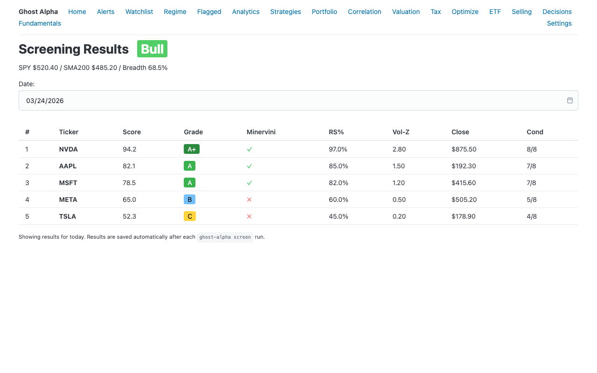 | 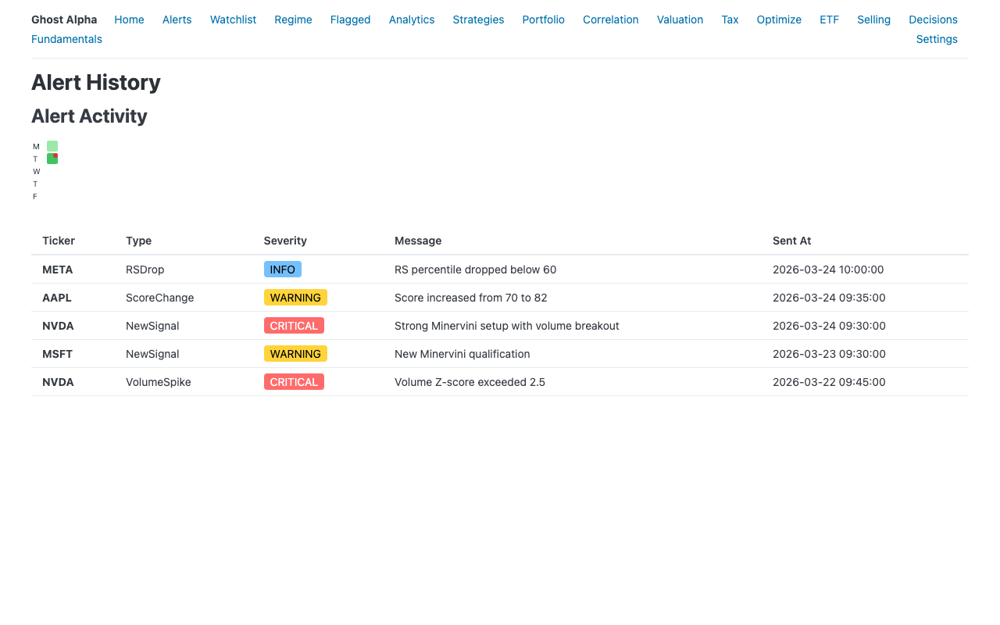 |

| Watchlist | Market Regime |
|:---:|:---:|
| 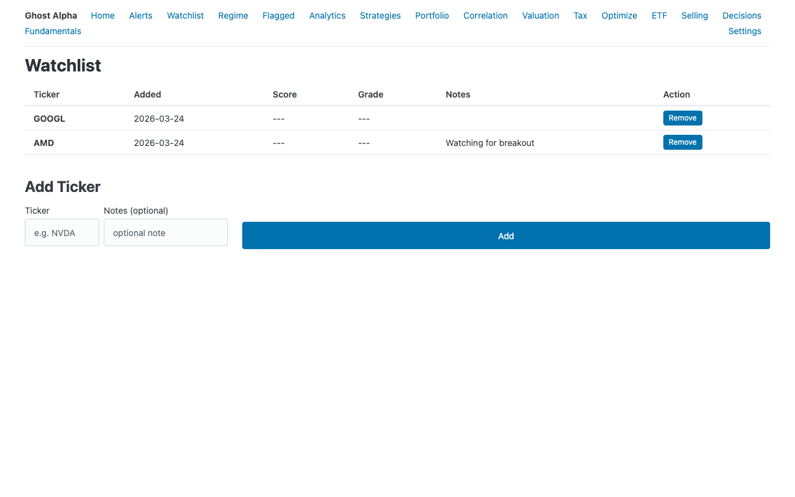 | 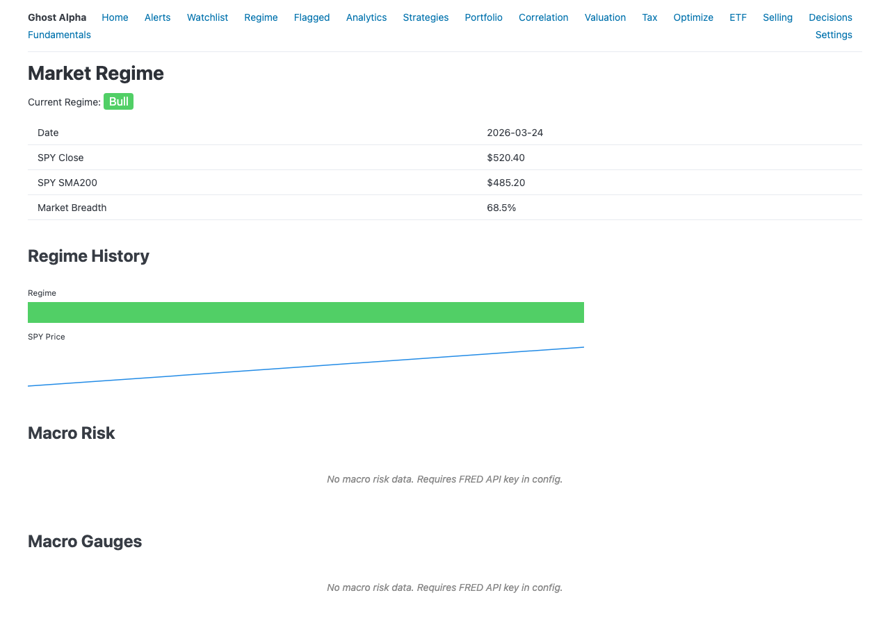 |

| Flagged Stocks | Strategies |
|:---:|:---:|
| 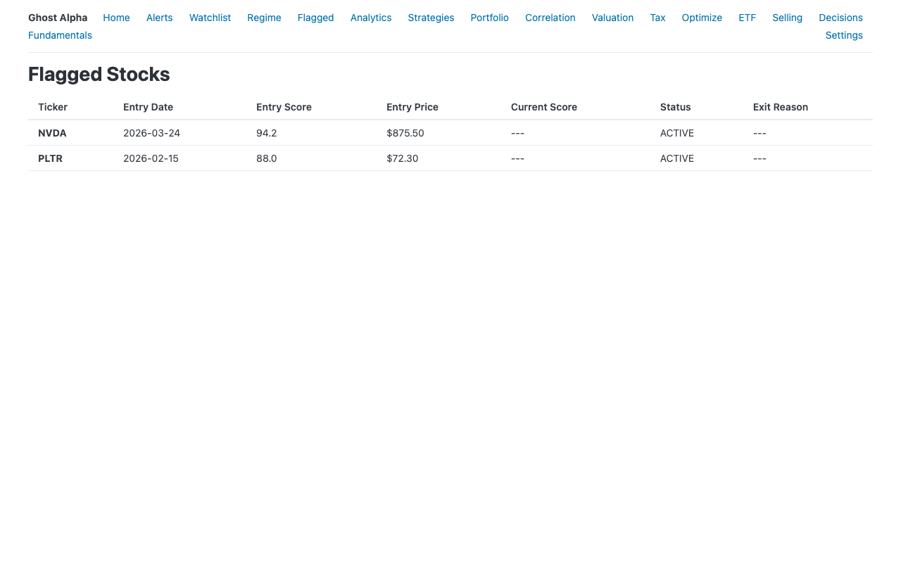 | 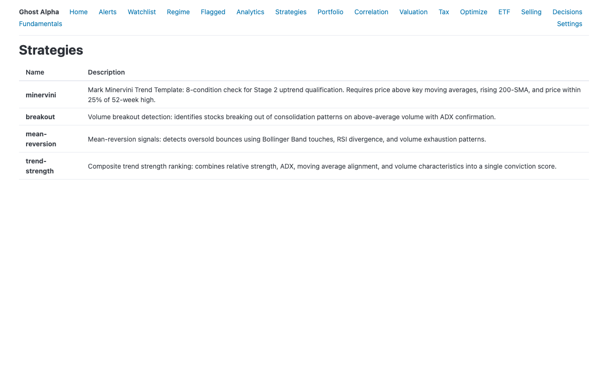 |

| Settings | Analytics |
|:---:|:---:|
| 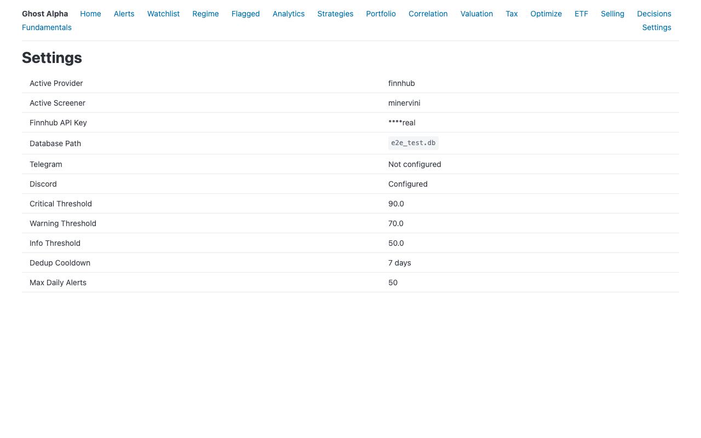 | 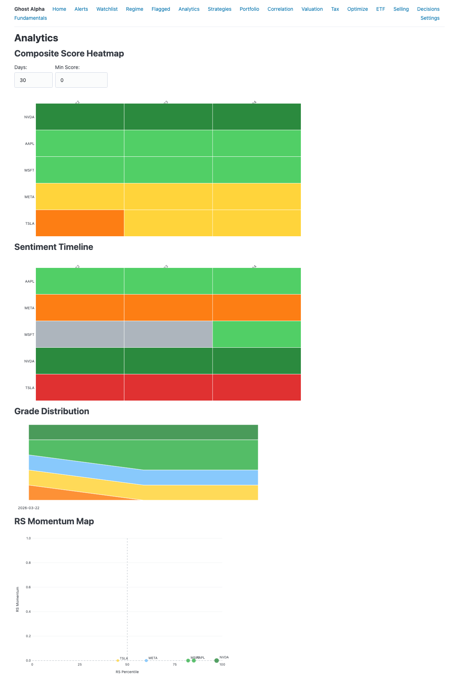 |

Features: htmx-powered live updates, color-coded severity/grade badges, watchlist management (add/remove), market regime indicator, API key masking, mobile-responsive via Pico CSS. The Analytics page includes composite score heatmaps, sentiment timelines, grade distribution charts, and RS momentum scatter plots.

---

## Table of Contents

- [Web Dashboard](#web-dashboard)
- [System Architecture](#system-architecture)
- [Screening Pipeline](#screening-pipeline)
- [Scoring Formula](#scoring-formula)
- [Position Sizing](#position-sizing)
- [Capital Rotation](#capital-rotation)
- [Adaptive Engine](#adaptive-engine)
- [Alert Routing](#alert-routing)
- [Exit Signal Detection](#exit-signal-detection)
- [Database Schema](#database-schema)
- [Plugin / BYOA Architecture](#plugin--byoa-architecture)
- [MCP Server Integration](#mcp-server-integration)
- [Portfolio Plan Pipeline](#portfolio-plan-pipeline)
- [Quick Start](#quick-start)
- [CLI Reference](#cli-reference)
- [Project Structure](#project-structure)
- [Development](#development)
- [Roadmap](#roadmap)
- [Documentation](#documentation)

---

## System Architecture

The system has two entry points — a **CLI binary** for direct use, and an **MCP server** for AI agent integration. Both share the same config, plugin registry, and analysis engine.

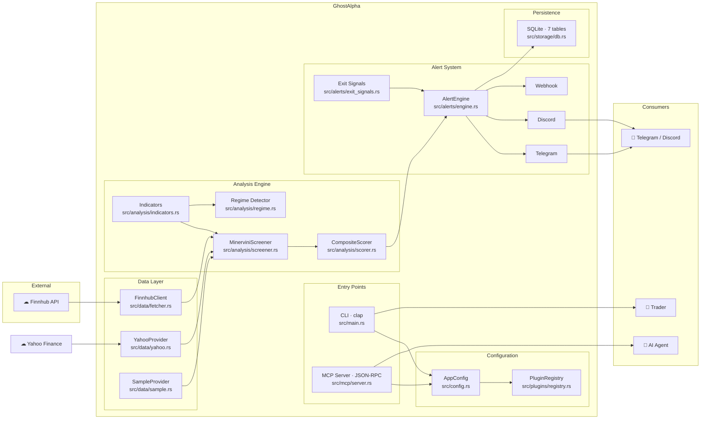

### How the pieces connect

| Layer | What it does | Code |
|-------|-------------|------|
| **Entry Points** | CLI parses subcommands via `clap`; MCP server speaks JSON-RPC 2.0 over stdin/stdout | `src/main.rs`, `src/mcp/server.rs` |
| **Configuration** | Layered config: `config.toml` → `.env` (via dotenvy) → `GHOST_ALPHA_*` env vars. Highest wins. | `src/config.rs` |
| **Data Layer** | Three providers: `FinnhubClient` (API key), `YahooProvider` (zero-signup), `SampleProvider` (bundled demo). Rate-limited with exponential backoff. | `src/data/fetcher.rs`, `src/data/yahoo.rs`, `src/data/sample.rs` |
| **Analysis Engine** | Pure computation, zero network calls. Indicators are stateless math functions. The screener orchestrates them into a `ScreenResult`. | `src/analysis/indicators.rs`, `src/analysis/screener.rs` |
| **Alert System** | `AlertEngine` classifies severity, deduplicates, enforces limits. Channels (`Telegram`, `Discord`, `Webhook`) deliver the alerts. | `src/alerts/engine.rs`, `src/alerts/telegram.rs` |
| **Persistence** | `SqliteRepository` implements the `Repository` trait. 7 tables, WAL mode, migrations via `run_migrations()`. | `src/storage/db.rs`, `src/storage/migrations.rs` |

---

## Screening Pipeline

This is the core workflow — what happens when you run `ghost-alpha screen`:

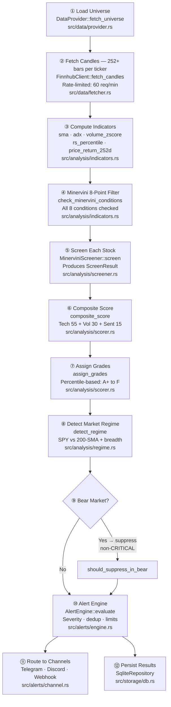

### Step-by-step walkthrough

**Steps ①–② — Data acquisition.** The pipeline fetches the stock universe (S&P 500 by default, or a custom list from `config.toml`). For each ticker, 252+ daily OHLCV candles are fetched from Finnhub. `FinnhubClient` (`src/data/fetcher.rs`) uses `governor` for token-bucket rate limiting and `backoff` for exponential retry on transient errors.

**Steps ③–④ — Indicator computation.** All indicator math lives in `src/analysis/indicators.rs` — pure functions with zero external dependencies. This includes SMA (50/150/200-day), ADX (14-period Wilder's), volume Z-score (20-day rolling, direction-aware), and RS percentile (cross-sectional ranking). The 8-point Minervini trend template is evaluated by `check_minervini_conditions()`:

| # | Condition | What it checks |
|---|-----------|---------------|
| 1 | Price > 50-SMA | Short-term trend |
| 2 | Price > 150-SMA | Medium-term trend |
| 3 | Price > 200-SMA | Long-term trend |
| 4 | 50-SMA > 150-SMA | Moving average alignment |
| 5 | 150-SMA > 200-SMA | Moving average alignment |
| 6 | 200-SMA trending up ≥ 1 month | Structural uptrend |
| 7 | Price within 25% of 52-week high | Near highs, not extended |
| 8 | Price ≥ 25% above 52-week low | Well off the lows |

**Steps ⑤–⑦ — Screening and scoring.** `MinerviniScreener::screen()` (`src/analysis/screener.rs`) runs each stock through the full indicator pipeline and produces a `ScreenResult`. The `CompositeScorer` (`src/analysis/scorer.rs`) combines three sub-scores into a 0–100 composite. Grades are assigned by percentile rank within the screening universe — not fixed cutoffs.

**Steps ⑧–⑨ — Market regime.** Before routing alerts, the regime detector (`src/analysis/regime.rs`) classifies the market. In **Bear** markets, only CRITICAL alerts pass through — this is the noise-reduction mechanism.

| Regime | Condition | Alert behavior |
|--------|-----------|---------------|
| **Bull** | SPY > 200-SMA AND breadth > 60% | All alerts sent |
| **Sideways** | Mixed signals | All alerts sent |
| **Bear** | SPY < 200-SMA AND breadth < 40% | Only CRITICAL |

**Steps ⑩–⑫ — Alert routing and persistence.** The `AlertEngine` (`src/alerts/engine.rs`) classifies severity, deduplicates (7-day cooldown), enforces daily limits, checks quiet hours, and fans alerts out to all configured channels. Results are persisted to SQLite for history and dedup.

---

## Scoring Formula

The composite score is the sum of three independently computed sub-scores:

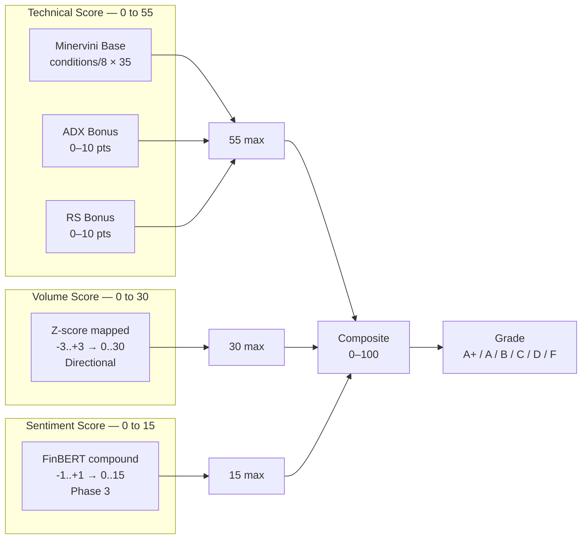

**Code:** `src/analysis/scorer.rs` — `technical_score()`, `volume_score()`, `sentiment_score()`, `composite_score()`, `assign_grades()`

### Grade cutoffs (percentile-based)

| Grade | Percentile | Meaning |
|-------|-----------|---------|
| **A+** | Top 5% | Exceptional — strongest signals in the universe |
| **A** | Top 15% | Very strong setup |
| **B** | Top 30% | Above average |
| **C** | Top 50% | Average |
| **D** | Top 75% | Below average |
| **F** | Bottom 25% | Weak / failing conditions |

Grades are relative to the current screening universe, not absolute thresholds. A "B" in a strong bull market may represent a better setup than an "A" in a bear market with few qualifying stocks.

---

## Position Sizing

The `ghost-alpha size` command converts screening signals into exact share counts using four methods:

| Method | Formula | Best For |
|--------|---------|----------|
| **VolatilityTarget** (default) | `Shares = RiskBudget / (ATR × StopMult)` | Momentum traders — smaller positions in volatile stocks |
| **EqualWeight** | `Shares = (Portfolio / N) / Price` | Simple portfolio construction |
| **FixedFractional** | `Shares = (Portfolio × RiskPct) / RiskPerShare` | Fixed-risk per trade |
| **HalfKelly** | `f* = (p×b - q) / b / 2` | Optimal growth with safety dampening |

Risk budget scales with grade (A+ = 1.5x, B = 0.7x) and regime (Bull = 1.0x, Sideways = 0.8x, Bear = 0.5x). All positions are capped at a configurable maximum (default 15%).

---

## Capital Rotation

The `ghost-alpha rotate` command evaluates existing positions with three continuous scores:

**Sell Pressure Score (SPS)** — 0-100 per position, 7 weighted components:

| Component | What It Measures |
|-----------|-----------------|
| TrendDecay | Minervini condition erosion since entry |
| MomentumFade | Rate of composite score decline |
| VolumeAbandonment | Down-day volume overtaking up-day volume |
| RelativeWeakness | RS percentile deterioration |
| DrawdownPenalty | Distance from 60-day local high (20% DD = 100) |
| TimeDecay | Stagnation after 40-day grace period |
| ConcentrationPenalty | Position oversized vs target weight |

Actions: **GREEN** (0-25: hold) → **YELLOW** (26-45: tighten stop) → **ORANGE** (46-65: evaluate swap) → **RED** (66-80: sell half) → **CRITICAL** (81+: sell all). Hard exit signals override to SPS >= 85.

**Cash Deployment Score (CDS)** — Should freed capital be deployed or held?

**Upgrade Score (US)** — Head-to-head candidate vs incumbent comparison. Threshold: US > +15 for A-grade positions, > +10 for B-grade (shorter leash on grandfathered holdings).

Anti-churn safeguards: min 10-session holding period, max 2 swaps/week, 20-session swap cooldown.

---

## Adaptive Engine

Phase 6 adds market-aware strategy selection across six modules:

| Module | Purpose |
|--------|---------|
| **Microstructure** | Vol regime (VIX + realized vol), correlation regime (sector ETFs), liquidity calendar (FOMC, quad witching, earnings season) |
| **Multi-Horizon** | Score each stock for Swing (2-4w), Position (2-6m), Trend (6-12m) with different weight profiles and sizing |
| **Strategy Selection** | Blend screener weights from affinity matrix × timeframe effectiveness × regime modifiers × vol adjustments |
| **Param Tuner** | Coordinate descent calibration of 6 adaptive parameters within guardrails (max step per cycle, signal count penalty) |
| **Bayesian Weights** | Beta(α,β) distributions per strategy-regime pair, updated from realized outcomes with exponential decay |
| **Attribution** | Brinson-Fachler decomposition: selection + timing + sizing + strategy + interaction = active return |

All adaptive features can be disabled with `--fixed-weights` for comparison. The engine adapts slowly (half-life ~6 months) with 5%/60% guardrails to prevent overfitting.

---

## Alert Routing

Every `ScreenResult` passes through a multi-stage decision pipeline before an alert is actually delivered:

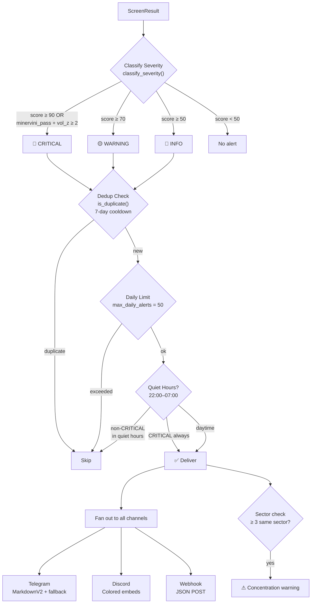

### How each stage works

| Stage | Logic | Code |
|-------|-------|------|
| **Severity** | Two paths to CRITICAL: score threshold (≥90) **or** the Minervini-pass + volume-spike rule. This catches low-score stocks with unusual volume breakouts. | `AlertEngine::classify_severity()` in `src/alerts/engine.rs` |
| **Dedup** | Key = `(ticker, alert_type)`. If the same key was sent within the cooldown window, it's suppressed. Backed by SQLite for persistence across runs. | `src/alerts/dedup.rs` — `InMemoryDedupStore` (ephemeral), `SqliteDedupStore` (persistent) |
| **Daily limit** | Hard cap prevents flooding. Default: 50/day. Set to 0 for unlimited. | `AlertEngine::evaluate()` in `src/alerts/engine.rs` |
| **Quiet hours** | 22:00–07:00 local time. CRITICAL alerts always pass. Non-CRITICAL suppressed until morning. | `AlertEngine::evaluate()` in `src/alerts/engine.rs` |
| **Channels** | Telegram tries MarkdownV2 first, falls back to plain text on HTTP 400. Discord uses colored embeds. Webhook POSTs raw JSON. | `src/alerts/telegram.rs`, `src/alerts/discord.rs`, `src/alerts/webhook.rs` |
| **Sector concentration** | When ≥3 alerts fire for the same GICS sector, a diversification warning is emitted. | `AlertEngine::evaluate()` in `src/alerts/engine.rs` |

---

## Exit Signal Detection

Stocks that pass screening are **flagged** and monitored daily for breakdown signals. Three exit conditions are checked in priority order:

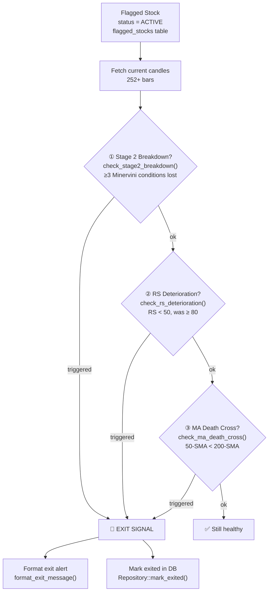

**Code:** `src/alerts/exit_signals.rs` — `check_exit_signals()` is the top-level entry point.

| Signal | Condition | Severity | What it means |
|--------|-----------|----------|---------------|
| **Stage 2 Breakdown** | ≥3 of the 8 Minervini conditions lost since entry | Most severe | Stock is losing its structural trend support |
| **RS Deterioration** | RS percentile fell below 50 (was ≥80 at entry) | Moderate | Stock is weakening relative to peers |
| **MA Death Cross** | 50-day SMA crossed below 200-day SMA | Long-term | Classic long-term trend reversal signal |

The exit alert includes ticker, reason, entry price, current price, and P&L percentage. Flagged stocks are tracked in the `flagged_stocks` table with full lifecycle: `ACTIVE` → `EXITED` or `EXPIRED`.

---

## Database Schema

GhostAlpha uses SQLite with WAL mode for concurrent read/write. Seven tables across two migrations:

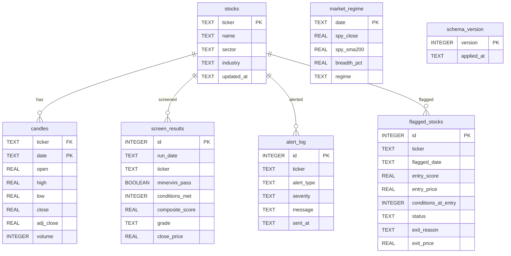

### Table details

| Table | Purpose | Migration |
|-------|---------|-----------|
| `stocks` | Ticker metadata (name, sector, industry) | `001_initial_schema.sql` |
| `candles` | OHLCV history, composite PK `(ticker, date)`, indexed DESC | `001_initial_schema.sql` |
| `screen_results` | Every screening run stored — full score breakdown | `001_initial_schema.sql` |
| `alert_log` | Sent alerts for dedup. Unique index on `(ticker, alert_type)` | `001_initial_schema.sql` |
| `market_regime` | Daily SPY regime (Bull/Sideways/Bear) | `001_initial_schema.sql` |
| `flagged_stocks` | Exit-alert watchlist. Partial unique index: one ACTIVE per ticker | `002_flagged_stocks.sql` |
| `schema_version` | Migration version tracking | Bootstrap table |

**Code:** Migrations in `src/storage/migrations.rs` — `run_migrations()` is idempotent and version-tracked. CRUD operations via `Repository` trait in `src/storage/db.rs`, implemented by `SqliteRepository`.

---

## Plugin / BYOA Architecture

GhostAlpha is built around four trait families. Every component can be swapped, extended, or replaced:

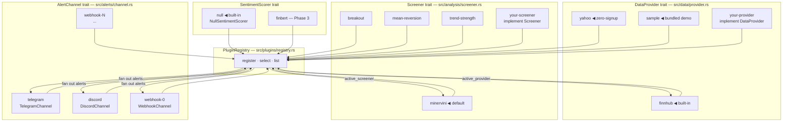

### The four extension points

| Trait | Method to implement | Registration |
|-------|-------------------|--------------|
| `DataProvider` | `fetch_candles()`, `fetch_stocks()`, `fetch_universe()`, `fetch_news()`, `spy_candles()` | `registry.register_provider("name", Arc::new(impl))` |
| `Screener` | `screen(ticker, candles, universe_returns) → ScreenResult` | `registry.register_screener("name", Arc::new(impl))` |
| `SentimentScorer` | `score(headlines) → f64` | `registry.register_scorer("name", Arc::new(impl))` |
| `AlertChannel` | `send(alert) → Result<()>` | `registry.register_channel(Arc::new(impl))` |

**Config-driven webhooks:** Add `[[plugins.webhooks]]` entries in `config.toml` — each becomes an `AlertChannel` automatically. Or set `GHOST_ALPHA_WEBHOOK_URL` for a single webhook.

**Selecting active implementations:**
```toml
[plugins]
active_provider = "finnhub"    # or your custom provider
active_screener = "minervini"  # or your custom screener
```

See [TUTORIAL.md](TUTORIAL.md) for full plugin examples with code.

---

## MCP Server Integration

The MCP (Model Context Protocol) server lets AI agents call GhostAlpha's analysis tools directly via JSON-RPC 2.0:

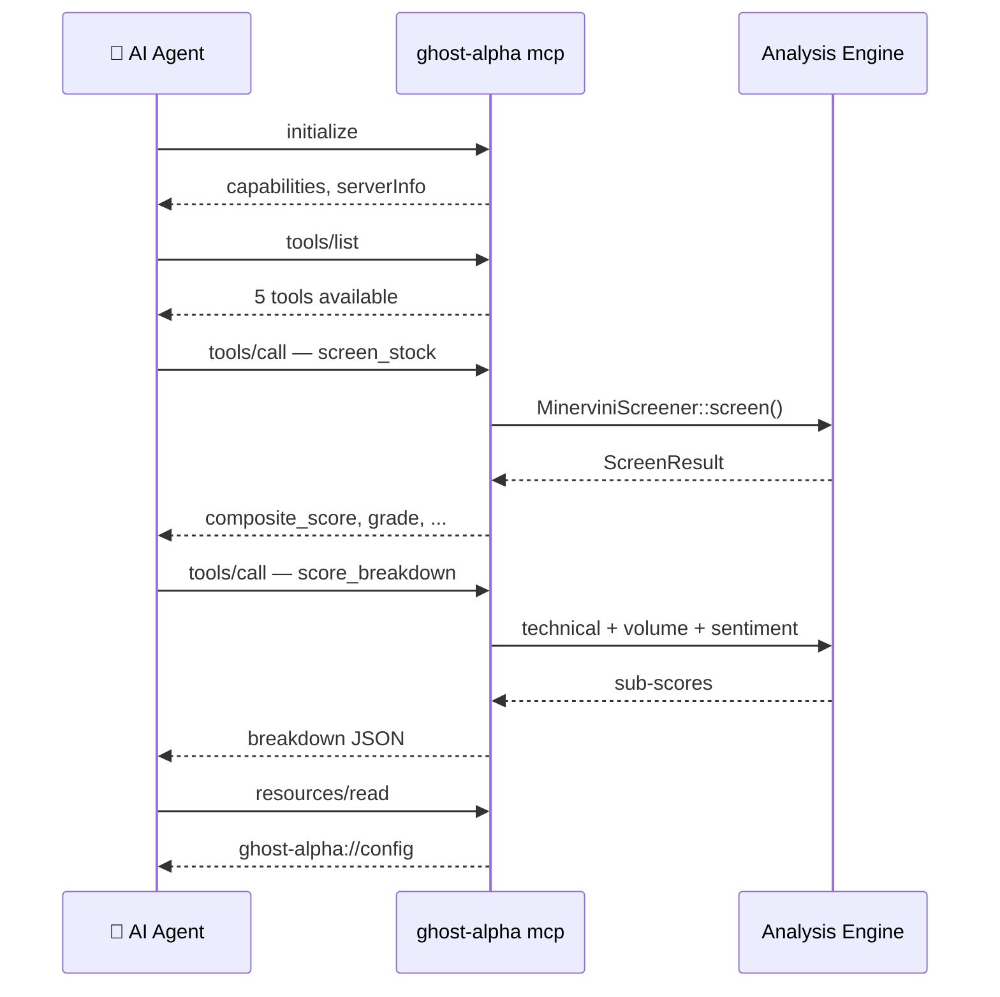

### Available tools and resources

| Tool | What it does | Code |
|------|-------------|------|
| `screen_stock` | Run full screening on a single ticker | `src/mcp/tools.rs` — `screen_stock()` |
| `score_breakdown` | Get detailed sub-score decomposition | `src/mcp/tools.rs` — `score_breakdown()` |
| `get_config` | Return current config (secrets masked) | `src/mcp/tools.rs` — `masked_config()` |
| `list_providers` | List all registered plugins | `src/mcp/tools.rs` — `list_providers()` |
| `health_check` | Check DB connectivity and API status | `src/mcp/server.rs` |

| Resource | URI |
|----------|-----|
| Configuration | `ghost-alpha://config` |
| Providers | `ghost-alpha://providers` |

**Code:** MCP server logic in `src/mcp/server.rs`, tool implementations in `src/mcp/tools.rs`. Runs as `ghost-alpha mcp` or standalone `ghost-alpha-mcp` binary.

---

## Portfolio Plan Pipeline

Forward portfolio NAV projection for a concentrated single-stock position (e.g. employer RSUs): broker exports + vesting schedule → 5,000-path lognormal Monte Carlo with block-correlation Σ → year-end percentile bands → CSV + audit JSON. Wired together as `ghost-alpha plan`. Works for any concentrated ticker, not just one company.

The engine is cross-validated against an independent Python reference implementation (within 1% on year-5 NAV for all three treatments; see `tests/fixtures/python_mc/README.md`).

### Bring your own data

Your files stay on your machine. `my_data/` is gitignored.

```bash
# 1. Write templates you can edit
ghost-alpha init-data my_data

# 2. Replace the examples with your data
#    my_data/positions/*.csv   one file per account — Fidelity "Portfolio_Positions" export
#                              OR a simple CSV: symbol,quantity,price[,cost_basis][,account]
#    my_data/vesting.csv       optional — symbol,vesting_date,quantity (minimal) or the full 12-column format
#    my_data/symbol_map.toml   optional — map tickers the built-in list doesn't know to an asset class
#    my_data/plan.toml         optional — as_of, symbol, treatment, tax rates, unwind schedule

# 3. Run
ghost-alpha plan --data-dir my_data --as-of 2026-05-01
```

Simple positions CSV:

```csv
symbol,quantity,price,cost_basis,account
MSFT,1300,420.00,185.00,Brokerage
VOO,250,600.00,420.00,Brokerage
SPAXX,40000,1.00,,Brokerage
```

Minimal vesting CSV:

```csv
symbol,vesting_date,quantity
MSFT,2026-08-15,40
MSFT,2026-11-15,40
```

Unknown tickers? Add them to `symbol_map.toml` (class names are the keys in `config/asset_classes.toml`), or set a fallback:

```toml
default_class = "us_large_cap_index"
[symbols]
FSKAX = "us_total_market"
```

You can also point at files directly (`GHOST_ALPHA_DATA_DIR` works too):

```bash
ghost-alpha plan \
  --positions ~/exports/brokerage_positions.csv \
  --positions ~/exports/joint_positions.csv \
  --vesting ~/exports/vesting.csv \
  --symbol MSFT \
  --treatment option-b --ltcg-rate 0.238 --floor-pct 0.25 --unwind "1:400,2:300" \
  --paths 5000 --seed 42 --horizon 5 \
  --as-of 2026-05-01 --out-dir ./plan_output
```

Precedence: CLI flag > `plan.toml` > built-in default. If `--symbol` is omitted, the concentrated ticker is the vesting schedule's symbol, else your largest non-cash holding. The unwind cost basis defaults to the average cost basis in your positions file (override with `--cost-basis`).

Output: a brief CLI summary (starting NAV, year-5 P5/P50/P95) + three artifacts in `plan_output/`:
- `nav_projection.csv` — percentile bands per (treatment, year)
- `nav_mc_paths.csv` — raw long-format path output
- `audit.json` — MC block, concentrated symbol, cost-basis source, report summary (reproducibility receipt)

### Pipeline at a glance

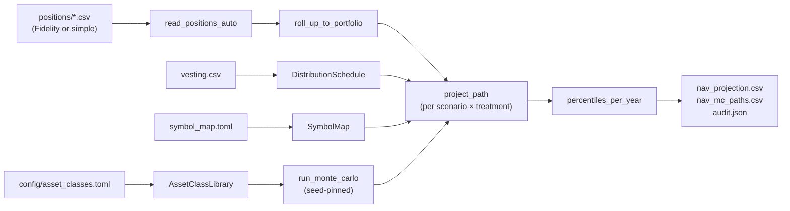

### Three vest treatments

| Treatment | What happens to vested shares |
|---|---|
| `hold` | Accumulate as the concentrated ticker; concentration grows |
| `sell-reinvest` | Sell on vest; redistribute proceeds pro-rata across the rest of the portfolio |
| `option-b` | Sell on vest + unwind existing shares on your `--unwind` schedule, throttled so the position never drops below `--floor-pct` of NAV; proceeds go to a diversified reinvest mix |

Full reference: [`docs/PLAN_PIPELINE.md`](docs/PLAN_PIPELINE.md).

---

## Quick Start

```bash
# Build from source
cargo build --release

# Try the demo instantly — no API key needed
./target/release/ghost-alpha demo

# Interactive setup wizard (configures API keys, alerts, database)
./target/release/ghost-alpha setup

# Or manual setup:
echo 'GHOST_ALPHA_FINNHUB_API_KEY=your-key' > .env
cp config.example.toml config.toml
./target/release/ghost-alpha migrate

# Run the screening pipeline
./target/release/ghost-alpha screen

# Screen with a different strategy
./target/release/ghost-alpha screen --strategy breakout

# Use Yahoo Finance (no API key needed)
./target/release/ghost-alpha screen --provider yahoo

# Check market regime
./target/release/ghost-alpha regime

# Start web dashboard
./target/release/ghost-alpha serve

# Start MCP server for AI agents
./target/release/ghost-alpha mcp --env-only
```

For detailed setup including Telegram alerts, Discord webhooks, AI agent integration (Claude Desktop, Goose), and custom plugins, see **[TUTORIAL.md](TUTORIAL.md)**.

---

## CLI Reference

| Command | Description | Entry Point |
|---------|-------------|-------------|
| `demo` | Run screening on bundled sample data — zero config | `src/main.rs` → `Commands::Demo` |
| `screen` | Run the full screening pipeline | `src/main.rs` → `Commands::Screen` |
| `screen --strategy <name>` | Screen with a specific strategy (breakout, mean-reversion, trend-strength) | `src/main.rs` → `Commands::Screen` |
| `screen --provider yahoo` | Screen using Yahoo Finance (no API key) | `src/main.rs` → `Commands::Screen` |
| `screen --format json\|csv` | Output results in JSON, CSV, JSONL, or HTML | `src/main.rs` → `Commands::Screen` |
| `strategies` | List all available screening strategies | `src/main.rs` → `Commands::Strategies` |
| `regime` | Show current market regime (Bull/Sideways/Bear) | `src/main.rs` → `Commands::Regime` |
| `watch add <ticker>` | Add ticker to personal watchlist | `src/main.rs` → `Commands::Watch` |
| `watch list` | Show watchlist with current scores | `src/main.rs` → `Commands::Watch` |
| `backtest` | Run walk-forward backtest with Monte Carlo | `src/main.rs` → `Commands::Backtest` |
| `backtest --format html` | Generate self-contained HTML backtest report | `src/main.rs` → `Commands::Backtest` |
| `serve` | Start embedded web dashboard (htmx + pico.css) | `src/main.rs` → `Commands::Serve` |
| `setup` | Interactive setup wizard | `src/main.rs` → `Commands::Setup` |
| `show-config` | Print loaded config with secrets masked | `src/main.rs` → `Commands::ShowConfig` |
| `migrate` | Run database migrations and exit | `src/main.rs` → `Commands::Migrate` |
| `plugins` | List all registered plugins and channels | `src/main.rs` → `Commands::Plugins` |
| `mcp` | Start MCP server (JSON-RPC over stdin/stdout) | `src/main.rs` → `Commands::Mcp` |
| `sell-plan` | Tax-aware selling programme for a vested position | `src/main.rs` → `Commands::SellPlan` |
| `sell-compare` | Compare 1..N year selling strategies to find tax-optimal spread | `src/main.rs` → `Commands::SellCompare` |
| `plan` | End-to-end forward-NAV pipeline: Fidelity CSVs → MC → CSV + audit JSON | `src/cli/plan.rs` → `run_plan_pipeline` |
| `plan --treatment hold\|sell-reinvest\|option-b` | Choose RSU treatment for the projection | `src/projection/portfolio_nav.rs` |
| `plan --paths N --seed N` | Configure MC paths and seed (default 5000 paths, seed 42; reproducible) | `src/projection/monte_carlo.rs` |
| `edgar facts\|filings <TICKER>` | SEC EDGAR point-in-time XBRL facts and filing lists (free, needs a User-Agent) | `src/cli/edgar.rs` |
| `allocate` | Show target fund allocation for a risk profile and brokerage | `src/main.rs` → `Commands::Allocate` |
| `size` | Recommend position sizes for screening results | `src/main.rs` → `Commands::Size` |
| `size --portfolio 150000` | Compute sizes for a specific portfolio value | `src/portfolio/sizing.rs` |
| `rotate` | Analyze capital rotation — sell pressure + deployment | `src/main.rs` → `Commands::Rotate` |
| `vol-target` | Show portfolio volatility targeting status and exposure recommendation | `src/portfolio/vol_target.rs` |
| `attribution` | Performance attribution: selection, timing, sizing, strategy | `src/analysis/attribution.rs` |
| `calibrate` | Adaptive parameter tuning via coordinate descent | `src/analysis/param_tuner.rs` |
| `execute` | Execute trades via Alpaca broker API (dry-run/paper/live) | `src/broker/alpaca.rs` |
| `geo-risk` | Compute geopolitical risk score from market inputs | `src/main.rs` → `Commands::GeoRisk` |
| `div-report` | Generate self-contained HTML diversification report | `src/main.rs` → `Commands::DivReport` |
| `alerts` | Show recent alerts from the alert log | `src/main.rs` → `Commands::Alerts` |

### SEC EDGAR (`ghost-alpha edgar`)

Free, key-less access to SEC filings data. `edgar facts` prints XBRL values as they were known on a
given date (`--as-of`), so restated figures never leak into the past; `edgar filings` lists filings
filtered by form, 8-K item and date. No `config.toml` or Finnhub key is required.

SEC blocks anonymous clients: provide a User-Agent of the form `<app or name> <contact email>`
via `GHOST_ALPHA_EDGAR_USER_AGENT` (or `[edgar] user_agent` in `config.toml`). Responses are cached for
24h under your user cache directory (`GHOST_ALPHA_EDGAR_CACHE_DIR` to override).

Things to know:
- `--as-of` is inclusive of the filing date. For close-to-close backtests, pass the previous trading
  day so a filing made after the close is not visible.
- `edgar filings` searches only SEC's `recent` list (roughly the latest 1000 filings) unless `--since`
  is given; with `--since DATE` older archive pages reaching back to DATE are fetched (and cached).
  Without `--since`, a stderr note says when older filings exist.
- Concept names vary: since ASC 606 many filers report revenue as
  `RevenueFromContractWithCustomerExcludingAssessedTax` rather than `Revenues`. When a concept or unit
  is not found, stderr lists similar concepts / available units.
- Annual series only include ~12-month periods and quarterly series only ~3-month periods, so
  year-to-date and Q4 slices do not pollute them.

```bash
export GHOST_ALPHA_EDGAR_USER_AGENT="Jane Doe jane@example.com"
ghost-alpha edgar facts AAPL --concept RevenueFromContractWithCustomerExcludingAssessedTax --as-of 2024-03-01 --format json
ghost-alpha edgar filings AAPL --form 8-K --item 2.02 --since 2024-01-01
```

Global flags: `-c <path>` (config file), `-v` (verbose logging), `--fixed-weights` (disable adaptive engine).

---

## Project Structure

```
src/
├── main.rs                    CLI entry point (clap subcommands)
├── lib.rs                     Re-exports all modules
├── config.rs                  AppConfig — TOML + .env + env var layering
├── error.rs                   Typed errors: Data, Analysis, Alert, Storage, Config
├── output.rs                  Multi-format output: Table, JSON, CSV, JSONL, HTML
├── wizard.rs                  Interactive setup wizard (dialoguer)
│
├── data/
│   ├── models.rs              Candle, Stock, FlaggedStock, RegimeState, Severity
│   ├── provider.rs            DataProvider trait (the testing seam)
│   ├── fetcher.rs             FinnhubClient — HTTP + rate limit + retry
│   ├── yahoo.rs               YahooProvider — zero-signup alternative
│   ├── sample.rs              SampleProvider — bundled demo data (50 tickers)
│   ├── universes.rs           Bundled S&P 500 ticker list
│   └── cache.rs               ThreeLevelCache (memory → file → SQLite)
│
├── analysis/
│   ├── indicators.rs          Pure math: sma, adx, rsi, volume_zscore, rs_percentile
│   ├── screener.rs            MinerviniScreener — 8-point filter → ScreenResult
│   ├── breakout.rs            BreakoutScreener — price/volume breakout detection
│   ├── mean_reversion.rs      MeanReversionScreener — oversold bounce strategy
│   ├── trend_strength.rs      TrendStrengthScreener — ADX momentum strategy
│   ├── scorer.rs              CompositeScorer — technical + volume + sentiment
│   ├── sentiment.rs           FinBERT ONNX scorer (feature-gated)
│   ├── regime.rs              Market regime: SPY vs 200-SMA + breadth
│   └── geopolitical.rs        Geo risk scorer: Oil/VIX/Gold/DXY → composite 0-10
│
├── alerts/
│   ├── channel.rs             AlertChannel trait + OutboundAlert + NullChannel
│   ├── engine.rs              AlertEngine — severity, dedup, limits, quiet hours
│   ├── telegram.rs            TelegramChannel — MarkdownV2 + plain text fallback
│   ├── discord.rs             DiscordChannel — colored embeds via webhook
│   ├── webhook.rs             GenericWebhookChannel — POST JSON to any URL
│   ├── narrative.rs           Human-readable alert narratives
│   ├── dedup.rs               InMemoryDedupStore + SqliteDedupStore
│   └── exit_signals.rs        Exit detection: Stage2, RSDrop, MADeathCross
│
├── storage/
│   ├── db.rs                  SqliteRepository — Repository trait, full CRUD + watchlist
│   └── migrations.rs          run_migrations() — idempotent, version-tracked
│
├── plugins/
│   └── registry.rs            PluginRegistry — register/select/list components
│
├── backtest/
│   ├── mod.rs                 Walk-forward backtesting engine
│   ├── monte_carlo.rs         Monte Carlo simulation + confidence intervals
│   └── html_report.rs         Self-contained HTML report generation
│
├── portfolio/
│   ├── types.rs               TaxLot, Position, Portfolio, HHI, days_to_long_term
│   ├── selling.rs             SellingProgramme, PaceRules, MarketContext
│   ├── prepare.rs             Selling programme generator with tax projections
│   ├── allocation.rs          Brokerage fund mapper, risk profiles, TLH pairs
│   ├── decision.rs            Decision audit log (Sell/Buy/Hold/Rebalance)
│   ├── import.rs              CSV import — generic + Fidelity (BOM, disclaimer, FCASH** sleeves)
│   ├── symbol_map.rs          Ticker → AssetClass lookup (23 tickers)        [Gap 1]
│   ├── vesting.rs             VestingEvent, DistributionSchedule from CSV    [Gap 2]
│   ├── concentration.rs       compute_k_max — single-name floor solver       [Gap 4]
│   └── sequencer.rs           route_cash — Greedy + ProRata build-out        [Gap 9]
│
├── projection/                Forward portfolio NAV projection                [Gaps 1+8a]
│   ├── monte_carlo.rs         Lognormal MC + block-correlation Σ + percentile aggregation
│   ├── asset_class_library.rs TOML-loaded μ/σ library (config/asset_classes.toml)
│   ├── scenario.rs            ScenarioPath + walk_price (per-asset compounder)
│   ├── portfolio_nav.rs       project_path — Hold/SellReinvest/OptionBUnwind treatments
│   └── output.rs              CSV + audit JSON emitters
│
├── plans/                     Trading plan generators                        [Gap 3]
│   └── rule_10b5_1.rs         SEC Rule 10b5-1(c)(1) plan: cooling-off + executions + sizing
│
├── output/                    Markdown emitters                              [Gap 5]
│   ├── mermaid.rs             quote_label_if_needed for strict renderers (GitHub, Obsidian)
│   └── plan_10b5_1_md.rs      Markdown rendering for Plan10b5_1
│
├── cli/                       CLI subcommand orchestrators (testable as functions)
│   └── plan.rs                run_plan_pipeline — composes the projection stack [Gap 10]
│
├── tax/
│   ├── brackets.rs            Federal & state tax brackets, tiered WA (7%/9.9%)
│   ├── engine.rs              compute_lot_tax — bracket stacking, NIIT, state tiers
│   ├── projection.rs          Multi-year projections + scenario comparison
│   ├── hifo.rs                HIFO + 3-tier priority lot selection
│   └── harvest.rs             Tax-loss harvesting scanner + wash sale detection
│
├── web/
│   ├── mod.rs                 Axum web server setup + router
│   ├── routes.rs              Dashboard routes (htmx + pico.css)
│   ├── dashboard_routes.rs    Portfolio, tax, selling, allocation, geo-risk pages
│   ├── diversification_report.rs  Self-contained HTML diversification report
│   ├── assets.rs              Embedded static file server (rust-embed)
│   └── charts.rs              SVG generators: donut, frontier, heatmap, decay
│
├── mcp/
│   ├── server.rs              McpServer — JSON-RPC 2.0 over stdin/stdout
│   └── tools.rs               5 MCP tools: screen_stock, score_breakdown, etc.
│
└── bin/
    └── ghost-alpha-mcp.rs     Standalone MCP binary
```

---

## Development

```bash
# Run all unit tests (1,300+ tests)
cargo test --lib --bins

# Run integration tests
cargo test --features integration

# Run with verbose logging
RUST_LOG=debug ./target/release/ghost-alpha -v screen

# Run Playwright e2e tests for the web dashboard (35 tests)
npx playwright test

# Regenerate dashboard screenshots for the README
npx playwright test e2e/screenshots.spec.ts

# Check binary size (target: < 15 MB)
ls -lh target/release/ghost-alpha
```

### Test coverage targets

| Module | Target | Strategy |
|--------|--------|----------|
| `indicators.rs` | ≥ 95% | Pure math — exhaustive edge cases |
| `screener.rs`, `scorer.rs` | ≥ 90% | Fixture candle data with known outputs |
| `alerts/engine.rs` | ≥ 85% | Dedup, quiet hours, limits, sector concentration |
| `storage/db.rs` | ≥ 85% | SQLite `:memory:` for every test |

All tests are inline `#[cfg(test)]` modules. Integration tests live in `tests/` with feature-gated `--features integration`. HTTP mocks via `wiremock`, temp DBs via `tempfile`.

See **[ARCHITECTURE.md](ARCHITECTURE.md)** for the full TDD strategy and implementation order.

---

## Diversification Engine

Tax-optimized selling programme for concentrated stock positions. Combines lot analysis, multi-year tax scenarios, brokerage-specific fund mapping, and geopolitical risk into a single actionable plan.

### Tax Scenario Comparison

Find the optimal number of years to spread a sale. The `sell-compare` command finds where WA's $278K deduction eliminates state tax:

```
$ ghost-alpha sell-compare --ticker AMZN --shares 3000 --cost-basis 50 --price 250 \
    --state WA --filing mfj --other-income 200000 --max-years 5

  AMZN — Multi-year scenario comparison (State: WA)
  ────────────────────────────────────────────────────────────────────────
  Years   Shares/yr     Total Tax         Fed       State    Eff %     Savings
  ────────────────────────────────────────────────────────────────────────
      1        3000       $146152     $100812      $22540    24.4%          $0
      2        1500       $115880      $90000       $3080    19.3%      $30272
      3        1000       $112800      $90000          $0    18.8%      $33352 <<<
      4         750       $112800      $90000          $0    18.8%      $33352
      5         600       $112800      $90000          $0    18.8%      $33352
  ────────────────────────────────────────────────────────────────────────
  Spreading over 3 years saves $33352 vs lump sum.
```

### Fund Allocation

Map target allocations to specific low-cost funds with TLH partners across Fidelity, Schwab, and Vanguard:

```
$ ghost-alpha allocate --profile aggressive --brokerage fidelity --value 1000000

  Target Allocation — Aggressive profile on Fidelity
  ────────────────────────────────────────────────────────────────────────────────
           Asset Class  Ticker                       Fund Name       ER        Amount     TLH
  ────────────────────────────────────────────────────────────────────────────────
       US Broad Market   FZROX      Fidelity ZERO Total Market   0.000%       $300000   FSKAX
          US Small Cap   FSSNX        Fidelity Small Cap Index   0.025%       $100000       —
        Intl Developed   FZILX        Fidelity ZERO Intl Index   0.000%       $150000   FTIHX
         Intl Emerging   FPADX  Fidelity Emerging Markets Index   0.075%       $100000       —
              US Bonds   FXNAX          Fidelity US Bond Index   0.025%        $50000       —
           Real Estate    FREL   Fidelity MSCI Real Estate ETF   0.084%       $100000       —
          US Large Cap   FNILX         Fidelity ZERO Large Cap   0.000%       $150000   FXAIX
  ────────────────────────────────────────────────────────────────────────────────
  Blended expense ratio: 0.0207%
```

### Geopolitical Risk

Market-priced composite risk score (Oil + VIX + Gold + DXY) with allocation adjustment recommendations:

```
$ ghost-alpha geo-risk --oil 140 --vix 38 --gold-3m 0.20 --dxy-3m -0.08

  Geopolitical Risk Assessment
  ──────────────────────────────────────────────────
  Oil (Brent):  $140/bbl  → 2.14/2.5
  VIX:          38.0       → 1.80/2.5
  Gold 3m:      20.0%      → 1.88/2.5
  DXY 3m:       -8.0%      → 2.00/2.5
  ──────────────────────────────────────────────────
  Composite: 7.8/10 — Extreme

  Suggested adjustments:
    energy               +10%
    defense              +5%
    cash                 +10%
    em                   -6%
    growth               -6%
```

### HTML Diversification Report

Generate a self-contained client-deliverable report combining all modules:

```bash
ghost-alpha div-report --ticker AMZN --shares 2000 --cost-basis 60 --price 215 \
    --state WA --filing mfj --other-income 200000 --other-value 80000 \
    --years 2 --brokerage fidelity --profile moderate
```

The report includes 6 sections — position summary, tax scenario comparison, selling programme, fund allocation, geopolitical risk, and concentration decay chart — all in a single HTML file with dark mode and print support.

### Web Dashboard Pages

Three new dashboard pages at `/concentration-decay`, `/allocation`, and `/geo-risk`:

| Fund Allocation | Geopolitical Risk |
|:---:|:---:|
| 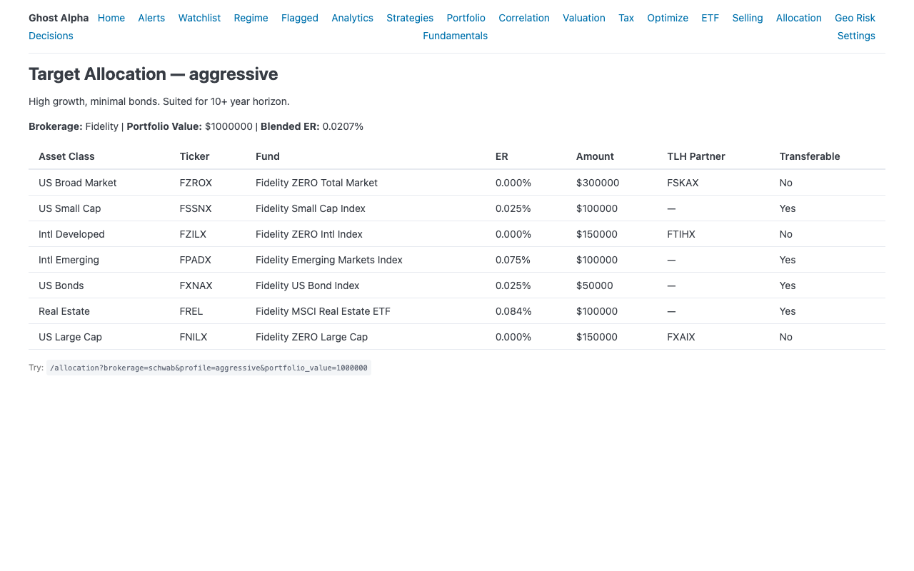 | 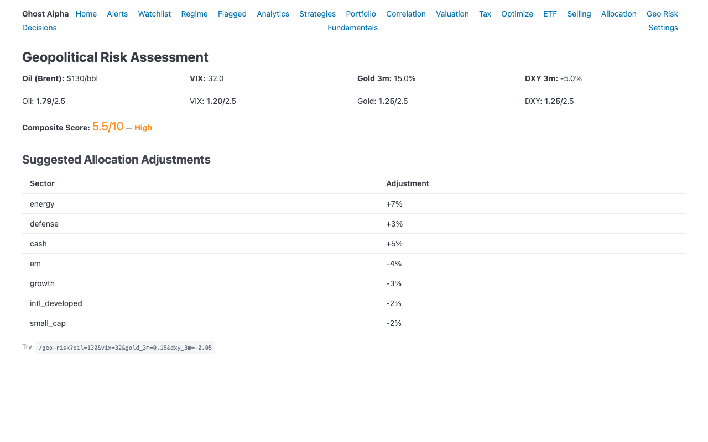 |

| Concentration Decay |
|:---:|
| 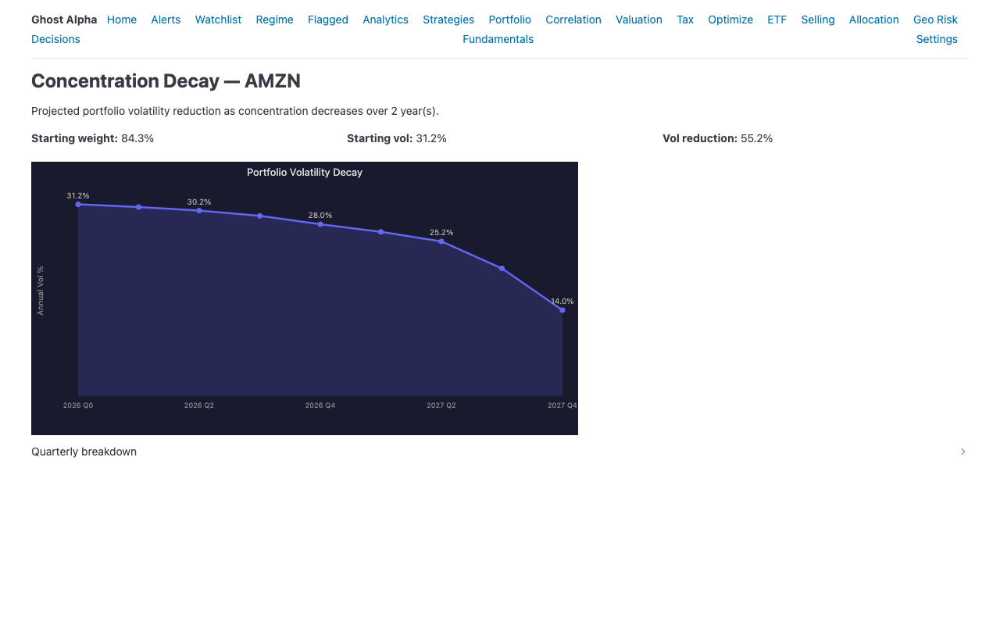 |

---

## Roadmap

| Phase | Status | Focus |
|-------|--------|-------|
| **1. Core Engine** | ✅ Complete | Indicators, screener, scorer, config, CLI, MCP server |
| **2. Alerts & Persistence** | ✅ Complete | SQLite storage, Telegram/Discord/Webhook, alert engine, dedup, exit signals |
| **3. Sentiment** | ✅ Complete | ONNX Runtime + FinBERT model, news fetcher, time-weighted scoring |
| **4. Polish** | ✅ Complete | Backtesting engine, HTML reports, Docker, strategy presets, web dashboard |
| **5. Diversification** | ✅ Complete | Tax optimizer, selling programmes, fund mapper, geo risk, HTML reports |
| **5.5 Quant Rigor** | ✅ Complete | Volume bias fix, conditions normalization, Sharpe methodology, position sizing, wash sale enforcement, regime hysteresis, multi-strategy ensemble |
| **5.5 Capital Rotation** | ✅ Complete | Sell Pressure Score (8 components), Cash Deployment Score, Upgrade Score, anti-churn safeguards, `size` and `rotate` CLI commands |
| **6. Adaptive Engine** | ✅ Complete | Market microstructure (vol/corr/liquidity), multi-horizon scoring (Swing/Position/Trend), adaptive strategy selection, parameter tuning, Bayesian weight updating, performance attribution |
| **7. Portfolio Plan Pipeline** | ✅ Complete | Forward NAV projection (lognormal MC w/ block correlations), 3 vest treatments (Hold / SellReinvest / concentration-floor unwind), bring-your-own-data import (Fidelity or simple CSV, minimal vesting CSV, custom symbol map), any concentrated ticker, `ghost-alpha init-data` + `ghost-alpha plan` CLI |

---

## Documentation

| Document | Description |
|----------|-------------|
| **[TUTORIAL.md](TUTORIAL.md)** | Full setup guide — config, Telegram, Discord, AI agent integration, BYOA examples |
| **[ARCHITECTURE.md](ARCHITECTURE.md)** | TDD plan, module layout, design decisions, coverage targets |
| **[Ghost_Alpha_PRD.md](Ghost_Alpha_PRD.md)** | Product spec — algorithms, DB schema, phases, success KPIs |
| **[config.example.toml](config.example.toml)** | Annotated configuration template |
| **[docs/metrics-and-calculations.md](docs/metrics-and-calculations.md)** | Every formula, threshold, and algorithm — indicators, scoring, alerts, exits |
| **[docs/SETUP_GUIDE.md](docs/SETUP_GUIDE.md)** | Step-by-step setup — developer build, user config, production deployment |
| **[docs/SCHEDULING.md](docs/SCHEDULING.md)** | Daily cron / launchd / systemd scheduling with weekly summary reports |
| **[docs/INVESTMENT_PLAYBOOK.md](docs/INVESTMENT_PLAYBOOK.md)** | Investment playbook — allocation, entries, exits, regime rules, development roadmap |
| **[docs/ghost alpha diversification prd.md](docs/ghost%20alpha%20diversification%20prd.md)** | Diversification engine PRD — position analysis, tax optimizer, allocation builder, geo risk overlay |
| **[docs/planning/diversification-gap-analysis.md](docs/planning/diversification-gap-analysis.md)** | Gap analysis comparing PRD scope vs implementation |
| **[docs/planning/diversification-tdd-plan.md](docs/planning/diversification-tdd-plan.md)** | Detailed TDD plan — 75 tests, dependency order, exact signatures |
| **[docs/planning/](docs/planning/)** | 13+ implementation plans (sample data, Docker, wizard, strategies, dashboard, visualizations, etc.) |

---

## Contributing

Pull requests are welcome. See [CONTRIBUTING.md](CONTRIBUTING.md); every change needs maintainer approval before merge.

---

## License

MIT — see [LICENSE](LICENSE).
