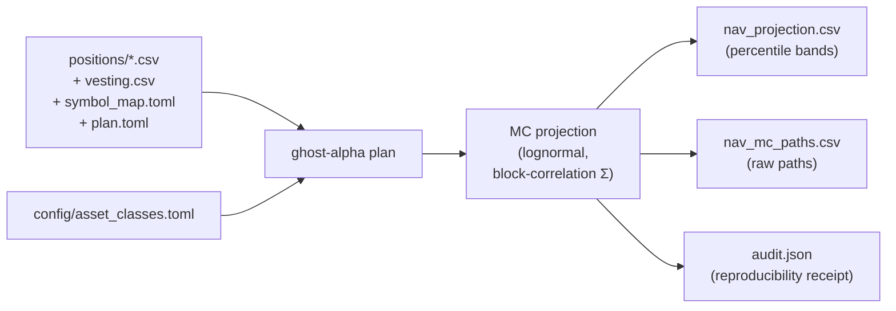

# Portfolio Plan Pipeline — Quick Start

Forward portfolio NAV projection for a portfolio with a concentrated single-stock position (typically employer RSUs), from your own broker exports, in one CLI call.

---

## What it does



- Reads one or more positions files — a Fidelity `Portfolio_Positions` export (BOM, disclaimer footer and `FCASH**` rows handled) **or** a simple `symbol,quantity,price[,cost_basis][,account]` CSV. The format is auto-detected per file.
- Reads an optional vesting schedule — minimal `symbol,vesting_date,quantity` or the full 12-column format.
- Maps each ticker to one of 19 asset classes via a built-in map of common ETFs/mega-caps, extended by your `symbol_map.toml` (with an optional `default_class` fallback).
- Loads per-class μ/σ from `config/asset_classes.toml`.
- Runs a seed-pinned lognormal Monte Carlo with a PSD-enforced block-correlation matrix.
- Projects every path under the chosen vest treatment and aggregates year-end percentile bands.

---

## Bring your own data

```bash
ghost-alpha init-data my_data          # writes editable templates (refuses to overwrite; --force to replace)
# edit my_data/positions/*.csv, my_data/vesting.csv, my_data/symbol_map.toml, my_data/plan.toml
ghost-alpha plan --data-dir my_data --as-of 2026-05-01
```

`my_data/` is gitignored, as are common broker-export filenames — keep personal files out of commits.

### Data directory layout

| Path | Required | Contents |
|---|---|---|
| `positions/*.csv` | yes (≥1) | One file per account. Fidelity export or simple CSV |
| `vesting.csv` | no | Future vests. Omit if you have none |
| `symbol_map.toml` | no | Extra ticker → asset-class mappings and/or `default_class` |
| `plan.toml` | no | Defaults for any `plan` flag |

`GHOST_ALPHA_DATA_DIR=my_data` is equivalent to `--data-dir my_data`. Explicit `--positions` / `--vesting` take precedence over discovered files.

### Simple positions CSV

```csv
symbol,quantity,price,cost_basis,account
MSFT,1300,420.00,185.00,Brokerage
VOO,250,600.00,420.00,Brokerage
SPAXX,40000,1.00,,Brokerage
```

Headers are case-insensitive; `$` and thousands separators are accepted; `cost_basis` is per share; lines starting with `#` are ignored.

### Vesting CSV

```csv
symbol,vesting_date,quantity
MSFT,2026-08-15,40
MSFT,2026-11-15,40
```

`quantity` is gross shares; net shares are computed with `--withhold-rate`. The full format (`snapshot_date,plan_name,symbol,plan_account,grant_date,grant_id,vesting_date,distribution_date,quantity,distribution_value,distributed_in,source_file`) is also accepted.

### `symbol_map.toml`

```toml
default_class = "us_large_cap_index"   # optional: used for any ticker not otherwise mapped
[symbols]
FSKAX = "us_total_market"
XLE   = "energy_sector"
```

Valid class names are the section keys in `config/asset_classes.toml`. Without a `default_class`, unmapped tickers fail fast with a list of every unknown symbol.

### `plan.toml`

```toml
as_of = "2026-05-01"
symbol = "MSFT"            # concentrated ticker; inferred if omitted
treatment = "option-b"     # hold | sell-reinvest | option-b
withhold_rate = 0.22
horizon_years = 5

[unwind]
ltcg_rate = 0.238          # federal 20% + 3.8% NIIT; add your state rate
floor_pct = 0.25           # never sell below this share of NAV
# cost_basis_per_share = 185.0   # default: average cost basis from positions
schedule = { "1" = 400, "2" = 300 }   # existing shares to sell per projection year

[unwind.reinvest_weights]  # optional; default is a diversified ETF mix
VOO = 0.5
VXUS = 0.3
IEF = 0.2
```

Precedence: **CLI flag > `plan.toml` > built-in default.**

---

## Vest treatments

| `--treatment` | What happens to vested shares |
|---|---|
| `hold` | Accumulate as the concentrated ticker; concentration grows |
| `sell-reinvest` | Sell on vest; redistribute proceeds pro-rata across the rest of the portfolio |
| `option-b` | Sell on vest **and** sell existing shares on the `--unwind` schedule, throttled by the floor solver so the position stays ≥ `--floor-pct` of NAV at year-end. After-tax proceeds go to the reinvest mix |

---

## CLI flags

| Flag | Default | Purpose |
|---|---|---|
| `--data-dir <DIR>` | `$GHOST_ALPHA_DATA_DIR` | Discover positions / vesting / symbol map / plan.toml |
| `--positions <CSV>` | from data dir | Positions file; repeat once per account |
| `--vesting <CSV>` | from data dir | Vesting schedule |
| `--symbol <TICKER>` | inferred | Concentrated ticker (else: vesting symbol, else largest non-cash holding) |
| `--symbol-map <TOML>` | from data dir | Extra ticker → class mappings |
| `--default-class <CLASS>` | none | Fallback class for unmapped tickers |
| `--asset-classes <TOML>` | `config/asset_classes.toml` | Per-class μ/σ library |
| `--treatment <NAME>` | `option-b` | `hold` \| `sell-reinvest` \| `option-b` |
| `--withhold-rate <FLOAT>` | `0.22` | Withholding on vests (US federal supplemental flat rate; 0.37 above $1M YTD) |
| `--ltcg-rate <FLOAT>` | `0.238` | Tax rate on unwind gains |
| `--floor-pct <FLOAT>` | `0.25` | Concentration floor for the unwind |
| `--cost-basis <FLOAT>` | from positions | Per-share basis for unwind gains |
| `--unwind <SPEC>` | none | Existing-share sales, e.g. `1:400,2:300` (year:shares) |
| `--paths <N>` / `--seed <N>` | `5000` / `42` | MC paths and seed |
| `--horizon <YEARS>` | `5` | Projection horizon |
| `--as-of <YYYY-MM-DD>` | from plan.toml | Snapshot date |
| `--out-dir <DIR>` | `plan_output` | Output directory |

---

## Output schema

### `nav_projection.csv`
One row per (treatment, year):
```
rsu_treatment, year, as_of, n_paths,
nav_p05, nav_p25, nav_p50, nav_p75, nav_p95, nav_mean,
concentrated_pct_p05, concentrated_pct_p25, concentrated_pct_p50, concentrated_pct_p75, concentrated_pct_p95
```

### `nav_mc_paths.csv`
Long format, one row per (path, treatment, year):
```
scenario, rsu_treatment, year, as_of, nav, concentrated_value, concentrated_pct_of_nav
```

### `audit.json`
Records seed, path count, per-treatment percentiles, `concentrated_symbol`, `cost_basis_source` (`override` | `positions` | `none`) and the report summary.

---

## Reproducibility

- Same `(seed, paths, inputs)` → byte-identical CSVs.
- Cross-language check: the Rust engine matches an independent Python reference within 1% on year-5 NAV for all three treatments, using the synthetic example portfolio in `tests/fixtures/` (see `tests/fixtures/python_mc/README.md`).

---

## When NOT to use this pipeline

- **No concentrated position** — use `--treatment hold`; the unwind logic adds nothing.
- **Short horizons (<1 year)** — the model is calibrated for multi-year horizons.
- **Active-trading portfolios** — the model assumes buy-and-hold plus vests; it doesn't model turnover or options.
- **Tax advice** — rates are inputs you supply; nothing here is tax or investment advice.
