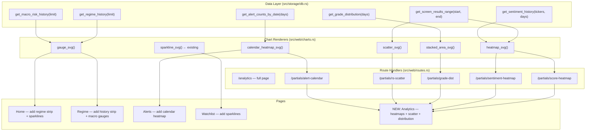
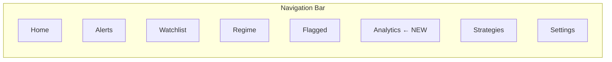
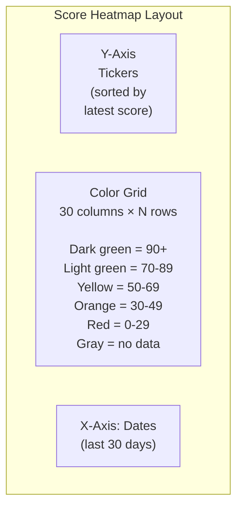
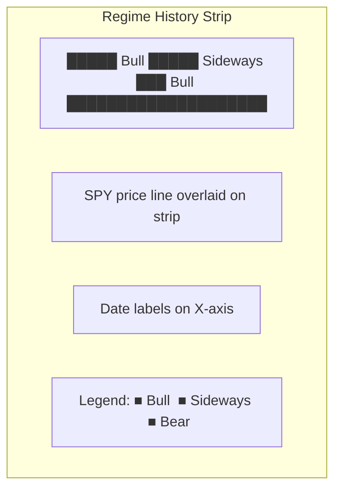
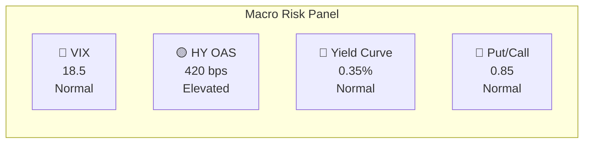
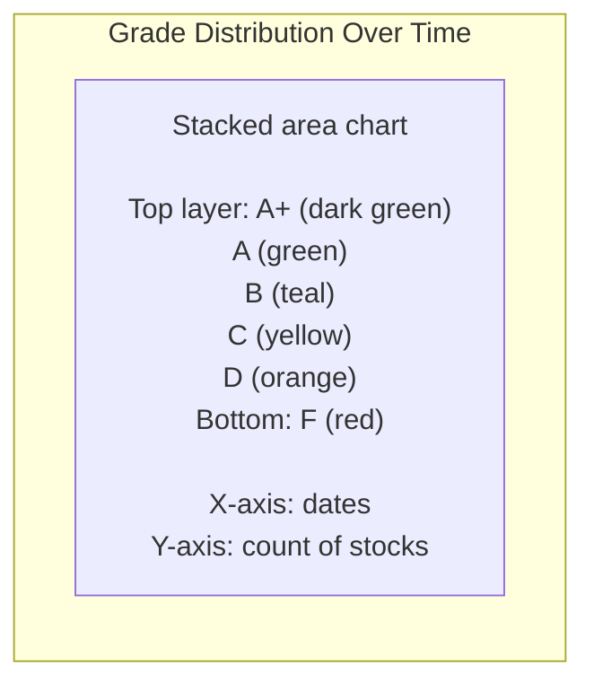
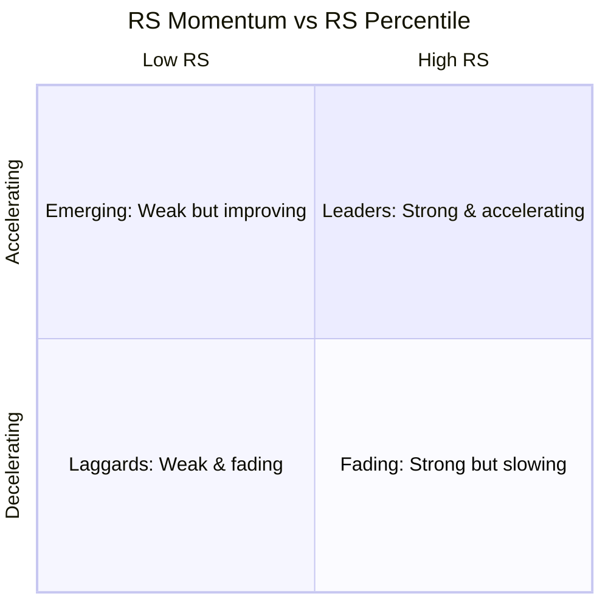
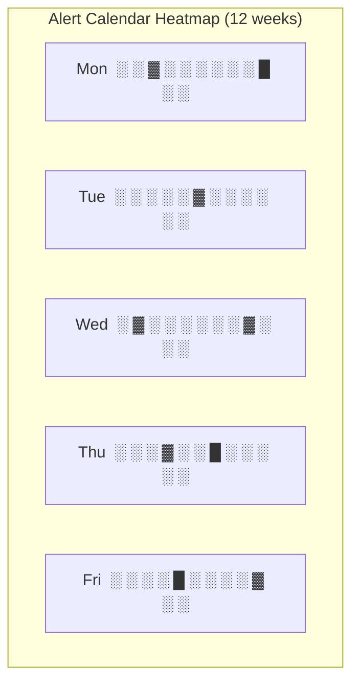
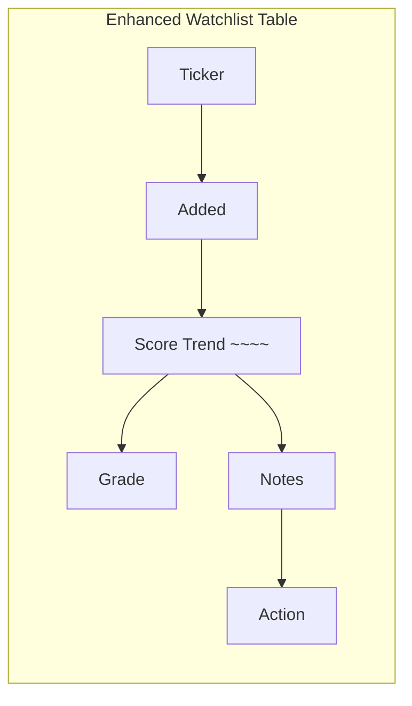
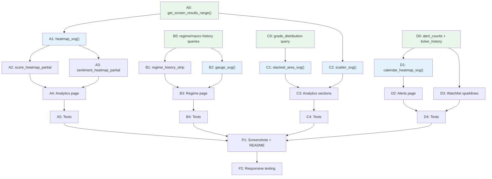

# Plan 13 — Dashboard Visualization Improvements

**Goal:** Add 8 data-dense visualizations to the GhostAlpha web dashboard, transforming it from a table-only interface into a visual intelligence platform that surfaces patterns invisible in tabular data.

**Constraints:**
- Pure SVG rendering in Rust (no JS chart libraries) — extends existing `src/web/charts.rs`
- Pico CSS + ghost-alpha.css design system — no new CSS frameworks
- htmx for interactivity — no client-side JS beyond htmx
- All data from existing SQLite tables — minimal new queries, zero schema changes
- Mobile-responsive — all charts must work at 375px viewport

---

## Table of Contents

- [Architecture Overview](#architecture-overview)
- [Phase A: Score & Sentiment Heatmaps](#phase-a-score--sentiment-heatmaps)
  - [A1: Composite Score Heatmap](#a1-composite-score-heatmap)
  - [A2: Sentiment Timeline Heatmap](#a2-sentiment-timeline-heatmap)
- [Phase B: Regime & Macro Timelines](#phase-b-regime--macro-timelines)
  - [B1: Regime History Strip](#b1-regime-history-strip)
  - [B2: Macro Risk Gauges](#b2-macro-risk-gauges)
- [Phase C: Distribution & Ranking Charts](#phase-c-distribution--ranking-charts)
  - [C1: Grade Distribution Stacked Area](#c1-grade-distribution-stacked-area)
  - [C2: RS Momentum Scatter Plot](#c2-rs-momentum-scatter-plot)
- [Phase D: Activity & Detail Views](#phase-d-activity--detail-views)
  - [D1: Alert Frequency Calendar](#d1-alert-frequency-calendar)
  - [D2: Watchlist Sparklines](#d2-watchlist-sparklines)
- [New Repository Methods](#new-repository-methods)
- [New Routes & Partials](#new-routes--partials)
- [CSS Additions](#css-additions)
- [Testing Strategy](#testing-strategy)
- [Implementation Order & Dependencies](#implementation-order--dependencies)
- [Risk Assessment](#risk-assessment)

---

## Architecture Overview

All visualizations follow the same pipeline: DB query -> Rust struct -> SVG renderer -> HTML embedding.



### New Page: `/analytics`

A dedicated analytics page houses the most data-intensive visualizations. Existing pages get lightweight enhancements (sparklines, regime strip) without becoming cluttered.



---

## Phase A: Score & Sentiment Heatmaps

### A1: Composite Score Heatmap

**What:** A grid with tickers on the Y-axis, dates on the X-axis, and cell color representing the composite score. Reveals which stocks are strengthening or weakening over time at a glance.

**Page:** `/analytics`
**Partial:** `/partials/score-heatmap?days=30&min_score=0`



**Data flow:**

```
screen_results table
    → GROUP BY ticker, run_date
    → SELECT ticker, run_date, composite_score
    → WHERE run_date >= (today - 30 days)
    → ORDER BY latest_score DESC, run_date ASC
```

**SVG specification:**

| Property | Value |
|----------|-------|
| Cell size | 16×20 px (width×height) |
| Max tickers (Y) | 50 (top 50 by latest score) |
| Max days (X) | 30 (configurable via query param) |
| Total SVG size | ~480×1000 px (scrollable) |
| Color scale | 5-stop: `#e03131` → `#fd7e14` → `#ffd43b` → `#51cf66` → `#2b8a3e` |
| Missing data | `#dee2e6` (light gray) |
| Tooltip | `<title>` element: "NVDA — 2026-03-05: 94.2" |
| Label font | 11px monospace (ticker labels on Y-axis) |
| Date labels | Every 5th date on X-axis, rotated 45deg |

**Color mapping function:**

```
fn score_to_color(score: f64) -> &str {
    match score {
        s if s >= 90.0 => "#2b8a3e",  // dark green — exceptional
        s if s >= 70.0 => "#51cf66",  // green — strong
        s if s >= 50.0 => "#ffd43b",  // yellow — average
        s if s >= 30.0 => "#fd7e14",  // orange — weak
        _              => "#e03131",  // red — failing
    }
}
```

**Interactivity:**
- htmx date range selector: `<input type="number" name="days" value="30" hx-get="/partials/score-heatmap" hx-trigger="change" hx-target="#score-heatmap">`
- Min-score filter: hide tickers whose latest score is below threshold
- Click on cell → navigate to `/` with `?date=YYYY-MM-DD` to see that day's full table

**SVG structure (pseudocode):**

```xml
<svg viewBox="0 0 {60 + days*16} {30 + tickers*20}" xmlns="...">
  <!-- Y-axis ticker labels -->
  <text x="55" y="{30 + i*20 + 14}" text-anchor="end" font-size="11">NVDA</text>
  ...
  <!-- X-axis date labels (every 5th) -->
  <text x="{60 + j*16 + 8}" y="{30 + tickers*20 + 15}" font-size="9"
        transform="rotate(45, ...)">03/05</text>
  ...
  <!-- Heatmap cells -->
  <rect x="{60 + j*16}" y="{30 + i*20}" width="15" height="19"
        rx="2" fill="#51cf66">
    <title>NVDA — 2026-03-05: 94.2</title>
  </rect>
  ...
</svg>
```

### A2: Sentiment Timeline Heatmap

**What:** Same grid layout as A1, but color encodes sentiment score instead of composite score. Red = negative, gray = neutral, green = positive.

**Page:** `/analytics`
**Partial:** `/partials/sentiment-heatmap?days=30`

**Data flow:**

```
screen_results table
    → SELECT ticker, run_date, sentiment_score
    → WHERE run_date >= (today - 30 days)
    → ORDER BY ticker ASC, run_date ASC

Enriched with news_cache:
    → SELECT ticker, DATE(published_at) as date, COUNT(*) as article_count
    → GROUP BY ticker, date
```

**Color scale (diverging):**

```
sentiment_score range: 0 to 15

fn sentiment_to_color(score: f64, has_data: bool) -> &str {
    if !has_data { return "#dee2e6"; }  // no articles → gray
    match score {
        s if s >= 12.0 => "#2b8a3e",  // very positive
        s if s >= 9.0  => "#51cf66",  // positive
        s if s >= 6.0  => "#adb5bd",  // neutral
        s if s >= 3.0  => "#fd7e14",  // negative
        _              => "#e03131",  // very negative
    }
}
```

**Additional detail:** Cell opacity encodes article count (confidence).

```
opacity = match article_count {
    0 => 0.2,    // no data — barely visible
    1 => 0.5,    // low confidence
    2 => 0.75,   // moderate
    _ => 1.0,    // 3+ articles — full confidence
}
```

This mirrors the confidence weighting in `scorer.rs` and communicates data quality visually.

**Tooltip format:** `"NVDA — 03/05: sentiment 12.3 (4 articles)"`

---

## Phase B: Regime & Macro Timelines

### B1: Regime History Strip

**What:** A horizontal stacked bar showing market regime over time (Bull/Sideways/Bear), with SPY price as an overlay line. Extends the existing `regime_timeline_svg()` with real data.

**Page:** `/regime` (replaces single-day view), also embedded as mini-strip on Home page
**Partial:** `/partials/regime-history?days=90`



**Data flow:**

```
market_regime table
    → SELECT date, spy_close, spy_sma200, breadth_pct, regime
    → WHERE date >= (today - 90 days)
    → ORDER BY date ASC
```

**SVG specification:**

| Property | Value |
|----------|-------|
| Width | 800px (responsive via viewBox) |
| Height | 80px (strip) + 60px (price line) = 140px total |
| Strip height | 30px colored blocks |
| Colors | Bull: `#51cf66`, Bear: `#ff6b6b`, Sideways: `#ffd43b` |
| Price line | Blue `#228be6`, 2px stroke |
| SMA200 line | Gray `#adb5bd`, 1px dashed |
| X labels | Monthly markers |

**Two-layer SVG:**

```xml
<svg viewBox="0 0 800 140">
  <!-- Layer 1: Regime strip (y=0..30) -->
  <rect x="0" y="0" width="..." height="30" fill="#51cf66"/>  <!-- Bull block -->
  <rect x="..." y="0" width="..." height="30" fill="#ffd43b"/> <!-- Sideways block -->
  ...

  <!-- Layer 2: SPY price line (y=40..130) -->
  <polyline points="..." fill="none" stroke="#228be6" stroke-width="2"/>
  <!-- SMA200 reference -->
  <polyline points="..." fill="none" stroke="#adb5bd" stroke-width="1"
            stroke-dasharray="4,4"/>

  <!-- X-axis labels -->
  <text x="..." y="138" font-size="10">Jan</text>
  ...
</svg>
```

### B2: Macro Risk Gauges

**What:** A row of circular gauge charts showing current VIX, HY OAS spread, yield curve, and put/call ratio with historical range context.

**Page:** `/regime` (below regime strip)
**Partial:** `/partials/macro-gauges`



**Data flow:**

```
macro_risk table
    → SELECT * ORDER BY date DESC LIMIT 60
    → Latest row for current values
    → Last 60 rows for min/max range (gauge scale)
```

**SVG specification (per gauge):**

| Property | Value |
|----------|-------|
| Size | 120×120 px |
| Arc | 240-degree semicircle (from 150deg to 390deg) |
| Needle | Line from center to arc position |
| Colors | Normal: `#51cf66`, Elevated: `#ffd43b`, HighRisk: `#ff6b6b` |
| Center text | Current value (bold, 16px) |
| Bottom label | Metric name (12px) |

**Gauge arc rendering:**

```
fn gauge_svg(value: f64, min: f64, max: f64, label: &str, risk: &str) -> String {
    let pct = ((value - min) / (max - min)).clamp(0.0, 1.0);
    let angle = 150.0 + pct * 240.0;  // 150° to 390° arc

    // Three colored arc segments
    // Green: 150°-230° (Normal)
    // Yellow: 230°-310° (Elevated)
    // Red: 310°-390° (HighRisk)

    // Needle points to `angle`
}
```

---

## Phase C: Distribution & Ranking Charts

### C1: Grade Distribution Stacked Area

**What:** A stacked area chart showing the count of each grade (A+, A, B, C, D, F) per day over the last 30 days. Reveals market quality trends — when F's expand and A's shrink, conditions are deteriorating.

**Page:** `/analytics`
**Partial:** `/partials/grade-dist?days=30`



**Data flow:**

```
screen_results table
    → SELECT run_date, grade, COUNT(*) as cnt
    → WHERE run_date >= (today - 30 days)
    → GROUP BY run_date, grade
    → ORDER BY run_date ASC
```

**SVG specification:**

| Property | Value |
|----------|-------|
| Width | 700px (viewBox) |
| Height | 250px |
| Y-axis | Stock count (0 to max_daily_total) |
| X-axis | Dates (last 30 days) |
| Stacking | Bottom to top: F, D, C, B, A, A+ |
| Colors | Same grade palette as badges |
| Fill opacity | 0.8 |
| Stroke | 1px white between layers for readability |

**Stacked area algorithm:**

```
For each date:
    cumulative = 0
    For each grade in [F, D, C, B, A, A+]:
        bottom[grade] = cumulative
        cumulative += count[grade]
        top[grade] = cumulative

Render as <path> elements using area fill between bottom and top polylines.
```

### C2: RS Momentum Scatter Plot

**What:** Scatter plot with RS percentile (X-axis) vs RS momentum (Y-axis). Each dot is a stock, colored by grade. The four quadrants have clear interpretations:



**Page:** `/analytics`
**Partial:** `/partials/rs-scatter?date=2026-03-08`

**Data flow:**

```
screen_results table (via migration V5 fields)
    → SELECT ticker, rs_percentile, weighted_rs, grade, composite_score
    → WHERE run_date = today
    → ORDER BY composite_score DESC

For rs_momentum (if stored), or compute from two dates:
    → rs_now = weighted_rs for today
    → rs_prev = weighted_rs for (today - 21 days)
    → momentum = (rs_now - rs_prev) / 21 * 100
```

**SVG specification:**

| Property | Value |
|----------|-------|
| Width | 600px |
| Height | 400px |
| Margin | 50px left, 30px right, 30px top, 40px bottom |
| X-axis | RS percentile (0-100) |
| Y-axis | RS momentum (auto-scaled from data) |
| Dot radius | 6px |
| Dot color | Grade color (same palette as badges) |
| Dot opacity | 0.8 |
| Quadrant lines | Dashed gray at x=50, y=0 |
| Labels | Ticker name as `<title>` tooltip, top 5 by score labeled inline |

**Quadrant interpretation:**

| Quadrant | X | Y | Meaning | Action |
|----------|---|---|---------|--------|
| Top-right | RS > 50 | Momentum > 0 | **Leaders** — strong and getting stronger | Buy / hold |
| Top-left | RS < 50 | Momentum > 0 | **Emerging** — weak but improving | Watch closely |
| Bottom-right | RS > 50 | Momentum < 0 | **Fading** — strong but losing momentum | Tighten stops |
| Bottom-left | RS < 50 | Momentum < 0 | **Laggards** — weak and getting weaker | Avoid / exit |

---

## Phase D: Activity & Detail Views

### D1: Alert Frequency Calendar

**What:** GitHub-contribution-style calendar heatmap showing alert density per day. Dark cells = many alerts. Reveals clustering patterns that may indicate macro events.

**Page:** `/alerts` (above the alert table)
**Partial:** `/partials/alert-calendar?weeks=12`



**Data flow:**

```
alert_log table
    → SELECT DATE(sent_at) as day, COUNT(*) as cnt,
             SUM(CASE WHEN severity='CRITICAL' THEN 1 ELSE 0 END) as critical_cnt
    → WHERE sent_at >= (today - 84 days)
    → GROUP BY day
    → ORDER BY day ASC
```

**SVG specification:**

| Property | Value |
|----------|-------|
| Cell size | 14×14 px |
| Gap | 2px |
| Rows | 5 (Mon-Fri, skip weekends) |
| Columns | 12 weeks |
| Total size | ~200×90 px |
| Color scale | 4-stop: `#ebedf0` (0) → `#9be9a8` (1-2) → `#40c463` (3-5) → `#216e39` (6+) |
| Critical overlay | Red dot (3px) in corner of cell if any CRITICAL alerts that day |
| Y labels | M, T, W, T, F (8px, left of grid) |
| X labels | Month names above (Jan, Feb, Mar) |

### D2: Watchlist Sparklines

**What:** For each watchlist ticker, show a 30-day sparkline of composite score trend inline in the watchlist table. Replaces the static "Score" column with a visual trend.

**Page:** `/watchlist` (enhanced table)



**Data flow (per watchlist ticker):**

```
screen_results table
    → SELECT run_date, composite_score
    → WHERE ticker = ? AND run_date >= (today - 30 days)
    → ORDER BY run_date ASC
```

**SVG specification:**

Uses existing `sparkline_svg()` from `charts.rs` — no new renderer needed.

| Property | Value |
|----------|-------|
| Width | 120px |
| Height | 24px |
| Inline | `<td>` cell in watchlist table |
| Color | Blue `#228be6` (existing sparkline color) |
| Fallback | "---" if fewer than 2 data points |

---

## New Repository Methods

Six new query methods required in `src/storage/db.rs`. All read-only; no schema changes.

```rust
/// A1/A2: Fetch screen results for multiple dates.
/// Returns Vec<(ticker, run_date, composite_score, sentiment_score)>
fn get_screen_results_range(
    &self,
    start: NaiveDate,
    end: NaiveDate,
) -> Result<Vec<ScreenResultSummary>, StorageError>;

/// B1: Fetch regime history for the last N days.
fn get_regime_history(
    &self,
    limit: usize,
) -> Result<Vec<RegimeState>, StorageError>;

/// B2: Fetch macro risk history for gauge ranges.
fn get_macro_risk_history(
    &self,
    limit: usize,
) -> Result<Vec<MacroRiskSnapshot>, StorageError>;

/// C1: Fetch grade counts per date for stacked area.
/// Returns Vec<(run_date, grade, count)>
fn get_grade_distribution(
    &self,
    start: NaiveDate,
    end: NaiveDate,
) -> Result<Vec<GradeCount>, StorageError>;

/// D1: Fetch alert counts per day for calendar heatmap.
/// Returns Vec<(date, total_count, critical_count)>
fn get_alert_counts_by_date(
    &self,
    since: NaiveDate,
) -> Result<Vec<AlertDayCount>, StorageError>;

/// D2: Fetch score history for a specific ticker (sparkline).
/// Returns Vec<(run_date, composite_score)>
fn get_ticker_score_history(
    &self,
    ticker: &str,
    days: u32,
) -> Result<Vec<(NaiveDate, f64)>, StorageError>;
```

**Supporting structs:**

```rust
pub struct ScreenResultSummary {
    pub ticker: String,
    pub run_date: NaiveDate,
    pub composite_score: f64,
    pub sentiment_score: f64,
    pub rs_percentile: f64,
    pub weighted_rs: f64,
    pub grade: String,
}

pub struct GradeCount {
    pub run_date: NaiveDate,
    pub grade: String,
    pub count: u32,
}

pub struct AlertDayCount {
    pub date: NaiveDate,
    pub total: u32,
    pub critical: u32,
}
```

**SQL for each query:**

```sql
-- get_screen_results_range
SELECT ticker, run_date, composite_score, sentiment_score,
       rs_percentile, weighted_rs, grade
FROM screen_results
WHERE run_date BETWEEN ?1 AND ?2
ORDER BY run_date ASC, composite_score DESC;

-- get_regime_history
SELECT date, spy_close, spy_sma200, breadth_pct, regime
FROM market_regime
ORDER BY date DESC LIMIT ?1;

-- get_macro_risk_history
SELECT date, vix_level, hy_oas_bps, yield_curve_2s10s,
       put_call_ratio, risk_level
FROM macro_risk
ORDER BY date DESC LIMIT ?1;

-- get_grade_distribution
SELECT run_date, grade, COUNT(*) as cnt
FROM screen_results
WHERE run_date BETWEEN ?1 AND ?2
GROUP BY run_date, grade
ORDER BY run_date ASC;

-- get_alert_counts_by_date
SELECT DATE(sent_at) as day,
       COUNT(*) as total,
       SUM(CASE WHEN severity = 'CRITICAL' THEN 1 ELSE 0 END) as critical
FROM alert_log
WHERE sent_at >= ?1
GROUP BY day
ORDER BY day ASC;

-- get_ticker_score_history
SELECT run_date, composite_score
FROM screen_results
WHERE ticker = ?1 AND run_date >= ?2
ORDER BY run_date ASC;
```

---

## New Routes & Partials

### Full page route

```
GET /analytics    → analytics_page()
```

### Partial routes (htmx fragments)

```
GET /partials/score-heatmap?days=30&min_score=0      → score_heatmap_partial()
GET /partials/sentiment-heatmap?days=30              → sentiment_heatmap_partial()
GET /partials/grade-dist?days=30                     → grade_dist_partial()
GET /partials/rs-scatter?date=YYYY-MM-DD             → rs_scatter_partial()
GET /partials/alert-calendar?weeks=12                → alert_calendar_partial()
GET /partials/regime-history?days=90                  → regime_history_partial()
GET /partials/macro-gauges                            → macro_gauges_partial()
```

### Router additions (src/web/mod.rs)

```rust
.route("/analytics", axum::routing::get(routes::analytics_page))
.route("/partials/score-heatmap", axum::routing::get(routes::score_heatmap_partial))
.route("/partials/sentiment-heatmap", axum::routing::get(routes::sentiment_heatmap_partial))
.route("/partials/grade-dist", axum::routing::get(routes::grade_dist_partial))
.route("/partials/rs-scatter", axum::routing::get(routes::rs_scatter_partial))
.route("/partials/alert-calendar", axum::routing::get(routes::alert_calendar_partial))
.route("/partials/regime-history", axum::routing::get(routes::regime_history_partial))
.route("/partials/macro-gauges", axum::routing::get(routes::macro_gauges_partial))
```

### Analytics page layout

```html
<h1>Analytics</h1>

<h2>Score Heatmap</h2>
<div class="filter-bar">
  <label>Days: <input type="number" name="days" value="30"
         hx-get="/partials/score-heatmap" hx-trigger="change"
         hx-target="#score-heatmap" hx-include="[name=min_score]"></label>
  <label>Min Score: <input type="number" name="min_score" value="0"
         hx-get="/partials/score-heatmap" hx-trigger="change"
         hx-target="#score-heatmap" hx-include="[name=days]"></label>
</div>
<div id="score-heatmap" class="chart-container"
     hx-get="/partials/score-heatmap?days=30" hx-trigger="load">
  Loading...
</div>

<h2>Sentiment Timeline</h2>
<div id="sentiment-heatmap" class="chart-container"
     hx-get="/partials/sentiment-heatmap?days=30" hx-trigger="load">
  Loading...
</div>

<h2>Grade Distribution</h2>
<div id="grade-dist" class="chart-container"
     hx-get="/partials/grade-dist?days=30" hx-trigger="load">
  Loading...
</div>

<h2>RS Momentum Map</h2>
<div id="rs-scatter" class="chart-container"
     hx-get="/partials/rs-scatter" hx-trigger="load">
  Loading...
</div>
```

---

## CSS Additions

New classes for `web/static/ghost-alpha.css`:

```css
/* ── Heatmap ─────────────────────────────────── */
.heatmap-container {
  overflow-x: auto;
  margin: 1rem 0;
}
.heatmap-container svg {
  min-width: 500px;
}
.heatmap-container svg text {
  font-family: ui-monospace, monospace;
}
.heatmap-legend {
  display: flex;
  gap: 0.75rem;
  align-items: center;
  margin-top: 0.5rem;
  font-size: 0.85em;
}
.heatmap-legend span {
  display: inline-block;
  width: 14px;
  height: 14px;
  border-radius: 2px;
  vertical-align: middle;
  margin-right: 4px;
}

/* ── Gauge panel ─────────────────────────────── */
.gauge-panel {
  display: flex;
  flex-wrap: wrap;
  gap: 1.5rem;
  justify-content: center;
  margin: 1.5rem 0;
}
.gauge-item {
  text-align: center;
}
.gauge-item svg {
  display: block;
  margin: 0 auto;
}
.gauge-label {
  font-size: 0.85em;
  color: #868e96;
  margin-top: 0.25rem;
}

/* ── Scatter plot ────────────────────────────── */
.scatter-container svg circle {
  cursor: pointer;
  transition: r 0.15s;
}
.scatter-container svg circle:hover {
  r: 9;
}

/* ── Calendar heatmap ────────────────────────── */
.calendar-heatmap {
  margin: 1rem 0;
}

/* ── Sparkline in table ──────────────────────── */
td .sparkline-cell {
  display: inline-block;
  vertical-align: middle;
}

/* ── Responsive ──────────────────────────────── */
@media (max-width: 768px) {
  .gauge-panel {
    gap: 0.75rem;
  }
  .gauge-item svg {
    width: 90px;
    height: 90px;
  }
}
```

---

## Testing Strategy

### Unit tests (src/web/charts.rs)

Each new SVG renderer gets inline tests following the existing pattern:

| Renderer | Tests |
|----------|-------|
| `heatmap_svg()` | empty data, single cell, full grid, NaN handling, color boundaries, SVG validity |
| `stacked_area_svg()` | empty series, single day, zero counts, correct stacking order |
| `scatter_svg()` | empty points, single point, negative momentum, label placement |
| `calendar_heatmap_svg()` | empty data, weekday alignment, month boundary labels |
| `gauge_svg()` | min/max edges, zero range, label truncation |

**Target:** 5-8 tests per renderer, ~30 new unit tests total.

### Route tests (src/web/routes.rs)

Each new partial endpoint gets `tower::ServiceExt::oneshot()` tests:

```rust
#[tokio::test]
async fn score_heatmap_partial_returns_svg() {
    // Seed DB with 3 tickers × 5 days of screen_results
    // GET /partials/score-heatmap?days=5
    // Assert: status 200, body contains "<svg", no "<!DOCTYPE"
}
```

**Target:** 2-3 tests per route, ~20 new route tests.

### Playwright e2e tests (e2e/analytics.spec.ts)

```typescript
test.describe("Analytics Page", () => {
  test("loads with all chart sections", async ({ page }) => {
    await page.goto("/analytics");
    await expect(page.locator("h1")).toContainText("Analytics");
    // Wait for htmx to load partials
    await page.waitForSelector("#score-heatmap svg", { timeout: 5000 });
    await expect(page.locator("#score-heatmap svg")).toBeVisible();
  });

  test("score heatmap responds to days filter", async ({ page }) => {
    await page.goto("/analytics");
    await page.waitForSelector("#score-heatmap svg");
    await page.fill('input[name="days"]', "7");
    await page.waitForTimeout(500);
    // Heatmap should re-render with fewer columns
    await expect(page.locator("#score-heatmap svg")).toBeVisible();
  });

  test("regime history strip shows on regime page", async ({ page }) => {
    await page.goto("/regime");
    await expect(page.locator("svg")).toBeVisible();
  });
});
```

**Target:** 8-10 new e2e tests.

### Screenshot updates

Add analytics page to `e2e/screenshots.spec.ts`:

```typescript
test("analytics — charts and heatmaps", async ({ page }) => {
  await page.goto("/analytics");
  await page.waitForSelector("#score-heatmap svg", { timeout: 5000 });
  await page.screenshot({
    path: join(SCREENSHOT_DIR, "08-analytics.png"),
    fullPage: true,
  });
});
```

---

## Implementation Order & Dependencies

```mermaid
gantt
    title Implementation Order
    dateFormat X
    axisFormat %s

    section Phase A — Heatmaps
    A0 Repository: get_screen_results_range       :a0, 0, 1
    A1 heatmap_svg() renderer                     :a1, after a0, 2
    A2 score_heatmap_partial route                :a2, after a1, 1
    A3 sentiment_heatmap_partial route            :a3, after a1, 1
    A4 Analytics page + navigation                :a4, after a2, 1
    A5 Unit + route tests                         :a5, after a4, 1

    section Phase B — Regime & Macro
    B0 Repository: regime_history, macro_history   :b0, 0, 1
    B1 regime_history_strip SVG                    :b1, after b0, 1
    B2 gauge_svg() renderer                        :b2, after b0, 2
    B3 Regime page enhancements                    :b3, after b1, 1
    B4 Unit + route tests                          :b4, after b3, 1

    section Phase C — Distribution & Scatter
    C0 Repository: grade_distribution              :c0, after a0, 1
    C1 stacked_area_svg() renderer                 :c1, after c0, 2
    C2 scatter_svg() renderer                      :c2, after c0, 2
    C3 Partials + analytics page sections          :c3, after c1, 1
    C4 Unit + route tests                          :c4, after c3, 1

    section Phase D — Activity & Detail
    D0 Repository: alert_counts, ticker_history    :d0, after a0, 1
    D1 calendar_heatmap_svg() renderer             :d1, after d0, 1
    D2 Alerts page enhancement                     :d2, after d1, 1
    D3 Watchlist sparklines                        :d3, after d0, 1
    D4 Unit + route + e2e tests                    :d4, after d2, 1

    section Polish
    P1 Screenshots + README update                 :p1, after d4, 1
    P2 Responsive testing                          :p2, after p1, 1
```

### Dependency graph



Legend: Green = DB layer, Blue = SVG renderer, White = routes/pages/tests.

### Parallel work opportunities

- **A and B** can run in parallel (different DB queries, different renderers)
- **C depends on A0** (reuses `get_screen_results_range`)
- **D0** is independent (alert_counts is a new table query)
- **All tests** can be written TDD-style before implementation

---

## Risk Assessment

| Risk | Impact | Likelihood | Mitigation |
|------|--------|------------|------------|
| SVG rendering performance with 50 tickers × 30 days (1500 cells) | Medium | Low | SVG is lightweight; benchmark on release build. Fallback: limit to 25 tickers. |
| Heatmap unreadable on mobile (375px) | Medium | Medium | Use horizontal scroll (`overflow-x: auto`), reduce cell size to 12px on mobile. |
| Empty heatmaps when no historical data exists | Low | High (new users) | Show "Run `ghost-alpha screen` for multiple days to populate this chart" placeholder. |
| Gauge SVG arc math complexity | Low | Medium | Use precomputed arc lookup table or simplify to horizontal bar gauges. |
| Stacked area path calculation edge cases | Medium | Medium | Extensive unit tests for zero counts, single day, missing grades. |
| htmx partial load latency with multiple charts | Low | Low | Charts load independently via separate `hx-trigger="load"`. Progressive rendering. |

### Scope summary

| Metric | Count |
|--------|-------|
| New SVG renderers | 5 (`heatmap`, `stacked_area`, `scatter`, `calendar_heatmap`, `gauge`) |
| New Repository methods | 6 |
| New route handlers | 8 (1 page + 7 partials) |
| New supporting structs | 3 (`ScreenResultSummary`, `GradeCount`, `AlertDayCount`) |
| Schema changes | 0 |
| New unit tests | ~30 |
| New route tests | ~20 |
| New e2e tests | ~10 |
| Files modified | 4 (`db.rs`, `charts.rs`, `routes.rs`, `mod.rs`) + 2 new (`ghost-alpha.css` additions, `analytics.spec.ts`) |
| Estimated new Rust LOC | ~1200 (renderers ~600, routes ~300, queries ~150, tests ~150) |
