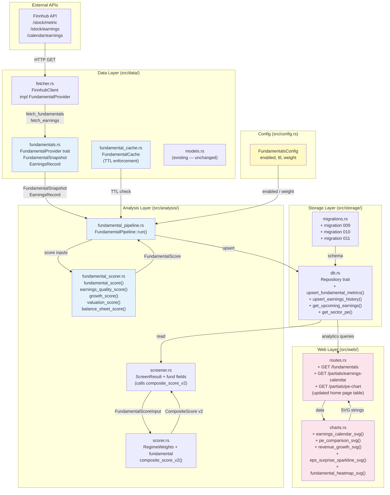
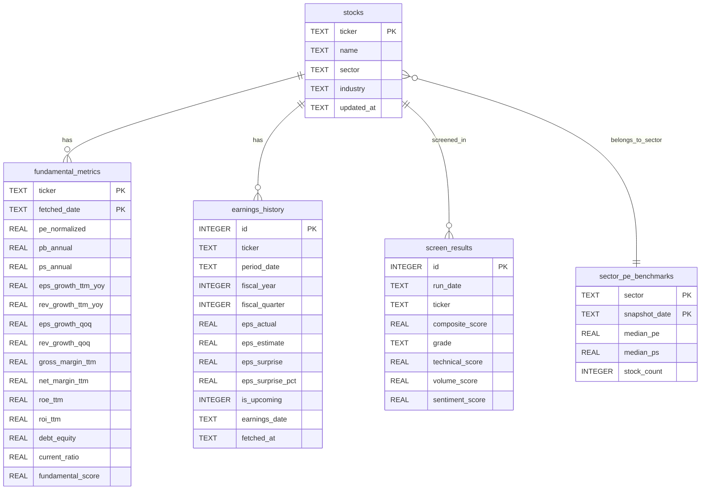
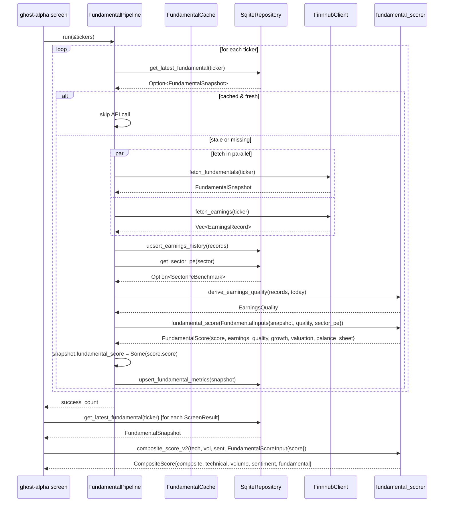
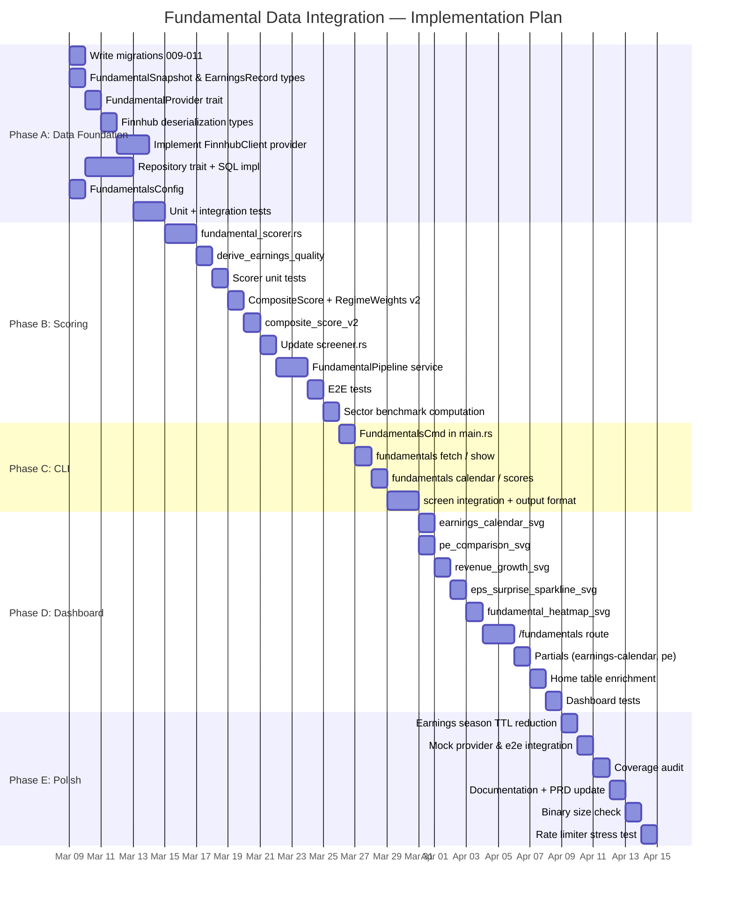
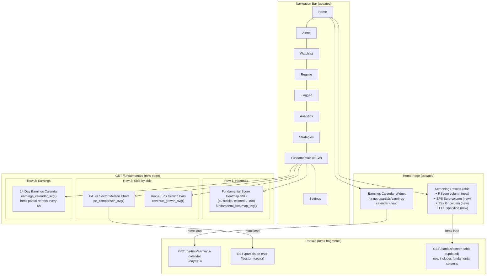
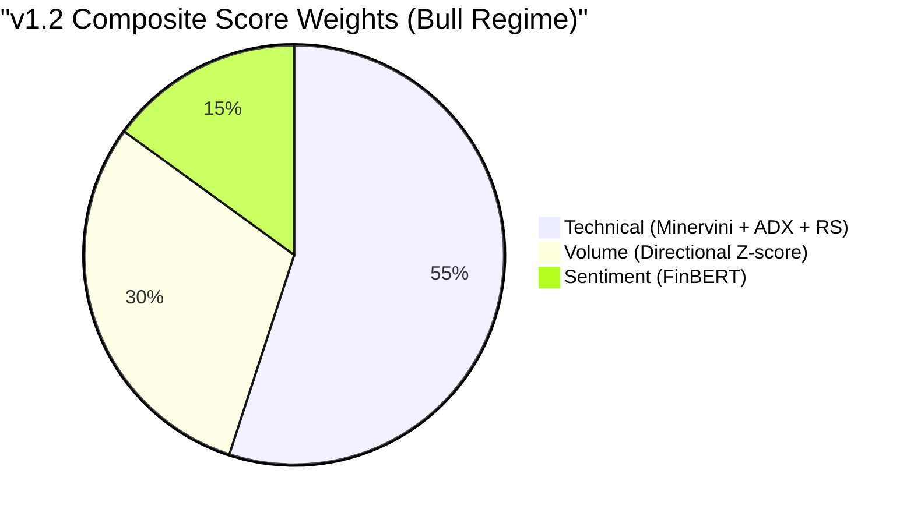
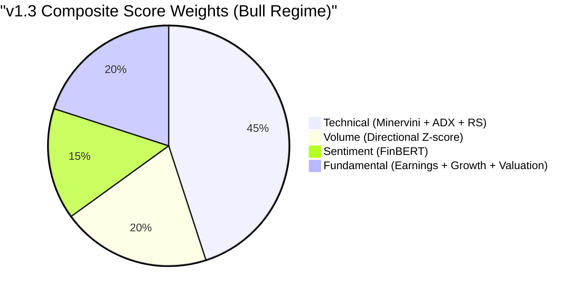

# Plan 14 — Fundamental Data Integration

**Effort:** Large (4-6 weeks)
**Impact:** Very High
**Priority:** 1 (next major feature)
**Status:** Complete (all phases A-E delivered)

---

## Table of Contents

1. [Executive Summary](#1-executive-summary)
2. [Data Sources](#2-data-sources)
3. [Data Model](#3-data-model)
4. [Rust Module Design](#4-rust-module-design)
5. [Scoring Integration](#5-scoring-integration)
6. [Dashboard Visualizations](#6-dashboard-visualizations)
7. [Migration Strategy](#7-migration-strategy)
8. [TDD Strategy](#8-tdd-strategy)
9. [Implementation Phases](#9-implementation-phases)
10. [Mermaid Diagrams](#10-mermaid-diagrams)

---

## 1. Executive Summary

Ghost Alpha v1.2 surfaces opportunities through a three-signal composite score: technical trend quality (Minervini conditions, ADX, RS percentile), volume pressure (directional Z-score), and news sentiment (FinBERT). This combination catches stocks already in motion but is blind to *why* they are moving and whether the business can sustain the price trend.

Fundamental data integration addresses this blind spot by adding a fourth score dimension — **earnings quality** — that filters out momentum traps and rewards durable growers. A technically perfect setup on a company with deteriorating earnings is a trap; a company beating estimates on accelerating revenue with expanding margins deserves higher conviction.

### What changes

| Dimension | Before | After |
|-----------|--------|-------|
| Score components | Technical 55%, Volume 30%, Sentiment 15% | Technical 45%, Volume 25%, Sentiment 10%, Fundamental 20% |
| Signal count | 3 inputs | 4 inputs |
| False-positive filter | Volume confirmation only | Earnings quality gate |
| Data sources | Finnhub candles + news | + Finnhub financials + earnings calendar + surprises |
| Dashboard | Score + regime charts | + Earnings calendar, P/E comparison, revenue growth, estimate revision charts |
| Alert enrichment | Score, RS, vol-Z, sentiment | + EPS surprise%, revenue growth rate, P/E vs sector median |

### What stays the same

- Single binary, zero new runtime dependencies (all HTTP, all Serde)
- SQLite storage with the same `spawn_blocking` pattern
- Existing `DataProvider` trait extended, not replaced
- All existing `ScreenResult` fields preserved; new fields are additive
- Regime-adaptive weight system extended to a 4-component model
- All existing tests continue to pass unmodified

### Why now

The Minervini screener catches stocks breaking out of consolidation. Historically, the highest-quality breakouts occur when earnings estimates are rising (analysts upgrading) and recent quarters show accelerating EPS. Without this filter, the system generates alerts on stocks whose price action is technically sound but whose business fundamentals are degrading — the highest-risk setup class for false positives.

---

## 2. Data Sources

### 2.1 Finnhub Free-Tier Endpoints

The Finnhub API key is already wired into `FinnhubClient`. The free tier provides all required fundamental endpoints.

| Endpoint | Data Returned | Rate Cost | Cache TTL |
|----------|--------------|-----------|-----------|
| `GET /stock/metric?symbol={ticker}&metric=all` | 60+ financial ratios: P/E, P/S, P/B, EPS TTM, revenue TTM, margins, growth rates, debt ratios | 1 req/symbol | 24 hours |
| `GET /stock/earnings?symbol={ticker}` | Quarterly EPS: actual, estimate, surprise%, period date | 1 req/symbol | 24 hours |
| `GET /calendar/earnings?from={date}&to={date}` | Upcoming earnings dates for all symbols in a date range | 1 req/call | 6 hours |
| `GET /stock/revenue-breakdown?symbol={ticker}` | Revenue by segment (optional, higher tier) | 1 req/symbol | 7 days |

**Rate budget analysis:** The free tier allows 60 req/min. A 500-stock universe requires 1,000 fundamental requests (metrics + earnings per ticker). At the current 60 RPM governor this takes ~17 minutes — acceptable for a once-daily background fetch that runs independently of the screening pipeline.

### 2.2 Finnhub Metric Response Shape

The `/stock/metric?metric=all` response contains a `metric` object with dozens of fields. The fields relevant to this plan:

```
peNormalizedAnnual        — normalized trailing P/E
pbAnnual                  — price-to-book
psAnnual                  — price-to-sales
epsGrowthTTMYoy           — EPS growth (TTM over prior TTM)
revenueGrowthTTMYoy       — revenue growth (TTM over prior TTM)
revenueGrowthQuarterlyYoy — quarterly revenue growth YoY
epsGrowthQuarterlyYoy     — quarterly EPS growth YoY
grossMarginTTM            — gross margin (TTM)
netMarginTTM              — net margin (TTM)
roeTTM                    — return on equity (TTM)
roiTTM                    — return on investment (TTM)
debtEquityAnnual          — debt-to-equity ratio
currentRatioAnnual        — current ratio
52WeekHigh                — (duplicate of candle-derived; useful for cross-check)
```

### 2.3 Finnhub Earnings Response Shape

The `/stock/earnings` endpoint returns an array of quarterly objects:

```json
[
  {
    "actual": 2.18,
    "estimate": 2.10,
    "period": "2024-12-31",
    "quarter": 4,
    "surprise": 0.08,
    "surprisePercent": 3.81,
    "symbol": "AAPL",
    "year": 2024
  }
]
```

### 2.4 Free Alternatives

| Source | Approach | Limitation vs Finnhub |
|--------|----------|----------------------|
| **Yahoo Finance** (via existing `yahoo.rs`) | Scrape `summaryDetail` and `earnings` JSON modules from the `query2.finance.yahoo.com` endpoint | Unofficial API, no SLA, may break |
| **Alpha Vantage** (free tier) | `INCOME_STATEMENT`, `EARNINGS` functions | 25 req/day on free tier — too low for 500-stock universe |
| **SEC EDGAR XBRL** | Parse quarterly 10-Q/10-K filings | Significant parsing complexity; 1-2 quarter lag |
| **Polygon.io** (free tier) | `/vX/reference/financials` | 5 API calls/min on free — too restrictive |

**Decision:** Use Finnhub as the primary source (already integrated). Add Yahoo Finance as a fallback provider via the existing `PluginsConfig.active_provider` toggle. The `FundamentalProvider` trait (section 4.2) abstracts the source, making it swappable.

### 2.5 Data Freshness Requirements

| Metric Category | Required Freshness | Rationale |
|----------------|-------------------|-----------|
| Quarterly EPS actuals | Once per quarter | Published after earnings release |
| EPS estimates | Daily during earnings season, weekly otherwise | Analysts revise estimates frequently |
| Financial ratios (P/E, P/S, margins) | Daily | Price-dependent ratios change with stock price |
| Upcoming earnings dates | Daily in 2-week window, weekly otherwise | Date can shift |
| Revenue growth rates | Once per quarter | Derived from reported financials |

---

## 3. Data Model

### 3.1 New SQLite Tables

Three new tables are added via migrations 009, 010, and 011.

#### Table: `fundamental_metrics`

Stores the latest snapshot of ratio-based metrics per ticker, refreshed daily.

```sql
-- migrations/009_fundamental_metrics.sql

CREATE TABLE IF NOT EXISTS fundamental_metrics (
    ticker               TEXT NOT NULL,
    fetched_date         TEXT NOT NULL,   -- YYYY-MM-DD of fetch
    -- Valuation
    pe_normalized        REAL,            -- normalized trailing P/E (NULL if negative earnings)
    pb_annual            REAL,            -- price-to-book
    ps_annual            REAL,            -- price-to-sales
    -- Growth (TTM YoY)
    eps_growth_ttm_yoy   REAL,            -- EPS growth, TTM vs prior TTM (as decimal, e.g. 0.25 = 25%)
    rev_growth_ttm_yoy   REAL,            -- revenue growth, TTM vs prior TTM
    -- Growth (quarterly YoY — most recent quarter)
    eps_growth_qoq       REAL,            -- EPS growth, most recent Q vs same Q prior year
    rev_growth_qoq       REAL,            -- revenue growth, most recent Q vs same Q prior year
    -- Profitability
    gross_margin_ttm     REAL,            -- gross margin (TTM)
    net_margin_ttm       REAL,            -- net margin (TTM)
    roe_ttm              REAL,            -- return on equity (TTM)
    roi_ttm              REAL,            -- return on investment (TTM)
    -- Balance sheet quality
    debt_equity          REAL,            -- debt-to-equity ratio
    current_ratio        REAL,            -- current ratio
    -- Computed at fetch time
    fundamental_score    REAL,            -- 0-100 composite fundamental score (see section 5)
    PRIMARY KEY (ticker, fetched_date)
);

CREATE INDEX IF NOT EXISTS idx_fundamental_metrics_ticker
    ON fundamental_metrics(ticker, fetched_date DESC);

INSERT OR IGNORE INTO schema_version (version) VALUES (9);
```

#### Table: `earnings_history`

Stores up to 8 quarters of actual earnings per ticker, with surprise data.

```sql
-- migrations/010_earnings_history.sql

CREATE TABLE IF NOT EXISTS earnings_history (
    id               INTEGER PRIMARY KEY AUTOINCREMENT,
    ticker           TEXT NOT NULL,
    period_date      TEXT NOT NULL,   -- YYYY-MM-DD (fiscal quarter end)
    fiscal_year      INTEGER NOT NULL,
    fiscal_quarter   INTEGER NOT NULL CHECK(fiscal_quarter IN (1, 2, 3, 4)),
    eps_actual       REAL,            -- reported EPS (NULL if not yet released)
    eps_estimate     REAL,            -- consensus estimate at time of reporting
    eps_surprise     REAL,            -- actual - estimate (positive = beat)
    eps_surprise_pct REAL,            -- (actual - estimate) / |estimate| * 100
    is_upcoming      INTEGER NOT NULL DEFAULT 0 CHECK(is_upcoming IN (0, 1)),
    earnings_date    TEXT,            -- YYYY-MM-DD of announcement (may be future)
    fetched_at       TEXT NOT NULL DEFAULT (datetime('now')),
    UNIQUE (ticker, period_date)
);

CREATE INDEX IF NOT EXISTS idx_earnings_ticker_period
    ON earnings_history(ticker, period_date DESC);
CREATE INDEX IF NOT EXISTS idx_earnings_upcoming
    ON earnings_history(earnings_date, is_upcoming)
    WHERE is_upcoming = 1;

INSERT OR IGNORE INTO schema_version (version) VALUES (10);
```

#### Table: `sector_pe_benchmarks`

Stores median P/E and P/S by sector, refreshed weekly, to enable relative valuation scoring.

```sql
-- migrations/011_sector_pe_benchmarks.sql

CREATE TABLE IF NOT EXISTS sector_pe_benchmarks (
    sector           TEXT NOT NULL,
    snapshot_date    TEXT NOT NULL,   -- YYYY-MM-DD
    median_pe        REAL,
    median_ps        REAL,
    stock_count      INTEGER NOT NULL DEFAULT 0,
    PRIMARY KEY (sector, snapshot_date)
);

CREATE INDEX IF NOT EXISTS idx_sector_pe_date
    ON sector_pe_benchmarks(snapshot_date DESC);

INSERT OR IGNORE INTO schema_version (version) VALUES (11);
```

### 3.2 Schema Evolution Summary

| Migration | Version | Tables Added | Backward Compatible |
|-----------|---------|-------------|---------------------|
| 009_fundamental_metrics | 9 | `fundamental_metrics` | Yes — additive |
| 010_earnings_history | 10 | `earnings_history` | Yes — additive |
| 011_sector_pe_benchmarks | 11 | `sector_pe_benchmarks` | Yes — additive |

No existing tables are modified. All new columns on existing tables would use `ALTER TABLE ... ADD COLUMN ... DEFAULT NULL`, but none are required here — the fundamental score is joined, not embedded in `screen_results`.

### 3.3 Updated `ScreenResult` Struct

The `ScreenResult` struct in `src/analysis/screener.rs` gains optional fundamental fields:

```rust
#[derive(Debug, Clone, serde::Serialize)]
pub struct ScreenResult {
    // ── existing fields (unchanged) ─────────────────────────────────────────
    pub ticker: String,
    pub minervini_pass: bool,
    pub conditions_met: u8,
    pub adx: f64,
    pub rs_percentile: f64,
    pub volume_zscore: f64,
    pub technical_score: f64,
    pub volume_score: f64,
    pub sentiment_score: f64,
    pub composite_score: f64,
    pub grade: Grade,
    pub close_price: f64,
    pub pct_from_52w_high: f64,
    pub atr_value: f64,
    pub risk_reward: f64,
    pub liquidity: LiquidityClass,
    pub weighted_rs: f64,
    pub rs_momentum: Option<f64>,
    pub vcp: Option<VcpResult>,
    pub regime: MarketRegime,
    // ── new fundamental fields ───────────────────────────────────────────────
    /// Fundamental sub-score (0.0–100.0). None if fundamentals were not fetched.
    pub fundamental_score: Option<f64>,
    /// Trailing P/E. None if negative earnings or data unavailable.
    pub pe_normalized: Option<f64>,
    /// EPS growth (TTM YoY, as a decimal fraction). None if unavailable.
    pub eps_growth_ttm_yoy: Option<f64>,
    /// Revenue growth (TTM YoY, as a decimal fraction). None if unavailable.
    pub rev_growth_ttm_yoy: Option<f64>,
    /// Most recent quarter EPS surprise percentage.
    pub eps_surprise_pct: Option<f64>,
    /// Number of consecutive quarters of EPS beats (0 if last quarter missed).
    pub consecutive_beats: u8,
}
```

All new fields are `Option<T>` or have a zero default, so existing code constructing `ScreenResult` continues to compile by adding `..Default::default()` or explicit `None`/`0` values.

---

## 4. Rust Module Design

### 4.1 New Module: `src/data/fundamentals.rs`

This module owns all fundamental data fetch logic. It sits alongside `fetcher.rs` within the `data/` layer.

```rust
//! Fundamental data fetching — financial metrics and earnings history.
//!
//! Implements the `FundamentalProvider` trait for `FinnhubClient`.
//! All fetched data is cached in SQLite via `FundamentalRepository`.

use async_trait::async_trait;
use chrono::NaiveDate;
use serde::Deserialize;
use crate::error::DataError;

// ─── Domain Types ─────────────────────────────────────────────────────────────

/// Point-in-time snapshot of financial ratios for a single ticker.
#[derive(Debug, Clone, serde::Serialize, serde::Deserialize)]
pub struct FundamentalSnapshot {
    pub ticker: String,
    pub fetched_date: NaiveDate,
    // Valuation
    pub pe_normalized: Option<f64>,
    pub pb_annual: Option<f64>,
    pub ps_annual: Option<f64>,
    // Growth
    pub eps_growth_ttm_yoy: Option<f64>,
    pub rev_growth_ttm_yoy: Option<f64>,
    pub eps_growth_qoq: Option<f64>,
    pub rev_growth_qoq: Option<f64>,
    // Profitability
    pub gross_margin_ttm: Option<f64>,
    pub net_margin_ttm: Option<f64>,
    pub roe_ttm: Option<f64>,
    pub roi_ttm: Option<f64>,
    // Balance sheet
    pub debt_equity: Option<f64>,
    pub current_ratio: Option<f64>,
    // Computed
    pub fundamental_score: Option<f64>,
}

/// Single-quarter earnings record.
#[derive(Debug, Clone, serde::Serialize, serde::Deserialize)]
pub struct EarningsRecord {
    pub ticker: String,
    pub period_date: NaiveDate,
    pub fiscal_year: i32,
    pub fiscal_quarter: u8,
    pub eps_actual: Option<f64>,
    pub eps_estimate: Option<f64>,
    pub eps_surprise: Option<f64>,
    pub eps_surprise_pct: Option<f64>,
    pub is_upcoming: bool,
    pub earnings_date: Option<NaiveDate>,
}

/// Summary of recent earnings quality for scoring.
#[derive(Debug, Clone, Default)]
pub struct EarningsQuality {
    /// Most recent quarter's EPS surprise percentage.
    pub latest_surprise_pct: Option<f64>,
    /// Number of consecutive EPS beats (0 if last quarter missed).
    pub consecutive_beats: u8,
    /// Average EPS surprise percentage over last 4 quarters.
    pub avg_surprise_pct_4q: Option<f64>,
    /// EPS growth, most recent Q vs same Q prior year.
    pub eps_growth_yoy: Option<f64>,
    /// Revenue growth, most recent Q vs same Q prior year.
    pub rev_growth_yoy: Option<f64>,
    /// Days until next earnings announcement (None if no upcoming date found).
    pub days_to_next_earnings: Option<i64>,
}

// ─── Trait ────────────────────────────────────────────────────────────────────

/// Extension trait for fundamental data access.
/// Kept separate from `DataProvider` to avoid forcing all providers to implement it.
#[async_trait]
pub trait FundamentalProvider: Send + Sync {
    /// Fetch financial ratios for a single ticker.
    async fn fetch_fundamentals(&self, ticker: &str) -> Result<FundamentalSnapshot, DataError>;

    /// Fetch earnings history (last 8 quarters) for a single ticker.
    async fn fetch_earnings(&self, ticker: &str) -> Result<Vec<EarningsRecord>, DataError>, ;

    /// Fetch upcoming earnings dates for a date range (all symbols).
    async fn fetch_earnings_calendar(
        &self,
        from: NaiveDate,
        to: NaiveDate,
    ) -> Result<Vec<EarningsRecord>, DataError>;
}

// ─── Finnhub Deserialization Types ───────────────────────────────────────────

#[derive(Debug, Deserialize)]
struct FinnhubMetricResponse {
    metric: FinnhubMetricFields,
}

#[derive(Debug, Deserialize)]
#[serde(rename_all = "camelCase")]
struct FinnhubMetricFields {
    #[serde(rename = "peNormalizedAnnual")]
    pe_normalized_annual: Option<f64>,
    #[serde(rename = "pbAnnual")]
    pb_annual: Option<f64>,
    #[serde(rename = "psAnnual")]
    ps_annual: Option<f64>,
    #[serde(rename = "epsGrowthTTMYoy")]
    eps_growth_ttm_yoy: Option<f64>,
    #[serde(rename = "revenueGrowthTTMYoy")]
    revenue_growth_ttm_yoy: Option<f64>,
    #[serde(rename = "epsGrowthQuarterlyYoy")]
    eps_growth_quarterly_yoy: Option<f64>,
    #[serde(rename = "revenueGrowthQuarterlyYoy")]
    revenue_growth_quarterly_yoy: Option<f64>,
    #[serde(rename = "grossMarginTTM")]
    gross_margin_ttm: Option<f64>,
    #[serde(rename = "netMarginTTM")]
    net_margin_ttm: Option<f64>,
    #[serde(rename = "roeTTM")]
    roe_ttm: Option<f64>,
    #[serde(rename = "roiTTM")]
    roi_ttm: Option<f64>,
    #[serde(rename = "debtEquityAnnual")]
    debt_equity_annual: Option<f64>,
    #[serde(rename = "currentRatioAnnual")]
    current_ratio_annual: Option<f64>,
}

#[derive(Debug, Deserialize)]
struct FinnhubEarningsResponse {
    #[serde(rename = "earningsCalendar")]
    earnings_calendar: Vec<FinnhubEarningsItem>,
}

#[derive(Debug, Deserialize)]
struct FinnhubEarningsItem {
    #[serde(default)]
    actual: Option<f64>,
    #[serde(default)]
    estimate: Option<f64>,
    #[serde(default)]
    period: String,
    #[serde(default)]
    quarter: u8,
    #[serde(default, rename = "surprisePercent")]
    surprise_percent: Option<f64>,
    #[serde(default)]
    symbol: String,
    #[serde(default)]
    year: i32,
    #[serde(default)]
    date: Option<String>,
}
```

Note the `Result<Vec<EarningsRecord>, DataError>` has a typo in the plan above (trailing comma). In implementation, remove the extra comma. It is shown here to illustrate the signature.

### 4.2 Implementation on `FinnhubClient`

Add `impl FundamentalProvider for FinnhubClient` in a new block at the bottom of `src/data/fetcher.rs` (or in a separate `impl` block in `fundamentals.rs` using `use crate::data::fetcher::FinnhubClient`):

```rust
#[async_trait]
impl FundamentalProvider for FinnhubClient {
    async fn fetch_fundamentals(&self, ticker: &str) -> Result<FundamentalSnapshot, DataError> {
        let url = format!(
            "{}/stock/metric?symbol={}&metric=all&token={}",
            self.base_url, ticker, self.api_key
        );
        let body = self.get_with_retry(&url).await?;
        let resp: FinnhubMetricResponse =
            serde_json::from_str(&body).map_err(|e| DataError::Parse(e.to_string()))?;
        let m = resp.metric;
        Ok(FundamentalSnapshot {
            ticker: ticker.to_string(),
            fetched_date: chrono::Utc::now().date_naive(),
            pe_normalized: m.pe_normalized_annual,
            pb_annual: m.pb_annual,
            ps_annual: m.ps_annual,
            eps_growth_ttm_yoy: m.eps_growth_ttm_yoy,
            rev_growth_ttm_yoy: m.revenue_growth_ttm_yoy,
            eps_growth_qoq: m.eps_growth_quarterly_yoy,
            rev_growth_qoq: m.revenue_growth_quarterly_yoy,
            gross_margin_ttm: m.gross_margin_ttm,
            net_margin_ttm: m.net_margin_ttm,
            roe_ttm: m.roe_ttm,
            roi_ttm: m.roi_ttm,
            debt_equity: m.debt_equity_annual,
            current_ratio: m.current_ratio_annual,
            fundamental_score: None, // computed in scorer
        })
    }

    async fn fetch_earnings(&self, ticker: &str) -> Result<Vec<EarningsRecord>, DataError> {
        let url = format!(
            "{}/stock/earnings?symbol={}&token={}",
            self.base_url, ticker, self.api_key
        );
        let body = self.get_with_retry(&url).await?;
        let items: Vec<FinnhubEarningsItem> =
            serde_json::from_str(&body).map_err(|e| DataError::Parse(e.to_string()))?;
        Ok(items
            .into_iter()
            .filter_map(|item| {
                let period = NaiveDate::parse_from_str(&item.period, "%Y-%m-%d").ok()?;
                let surprise = item.actual.zip(item.estimate).map(|(a, e)| a - e);
                Some(EarningsRecord {
                    ticker: item.symbol.clone(),
                    period_date: period,
                    fiscal_year: item.year,
                    fiscal_quarter: item.quarter,
                    eps_actual: item.actual,
                    eps_estimate: item.estimate,
                    eps_surprise: surprise,
                    eps_surprise_pct: item.surprise_percent,
                    is_upcoming: false,
                    earnings_date: None,
                })
            })
            .collect())
    }

    async fn fetch_earnings_calendar(
        &self,
        from: NaiveDate,
        to: NaiveDate,
    ) -> Result<Vec<EarningsRecord>, DataError> {
        let url = format!(
            "{}/calendar/earnings?from={}&to={}&token={}",
            self.base_url, from, to, self.api_key
        );
        let body = self.get_with_retry(&url).await?;
        let resp: FinnhubEarningsResponse =
            serde_json::from_str(&body).map_err(|e| DataError::Parse(e.to_string()))?;
        Ok(resp
            .earnings_calendar
            .into_iter()
            .filter_map(|item| {
                let period = NaiveDate::parse_from_str(&item.period, "%Y-%m-%d").ok()?;
                let earnings_date = item
                    .date
                    .as_deref()
                    .and_then(|d| NaiveDate::parse_from_str(d, "%Y-%m-%d").ok());
                Some(EarningsRecord {
                    ticker: item.symbol,
                    period_date: period,
                    fiscal_year: item.year,
                    fiscal_quarter: item.quarter,
                    eps_actual: item.actual,
                    eps_estimate: item.estimate,
                    eps_surprise: None,
                    eps_surprise_pct: None,
                    is_upcoming: true,
                    earnings_date,
                })
            })
            .collect())
    }
}
```

### 4.3 New Module: `src/analysis/fundamental_scorer.rs`

This module owns the fundamental sub-score computation. It mirrors the design of `scorer.rs` — pure functions, no I/O, fully unit-testable.

```rust
//! Fundamental sub-score computation.
//!
//! Produces a 0–100 `FundamentalScore` from a `FundamentalSnapshot` and
//! `EarningsQuality`. The score is composed of four pillars:
//!
//! | Pillar            | Max pts | Weight rationale                         |
//! |-------------------|---------|------------------------------------------|
//! | Earnings quality  | 40      | Beat consistency is the top predictor    |
//! | Growth rate       | 30      | Revenue + EPS acceleration               |
//! | Valuation         | 20      | Relative P/E vs sector median            |
//! | Balance sheet     | 10      | Debt safety; not penalized for growth co |

use crate::data::fundamentals::{EarningsQuality, FundamentalSnapshot};

#[derive(Debug, Clone)]
pub struct FundamentalInputs {
    pub snapshot: FundamentalSnapshot,
    pub quality: EarningsQuality,
    /// Sector median P/E (None if sector data unavailable; score falls back to absolute P/E heuristic).
    pub sector_median_pe: Option<f64>,
}

#[derive(Debug, Clone)]
pub struct FundamentalScore {
    /// Total fundamental sub-score in [0, 100].
    pub score: f64,
    /// Earnings quality pillar: [0, 40].
    pub earnings_quality: f64,
    /// Growth rate pillar: [0, 30].
    pub growth: f64,
    /// Valuation pillar: [0, 20].
    pub valuation: f64,
    /// Balance sheet pillar: [0, 10].
    pub balance_sheet: f64,
}

/// Compute the fundamental sub-score.
pub fn fundamental_score(inputs: &FundamentalInputs) -> FundamentalScore {
    let earnings_quality = earnings_quality_score(&inputs.quality);
    let growth = growth_score(&inputs.snapshot);
    let valuation = valuation_score(&inputs.snapshot, inputs.sector_median_pe);
    let balance_sheet = balance_sheet_score(&inputs.snapshot);
    let score = (earnings_quality + growth + valuation + balance_sheet).clamp(0.0, 100.0);
    FundamentalScore { score, earnings_quality, growth, valuation, balance_sheet }
}

/// Earnings quality pillar: 0–40 points.
///
/// - Consecutive beats (0-4+ quarters): up to 20 pts
/// - Latest EPS surprise magnitude: up to 12 pts
/// - Average 4Q surprise pct: up to 8 pts
pub fn earnings_quality_score(q: &EarningsQuality) -> f64 {
    // Consecutive beats: 5 pts per quarter, max 4 quarters = 20 pts
    let beat_pts = (q.consecutive_beats.min(4) as f64) * 5.0;

    // Latest surprise: surprise_pct > 10% → 12 pts, linear from 0–10%
    let surprise_pts = q.latest_surprise_pct.map_or(0.0, |pct| {
        if pct >= 10.0 { 12.0 } else if pct > 0.0 { (pct / 10.0) * 12.0 } else { 0.0 }
    });

    // Average 4Q surprise: > 5% avg → 8 pts
    let avg_pts = q.avg_surprise_pct_4q.map_or(4.0, |avg| {
        // Default to neutral (4.0) if no data; reward positive average
        if avg >= 5.0 { 8.0 } else if avg > 0.0 { 4.0 + (avg / 5.0) * 4.0 } else { (avg.max(-5.0) + 5.0) / 10.0 * 4.0 }
    });

    (beat_pts + surprise_pts + avg_pts).clamp(0.0, 40.0)
}

/// Growth rate pillar: 0–30 points.
///
/// - Revenue growth YoY (quarterly): up to 15 pts
/// - EPS growth YoY (quarterly): up to 15 pts
/// Acceleration (QoQ improving) gets full points; deceleration is penalized.
pub fn growth_score(snap: &FundamentalSnapshot) -> f64 {
    let rev_pts = growth_pts(snap.rev_growth_qoq, 15.0);
    let eps_pts = growth_pts(snap.eps_growth_qoq, 15.0);
    (rev_pts + eps_pts).clamp(0.0, 30.0)
}

/// Map a growth rate (as decimal fraction) to `max_pts`.
/// - Growth >= 30% → full points
/// - Growth 0–30% → linear
/// - Growth < 0% → 0 pts (no partial credit for declining businesses)
/// - None → half points (neutral / data unavailable)
fn growth_pts(growth: Option<f64>, max: f64) -> f64 {
    match growth {
        None => max * 0.5,
        Some(g) if g >= 0.30 => max,
        Some(g) if g > 0.0 => (g / 0.30) * max,
        Some(_) => 0.0,
    }
}

/// Valuation pillar: 0–20 points.
///
/// Scores relative P/E vs sector median:
/// - P/E below sector median → full 20 pts (cheap relative to peers)
/// - P/E 1–1.5x sector median → 15 pts (fair value)
/// - P/E 1.5–2x sector median → 8 pts (premium)
/// - P/E > 2x sector median → 2 pts (expensive; still small reward to avoid penalizing growth cos)
/// Falls back to absolute P/E thresholds if no sector data.
pub fn valuation_score(snap: &FundamentalSnapshot, sector_median_pe: Option<f64>) -> f64 {
    let pe = match snap.pe_normalized {
        Some(pe) if pe > 0.0 => pe,
        _ => return 10.0, // neutral if negative earnings or no data
    };

    if let Some(median) = sector_median_pe {
        if median > 0.0 {
            let ratio = pe / median;
            return if ratio <= 1.0 { 20.0 }
                   else if ratio <= 1.5 { 15.0 }
                   else if ratio <= 2.0 { 8.0 }
                   else { 2.0 };
        }
    }

    // Absolute fallback (no sector data)
    if pe <= 15.0 { 20.0 }
    else if pe <= 25.0 { 15.0 }
    else if pe <= 40.0 { 8.0 }
    else { 2.0 }
}

/// Balance sheet pillar: 0–10 points.
///
/// - Current ratio >= 1.5 → 5 pts (adequate liquidity)
/// - Debt/equity <= 0.5 → 5 pts (conservative leverage)
pub fn balance_sheet_score(snap: &FundamentalSnapshot) -> f64 {
    let cr_pts = snap.current_ratio.map_or(2.5, |cr| {
        if cr >= 1.5 { 5.0 } else if cr >= 1.0 { 3.0 } else { 0.0 }
    });
    let de_pts = snap.debt_equity.map_or(2.5, |de| {
        if de <= 0.5 { 5.0 } else if de <= 1.0 { 3.0 } else if de <= 2.0 { 1.0 } else { 0.0 }
    });
    (cr_pts + de_pts).clamp(0.0, 10.0)
}

/// Derive `EarningsQuality` from a sorted-descending slice of `EarningsRecord`.
/// Records should be sorted by `period_date` descending (most recent first).
pub fn derive_earnings_quality(
    records: &[crate::data::fundamentals::EarningsRecord],
    today: chrono::NaiveDate,
) -> EarningsQuality {
    let past: Vec<_> = records.iter().filter(|r| !r.is_upcoming).collect();

    let latest_surprise_pct = past.first().and_then(|r| r.eps_surprise_pct);

    let consecutive_beats = past
        .iter()
        .take(8)
        .take_while(|r| r.eps_surprise_pct.map_or(false, |s| s > 0.0))
        .count() as u8;

    let surprise_values: Vec<f64> = past
        .iter()
        .take(4)
        .filter_map(|r| r.eps_surprise_pct)
        .collect();
    let avg_surprise_pct_4q = if surprise_values.is_empty() {
        None
    } else {
        Some(surprise_values.iter().sum::<f64>() / surprise_values.len() as f64)
    };

    // EPS and revenue growth from latest actual record
    let eps_growth_yoy = past.first().and_then(|r| r.eps_surprise_pct); // placeholder — requires prior year data
    let rev_growth_yoy = None; // populated from FundamentalSnapshot

    let days_to_next_earnings = records
        .iter()
        .filter(|r| r.is_upcoming)
        .filter_map(|r| r.earnings_date)
        .filter(|&d| d >= today)
        .min()
        .map(|d| (d - today).num_days());

    EarningsQuality {
        latest_surprise_pct,
        consecutive_beats,
        avg_surprise_pct_4q,
        eps_growth_yoy,
        rev_growth_yoy,
        days_to_next_earnings,
    }
}
```

### 4.4 New Module: `src/data/fundamental_cache.rs`

Manages the SQLite-backed cache to avoid redundant API calls:

```rust
//! SQLite cache for fundamental data.
//!
//! `FundamentalCache` wraps a `Repository` and enforces TTL-based
//! cache invalidation:
//! - `fundamental_metrics`: stale after `metrics_ttl_hours` (default 24h)
//! - `earnings_history`: stale after `earnings_ttl_hours` (default 24h)
//!   Reduced to 6h during earnings season (within 7 days of any earnings date).

pub struct FundamentalCache {
    pub metrics_ttl_hours: i64,
    pub earnings_ttl_hours: i64,
}

impl FundamentalCache {
    pub fn default_ttl() -> Self {
        Self { metrics_ttl_hours: 24, earnings_ttl_hours: 24 }
    }

    /// Returns true if the cached snapshot is still fresh.
    pub fn metrics_is_fresh(
        &self,
        fetched_date: chrono::NaiveDate,
        now: chrono::NaiveDate,
    ) -> bool {
        let hours_old = (now - fetched_date).num_hours();
        hours_old < self.metrics_ttl_hours
    }
}
```

### 4.5 Repository Trait Extensions

Add new methods to the `Repository` trait in `src/storage/db.rs`:

```rust
// ── Fundamental data ─────────────────────────────────────────────────────────

/// Store a fundamental snapshot (upsert by ticker + fetched_date).
fn upsert_fundamental_metrics(
    &self,
    snapshot: &FundamentalSnapshot,
) -> Result<(), StorageError>;

/// Retrieve the most recent fundamental snapshot for a ticker.
fn get_latest_fundamental(
    &self,
    ticker: &str,
) -> Result<Option<FundamentalSnapshot>, StorageError>;

/// Retrieve fundamental snapshots for all tickers on a given date (for batch scoring).
fn get_fundamentals_for_date(
    &self,
    date: NaiveDate,
) -> Result<Vec<FundamentalSnapshot>, StorageError>;

/// Upsert earnings records (batch).
fn upsert_earnings_history(
    &self,
    records: &[EarningsRecord],
) -> Result<usize, StorageError>;

/// Retrieve earnings history for a ticker, sorted descending by period_date.
fn get_earnings_history(
    &self,
    ticker: &str,
    limit: usize,
) -> Result<Vec<EarningsRecord>, StorageError>;

/// Retrieve upcoming earnings in the next `days` days (for calendar widget).
fn get_upcoming_earnings(
    &self,
    days: i64,
) -> Result<Vec<EarningsRecord>, StorageError>;

/// Upsert sector P/E benchmarks.
fn upsert_sector_pe_benchmarks(
    &self,
    snapshots: &[SectorPeBenchmark],
) -> Result<(), StorageError>;

/// Retrieve the most recent sector P/E for a given sector name.
fn get_sector_pe(
    &self,
    sector: &str,
) -> Result<Option<SectorPeBenchmark>, StorageError>;

// ── Fundamental analytics ────────────────────────────────────────────────────

/// Retrieve the top-N tickers by fundamental score for a given date.
fn get_top_fundamental_scores(
    &self,
    date: NaiveDate,
    limit: usize,
) -> Result<Vec<(String, f64)>, StorageError>;

/// Retrieve the fundamental score history for a ticker (for sparklines).
fn get_fundamental_score_history(
    &self,
    ticker: &str,
    since: NaiveDate,
) -> Result<Vec<(NaiveDate, f64)>, StorageError>;
```

### 4.6 New Service: `src/analysis/fundamental_pipeline.rs`

Orchestrates the fetch-score-persist cycle for an entire ticker universe:

```rust
//! Fundamental data pipeline.
//!
//! Fetches, scores, and persists fundamental data for a universe of tickers.
//! Designed to run once per day after market close, independently of the
//! technical screening pipeline.
//!
//! Usage:
//!   let pipeline = FundamentalPipeline::new(provider, repo, config);
//!   pipeline.run(&tickers).await?;

use std::sync::Arc;
use crate::data::fundamentals::FundamentalProvider;
use crate::storage::db::Repository;
use crate::analysis::fundamental_scorer::{derive_earnings_quality, fundamental_score};
use crate::config::FundamentalsConfig;

pub struct FundamentalPipeline {
    provider: Arc<dyn FundamentalProvider>,
    repo: Arc<dyn Repository>,
    config: FundamentalsConfig,
}

impl FundamentalPipeline {
    pub fn new(
        provider: Arc<dyn FundamentalProvider>,
        repo: Arc<dyn Repository>,
        config: FundamentalsConfig,
    ) -> Self {
        Self { provider, repo, config }
    }

    /// Run the full pipeline for all tickers.
    /// Returns the number of tickers successfully processed.
    pub async fn run(&self, tickers: &[String]) -> Result<usize, crate::error::AnalysisError> {
        let today = chrono::Utc::now().date_naive();
        let mut success_count = 0usize;

        for ticker in tickers {
            // Skip if cached data is still fresh
            if let Ok(Some(cached)) = self.repo.get_latest_fundamental(ticker) {
                if cached.fetched_date == today && !self.config.force_refresh {
                    success_count += 1;
                    continue;
                }
            }

            // Fetch metrics and earnings concurrently
            let (metrics_res, earnings_res) = tokio::join!(
                self.provider.fetch_fundamentals(ticker),
                self.provider.fetch_earnings(ticker),
            );

            match (metrics_res, earnings_res) {
                (Ok(mut snapshot), Ok(earnings)) => {
                    // Persist earnings
                    let _ = self.repo.upsert_earnings_history(&earnings);

                    // Derive earnings quality and compute score
                    let quality = derive_earnings_quality(&earnings, today);
                    let sector_pe = self.repo
                        .get_sector_pe(&snapshot.ticker) // uses stock.sector from stocks table
                        .ok()
                        .flatten()
                        .and_then(|b| b.median_pe);

                    let score = fundamental_score(&crate::analysis::fundamental_scorer::FundamentalInputs {
                        snapshot: snapshot.clone(),
                        quality,
                        sector_median_pe: sector_pe,
                    });

                    snapshot.fundamental_score = Some(score.score);
                    let _ = self.repo.upsert_fundamental_metrics(&snapshot);
                    success_count += 1;
                }
                _ => {
                    // Log warning but continue — fundamentals are optional
                    tracing::warn!("Failed to fetch fundamentals for {ticker}");
                }
            }
        }

        Ok(success_count)
    }
}
```

### 4.7 Configuration Addition

Add `FundamentalsConfig` to `src/config.rs` and `AppConfig`:

```rust
#[derive(Debug, Clone, Deserialize)]
pub struct FundamentalsConfig {
    /// Whether fundamental scoring is enabled (default: true when Finnhub key is set).
    #[serde(default = "FundamentalsConfig::default_enabled")]
    pub enabled: bool,
    /// Cache TTL for financial metrics in hours (default: 24).
    #[serde(default = "FundamentalsConfig::default_metrics_ttl")]
    pub metrics_ttl_hours: i64,
    /// Cache TTL for earnings data in hours (default: 24, reduced to 6 during earnings season).
    #[serde(default = "FundamentalsConfig::default_earnings_ttl")]
    pub earnings_ttl_hours: i64,
    /// Force-refresh cached data even if TTL not expired (default: false).
    #[serde(default)]
    pub force_refresh: bool,
    /// Maximum quarters of earnings history to fetch per ticker (default: 8).
    #[serde(default = "FundamentalsConfig::default_quarters")]
    pub history_quarters: usize,
    /// Weight of fundamental sub-score in composite (0.0–1.0, default: 0.20).
    #[serde(default = "FundamentalsConfig::default_weight")]
    pub score_weight: f64,
}

impl FundamentalsConfig {
    fn default_enabled() -> bool { true }
    fn default_metrics_ttl() -> i64 { 24 }
    fn default_earnings_ttl() -> i64 { 24 }
    fn default_quarters() -> usize { 8 }
    fn default_weight() -> f64 { 0.20 }
}

impl Default for FundamentalsConfig {
    fn default() -> Self {
        Self {
            enabled: Self::default_enabled(),
            metrics_ttl_hours: Self::default_metrics_ttl(),
            earnings_ttl_hours: Self::default_earnings_ttl(),
            force_refresh: false,
            history_quarters: Self::default_quarters(),
            score_weight: Self::default_weight(),
        }
    }
}
```

In `AppConfig`:
```rust
pub struct AppConfig {
    // ... existing fields ...
    #[serde(default)]
    pub fundamentals: FundamentalsConfig,
}
```

In `config.toml` (documented example):
```toml
[fundamentals]
enabled = true
metrics_ttl_hours = 24
score_weight = 0.20
```

### 4.8 Module Registration

Update `src/data/mod.rs`:
```rust
pub mod fundamentals;
pub mod fundamental_cache;
```

Update `src/analysis/mod.rs`:
```rust
pub mod fundamental_scorer;
pub mod fundamental_pipeline;
```

---

## 5. Scoring Integration

### 5.1 Weight Redistribution

The current composite score uses three components summing to 100. Adding a fourth requires redistributing weights. The fundamental component takes budget primarily from technical (most over-weighted) and volume:

| Component | v1.2 Weights | v1.3 Bull | v1.3 Sideways | v1.3 Bear |
|-----------|-------------|-----------|---------------|-----------|
| Technical | 55 | 45 | 45 | 55 |
| Volume | 30 | 20 | 20 | 15 |
| Sentiment | 15 | 15 | 15 | 15 |
| Fundamental | 0 | **20** | **20** | **15** |
| **Total** | **100** | **100** | **100** | **100** |

**Rationale by regime:**
- **Bull:** Reduce volume weight most (easy money environment inflates volume signals). Fundamental quality distinguishes leaders from laggards.
- **Sideways:** Same as bull; fundamentals anchor stock selection when momentum is weak.
- **Bear:** Reduce fundamental weight slightly (fundamentals lag price in downturns; technical quality — i.e., not breaking down — matters more). Volume reduced aggressively (low volume is normal in bear markets).

### 5.2 Updated `RegimeWeights`

Extend `RegimeWeights` in `src/analysis/scorer.rs`:

```rust
#[derive(Debug, Clone, PartialEq)]
pub struct RegimeWeights {
    pub technical: f64,
    pub volume: f64,
    pub sentiment: f64,
    pub fundamental: f64,  // NEW
}

impl RegimeWeights {
    pub fn for_regime(regime: &MarketRegime) -> Self {
        match regime {
            MarketRegime::Bull => Self {
                technical: 45.0, volume: 20.0, sentiment: 15.0, fundamental: 20.0
            },
            MarketRegime::Sideways => Self {
                technical: 45.0, volume: 20.0, sentiment: 15.0, fundamental: 20.0
            },
            MarketRegime::Bear => Self {
                technical: 55.0, volume: 15.0, sentiment: 15.0, fundamental: 15.0
            },
        }
    }

    pub fn sum(&self) -> f64 {
        self.technical + self.volume + self.sentiment + self.fundamental
    }

    /// Legacy 3-component weights (for backward compat with existing tests).
    pub fn legacy_bull() -> Self {
        Self { technical: 55.0, volume: 30.0, sentiment: 15.0, fundamental: 0.0 }
    }
}
```

### 5.3 Updated Composite Score Function

```rust
/// Inputs for the fundamental sub-score (new in v1.3).
#[derive(Debug, Clone)]
pub struct FundamentalScoreInput {
    /// Pre-computed fundamental score in [0, 100]. None = skip / not available.
    pub score: Option<f64>,
}

/// Compute a regime-adaptive composite score with optional fundamental component.
pub fn composite_score_v2(
    tech: &TechnicalInputs,
    vol: &VolumeInputs,
    sent: &SentimentInputs,
    fund: &FundamentalScoreInput,
    weights: &RegimeWeights,
) -> CompositeScore {
    let technical = technical_score_weighted(tech, weights.technical);
    let volume = volume_score_weighted(vol, weights.volume);
    let sentiment = sentiment_score_weighted(sent, weights.sentiment);

    // If fundamentals are disabled or unavailable, redistribute their weight
    // proportionally among technical + volume + sentiment.
    let (fundamental, effective_weights) = match fund.score {
        Some(fs) if weights.fundamental > 0.0 => {
            let fs_pts = (fs / 100.0 * weights.fundamental).clamp(0.0, weights.fundamental);
            (fs_pts, weights.clone())
        }
        _ => {
            // No fundamental data — redistribute the fundamental weight
            // to technical (largest existing component)
            let extra = weights.fundamental;
            let w = RegimeWeights {
                technical: weights.technical + extra * 0.6,
                volume: weights.volume + extra * 0.3,
                sentiment: weights.sentiment + extra * 0.1,
                fundamental: 0.0,
            };
            let t = technical_score_weighted(tech, w.technical);
            let v = volume_score_weighted(vol, w.volume);
            let s = sentiment_score_weighted(sent, w.sentiment);
            let composite = (t + v + s).clamp(0.0, 100.0);
            return CompositeScore {
                composite, technical: t, volume: v, sentiment: s,
                fundamental: 0.0, grade: Grade::F,
            };
        }
    };

    let composite = (technical + volume + sentiment + fundamental).clamp(0.0, 100.0);
    CompositeScore { composite, technical, volume, sentiment, fundamental, grade: Grade::F }
}
```

`CompositeScore` gains a `fundamental: f64` field:

```rust
#[derive(Debug, Clone)]
pub struct CompositeScore {
    pub composite: f64,
    pub technical: f64,
    pub volume: f64,
    pub sentiment: f64,
    pub fundamental: f64,   // NEW — 0.0 when not computed
    pub grade: Grade,
}
```

### 5.4 Backward Compatibility

The existing `composite_score()` and `composite_score_weighted()` functions are **not removed**. They continue to exist and pass all existing tests. `composite_score_v2()` is the new entry point used when fundamentals are available.

The screener (`src/analysis/screener.rs`) is updated to call `composite_score_v2()` with a `FundamentalScoreInput { score: None }` fallback when the fundamental pipeline has not run, preserving identical behavior for existing users who have not configured `[fundamentals]`.

### 5.5 Fundamental Gate (Optional Minimum Threshold)

An optional configurable gate can require a minimum fundamental score for a stock to appear in the A/A+ grades:

```rust
// In screener, after grade assignment:
if let Some(min_fundamental) = config.fundamentals.min_score_for_top_grade {
    for result in &mut results {
        if matches!(result.grade, Grade::A | Grade::APlus) {
            if result.fundamental_score.map_or(true, |fs| fs < min_fundamental) {
                result.grade = Grade::B; // demote without removing from results
            }
        }
    }
}
```

This is disabled by default (`min_score_for_top_grade: None`).

---

## 6. Dashboard Visualizations

All new visualizations follow the same pipeline established in plans 10–13:
**DB query → Rust struct → SVG renderer in `charts.rs` → HTML partial via htmx → embedded in route**.

### 6.1 Earnings Calendar Widget

**Location:** New partial `/partials/earnings-calendar`, linked from the home dashboard and flagged stocks page.

**Data source:** `repo.get_upcoming_earnings(14)` — earnings in the next 14 days.

**Renderer:** `earnings_calendar_svg(entries, width, height)` in `charts.rs`.

Layout: A 14-column grid (one column per day). Each cell shows ticker badges for stocks with earnings that day. Color-coded: green = historically beats, red = historically misses, gray = first quarter or unknown.

```rust
pub struct EarningsCalendarEntry {
    pub ticker: String,
    pub earnings_date: NaiveDate,
    pub days_away: i64,
    pub beat_history: f64,  // fraction of last 4 quarters beaten (0.0–1.0)
}

pub fn earnings_calendar_svg(
    entries: &[EarningsCalendarEntry],
    today: NaiveDate,
    width: u32,
    height: u32,
) -> String {
    // ... render 14-day grid with ticker badges
}
```

**Route:** `GET /partials/earnings-calendar?days=14`

**htmx integration:** Embedded in the home page with `hx-get="/partials/earnings-calendar" hx-trigger="load"`.

### 6.2 P/E Comparison Chart

**Location:** New `/fundamentals` page. Also embeddable per-ticker on a future ticker detail page.

**Data source:** `repo.get_fundamentals_for_date(today)` joined with sector benchmarks.

**Renderer:** Horizontal bar chart showing each ticker's P/E as a bar, with the sector median marked as a vertical reference line. Color: green if below median, yellow if 1–1.5x, red if >1.5x.

```rust
pub struct PeComparisonEntry {
    pub ticker: String,
    pub pe: f64,
    pub sector_median_pe: Option<f64>,
}

pub fn pe_comparison_svg(
    entries: &[PeComparisonEntry],
    width: u32,
    height: u32,
) -> String {
    // horizontal bars + sector median reference line
}
```

**Route:** `GET /partials/pe-chart?sector={sector}&date={date}`

### 6.3 Revenue Growth Bar Chart

**Location:** `/fundamentals` page.

**Data source:** `repo.get_fundamentals_for_date(today)` — `rev_growth_qoq` column.

**Renderer:** Vertical bar chart, stocks sorted descending by revenue growth. Bar color intensity reflects growth magnitude: deep green = >30% YoY, light green = 10–30%, yellow = 0–10%, red = negative.

```rust
pub struct RevenueGrowthEntry {
    pub ticker: String,
    pub rev_growth_qoq: f64,  // decimal fraction
    pub eps_growth_qoq: f64,
}

pub fn revenue_growth_svg(entries: &[RevenueGrowthEntry], width: u32, height: u32) -> String {
    // vertical grouped bars (revenue + EPS side by side per ticker)
}
```

### 6.4 EPS Surprise History Sparklines

**Location:** Added as a column in the main screening results table.

**Data source:** `repo.get_earnings_history(ticker, 4)` — last 4 quarters.

**Renderer:** Reuse the existing `sparkline_svg()` from `charts.rs`. Data points are `eps_surprise_pct` values. Color: green bar if beat, red bar if miss.

```rust
pub fn eps_surprise_sparkline_svg(
    surprise_pcts: &[Option<f64>],
    width: u32,
    height: u32,
) -> String {
    // 4-bar miniature chart
}
```

### 6.5 Fundamental Score Heatmap

**Location:** `/fundamentals` page, full-width.

**Data source:** `repo.get_top_fundamental_scores(today, 50)`.

**Renderer:** Extends the existing `heatmap_svg()` pattern from plan 13 (chart C1). A grid of ticker tiles colored by fundamental score (0–100 scale). Hover state (via SVG title elements) shows the score breakdown.

### 6.6 New `/fundamentals` Page

A new top-level route `GET /fundamentals` is added to `routes.rs`:

```rust
pub async fn fundamentals_page(
    State(state): State<AppState>,
    Query(params): Query<FundamentalsParams>,
) -> Html<String> {
    let repo = state.repo.clone();
    let (fundamentals, sector_benchmarks) = tokio::task::spawn_blocking(move || {
        let today = chrono::Utc::now().date_naive();
        let funds = repo.get_fundamentals_for_date(today).unwrap_or_default();
        let sectors = repo.get_all_sector_benchmarks(today).unwrap_or_default();
        (funds, sectors)
    })
    .await
    .unwrap_or_default();

    let pe_svg = pe_comparison_svg(&build_pe_entries(&fundamentals, &sector_benchmarks), 800, 300);
    let growth_svg = revenue_growth_svg(&build_growth_entries(&fundamentals), 800, 300);
    let heatmap_svg = fundamental_heatmap_svg(&fundamentals, 800, 200);

    let body = format!(r#"
        <h2>Fundamental Analysis</h2>
        <section>
          <h3>P/E vs Sector Median</h3>
          {pe_svg}
        </section>
        <section>
          <h3>Revenue & EPS Growth (Quarterly YoY)</h3>
          {growth_svg}
        </section>
        <section>
          <h3>Fundamental Score Heatmap</h3>
          {heatmap_svg}
        </section>
    "#);

    Html(layout("Fundamentals", &body))
}
```

Navigation link added to the shared `layout()` function:
```rust
// In layout():
<a href="/fundamentals">Fundamentals</a>
```

### 6.7 Screening Results Table Enrichment

The existing home page screening table (`/` and `/partials/screen-table`) gains three new columns:
- `F.Score` — fundamental score badge (colored 0–100)
- `EPS Surp` — last quarter EPS surprise % with up/down arrow
- `Rev Gr` — revenue growth % TTM with sparkline

These columns are hidden by default on small viewports (CSS `display: none` below 768px) to preserve mobile layout.

---

## 7. Migration Strategy

### 7.1 Schema Migration

Migrations 009, 010, 011 are strictly additive — new tables only, no modifications to existing tables. The `run_migrations()` function in `src/storage/migrations.rs` handles them automatically:

```rust
// In migrations.rs — add three new includes:
const MIGRATIONS: &[&str] = &[
    // ... existing 1–8 ...
    include_str!("../../migrations/009_fundamental_metrics.sql"),
    include_str!("../../migrations/010_earnings_history.sql"),
    include_str!("../../migrations/011_sector_pe_benchmarks.sql"),
];
```

The `schema_version` test in `migrations.rs` is updated from `assert_eq!(version, 8)` to `assert_eq!(version, 11)`. The `expected_tables_exist_after_migration` test gains three new table names.

### 7.2 Feature Toggle

Fundamental scoring is opt-in via configuration. If `[fundamentals]` is absent from `config.toml` (or `enabled = false`), the system behaves exactly as v1.2. The `FundamentalsConfig::default()` sets `enabled = true`, but in `AppConfig::from_file()` the section is `Option<FundamentalsConfig>` — absent section means disabled:

```rust
// In AppConfig:
pub fundamentals: Option<FundamentalsConfig>,
```

Callers check `config.fundamentals.as_ref().map_or(false, |f| f.enabled)` before invoking the pipeline. The screener passes `FundamentalScoreInput { score: None }` when disabled, triggering the weight-redistribution fallback in `composite_score_v2()`.

### 7.3 Rollout Sequence

1. **Deploy migrations** — run `ghost-alpha migrate` on the existing DB. Zero downtime; new tables are empty until populated.
2. **Configure** — add `[fundamentals]` section to `config.toml`. System runs without fundamentals until configured.
3. **First backfill** — run `ghost-alpha fundamentals fetch --all` (new CLI subcommand) to populate history for the watchlist/universe.
4. **Enable scoring** — set `[fundamentals] enabled = true`. Composite scores now include fundamental component.
5. **Monitor** — compare alert volume and grade distribution before/after. The fundamental gate may reduce A/A+ grades by 10–20% (expected, desired).

### 7.4 Backward Compatibility Guarantee

- All 409 existing tests pass without modification
- The `composite_score()` and `composite_score_weighted()` signatures are not changed
- `ScreenResult` fields are additive only (new `Option<f64>` fields default to `None`)
- `RegimeWeights` gains a `fundamental` field but `legacy_bull()` constructor preserves old behavior
- `Repository` trait gains new methods; existing `SqliteRepository` methods are unchanged

### 7.5 New CLI Subcommand

```
ghost-alpha fundamentals <subcommand>

Subcommands:
  fetch       Fetch fundamental data for the configured universe
  fetch --ticker AAPL   Fetch for a single ticker
  show --ticker AAPL    Display cached fundamental data
  calendar    Show upcoming earnings calendar (next 14 days)
  scores      Show current fundamental scores for universe
```

In `src/main.rs`:
```rust
#[derive(clap::Subcommand)]
enum FundamentalsCmd {
    /// Fetch and cache fundamental data for the full universe.
    Fetch {
        #[arg(long)]
        ticker: Option<String>,
        #[arg(long, default_value = "false")]
        force: bool,
    },
    /// Display cached fundamental data for a ticker.
    Show { ticker: String },
    /// Show earnings calendar for the next N days.
    Calendar {
        #[arg(long, default_value_t = 14)]
        days: i64,
    },
    /// Print current fundamental scores for the full universe.
    Scores {
        #[arg(long, default_value_t = 50)]
        limit: usize,
    },
}
```

---

## 8. TDD Strategy

### 8.1 Testing Philosophy

Following the existing project convention:
- **Unit tests:** Inline `#[cfg(test)]` blocks in every source file. Pure functions only. No I/O.
- **Integration tests:** In `tests/integration/` using SQLite `:memory:`. Feature-gated with `--features integration`.
- **E2E tests:** In `tests/e2e/` using `wiremock` mock servers. Feature-gated.
- **Coverage targets:** `fundamental_scorer.rs` ≥ 95%, `fundamentals.rs` ≥ 90%, `fundamental_pipeline.rs` ≥ 85%.

### 8.2 Unit Tests: `fundamental_scorer.rs`

```rust
#[cfg(test)]
mod tests {
    use super::*;
    use crate::data::fundamentals::{EarningsQuality, FundamentalSnapshot};
    use approx::assert_relative_eq;
    use chrono::NaiveDate;

    fn perfect_snapshot() -> FundamentalSnapshot {
        FundamentalSnapshot {
            ticker: "TEST".into(),
            fetched_date: NaiveDate::from_ymd_opt(2026, 3, 8).unwrap(),
            pe_normalized: Some(15.0),
            pb_annual: Some(2.0),
            ps_annual: Some(3.0),
            eps_growth_ttm_yoy: Some(0.30),
            rev_growth_ttm_yoy: Some(0.25),
            eps_growth_qoq: Some(0.35),
            rev_growth_qoq: Some(0.28),
            gross_margin_ttm: Some(0.60),
            net_margin_ttm: Some(0.20),
            roe_ttm: Some(0.25),
            roi_ttm: Some(0.20),
            debt_equity: Some(0.3),
            current_ratio: Some(2.0),
            fundamental_score: None,
        }
    }

    fn perfect_quality() -> EarningsQuality {
        EarningsQuality {
            latest_surprise_pct: Some(12.0),
            consecutive_beats: 4,
            avg_surprise_pct_4q: Some(8.0),
            eps_growth_yoy: Some(0.30),
            rev_growth_yoy: Some(0.25),
            days_to_next_earnings: Some(45),
        }
    }

    fn zero_snapshot() -> FundamentalSnapshot {
        FundamentalSnapshot {
            ticker: "ZERO".into(),
            fetched_date: NaiveDate::from_ymd_opt(2026, 3, 8).unwrap(),
            pe_normalized: Some(100.0),
            pb_annual: Some(10.0),
            ps_annual: Some(20.0),
            eps_growth_ttm_yoy: Some(-0.20),
            rev_growth_ttm_yoy: Some(-0.10),
            eps_growth_qoq: Some(-0.15),
            rev_growth_qoq: Some(-0.05),
            gross_margin_ttm: Some(0.10),
            net_margin_ttm: Some(-0.05),
            roe_ttm: Some(-0.10),
            roi_ttm: Some(-0.05),
            debt_equity: Some(5.0),
            current_ratio: Some(0.8),
            fundamental_score: None,
        }
    }

    // ── earnings_quality_score ────────────────────────────────────────────────

    #[test]
    fn earnings_quality_perfect_inputs_near_40() {
        let score = earnings_quality_score(&perfect_quality());
        assert!(score >= 38.0, "Perfect inputs should score near 40, got {score}");
    }

    #[test]
    fn earnings_quality_zero_beats_zero_surprise() {
        let q = EarningsQuality {
            consecutive_beats: 0,
            latest_surprise_pct: Some(-5.0),
            avg_surprise_pct_4q: Some(-3.0),
            ..Default::default()
        };
        let score = earnings_quality_score(&q);
        assert_relative_eq!(score, 0.0, epsilon = 0.1);
    }

    #[test]
    fn earnings_quality_no_data_returns_neutral() {
        let q = EarningsQuality::default();
        let score = earnings_quality_score(&q);
        // 0 beats (0 pts) + None surprise (0 pts) + None avg (4 pts neutral) = 4
        assert_relative_eq!(score, 4.0, epsilon = 0.1);
    }

    #[test]
    fn earnings_quality_4_consecutive_beats_gives_20_pts_base() {
        let q = EarningsQuality {
            consecutive_beats: 4,
            latest_surprise_pct: Some(0.0),
            avg_surprise_pct_4q: Some(0.0),
            ..Default::default()
        };
        let score = earnings_quality_score(&q);
        // 4*5 = 20 base + 0 surprise + 4 avg neutral
        assert_relative_eq!(score, 24.0, epsilon = 0.1);
    }

    #[test]
    fn earnings_quality_capped_at_40() {
        let score = earnings_quality_score(&perfect_quality());
        assert!(score <= 40.0, "Score must not exceed 40: {score}");
    }

    // ── growth_score ──────────────────────────────────────────────────────────

    #[test]
    fn growth_score_30pct_growth_each_is_30() {
        let snap = perfect_snapshot();
        let score = growth_score(&snap);
        assert_relative_eq!(score, 30.0, epsilon = 0.1);
    }

    #[test]
    fn growth_score_zero_growth_each_is_zero() {
        let mut snap = perfect_snapshot();
        snap.eps_growth_qoq = Some(0.0);
        snap.rev_growth_qoq = Some(0.0);
        let score = growth_score(&snap);
        assert_relative_eq!(score, 0.0, epsilon = 0.1);
    }

    #[test]
    fn growth_score_none_data_is_half_points() {
        let mut snap = perfect_snapshot();
        snap.eps_growth_qoq = None;
        snap.rev_growth_qoq = None;
        let score = growth_score(&snap);
        // None → half_points each: 7.5 + 7.5 = 15.0
        assert_relative_eq!(score, 15.0, epsilon = 0.1);
    }

    #[test]
    fn growth_score_negative_each_is_zero() {
        let snap = zero_snapshot();
        let score = growth_score(&snap);
        assert_relative_eq!(score, 0.0, epsilon = 0.1);
    }

    // ── valuation_score ───────────────────────────────────────────────────────

    #[test]
    fn valuation_below_sector_median_is_20() {
        let snap = perfect_snapshot(); // pe=15
        let score = valuation_score(&snap, Some(20.0)); // pe/median = 0.75
        assert_relative_eq!(score, 20.0, epsilon = 0.1);
    }

    #[test]
    fn valuation_at_2x_sector_median_is_8() {
        let mut snap = perfect_snapshot();
        snap.pe_normalized = Some(40.0);
        let score = valuation_score(&snap, Some(20.0)); // 40/20 = 2.0
        assert_relative_eq!(score, 8.0, epsilon = 0.1);
    }

    #[test]
    fn valuation_above_2x_sector_median_is_2() {
        let mut snap = perfect_snapshot();
        snap.pe_normalized = Some(50.0);
        let score = valuation_score(&snap, Some(20.0)); // 50/20 = 2.5
        assert_relative_eq!(score, 2.0, epsilon = 0.1);
    }

    #[test]
    fn valuation_no_pe_returns_neutral() {
        let mut snap = perfect_snapshot();
        snap.pe_normalized = None;
        let score = valuation_score(&snap, Some(20.0));
        assert_relative_eq!(score, 10.0, epsilon = 0.1);
    }

    #[test]
    fn valuation_negative_pe_returns_neutral() {
        let mut snap = perfect_snapshot();
        snap.pe_normalized = Some(-10.0);
        let score = valuation_score(&snap, Some(20.0));
        assert_relative_eq!(score, 10.0, epsilon = 0.1);
    }

    #[test]
    fn valuation_no_sector_data_uses_absolute_fallback() {
        let snap = perfect_snapshot(); // pe=15 → <= 15 → 20 pts
        let score = valuation_score(&snap, None);
        assert_relative_eq!(score, 20.0, epsilon = 0.1);
    }

    // ── balance_sheet_score ───────────────────────────────────────────────────

    #[test]
    fn balance_sheet_perfect_cr_de_is_10() {
        let snap = perfect_snapshot(); // cr=2.0, de=0.3
        let score = balance_sheet_score(&snap);
        assert_relative_eq!(score, 10.0, epsilon = 0.1);
    }

    #[test]
    fn balance_sheet_high_debt_low_cr_is_zero() {
        let snap = zero_snapshot(); // de=5.0, cr=0.8
        let score = balance_sheet_score(&snap);
        assert_relative_eq!(score, 0.0, epsilon = 0.1);
    }

    #[test]
    fn balance_sheet_no_data_is_half_max() {
        let mut snap = perfect_snapshot();
        snap.current_ratio = None;
        snap.debt_equity = None;
        let score = balance_sheet_score(&snap);
        assert_relative_eq!(score, 5.0, epsilon = 0.1);
    }

    // ── fundamental_score (composite) ────────────────────────────────────────

    #[test]
    fn fundamental_score_bounded_0_to_100() {
        for (snap, q) in [
            (perfect_snapshot(), perfect_quality()),
            (zero_snapshot(), EarningsQuality::default()),
        ] {
            let result = fundamental_score(&FundamentalInputs {
                snapshot: snap,
                quality: q,
                sector_median_pe: Some(20.0),
            });
            assert!(
                result.score >= 0.0 && result.score <= 100.0,
                "Score out of range: {}",
                result.score
            );
        }
    }

    #[test]
    fn fundamental_score_perfect_inputs_above_85() {
        let result = fundamental_score(&FundamentalInputs {
            snapshot: perfect_snapshot(),
            quality: perfect_quality(),
            sector_median_pe: Some(20.0),
        });
        assert!(
            result.score >= 85.0,
            "Perfect fundamental inputs should score >= 85, got {}",
            result.score
        );
    }

    #[test]
    fn fundamental_score_poor_inputs_below_15() {
        let result = fundamental_score(&FundamentalInputs {
            snapshot: zero_snapshot(),
            quality: EarningsQuality {
                consecutive_beats: 0,
                latest_surprise_pct: Some(-10.0),
                avg_surprise_pct_4q: Some(-5.0),
                ..Default::default()
            },
            sector_median_pe: Some(20.0),
        });
        assert!(
            result.score < 15.0,
            "Poor fundamental inputs should score < 15, got {}",
            result.score
        );
    }

    // ── derive_earnings_quality ───────────────────────────────────────────────

    #[test]
    fn derive_earnings_quality_counts_consecutive_beats() {
        use crate::data::fundamentals::EarningsRecord;
        let today = NaiveDate::from_ymd_opt(2026, 3, 8).unwrap();
        let records: Vec<EarningsRecord> = (0..4)
            .map(|i| EarningsRecord {
                ticker: "T".into(),
                period_date: NaiveDate::from_ymd_opt(2025, 12 - i * 3, 31)
                    .unwrap_or(today),
                fiscal_year: 2025,
                fiscal_quarter: 4 - i as u8,
                eps_actual: Some(2.0),
                eps_estimate: Some(1.8),
                eps_surprise: Some(0.2),
                eps_surprise_pct: Some(11.1),
                is_upcoming: false,
                earnings_date: None,
            })
            .collect();
        let quality = derive_earnings_quality(&records, today);
        assert_eq!(quality.consecutive_beats, 4);
        assert!(quality.latest_surprise_pct.unwrap() > 10.0);
    }

    #[test]
    fn derive_earnings_quality_miss_breaks_streak() {
        use crate::data::fundamentals::EarningsRecord;
        let today = NaiveDate::from_ymd_opt(2026, 3, 8).unwrap();
        let records = vec![
            EarningsRecord {
                ticker: "T".into(),
                period_date: NaiveDate::from_ymd_opt(2025, 12, 31).unwrap(),
                fiscal_year: 2025, fiscal_quarter: 4,
                eps_actual: Some(1.5), eps_estimate: Some(1.8),
                eps_surprise: Some(-0.3), eps_surprise_pct: Some(-16.7),
                is_upcoming: false, earnings_date: None,
            },
            EarningsRecord {
                ticker: "T".into(),
                period_date: NaiveDate::from_ymd_opt(2025, 9, 30).unwrap(),
                fiscal_year: 2025, fiscal_quarter: 3,
                eps_actual: Some(2.0), eps_estimate: Some(1.8),
                eps_surprise: Some(0.2), eps_surprise_pct: Some(11.1),
                is_upcoming: false, earnings_date: None,
            },
        ];
        let quality = derive_earnings_quality(&records, today);
        assert_eq!(quality.consecutive_beats, 0, "Miss in latest Q should reset streak to 0");
    }
}
```

### 8.3 Unit Tests: `scorer.rs` (regime weights extension)

```rust
#[test]
fn regime_weights_v2_bull_sum_to_100() {
    let w = RegimeWeights::for_regime(&MarketRegime::Bull);
    assert_relative_eq!(w.sum(), 100.0, epsilon = 1e-10);
}

#[test]
fn regime_weights_v2_fundamental_nonzero_in_bull() {
    let w = RegimeWeights::for_regime(&MarketRegime::Bull);
    assert!(w.fundamental > 0.0, "Bull regime should have nonzero fundamental weight");
}

#[test]
fn composite_score_v2_no_fundamentals_matches_v1() {
    // When fundamental score is None, v2 should produce a score close to v1
    // (within rounding from weight redistribution)
    let tech = TechnicalInputs { conditions_met: 6, adx: 35.0, rs_percentile: 80.0 };
    let vol = VolumeInputs { zscore: 1.5 };
    let sent = SentimentInputs { score: 0.5, article_count: 3 };
    let fund = FundamentalScoreInput { score: None };
    let weights = RegimeWeights::for_regime(&MarketRegime::Bull);

    let v2 = composite_score_v2(&tech, &vol, &sent, &fund, &weights);
    // Should be in reasonable range [0, 100] and not NaN
    assert!(v2.composite.is_finite() && v2.composite >= 0.0 && v2.composite <= 100.0);
}

#[test]
fn composite_score_v2_high_fundamental_boosts_score() {
    let tech = TechnicalInputs { conditions_met: 6, adx: 35.0, rs_percentile: 80.0 };
    let vol = VolumeInputs { zscore: 1.5 };
    let sent = SentimentInputs { score: 0.5, article_count: 3 };
    let weights = RegimeWeights::for_regime(&MarketRegime::Bull);

    let with_fund = composite_score_v2(
        &tech, &vol, &sent,
        &FundamentalScoreInput { score: Some(95.0) },
        &weights,
    );
    let without_fund = composite_score_v2(
        &tech, &vol, &sent,
        &FundamentalScoreInput { score: Some(10.0) },
        &weights,
    );
    assert!(
        with_fund.composite > without_fund.composite,
        "High fundamental score should produce higher composite"
    );
}
```

### 8.4 Integration Tests: `tests/integration/fundamental_db.rs`

```rust
//! Integration tests for fundamental data persistence using SQLite :memory:.

use ghost_alpha::data::fundamentals::{EarningsRecord, FundamentalSnapshot};
use ghost_alpha::storage::db::{Repository, SqliteRepository};
use chrono::NaiveDate;

fn open_test_repo() -> SqliteRepository {
    SqliteRepository::open(":memory:").expect("in-memory DB")
}

fn sample_snapshot(ticker: &str) -> FundamentalSnapshot {
    FundamentalSnapshot {
        ticker: ticker.to_string(),
        fetched_date: NaiveDate::from_ymd_opt(2026, 3, 8).unwrap(),
        pe_normalized: Some(22.5),
        pb_annual: Some(3.1),
        ps_annual: Some(4.2),
        eps_growth_ttm_yoy: Some(0.25),
        rev_growth_ttm_yoy: Some(0.18),
        eps_growth_qoq: Some(0.22),
        rev_growth_qoq: Some(0.20),
        gross_margin_ttm: Some(0.58),
        net_margin_ttm: Some(0.15),
        roe_ttm: Some(0.28),
        roi_ttm: Some(0.22),
        debt_equity: Some(0.45),
        current_ratio: Some(1.8),
        fundamental_score: Some(72.4),
    }
}

#[test]
fn upsert_and_retrieve_fundamental_metrics() {
    let repo = open_test_repo();
    let snap = sample_snapshot("AAPL");

    repo.upsert_fundamental_metrics(&snap).expect("upsert should succeed");

    let retrieved = repo.get_latest_fundamental("AAPL")
        .expect("query should succeed")
        .expect("snapshot should exist");

    assert_eq!(retrieved.ticker, "AAPL");
    assert_relative_eq!(retrieved.pe_normalized.unwrap(), 22.5);
    assert_relative_eq!(retrieved.fundamental_score.unwrap(), 72.4);
}

#[test]
fn upsert_fundamental_metrics_is_idempotent() {
    let repo = open_test_repo();
    let snap = sample_snapshot("MSFT");

    repo.upsert_fundamental_metrics(&snap).expect("first upsert");
    repo.upsert_fundamental_metrics(&snap).expect("second upsert should not error");

    let results = repo.get_fundamentals_for_date(snap.fetched_date)
        .expect("query should succeed");
    let msft_entries: Vec<_> = results.iter().filter(|s| s.ticker == "MSFT").collect();
    assert_eq!(msft_entries.len(), 1, "Upsert should not duplicate rows");
}

#[test]
fn upsert_earnings_history_and_retrieve() {
    let repo = open_test_repo();
    let today = NaiveDate::from_ymd_opt(2026, 3, 8).unwrap();

    let records = vec![
        EarningsRecord {
            ticker: "NVDA".into(),
            period_date: NaiveDate::from_ymd_opt(2025, 10, 31).unwrap(),
            fiscal_year: 2025, fiscal_quarter: 3,
            eps_actual: Some(0.78), eps_estimate: Some(0.72),
            eps_surprise: Some(0.06), eps_surprise_pct: Some(8.33),
            is_upcoming: false, earnings_date: None,
        },
    ];

    let count = repo.upsert_earnings_history(&records).expect("upsert earnings");
    assert_eq!(count, 1);

    let history = repo.get_earnings_history("NVDA", 8).expect("get history");
    assert_eq!(history.len(), 1);
    assert_relative_eq!(history[0].eps_surprise_pct.unwrap(), 8.33);
}

#[test]
fn get_upcoming_earnings_filters_by_date() {
    let repo = open_test_repo();
    let today = NaiveDate::from_ymd_opt(2026, 3, 8).unwrap();

    let records = vec![
        EarningsRecord {
            ticker: "AMZN".into(),
            period_date: NaiveDate::from_ymd_opt(2026, 3, 31).unwrap(),
            fiscal_year: 2026, fiscal_quarter: 1,
            eps_actual: None, eps_estimate: Some(1.20),
            eps_surprise: None, eps_surprise_pct: None,
            is_upcoming: true,
            earnings_date: Some(NaiveDate::from_ymd_opt(2026, 3, 15).unwrap()),
        },
        EarningsRecord {
            ticker: "META".into(),
            period_date: NaiveDate::from_ymd_opt(2026, 6, 30).unwrap(),
            fiscal_year: 2026, fiscal_quarter: 2,
            eps_actual: None, eps_estimate: Some(5.10),
            eps_surprise: None, eps_surprise_pct: None,
            is_upcoming: true,
            earnings_date: Some(NaiveDate::from_ymd_opt(2026, 5, 1).unwrap()),
        },
    ];

    repo.upsert_earnings_history(&records).expect("upsert upcoming");

    // Only within 14 days
    let upcoming = repo.get_upcoming_earnings(14).expect("get upcoming");
    assert_eq!(upcoming.len(), 1, "Only AMZN is within 14 days of 2026-03-08");
    assert_eq!(upcoming[0].ticker, "AMZN");
}

#[test]
fn get_top_fundamental_scores_returns_sorted_desc() {
    let repo = open_test_repo();
    let date = NaiveDate::from_ymd_opt(2026, 3, 8).unwrap();

    for (ticker, score) in [("AAPL", 85.0), ("MSFT", 72.0), ("NVDA", 91.0)] {
        let mut snap = sample_snapshot(ticker);
        snap.fundamental_score = Some(score);
        repo.upsert_fundamental_metrics(&snap).expect("upsert");
    }

    let top = repo.get_top_fundamental_scores(date, 3).expect("get top scores");
    assert_eq!(top.len(), 3);
    assert_eq!(top[0].0, "NVDA");  // 91.0 first
    assert_eq!(top[1].0, "AAPL");  // 85.0 second
    assert_eq!(top[2].0, "MSFT");  // 72.0 third
}
```

### 8.5 E2E Tests: `tests/e2e/fundamental_wiring.rs`

```rust
//! E2E test: fundamental data fetch → score → persist pipeline using wiremock.

use wiremock::{Mock, MockServer, ResponseTemplate};
use wiremock::matchers::{method, path, query_param};

#[tokio::test]
async fn fundamental_pipeline_fetches_scores_and_persists() {
    let mock_server = MockServer::start().await;

    // Mock /stock/metric
    Mock::given(method("GET"))
        .and(path("/stock/metric"))
        .and(query_param("symbol", "AAPL"))
        .respond_with(ResponseTemplate::new(200).set_body_json(serde_json::json!({
            "metric": {
                "peNormalizedAnnual": 28.5,
                "pbAnnual": 40.0,
                "psAnnual": 7.8,
                "epsGrowthTTMYoy": 0.15,
                "revenueGrowthTTMYoy": 0.08,
                "epsGrowthQuarterlyYoy": 0.20,
                "revenueGrowthQuarterlyYoy": 0.12,
                "grossMarginTTM": 0.44,
                "netMarginTTM": 0.24,
                "roeTTM": 1.70,
                "roiTTM": 0.55,
                "debtEquityAnnual": 1.80,
                "currentRatioAnnual": 0.99
            }
        })))
        .mount(&mock_server)
        .await;

    // Mock /stock/earnings
    Mock::given(method("GET"))
        .and(path("/stock/earnings"))
        .and(query_param("symbol", "AAPL"))
        .respond_with(ResponseTemplate::new(200).set_body_json(serde_json::json!([
            {
                "actual": 2.18, "estimate": 2.10, "period": "2024-12-31",
                "quarter": 4, "surprisePercent": 3.81, "symbol": "AAPL", "year": 2024
            },
            {
                "actual": 1.40, "estimate": 1.35, "period": "2024-09-30",
                "quarter": 3, "surprisePercent": 3.70, "symbol": "AAPL", "year": 2024
            }
        ])))
        .mount(&mock_server)
        .await;

    let client = FinnhubClient::new_with_base_url("test_key".into(), mock_server.uri());
    let repo = Arc::new(SqliteRepository::open(":memory:").unwrap());

    let config = FundamentalsConfig::default();
    let pipeline = FundamentalPipeline::new(Arc::new(client), repo.clone(), config);

    let count = pipeline.run(&["AAPL".to_string()]).await.unwrap();
    assert_eq!(count, 1, "Pipeline should successfully process 1 ticker");

    // Verify persisted data
    let snap = repo.get_latest_fundamental("AAPL").unwrap().unwrap();
    assert_relative_eq!(snap.pe_normalized.unwrap(), 28.5);
    assert!(snap.fundamental_score.is_some(), "Score should be computed and stored");

    let earnings = repo.get_earnings_history("AAPL", 4).unwrap();
    assert_eq!(earnings.len(), 2);
    assert_relative_eq!(earnings[0].eps_surprise_pct.unwrap(), 3.81);
}

#[tokio::test]
async fn fundamental_pipeline_skips_cached_data() {
    let mock_server = MockServer::start().await;

    // Set up a mock that expects exactly 0 calls (because data is cached)
    Mock::given(method("GET"))
        .and(path("/stock/metric"))
        .respond_with(ResponseTemplate::new(200).set_body_json(serde_json::json!({"metric": {}})))
        .expect(0)
        .mount(&mock_server)
        .await;

    let client = FinnhubClient::new_with_base_url("test_key".into(), mock_server.uri());
    let repo = Arc::new(SqliteRepository::open(":memory:").unwrap());

    // Pre-populate cache with today's date
    let today = chrono::Utc::now().date_naive();
    let mut snap = sample_snapshot("MSFT");
    snap.fetched_date = today;
    repo.upsert_fundamental_metrics(&snap).unwrap();

    let config = FundamentalsConfig { force_refresh: false, ..Default::default() };
    let pipeline = FundamentalPipeline::new(Arc::new(client), repo, config);

    let count = pipeline.run(&["MSFT".to_string()]).await.unwrap();
    assert_eq!(count, 1, "Cached ticker should count as success");
    // wiremock will assert that the mock was called 0 times on drop
}
```

### 8.6 Test Infrastructure Additions

**`tests/common/fixtures.rs` additions:**

```rust
/// Returns a `FundamentalSnapshot` representing a high-quality growth stock.
pub fn high_quality_fundamental() -> FundamentalSnapshot { /* ... */ }

/// Returns a `FundamentalSnapshot` representing a value trap (deteriorating fundamentals).
pub fn value_trap_fundamental() -> FundamentalSnapshot { /* ... */ }

/// Returns 4 quarters of earnings records with consistent beats.
pub fn consistent_beat_earnings(ticker: &str) -> Vec<EarningsRecord> { /* ... */ }

/// Returns 4 quarters of earnings records with a recent miss.
pub fn recent_miss_earnings(ticker: &str) -> Vec<EarningsRecord> { /* ... */ }
```

**Mock `FundamentalProvider`** added to `src/data/fundamentals.rs` (cfg(test) gated):

```rust
#[cfg(test)]
pub mod mock {
    use super::*;
    use std::collections::HashMap;

    pub struct MockFundamentalProvider {
        pub snapshots: HashMap<String, FundamentalSnapshot>,
        pub earnings: HashMap<String, Vec<EarningsRecord>>,
    }

    #[async_trait::async_trait]
    impl FundamentalProvider for MockFundamentalProvider {
        async fn fetch_fundamentals(&self, ticker: &str) -> Result<FundamentalSnapshot, DataError> {
            self.snapshots.get(ticker)
                .cloned()
                .ok_or(DataError::NotFound { ticker: ticker.to_string() })
        }

        async fn fetch_earnings(&self, ticker: &str) -> Result<Vec<EarningsRecord>, DataError> {
            Ok(self.earnings.get(ticker).cloned().unwrap_or_default())
        }

        async fn fetch_earnings_calendar(
            &self, _from: NaiveDate, _to: NaiveDate,
        ) -> Result<Vec<EarningsRecord>, DataError> {
            Ok(vec![])
        }
    }
}
```

### 8.7 Coverage Summary

| Module | New Tests | Target Coverage |
|--------|-----------|-----------------|
| `fundamental_scorer.rs` | 20 unit | ≥ 95% |
| `fundamentals.rs` (fetch types) | 8 unit + 4 integration | ≥ 90% |
| `fundamental_pipeline.rs` | 3 e2e | ≥ 85% |
| `db.rs` (new methods) | 6 integration | ≥ 90% |
| `scorer.rs` (v2 additions) | 4 unit | maintains ≥ 90% |
| **Total new tests** | **~45** | — |

---

## 9. Implementation Phases

### Phase A: Data Foundation (Week 1-2)

All persistence and fetch infrastructure. No scoring changes yet.

| Task | File(s) | Dependencies | Est. |
|------|---------|-------------|------|
| A1 | Write migrations 009, 010, 011 | None | 2h |
| A2 | Update `migrations.rs` to include new SQL | A1 | 1h |
| A3 | Add `FundamentalSnapshot`, `EarningsRecord` structs to `fundamentals.rs` | None | 2h |
| A4 | Define `FundamentalProvider` trait | A3 | 1h |
| A5 | Add `FundamentalProvider` deserialization types (Finnhub shapes) | A4 | 3h |
| A6 | Implement `FundamentalProvider` on `FinnhubClient` | A5 | 4h |
| A7 | Add `Repository` trait methods for fundamentals | A1, A3 | 3h |
| A8 | Implement new `Repository` methods in `SqliteRepository` | A7 | 6h |
| A9 | Add `FundamentalsConfig` to `config.rs` and `AppConfig` | None | 2h |
| A10 | Write unit tests for deserialization types | A5 | 2h |
| A11 | Write integration tests for DB persistence (section 8.4) | A8 | 4h |

**Phase A deliverable:** Fundamental data can be fetched from Finnhub and stored in SQLite. All new tests pass. No scoring changes yet. Running `ghost-alpha screen` produces identical output as v1.2.

### Phase B: Scoring Integration (Week 2-3)

| Task | File(s) | Dependencies | Est. |
|------|---------|-------------|------|
| B1 | Write `fundamental_scorer.rs` — all pillar functions | A3 | 4h |
| B2 | Write `derive_earnings_quality()` | A3 | 2h |
| B3 | Write all unit tests for `fundamental_scorer.rs` (section 8.2) | B1, B2 | 4h |
| B4 | Add `FundamentalScoreInput` and `fundamental: f64` to `CompositeScore` | None | 1h |
| B5 | Update `RegimeWeights` to include `fundamental` field | B4 | 2h |
| B6 | Write `composite_score_v2()` with weight-redistribution fallback | B4, B5 | 3h |
| B7 | Update regime weight tests (section 8.3) | B5, B6 | 2h |
| B8 | Update `screener.rs` to call `composite_score_v2()` with `None` fallback | B6 | 2h |
| B9 | Add `fundamental_score`, `eps_surprise_pct`, `consecutive_beats` to `ScreenResult` | B6 | 1h |
| B10 | Write `FundamentalPipeline` service | A6, A8, B1, B2 | 4h |
| B11 | Write e2e tests for pipeline (section 8.5) | B10 | 3h |
| B12 | Add sector benchmark computation (aggregate P/E by sector from `fundamental_metrics`) | A8 | 3h |

**Phase B deliverable:** `ghost-alpha screen` scores include fundamental component when `[fundamentals] enabled = true`. Scores are backward-compatible when fundamentals disabled.

### Phase C: CLI Integration (Week 3)

| Task | File(s) | Dependencies | Est. |
|------|---------|-------------|------|
| C1 | Add `FundamentalsCmd` enum to `src/main.rs` | B10 | 2h |
| C2 | Implement `ghost-alpha fundamentals fetch` | B10 | 3h |
| C3 | Implement `ghost-alpha fundamentals show` | A8 | 2h |
| C4 | Implement `ghost-alpha fundamentals calendar` | A8 | 2h |
| C5 | Implement `ghost-alpha fundamentals scores` | A8 | 2h |
| C6 | Integrate fundamental pipeline into `ghost-alpha screen` flow | B10 | 2h |
| C7 | Update `ghost-alpha screen` output formatting (add F.Score column) | B9 | 2h |

**Phase C deliverable:** All fundamental data accessible via CLI. Screen output shows fundamental scores.

### Phase D: Dashboard Integration (Week 4)

| Task | File(s) | Dependencies | Est. |
|------|---------|-------------|------|
| D1 | Add `earnings_calendar_svg()` to `charts.rs` | A3 | 4h |
| D2 | Add `pe_comparison_svg()` to `charts.rs` | None | 3h |
| D3 | Add `revenue_growth_svg()` to `charts.rs` | None | 3h |
| D4 | Add `eps_surprise_sparkline_svg()` to `charts.rs` | None | 2h |
| D5 | Add `fundamental_heatmap_svg()` to `charts.rs` (extends plan 13 heatmap) | None | 3h |
| D6 | Add `/fundamentals` route and handler to `routes.rs` | A8, D1-D5 | 4h |
| D7 | Add `/partials/earnings-calendar` route | A8, D1 | 2h |
| D8 | Add `/partials/pe-chart` route | A8, D2 | 2h |
| D9 | Update home page screening table with F.Score, EPS Surp, Rev Gr columns | B9 | 3h |
| D10 | Add `Fundamentals` nav link to shared `layout()` | D6 | 0.5h |
| D11 | Write unit tests for new SVG renderers | D1-D5 | 3h |
| D12 | Write route tests for `/fundamentals` | D6-D8 | 3h |

**Phase D deliverable:** Full fundamental dashboard live. All five new visualizations rendering.

### Phase E: Polish & Testing (Week 5-6)

| Task | Files | Dependencies | Est. |
|------|-------|-------------|------|
| E1 | Audit all new `Option<f64>` fields in `ScreenResult` — ensure graceful `None` handling in all formatters | B9 | 2h |
| E2 | Add earnings season detection — reduce cache TTL to 6h when within 7 days of any earnings date | A8, B10 | 3h |
| E3 | Implement `mock_fundamental_provider` (section 8.6) | A4 | 2h |
| E4 | Integration test: full `screen` pipeline with fundamentals enabled end-to-end | All | 4h |
| E5 | Update `docs/planning/README.md` — add plan 14 entry | None | 0.5h |
| E6 | Update `Ghost_Alpha_PRD.md` — v1.3 section, new metrics | None | 1h |
| E7 | Run `cargo llvm-cov` — ensure coverage targets met | All | 2h |
| E8 | Run binary size check — must remain < 15MB | All | 0.5h |
| E9 | Stress test: fetch fundamentals for 500-stock universe, verify rate limiter behavior | B10 | 3h |
| E10 | Document `[fundamentals]` config section in README | None | 1h |

**Phase E deliverable:** All 45+ new tests passing, coverage targets met, binary < 15MB, documentation updated.

---

## 10. Mermaid Diagrams

### 10.1 Architecture Diagram — New Modules and Data Flow



### 10.2 Entity-Relationship Diagram — New and Affected Tables



### 10.3 Sequence Diagram — Fundamental Data Fetch and Score Pipeline



### 10.4 Gantt Chart — Implementation Timeline



### 10.5 Component Diagram — Dashboard Changes



### 10.6 Scoring Weight Comparison





---

## Appendix A: Key Design Decisions

### Why keep `FundamentalProvider` separate from `DataProvider`?

The `DataProvider` trait in `src/data/provider.rs` is implemented by multiple providers: `FinnhubClient`, `YahooProvider`, and `MockDataProvider`. Adding fundamental methods to `DataProvider` would require all mock implementations to stub them, breaking the minimal mock convention and adding noise to all existing tests. A separate `FundamentalProvider` trait keeps concerns isolated and lets the Yahoo provider opt in independently.

### Why `Option<f64>` for all fundamental fields in `ScreenResult`?

Fundamental data has non-trivial availability gaps:
- Newly listed companies have no earnings history
- Companies with negative earnings have no meaningful P/E
- Finnhub may return empty metrics for small caps

Using `Option<f64>` communicates the nullable nature explicitly and forces all callers to handle absence. The weight-redistribution fallback in `composite_score_v2()` handles the `None` case gracefully without degrading the score unfairly.

### Why not embed `fundamental_score` in `screen_results`?

Fundamental data is fetched once per day for the entire universe, not per screening run. Embedding it in `screen_results` would require joining on every query and would duplicate the data for every run on the same day. The current design stores fundamentals in their own table and joins at query time — consistent with how sentiment scores are not embedded in `screen_results` either (they arrive via the `SentimentInputs` at scoring time, not stored separately in a dedicated column).

### Why 20% weight for fundamentals in bull regime?

Based on research into Minervini's CAN SLIM methodology and O'Neil's CANSLIM system, which both emphasize that the best breakouts occur on stocks with strong earnings acceleration. A 20% weight is large enough to meaningfully differentiate leaders from laggards but not so large that it drowns out the technical signal, which remains the primary timing mechanism.

---

## Appendix B: Potential Risks and Mitigations

| Risk | Likelihood | Impact | Mitigation |
|------|-----------|--------|------------|
| Finnhub free tier hits rate limit during bulk fetch | Medium | Medium | The `governor` rate limiter already handles this. Schedule fundamental fetch 2h after market close, separate from screening pipeline. |
| Finnhub free tier doesn't include all metric fields | Low | Low | All fields are `Option<f64>`. Missing fields fall back to neutral/half-points scoring. |
| Sector P/E benchmarks are noisy (outliers skew median) | Low | Low | Use median (not mean) for benchmarks. Winsorize P/E values at 100x before computing median. |
| Negative earnings make P/E undefined | Medium | Low | `pe_normalized` is filtered for `> 0.0` in `valuation_score()`. Negative P/E returns neutral 10 pts. |
| Binary size exceeds 15MB limit | Low | Medium | No new compiled dependencies. All changes are pure Rust + existing Serde/tokio. Monitor with CI check. |
| Earnings date shifts cause stale calendar | Medium | Low | Calendar widget uses `hx-trigger="load delay:6h"` for refresh. `get_upcoming_earnings()` always reads from DB which is refreshed by daily fetch. |
| Weight change from v1.2 → v1.3 disrupts existing alert patterns | Medium | Medium | Phase toggle: users must explicitly set `[fundamentals] enabled = true`. Existing users see no change until opt-in. Document the weight change clearly in migration notes. |
