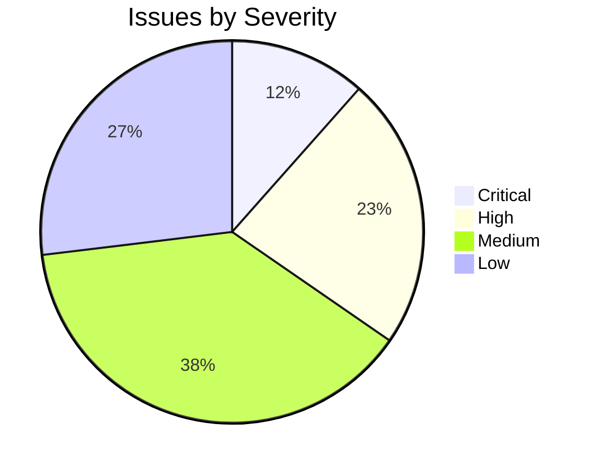

# GhostAlpha Code Review — March 2026

> Comprehensive review covering code quality, security, documentation, and CI

---

## Severity Overview



---

## Critical Issues (Must Fix)

| # | Issue | Location | Fix |
|---|-------|----------|-----|
| **C1** | **Stored XSS** — watchlist notes rendered unescaped | `src/web/routes.rs:788` | Use `html_escape()` on `notes` before rendering |
| **C2** | **Integration tests broken** — `max_conditions` missing | `tests/integration/sentiment_test.rs`, `tests/demo_sentiment_wiring.rs` | Add `max_conditions: 8` to TechnicalInputs |
| **C3** | **Credentials in .env** — Finnhub key, Discord webhook, Asana token on disk | `.env` (untracked) | Rotate all tokens immediately |

## High Priority

| # | Issue | Location | Fix |
|---|-------|----------|-----|
| **H1** | Mutex poison cascades — `self.conn.lock().unwrap()` in 40+ sites | `src/storage/db.rs` | Use `.map_err(|_| StorageError::Poisoned)?` |
| **H2** | `serde_json::to_string().unwrap()` in MCP server loop | `src/mcp/server.rs:188+` | Return `io::Error` instead of panicking |
| **H3** | `AlpacaClient::headers()` panics on invalid key chars | `src/broker/alpaca.rs:191` | Trim + return `Result` instead of unwrap |
| **H4** | `reqwest 0.11` duplicates entire HTTP stack | `Cargo.toml:28` | Upgrade to `reqwest 0.12` (hyper 1.x) |
| **H5** | `param_tuner.rs` get/set panic on OOB index | `src/analysis/param_tuner.rs:58,71` | Return `Option<f64>` or bounded newtype |
| **H6** | `spawn_blocking().await.unwrap()` in web routes | `src/web/routes.rs:860+` | Use `.unwrap_or_else(\|_\| Ok(Vec::new()))` |

## Medium Priority

| # | Issue | Location | Fix |
|---|-------|----------|-----|
| **M1** | README missing 5 CLI commands | `README.md` CLI Reference | Add vol-target, attribution, calibrate, execute, alerts |
| **M2** | TUTORIAL missing 6 commands | `docs/TUTORIAL.md` | Add sections for new commands |
| **M3** | CHANGELOG missing recent additions | `CHANGELOG.md` | Add vol-target, attribution, calibrate, execute entries |
| **M4** | `main.rs` is 2,790 lines | `src/main.rs` | Extract to `src/commands/` modules |
| **M5** | `db.rs` is 3,539 lines | `src/storage/db.rs` | Split into schema + impl + test helpers |
| **M6** | `wash_sale.rs` — no "substantially identical" handling | `src/tax/wash_sale.rs` | Document the limitation |
| **M7** | `attribution.rs` timing effect is a crude approximation | `src/analysis/attribution.rs:80` | Add APPROXIMATION comment |
| **M8** | ARCHITECTURE.md stats outdated | `ARCHITECTURE.md:3` | Update file count + add broker to diagram |
| **M9** | No coverage reporting in CI | `.github/workflows/ci.yml` | Add `cargo llvm-cov` step |
| **M10** | Missing .gitignore entries | `.gitignore` | Add `*.log`, `profiling/`, `criterion/` |

## Low Priority (Clippy)

| # | Issue | Location |
|---|-------|----------|
| L1 | `unused_mut` | `bayesian_weights.rs:300` |
| L2 | `unused variable s_min` | `multi_horizon.rs:502` |
| L3 | `unused variable i` in lambda | `param_tuner.rs:352` |
| L4 | `same_item_push` in test | `vol_target.rs:187` |
| L5 | `needless_range_loop` | `bayesian_weights.rs:341` |
| L6 | `manual_range_contains` (4 sites) | `indicators.rs`, `scorer.rs` |
| L7 | `unnecessary_cast` | `html_report.rs:872` |

---

## Fix Priority Order

```mermaid
gantt
    title Fix Priority Timeline
    dateFormat YYYY-MM-DD

    section Critical (Day 1)
    Fix XSS in watchlist notes           :crit, c1, 2026-03-30, 1d
    Fix broken integration tests         :crit, c2, 2026-03-30, 1d
    Rotate leaked credentials            :crit, c3, 2026-03-30, 1d

    section High (Days 2-3)
    Fix mutex poison pattern             :h1, after c1, 1d
    Fix MCP server unwrap                :h2, after c1, 1d
    Fix Alpaca headers panic             :h3, after c1, 1d
    Fix param_tuner OOB panic            :h5, after c1, 1d
    Fix spawn_blocking unwrap            :h6, after h1, 1d
    Upgrade reqwest 0.11 → 0.12          :h4, after h6, 2d

    section Medium (Days 4-5)
    Update README CLI reference          :m1, after h4, 1d
    Update TUTORIAL + CHANGELOG          :m2, after m1, 1d
    Fix all clippy warnings              :m3, after m2, 1d
    Document wash_sale limitation        :m4, after m3, 1d
