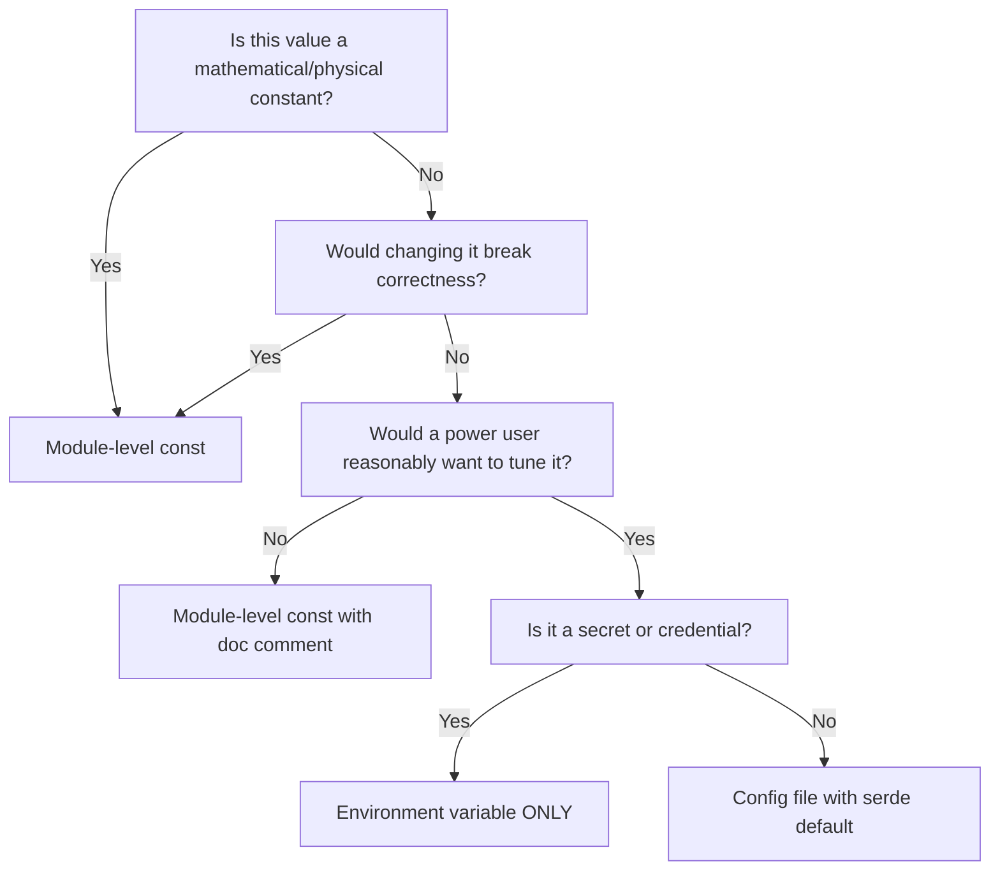
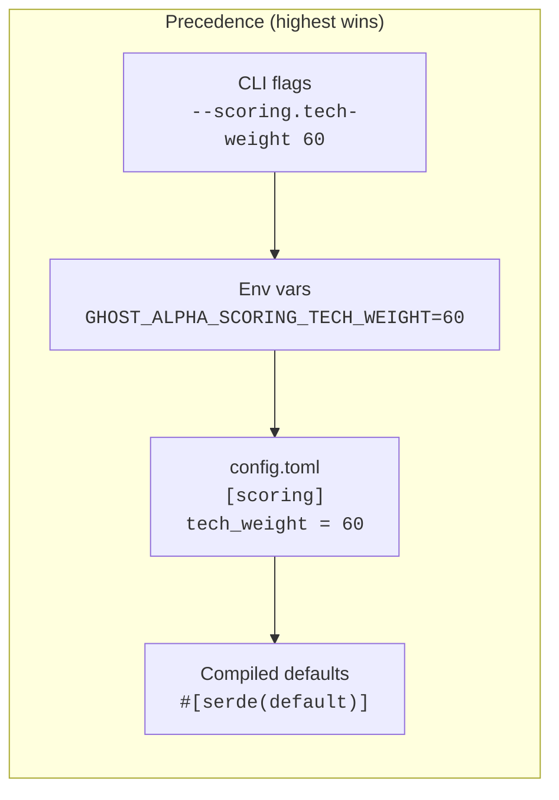
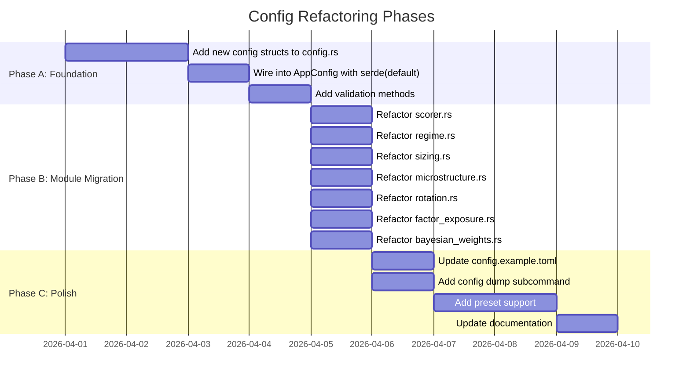

# Configuration Best Practices: Eliminating Magic Numbers

> Plan for making every tunable parameter in GhostAlpha user-configurable
> without breaking the zero-config experience.

---

## Table of Contents

1. [Decision Framework: Where Each Constant Belongs](#1-decision-framework)
2. [Layered Config Architecture](#2-layered-config-architecture)
3. [TOML Structure and Naming Conventions](#3-toml-structure)
4. [Type-Safe Config in Rust](#4-type-safe-config)
5. [Bring Your Own Config Pattern](#5-byoc-pattern)
6. [Concrete Refactoring Plan](#6-concrete-refactoring)
7. [Migration Strategy](#7-migration-strategy)
8. [Testing Strategy](#8-testing-strategy)

---

## 1. Decision Framework

Not every number deserves to be configurable. Use this decision tree:



### Categorization of Current Magic Numbers

| Category | Where | Examples |
|----------|-------|---------|
| **Always const** | Module `const` | `N_STATES = 3`, `N_OBS = 3`, `PI`, array dimensions |
| **Tunable, exposed** | Config TOML + `#[serde(default)]` | Scoring weights, ADX/RS/VIX thresholds, decay factors |
| **Tunable, hidden** | Config TOML (documented but commented out) | HMM convergence, Bayesian priors, SMA periods |
| **Secrets** | Env var only | API keys, tokens, webhook URLs |

### Specific Classifications

```
ALWAYS CONST (structural, not behavioral):
  - HMM N_STATES=3, N_OBS=3 (model architecture, not a knob)
  - ONNX MAX_BATCH_SIZE=32 (hardware-dependent, not domain)
  - ParamTuner PARAM_COUNT=6 (array sizing, derived from code)

EXPOSED TUNABLE (users will want these):
  - Scoring weights: 55/30/15
  - ADX thresholds: 25.0, 30.0, 50.0
  - RS percentile thresholds: 70.0, 90.0
  - Volume z-score thresholds: -3.0, 3.0
  - Position sizing: risk 1%, max 15%, stop 2.0x
  - SPS action thresholds: 25, 45, 65, 80

HIDDEN TUNABLE (power users / researchers only):
  - Regime breadth thresholds: 40%, 60%
  - VIX thresholds: 15.0, 25.0
  - Correlation thresholds: 0.30, 0.70
  - Bayesian decay: 0.995, blend: 0.4
  - HMM convergence: 1e-6
  - Factor alert thresholds: beta 1.3, sector 50%, HHI 0.30
```

---

## 2. Layered Config Architecture



### Current State vs Target

**Current:** TOML -> env override (secrets only) -> serde defaults. CLI flags do not
override config values for analysis parameters.

**Target:** Serde defaults -> TOML -> env vars (all `GHOST_ALPHA_*`) -> CLI flags.
The key addition is (a) env var support for non-secret tunables and (b) CLI flag
overrides for quick experimentation.

### Implementation: Config Resolver

The existing `resolve_env_overrides` method handles secrets. Extend it with a
generic pattern for all numeric tunables:

```rust
/// Resolve a single env var override for a numeric field.
/// Returns the env value if set and parseable, otherwise the existing value.
fn env_override_f64(env_key: &str, current: f64) -> f64 {
    std::env::var(env_key)
        .ok()
        .and_then(|v| v.trim().parse::<f64>().ok())
        .unwrap_or(current)
}

fn env_override_usize(env_key: &str, current: usize) -> usize {
    std::env::var(env_key)
        .ok()
        .and_then(|v| v.trim().parse::<usize>().ok())
        .unwrap_or(current)
}
```

For CLI flag overrides, use `clap`'s `Option<T>` pattern:

```rust
#[derive(clap::Parser)]
struct Cli {
    /// Override technical scoring weight (default: 55)
    #[arg(long, env = "GHOST_ALPHA_SCORING_TECH_WEIGHT")]
    scoring_tech_weight: Option<f64>,
    // ...
}

// In main, after loading config:
if let Some(w) = cli.scoring_tech_weight {
    config.scoring.tech_weight = w;
}
```

---

## 3. TOML Structure

### Naming Conventions

- **Section names:** lowercase, singular nouns matching the Rust module name
  (`[scoring]`, `[regime]`, `[sizing]`).
- **Field names:** `snake_case`, matching the Rust struct field exactly.
- **Units in names:** Append `_pct`, `_days`, `_bps`, `_secs` when the unit is
  not obvious. Example: `risk_per_trade_pct = 1.0` not `risk_per_trade = 0.01`.
- **Threshold naming:** Use `{metric}_{direction}_threshold`.
  Example: `adx_strong_threshold = 30.0`, `rs_high_threshold = 90.0`.

### Proposed New Sections

```toml
# ── Scoring Weights ─────────────────────────────────────────────────────────
# Weights must sum to 100. Used in composite score calculation.
[scoring]
tech_weight    = 55    # Technical indicators (Minervini template match, trend)
volume_weight  = 30    # Volume confirmation (z-score, OBV trend)
sentiment_weight = 15  # News sentiment (FinBERT ONNX score)

# ADX-based trend strength thresholds
adx_weak_threshold   = 25.0   # Below: no trend
adx_strong_threshold = 30.0   # Above: confirmed trend
adx_max_threshold    = 50.0   # Above: potentially overextended

# Relative Strength percentile thresholds
rs_pass_threshold = 70.0   # Minimum RS rank to pass screener
rs_high_threshold = 90.0   # Bonus points for top-decile RS

# Volume z-score clamp range (outlier protection)
volume_zscore_min = -3.0
volume_zscore_max =  3.0

# ── Regime Detection ────────────────────────────────────────────────────────
# Threshold-based regime classifier (used when HMM is disabled).
[regime]
breadth_bull_threshold_pct = 60.0   # Breadth > this + SPY > 200-SMA = Bull
breadth_bear_threshold_pct = 40.0   # Breadth < this + SPY < 200-SMA = Bear
sma_period                 = 200    # Long-term trend SMA for SPY
breadth_sma_period         = 50     # SMA period for breadth calculation

# ── HMM Regime (Advanced) ──────────────────────────────────────────────────
# Hidden Markov Model parameters. Rarely need tuning.
# [hmm]
# convergence_threshold = 1e-6
# max_iterations        = 100

# ── Microstructure ──────────────────────────────────────────────────────────
[microstructure]
vix_low_threshold     = 15.0   # Below: low-fear environment
vix_high_threshold    = 25.0   # Above: elevated fear
corr_low_threshold    = 0.30   # Below: diversification benefit
corr_high_threshold   = 0.70   # Above: crowded trade warning

# ── Rotation / SPS ─────────────────────────────────────────────────────────
# Sector/Position Strength action thresholds.
[rotation]
sps_accumulate_threshold = 25    # Below: accumulate on weakness
sps_hold_threshold       = 45    # Below: hold, above: add
sps_trim_threshold       = 65    # Below: hold, above: start trimming
sps_exit_threshold       = 80    # Above: exit / reduce aggressively

# ── Factor Exposure Alerts ──────────────────────────────────────────────────
[factor_alerts]
beta_high_threshold         = 1.3    # Portfolio beta above this triggers alert
sector_concentration_pct    = 50.0   # Single sector > this % triggers alert
hhi_concentration_threshold = 0.30   # HHI above this = concentrated portfolio

# ── Position Sizing ────────────────────────────────────────────────────────
[sizing]
risk_per_trade_pct     = 1.0    # Max risk per trade as % of portfolio
max_position_pct       = 15.0   # Max single position as % of portfolio
atr_stop_multiplier    = 2.0    # ATR multiple for initial stop loss
# kelly_fraction       = 0.25   # Kelly criterion scaling (conservative half-Kelly)

# ── Bayesian Adaptive Engine ───────────────────────────────────────────────
# Controls self-calibrating strategy selection. Disable with --fixed-weights.
[adaptive]
blend_factor           = 0.4     # 0=prior only, 1=Bayesian only
decay_factor           = 0.995   # Per-observation evidence decay (~138 obs half-life)
softmax_temperature    = 1.0     # Weight concentration (lower = more aggressive)
calibration_window_days = 252    # Rolling calibration lookback
min_signals            = 20      # Cold start: require this many before adapting
```

### What NOT to Put in TOML

- Secrets (API keys, tokens) -- env vars only
- Array dimensions and model architecture constants (`N_STATES`, `PARAM_COUNT`)
- Formatting/display constants (column widths, color codes)
- Test-only values

---

## 4. Type-Safe Config in Rust

### Pattern: Nested Config Structs with Validated Defaults

Each TOML section maps to a dedicated struct. The `#[serde(default)]` attribute
on the parent field means the entire section is optional -- omitting `[scoring]`
from the TOML gives you all defaults.

```rust
// src/config/scoring.rs

use serde::Deserialize;

/// Scoring engine configuration.
///
/// Controls composite score weights and threshold boundaries.
/// All fields have sensible defaults; override in `[scoring]` TOML section.
#[derive(Debug, Clone, Deserialize)]
pub struct ScoringConfig {
    /// Technical indicator weight (must sum to 100 with volume + sentiment).
    #[serde(default = "defaults::tech_weight")]
    pub tech_weight: f64,

    /// Volume confirmation weight.
    #[serde(default = "defaults::volume_weight")]
    pub volume_weight: f64,

    /// Sentiment weight.
    #[serde(default = "defaults::sentiment_weight")]
    pub sentiment_weight: f64,

    /// ADX threshold: below this, trend is considered weak.
    #[serde(default = "defaults::adx_weak")]
    pub adx_weak_threshold: f64,

    /// ADX threshold: above this, trend is confirmed strong.
    #[serde(default = "defaults::adx_strong")]
    pub adx_strong_threshold: f64,

    /// ADX threshold: above this, trend may be overextended.
    #[serde(default = "defaults::adx_max")]
    pub adx_max_threshold: f64,

    /// RS percentile: minimum to pass the screener filter.
    #[serde(default = "defaults::rs_pass")]
    pub rs_pass_threshold: f64,

    /// RS percentile: above this earns bonus points.
    #[serde(default = "defaults::rs_high")]
    pub rs_high_threshold: f64,

    /// Volume z-score lower clamp (outlier protection).
    #[serde(default = "defaults::vol_z_min")]
    pub volume_zscore_min: f64,

    /// Volume z-score upper clamp (outlier protection).
    #[serde(default = "defaults::vol_z_max")]
    pub volume_zscore_max: f64,
}

/// Private module for default value functions (required by serde).
mod defaults {
    pub fn tech_weight() -> f64 { 55.0 }
    pub fn volume_weight() -> f64 { 30.0 }
    pub fn sentiment_weight() -> f64 { 15.0 }
    pub fn adx_weak() -> f64 { 25.0 }
    pub fn adx_strong() -> f64 { 30.0 }
    pub fn adx_max() -> f64 { 50.0 }
    pub fn rs_pass() -> f64 { 70.0 }
    pub fn rs_high() -> f64 { 90.0 }
    pub fn vol_z_min() -> f64 { -3.0 }
    pub fn vol_z_max() -> f64 { 3.0 }
}

impl Default for ScoringConfig {
    fn default() -> Self {
        Self {
            tech_weight: defaults::tech_weight(),
            volume_weight: defaults::volume_weight(),
            sentiment_weight: defaults::sentiment_weight(),
            adx_weak_threshold: defaults::adx_weak(),
            adx_strong_threshold: defaults::adx_strong(),
            adx_max_threshold: defaults::adx_max(),
            rs_pass_threshold: defaults::rs_pass(),
            rs_high_threshold: defaults::rs_high(),
            volume_zscore_min: defaults::vol_z_min(),
            volume_zscore_max: defaults::vol_z_max(),
        }
    }
}
```

### Pattern: Centralized Validation

Validation runs after all layers merge. This catches cross-field invariants that
no single layer can enforce:

```rust
impl ScoringConfig {
    pub fn validate(&self) -> Result<(), ConfigError> {
        // Weights must sum to 100
        let sum = self.tech_weight + self.volume_weight + self.sentiment_weight;
        if (sum - 100.0).abs() > 0.01 {
            return Err(ConfigError::InvalidValue {
                field: "scoring.{tech,volume,sentiment}_weight".into(),
                reason: format!("weights must sum to 100, got {sum:.1}"),
            });
        }

        // ADX thresholds must be ordered
        if self.adx_weak_threshold >= self.adx_strong_threshold {
            return Err(ConfigError::InvalidValue {
                field: "scoring.adx_weak_threshold".into(),
                reason: "must be less than adx_strong_threshold".into(),
            });
        }
        if self.adx_strong_threshold >= self.adx_max_threshold {
            return Err(ConfigError::InvalidValue {
                field: "scoring.adx_strong_threshold".into(),
                reason: "must be less than adx_max_threshold".into(),
            });
        }

        // RS thresholds: pass < high, both in [0, 100]
        if self.rs_pass_threshold >= self.rs_high_threshold {
            return Err(ConfigError::InvalidValue {
                field: "scoring.rs_pass_threshold".into(),
                reason: "must be less than rs_high_threshold".into(),
            });
        }

        // Z-score range must be ordered
        if self.volume_zscore_min >= self.volume_zscore_max {
            return Err(ConfigError::InvalidValue {
                field: "scoring.volume_zscore_min".into(),
                reason: "must be less than volume_zscore_max".into(),
            });
        }

        Ok(())
    }
}
```

### Pattern: Wiring into AppConfig

Add the new section as `#[serde(default)]` on the parent:

```rust
#[derive(Debug, Clone, Deserialize)]
pub struct AppConfig {
    // ... existing fields ...

    #[serde(default)]
    pub scoring: ScoringConfig,

    #[serde(default)]
    pub regime: RegimeConfig,

    #[serde(default)]
    pub microstructure: MicrostructureConfig,

    #[serde(default)]
    pub rotation: RotationConfig,

    #[serde(default)]
    pub factor_alerts: FactorAlertsConfig,

    #[serde(default)]
    pub sizing: SizingConfig,
}
```

Then in `AppConfig::validate`:

```rust
fn validate(&self) -> Result<(), ConfigError> {
    // Existing validations...
    self.scoring.validate()?;
    self.regime.validate()?;
    self.sizing.validate()?;
    // etc.
    Ok(())
}
```

---

## 5. Bring Your Own Config (BYOC) Pattern

### Goal

A user can override *any* tunable by providing only the fields they care about.
Everything else falls through to defaults. This is the "partial config" pattern.

### How serde(default) Achieves This

With `#[serde(default)]` on every field, a user's TOML can be as sparse as:

```toml
# Override only what matters to me
[scoring]
tech_weight = 70
volume_weight = 20
sentiment_weight = 10

[sizing]
risk_per_trade_pct = 0.5
```

All other fields (ADX thresholds, regime breadths, HMM convergence, etc.) retain
compiled defaults. No need to copy the entire example config.

### Config Dump for Transparency

Add a `ghost-alpha config dump` subcommand that prints the fully-resolved config
(after all layers merge) so users can see exactly what values are active:

```rust
/// Serialize the resolved config back to TOML for inspection.
pub fn dump_resolved(&self) -> String {
    // toml::to_string_pretty requires Serialize
    toml::to_string_pretty(self)
        .unwrap_or_else(|e| format!("# Failed to serialize: {e}"))
}
```

This requires adding `#[derive(serde::Serialize)]` to all config structs --
which is good practice anyway for persistence and debugging.

### Config Diff

For researchers comparing runs, add a diff against defaults:

```rust
pub fn diff_from_defaults(&self) -> Vec<(String, String, String)> {
    let defaults = AppConfig::default_config();
    let self_toml = toml::Value::try_from(self).unwrap_or_default();
    let default_toml = toml::Value::try_from(&defaults).unwrap_or_default();
    // Walk both trees, collect (path, default_value, actual_value) triples
    // where they differ.
    collect_diffs("", &default_toml, &self_toml)
}
```

### Strategy Presets

For common use cases, ship named presets that override groups of parameters:

```toml
# config.presets/aggressive.toml
[scoring]
tech_weight = 70
volume_weight = 25
sentiment_weight = 5
rs_pass_threshold = 60.0

[sizing]
risk_per_trade_pct = 2.0
max_position_pct = 20.0
```

Load with `ghost-alpha screen --preset aggressive` or `preset = "aggressive"` in
config.toml. Presets merge *under* the user's explicit config:

```
Defaults -> Preset -> config.toml -> env vars -> CLI flags
```


Implementation:

```rust
impl AppConfig {
    /// Load config with full layer resolution.
    ///
    /// Precedence (highest wins):
    ///   CLI flags > env vars > config.toml > preset > compiled defaults
    pub fn load(
        config_path: Option<&str>,
        preset: Option<&str>,
        cli_overrides: &CliOverrides,
    ) -> Result<Self, ConfigError> {
        load_dotenv();

        // 1. Start from compiled defaults
        let mut config = Self::default_config();

        // 2. Merge preset if specified
        if let Some(preset_name) = preset {
            let preset_config = Self::load_preset(preset_name)?;
            config.merge(preset_config);
        }

        // 3. Merge config file
        if let Some(path) = config_path {
            let file_config = Self::parse_file(path)?;
            config.merge(file_config);
        }

        // 4. Overlay env vars
        config.resolve_env_overrides();

        // 5. Apply CLI flag overrides
        config.apply_cli_overrides(cli_overrides);

        // 6. Validate the resolved config
        config.validate()?;

        Ok(config)
    }
}
```

### The Merge Trait

For partial configs, use `Option<T>` fields in a "patch" struct, or implement a
simple merge that overwrites non-default values. The cleanest approach for TOML:

```rust
use toml::Value;

/// Deep-merge `overlay` into `base`. Overlay values win on conflict.
fn deep_merge(base: &mut Value, overlay: Value) {
    match (base, overlay) {
        (Value::Table(base_map), Value::Table(overlay_map)) => {
            for (key, value) in overlay_map {
                let entry = base_map
                    .entry(key)
                    .or_insert(Value::Boolean(false)); // placeholder
                deep_merge(entry, value);
            }
        }
        (base, overlay) => *base = overlay,
    }
}

impl AppConfig {
    fn merge_toml(&mut self, overlay_toml: &str) -> Result<(), ConfigError> {
        let mut base: Value = toml::to_string(self)
            .and_then(|s| s.parse())
            .map_err(|e| ConfigError::Parse(e.to_string()))?;

        let overlay: Value = overlay_toml
            .parse()
            .map_err(|e: toml::de::Error| ConfigError::Parse(e.to_string()))?;

        deep_merge(&mut base, overlay);

        *self = base
            .try_into()
            .map_err(|e: toml::de::Error| ConfigError::Parse(e.to_string()))?;

        Ok(())
    }
}
```

---

## 6. Concrete Refactoring Plan

### Step-by-step for each module

#### 6.1 Scorer (`src/analysis/scorer.rs`)

**Before:**
```rust
let tech_weight = 0.55;
let vol_weight = 0.30;
let sent_weight = 0.15;
// ... later ...
if adx > 30.0 { bonus += 5.0; }
if rs_pct > 90.0 { bonus += 10.0; }
```

**After:**
```rust
pub fn score(result: &ScreenResult, config: &ScoringConfig) -> f64 {
    let tw = config.tech_weight / 100.0;
    let vw = config.volume_weight / 100.0;
    let sw = config.sentiment_weight / 100.0;

    let base = result.technical * tw
             + result.volume * vw
             + result.sentiment * sw;

    let mut bonus = 0.0;
    if result.adx > config.adx_strong_threshold { bonus += 5.0; }
    if result.rs_pct > config.rs_high_threshold { bonus += 10.0; }

    let z = result.volume_zscore
        .clamp(config.volume_zscore_min, config.volume_zscore_max);

    base + bonus + z
}
```

#### 6.2 Regime (`src/analysis/regime.rs`)

**Before:**
```rust
const BREADTH_BULL_THRESHOLD: f64 = 60.0;
const BREADTH_BEAR_THRESHOLD: f64 = 40.0;
const SMA_PERIOD: usize = 200;
const BREADTH_SMA_PERIOD: usize = 50;
```

**After:**
```rust
#[derive(Debug, Clone, Deserialize)]
pub struct RegimeConfig {
    #[serde(default = "defaults::breadth_bull")]
    pub breadth_bull_threshold_pct: f64,
    #[serde(default = "defaults::breadth_bear")]
    pub breadth_bear_threshold_pct: f64,
    #[serde(default = "defaults::sma_period")]
    pub sma_period: usize,
    #[serde(default = "defaults::breadth_sma")]
    pub breadth_sma_period: usize,
}

mod defaults {
    pub fn breadth_bull() -> f64 { 60.0 }
    pub fn breadth_bear() -> f64 { 40.0 }
    pub fn sma_period() -> usize { 200 }
    pub fn breadth_sma() -> usize { 50 }
}

impl Default for RegimeConfig {
    fn default() -> Self {
        Self {
            breadth_bull_threshold_pct: defaults::breadth_bull(),
            breadth_bear_threshold_pct: defaults::breadth_bear(),
            sma_period: defaults::sma_period(),
            breadth_sma_period: defaults::breadth_sma(),
        }
    }
}

impl RegimeConfig {
    pub fn validate(&self) -> Result<(), ConfigError> {
        if self.breadth_bear_threshold_pct >= self.breadth_bull_threshold_pct {
            return Err(ConfigError::InvalidValue {
                field: "regime.breadth_bear_threshold_pct".into(),
                reason: "must be less than breadth_bull_threshold_pct".into(),
            });
        }
        if self.sma_period == 0 || self.breadth_sma_period == 0 {
            return Err(ConfigError::InvalidValue {
                field: "regime.sma_period".into(),
                reason: "SMA periods must be > 0".into(),
            });
        }
        Ok(())
    }
}
```

The `detect_regime` function signature changes to accept the config:

```rust
pub fn detect_regime(
    spy_candles: &[Candle],
    universe_candles: &[(&str, &[Candle])],
    config: &RegimeConfig,
) -> Result<RegimeState, AnalysisError> {
    let spy_sma = sma(&spy_prices, config.sma_period)?;
    // ... use config.breadth_bull_threshold_pct, etc.
}
```

#### 6.3 Position Sizing (`src/analysis/sizing.rs`)

```rust
#[derive(Debug, Clone, Deserialize, Serialize)]
pub struct SizingConfig {
    #[serde(default = "defaults::risk")]
    pub risk_per_trade_pct: f64,

    #[serde(default = "defaults::max_pos")]
    pub max_position_pct: f64,

    #[serde(default = "defaults::stop_mult")]
    pub atr_stop_multiplier: f64,
}

mod defaults {
    pub fn risk() -> f64 { 1.0 }
    pub fn max_pos() -> f64 { 15.0 }
    pub fn stop_mult() -> f64 { 2.0 }
}

impl Default for SizingConfig {
    fn default() -> Self {
        Self {
            risk_per_trade_pct: defaults::risk(),
            max_position_pct: defaults::max_pos(),
            atr_stop_multiplier: defaults::stop_mult(),
        }
    }
}

impl SizingConfig {
    pub fn validate(&self) -> Result<(), ConfigError> {
        if self.risk_per_trade_pct <= 0.0 || self.risk_per_trade_pct > 10.0 {
            return Err(ConfigError::InvalidValue {
                field: "sizing.risk_per_trade_pct".into(),
                reason: "must be in (0, 10]".into(),
            });
        }
        if self.max_position_pct <= 0.0 || self.max_position_pct > 100.0 {
            return Err(ConfigError::InvalidValue {
                field: "sizing.max_position_pct".into(),
                reason: "must be in (0, 100]".into(),
            });
        }
        if self.atr_stop_multiplier <= 0.0 {
            return Err(ConfigError::InvalidValue {
                field: "sizing.atr_stop_multiplier".into(),
                reason: "must be positive".into(),
            });
        }
        Ok(())
    }
}
```

#### 6.4 Bayesian Weights (`src/analysis/bayesian_weights.rs`)

The decay and blend factors are already mentioned in `config.example.toml` under
`[adaptive]`. Formalize them:

```rust
#[derive(Debug, Clone, Deserialize, Serialize)]
pub struct AdaptiveConfig {
    #[serde(default = "defaults::blend")]
    pub blend_factor: f64,

    #[serde(default = "defaults::decay")]
    pub decay_factor: f64,

    #[serde(default = "defaults::temperature")]
    pub softmax_temperature: f64,

    #[serde(default = "defaults::window")]
    pub calibration_window_days: u32,

    #[serde(default = "defaults::min_signals")]
    pub min_signals: u32,
}

mod defaults {
    pub fn blend() -> f64 { 0.4 }
    pub fn decay() -> f64 { 0.995 }
    pub fn temperature() -> f64 { 1.0 }
    pub fn window() -> u32 { 252 }
    pub fn min_signals() -> u32 { 20 }
}

impl Default for AdaptiveConfig {
    fn default() -> Self {
        Self {
            blend_factor: defaults::blend(),
            decay_factor: defaults::decay(),
            softmax_temperature: defaults::temperature(),
            calibration_window_days: defaults::window(),
            min_signals: defaults::min_signals(),
        }
    }
}

impl AdaptiveConfig {
    pub fn validate(&self) -> Result<(), ConfigError> {
        if !(0.0..=1.0).contains(&self.blend_factor) {
            return Err(ConfigError::InvalidValue {
                field: "adaptive.blend_factor".into(),
                reason: "must be in [0.0, 1.0]".into(),
            });
        }
        if !(0.9..1.0).contains(&self.decay_factor) {
            return Err(ConfigError::InvalidValue {
                field: "adaptive.decay_factor".into(),
                reason: "must be in [0.9, 1.0)".into(),
            });
        }
        if self.softmax_temperature <= 0.0 {
            return Err(ConfigError::InvalidValue {
                field: "adaptive.softmax_temperature".into(),
                reason: "must be positive".into(),
            });
        }
        Ok(())
    }
}
```

---

## 7. Migration Strategy

### Backward Compatibility

Because every new field uses `#[serde(default)]`, existing `config.toml` files
continue to work without modification. The migration is purely additive.

### Rollout Order



### Module-by-Module Refactoring Checklist

For each module being migrated:

1. **Create the config struct** with `#[serde(default)]` fields and a `defaults`
   module.
2. **Implement `Default`** that calls the same default functions.
3. **Implement `validate()`** with cross-field invariant checks.
4. **Add the field** to `AppConfig` with `#[serde(default)]`.
5. **Call `validate()`** from `AppConfig::validate()`.
6. **Change function signatures** to accept `&XxxConfig` instead of using
   module-level `const` values.
7. **Update call sites** in `main.rs` and integration points to pass
   `&config.scoring`, `&config.regime`, etc.
8. **Remove the old `const`** declarations.
9. **Update tests** to construct config explicitly (makes test intent clearer).
10. **Add the section** to `config.example.toml` (commented out, with doc
    comments explaining each field).

---

## 8. Testing Strategy

### Unit Tests for Config Structs

```rust
#[cfg(test)]
mod tests {
    use super::*;

    #[test]
    fn scoring_defaults_sum_to_100() {
        let cfg = ScoringConfig::default();
        let sum = cfg.tech_weight + cfg.volume_weight + cfg.sentiment_weight;
        assert!((sum - 100.0).abs() < 0.01);
    }

    #[test]
    fn scoring_rejects_weights_not_summing_to_100() {
        let mut cfg = ScoringConfig::default();
        cfg.tech_weight = 50.0;
        // Sum = 50 + 30 + 15 = 95
        assert!(cfg.validate().is_err());
    }

    #[test]
    fn scoring_rejects_inverted_adx_thresholds() {
        let mut cfg = ScoringConfig::default();
        cfg.adx_weak_threshold = 40.0;
        cfg.adx_strong_threshold = 30.0;
        assert!(cfg.validate().is_err());
    }

    #[test]
    fn partial_toml_uses_defaults_for_missing_fields() {
        let toml = r#"
[scoring]
tech_weight = 60
volume_weight = 25
sentiment_weight = 15
"#;
        let cfg: AppConfig = toml::from_str(toml).unwrap();
        // Explicitly set fields
        assert!((cfg.scoring.tech_weight - 60.0).abs() < 0.01);
        // Default fields
        assert!((cfg.scoring.adx_weak_threshold - 25.0).abs() < 0.01);
        assert!((cfg.scoring.rs_pass_threshold - 70.0).abs() < 0.01);
    }

    #[test]
    fn empty_toml_gives_all_defaults() {
        let cfg: AppConfig = toml::from_str("").unwrap();
        let scoring = &cfg.scoring;
        assert!((scoring.tech_weight - 55.0).abs() < 0.01);
        assert!((scoring.volume_weight - 30.0).abs() < 0.01);
        assert!((scoring.sentiment_weight - 15.0).abs() < 0.01);
    }

    #[test]
    fn regime_rejects_bear_above_bull() {
        let mut cfg = RegimeConfig::default();
        cfg.breadth_bear_threshold_pct = 70.0;
        cfg.breadth_bull_threshold_pct = 50.0;
        assert!(cfg.validate().is_err());
    }

    #[test]
    fn sizing_rejects_zero_risk() {
        let mut cfg = SizingConfig::default();
        cfg.risk_per_trade_pct = 0.0;
        assert!(cfg.validate().is_err());
    }

    #[test]
    fn adaptive_rejects_blend_out_of_range() {
        let mut cfg = AdaptiveConfig::default();
        cfg.blend_factor = 1.5;
        assert!(cfg.validate().is_err());
    }
}
```

### Integration Test: Full Config Roundtrip

```rust
#[test]
fn config_roundtrip_toml_serialize_deserialize() {
    let original = AppConfig::default_config();
    let toml_str = toml::to_string_pretty(&original).unwrap();
    let restored: AppConfig = toml::from_str(&toml_str).unwrap();

    // Spot-check key fields survive the roundtrip
    assert!((original.scoring.tech_weight - restored.scoring.tech_weight).abs() < 0.01);
    assert_eq!(original.regime.sma_period, restored.regime.sma_period);
    assert!((original.adaptive.decay_factor - restored.adaptive.decay_factor).abs() < 1e-9);
}
```

### Property-Based Test: Any Valid Config Validates

```rust
#[cfg(test)]
mod prop_tests {
    use super::*;
    use proptest::prelude::*;

    prop_compose! {
        fn arb_scoring_config()
            (tech in 10.0..=80.0f64)
            (
                tech in Just(tech),
                volume in 5.0..=(95.0 - tech),
            )
            (
                tech in Just(tech),
                volume in Just(volume),
                sentiment in Just(100.0 - tech - volume),
            )
        -> ScoringConfig {
            ScoringConfig {
                tech_weight: tech,
                volume_weight: volume,
                sentiment_weight: sentiment,
                ..Default::default()
            }
        }
    }

    proptest! {
        #[test]
        fn valid_weights_always_validate(cfg in arb_scoring_config()) {
            prop_assert!(cfg.validate().is_ok());
        }
    }
}
```

---

## Summary

The core principles:

1. **Zero-config by default.** Every field has a `#[serde(default)]`. A user can
   run `ghost-alpha` with an empty config file (or no config file at all) and get
   the current hardcoded behavior.

2. **Partial override.** Users specify only the fields they want to change. The
   merge is handled by serde deserialization, not custom code.

3. **Layered precedence.** Defaults < preset < TOML < env var < CLI flag. Each
   layer is explicit and inspectable via `config dump`.

4. **Validation at the boundary.** All validation happens once, after all layers
   merge, in typed `validate()` methods. No runtime panics from bad config.

5. **Backward compatible.** Existing `config.toml` files continue to work
   unchanged. New sections are purely additive.
