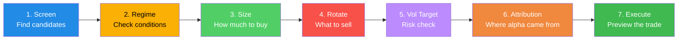

# GhostAlpha Demo Design

> How the demo should showcase all features in a compelling 3-minute walkthrough

---

## Demo Philosophy

The demo tells a **story** — a complete investment decision cycle from "what should I buy?" to "should I sell?". Each step naturally leads to the next, showing how GhostAlpha's modules connect into a single workflow.

**Audience:** Technical retail investor, $150K portfolio, familiar with momentum investing.

**Key message:** GhostAlpha doesn't just screen stocks — it sizes positions, monitors risk, detects regime changes, and tells you when to rotate.

---

## Demo Flow (7 Steps)



---

## Step-by-Step: What Each Screen Should Show

### Step 1: Stock Screening — "Find the best setups"

```
$ ghost-alpha demo --top 10
```

**What the user sees:**
- ASCII logo banner
- Table of top 10 ranked stocks with Grade, Score, Minervini pass/fail, Conditions, ADX, RS%, 52wH%
- Color coding: A+ green bold, A green, B yellow, C/D red
- Regime indicator: "SIDEWAYS" in yellow
- Speed: "Screened 50 stocks in 0.0s"

**Story beat:** "Here are the highest-conviction setups in the current market."

### Step 2: Available Strategies — "Not just Minervini"

```
$ ghost-alpha strategies
```

**What the user sees:**
- 4 strategies with one-line descriptions
- Clear differentiation: momentum vs breakout vs mean-reversion vs trend
- Usage hint: `ghost-alpha screen --strategy breakout`

**Story beat:** "The adaptive engine selects which strategy to emphasize based on market conditions. In Sideways markets, mean-reversion gets 32% weight."

### Step 3: Position Sizing — "How much to buy"

```
$ ghost-alpha size --portfolio 150000 --risk-pct 1 --max-pct 10
```

**What the user sees:**
- Clean table: Ticker, Price, Shares, Stop, Amount, Risk$, Pct%
- `*` markers on capped positions
- Grade and regime multipliers explained in footer
- Exact share counts — immediately actionable

**Story beat:** "NVDA gets 83 shares (capped at 10% max), while PLTR gets 157 shares because it's cheaper with lower ATR. The vol-target method sizes smaller in volatile stocks."

### Step 4: Capital Rotation — "What to sell"

```
$ ghost-alpha rotate
```

**What the user sees:**
- SPS table with color-coded actions: GREEN/YELLOW/RED
- Component breakdown: Trend, Momentum, Drawdown, RS, TimeDecay
- DDOG highlighted in YELLOW (34.5) — the weakest position
- Cash Deployment Score: "HoldCash" recommendation
- Regime context: "Sideways | Target weight: 12.5%"

**Story beat:** "DDOG has the highest sell pressure — trend decay, drawdown from $125 to $108, and it's been 50 days since a new high. Consider swapping for CRWD."

### Step 5: Volatility Targeting — "Are we taking too much risk?"

```
$ ghost-alpha vol-target --target 15 --invested 70
```

**What the user sees:**
- Realized vol vs target vol
- Exposure scalar (e.g., 1.13x = can add more)
- Action: INCREASE/MAINTAIN/REDUCE with color
- Specific recommendation: "Deploy cash into top candidates"

**Story beat:** "Realized vol is 13.3% vs our 15% target — we have room to add exposure. The engine says increase from 70% to 79% invested."

### Step 6: Performance Attribution — "Where did the alpha come from?"

```
$ ghost-alpha attribution --period 90
```

**What the user sees:**
- Portfolio return vs SPY benchmark
- Active return decomposition:
  - Stock Selection: +2.88% (the biggest contributor)
  - Strategy Weighting: +2.18%
  - Market Timing: -0.84% (cash drag)
  - Position Sizing: -0.16%
- Clean waterfall: contributions sum to active return

**Story beat:** "Over 90 days: +6.2% vs SPY's +3.5%. Most alpha came from stock selection and strategy weighting. The cash drag cost 0.84% — the deployment score would have flagged this earlier."

### Step 7: Trade Execution — "Make it happen"

```
$ ghost-alpha execute --buy CRWD --shares 15
```

**What the user sees:**
- `PREVIEW: BUY 15 shares of CRWD — DRY RUN: Would buy 15 shares of CRWD @ market`
- Clear "DRY RUN" label — no money at risk
- Hint about `--mode paper` for Alpaca paper trading

**Story beat:** "When you're ready, add `--mode paper` to execute on Alpaca's paper trading. Or `--mode live` with real money. Dry-run is always the default."

---

## Demo Script: Ideal Terminal Recording

```bash
#!/usr/bin/env bash
# GhostAlpha Feature Demo — complete investment workflow

# 1. Find the best setups
ghost-alpha demo --top 10

# 2. What strategies are available?
ghost-alpha strategies

# 3. Size the positions ($150K portfolio)
ghost-alpha size --portfolio 150000 --risk-pct 1 --max-pct 10

# 4. Analyze existing positions — what to sell?
ghost-alpha rotate

# 5. Are we taking too much risk?
ghost-alpha vol-target --target 15 --invested 70

# 6. Where did our alpha come from?
ghost-alpha attribution --period 90

# 7. Preview the trade
ghost-alpha execute --buy CRWD --shares 15

# Bonus: all 23 commands available
ghost-alpha --help
```

---

## What's Missing from Current Demo

| Gap | Impact | Fix |
|-----|--------|-----|
| **No factor exposure in demo** | Users don't see concentration risk detection | Add `ghost-alpha factors` command |
| **No VIX signal in demo** | Forward-looking risk not shown | Add `ghost-alpha vix` command |
| **No HMM regime in demo** | Probabilistic regime not shown | Add `ghost-alpha regime --model hmm` |
| **No web dashboard in demo** | Visual users miss the best UI | Record a short serve + browser clip |
| **Size/rotate use demo data** | Looks fake | Wire to live DB when available (done) |
| **No calibrate in demo** | Adaptive tuning invisible | Show `ghost-alpha calibrate --dry-run` |

---

## Ideal Demo Output (Annotated)

### What Makes It Compelling

1. **Zero to insight in 1 command** — `ghost-alpha demo` works with no setup
2. **Every number is actionable** — share counts, stop prices, not just scores
3. **Color coding carries meaning** — GREEN=safe, YELLOW=watch, RED=act
4. **Each step motivates the next** — screening → "how much?" → sizing → "what about existing?" → rotation
5. **The story has a punchline** — attribution shows where alpha actually came from
6. **Safety is the default** — execute defaults to dry-run, never real money without opt-in

### What Would Make It Better

1. **Side-by-side comparison** — show the same stock scored across Swing/Position/Trend horizons
2. **Regime probability** — "Bull 72%, Sideways 25%, Bear 3%" instead of just "SIDEWAYS"
3. **Factor dashboard** — "Your portfolio is 62% Tech, beta 1.3, avg correlation 0.71"
4. **VIX overlay** — "VIX term structure: Contango (RISK-ON), SKEW: 122 (normal)"
5. **Upgrade comparison** — "Swap DDOG → CRWD: Upgrade Score +24.3, save $900 in tax loss"
