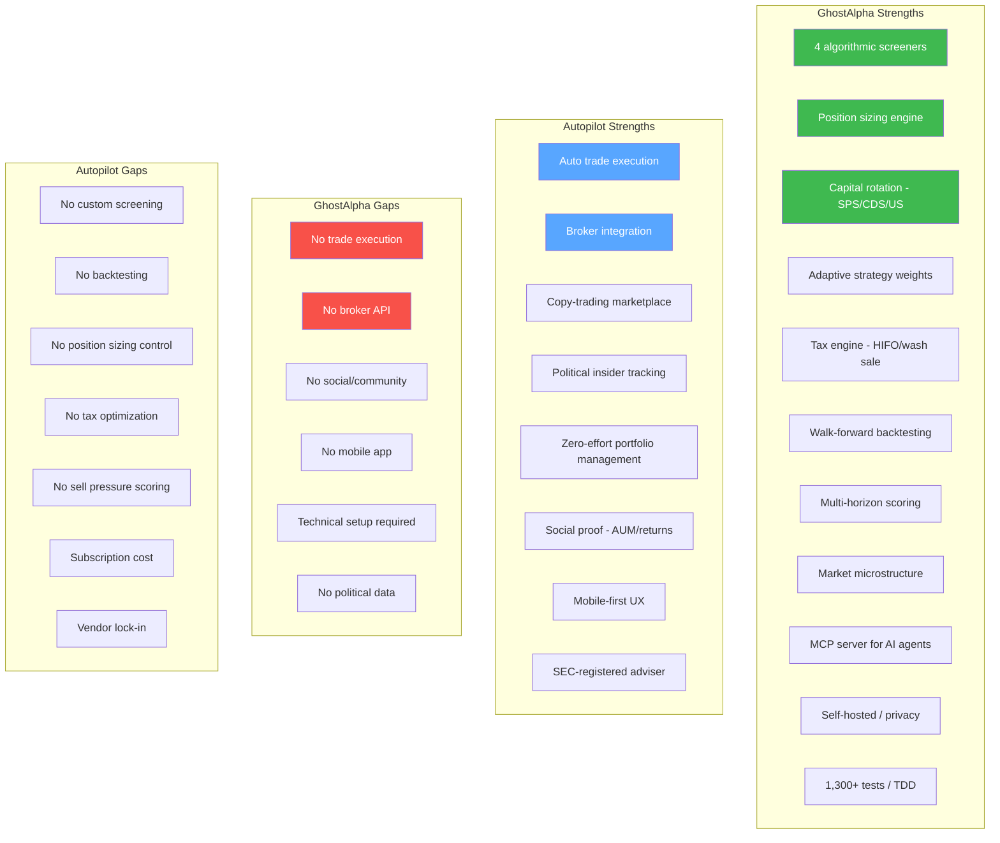
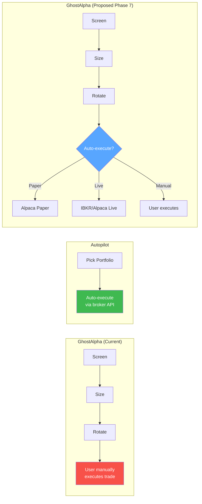
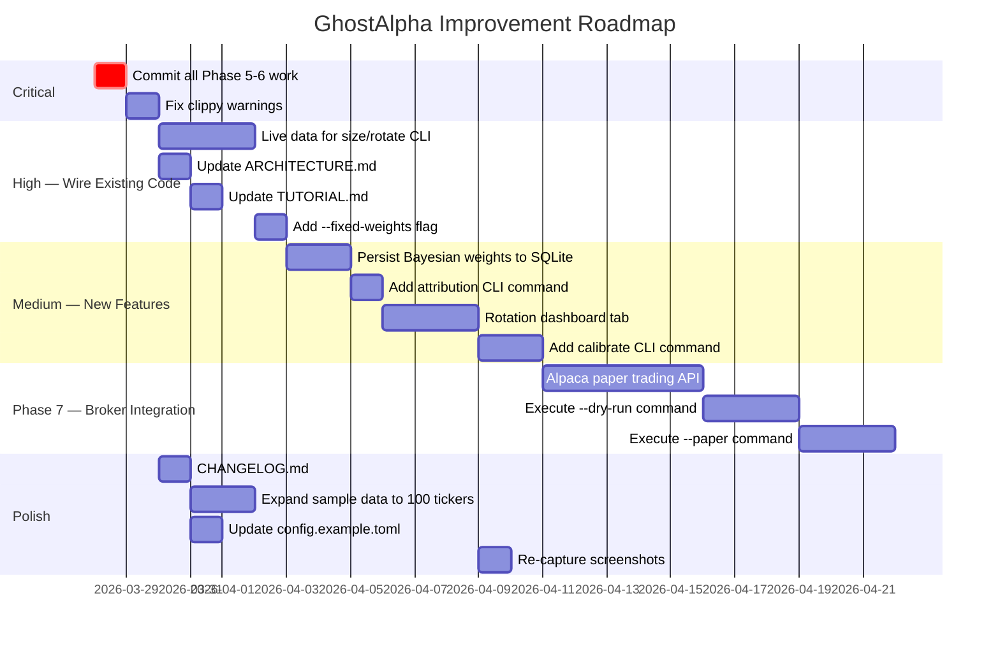

# GhostAlpha vs Autopilot — Competitive Review & Improvement Plan

> Generated: 2026-03-28 | GhostAlpha: 100 files, 44,496 LOC, 1,306 tests, 6.9MB binary

---

## Product Comparison

### What Each Product Does

| Dimension | **GhostAlpha** | **Autopilot** (joinautopilot.com) |
|-----------|---------------|----------------------------------|
| **Core model** | DIY screening + analysis tool | Copy-trading marketplace |
| **User action** | User makes all decisions, tool provides signals | User picks a portfolio, trades execute automatically |
| **Execution** | Advisory only — no broker integration | Auto-executes trades via brokerage API |
| **Data source** | Finnhub, Yahoo Finance, FRED, bundled sample | Broker APIs, political filings (STOCK Act), hedge fund 13F |
| **Strategies** | 4 algorithmic screeners (Minervini, Breakout, MeanReversion, TrendStrength) | Human-curated portfolios (Pelosi Tracker, AI portfolios, thematic) |
| **Pricing** | Free/open source | Subscription (SEC-registered investment adviser) |
| **Target user** | Technical/quantitative retail investor who wants control | Passive retail investor who wants to follow experts |
| **Deployment** | Self-hosted single binary | Cloud SaaS |
| **AI** | MCP server for Claude/Copilot integration, FinBERT sentiment | Not AI-driven (human portfolio managers) |

### Feature-by-Feature Matrix

---

## GhostAlpha Review — Current State Assessment

### What's Working Well

| Area | Assessment |
|------|-----------|
| **Test coverage** | 1,306 tests, 0 failures. Every module has inline `#[cfg(test)]`. Boundary-value testing is thorough. |
| **Architecture** | Clean module separation: `analysis/`, `portfolio/`, `tax/`, `web/`, `data/`. Error handling via `thiserror` per module. |
| **Scoring model** | Phase 5 fixes (volume bias, conditions normalization, sentiment redistribution) are solid. |
| **Position sizing** | 4 methods with grade/regime multipliers and position caps. Well-tested. |
| **Capital rotation** | SPS/CDS/US scores are a genuine differentiator — no competitor has this continuous sell-pressure analysis. |
| **Adaptive engine** | Microstructure + multi-horizon + Bayesian weights is a sophisticated stack for a personal tool. |
| **Binary size** | 6.9MB release binary — excellent for a tool with embedded web server + 50-stock sample data. |
| **Zero-config demo** | `ghost-alpha demo` works instantly with bundled data. Very low friction first experience. |

### Issues Found

#### Critical (Must Fix)

| # | Issue | Details | Fix |
|---|-------|---------|-----|
| 1 | **Uncommitted changes** | All Phase 5/5.5/6 work (10 new files, 15 modified) is uncommitted. Risk of losing ~2,500 lines of new code. | Commit and push immediately. |
| 2 | **README stats outdated** | README references various counts that are stale vs actual. | Update file counts, LOC, test counts after commit. |

#### High Priority

| # | Issue | Details | Fix |
|---|-------|---------|-----|
| 3 | **13 clippy warnings** | `too_many_arguments`, `manual_div_ceil`, `map_or` simplifications, loop variable indexing. | Run `cargo clippy --fix` for auto-fixable, refactor functions with >7 args. |
| 4 | **No broker integration** | Biggest functional gap vs Autopilot. Users must manually execute every trade. | Phase 7: Add Alpaca/IBKR paper trading API for optional auto-execution. |
| 5 | **`size` and `rotate` use hardcoded demo data** | CLI commands show example data, not live portfolio. | Wire to SQLite — read positions from `portfolio_snapshots` table, screen results from `screen_results`. |
| 6 | **ARCHITECTURE.md likely stale** | Was written before Phases 5-6. New modules (`sizing.rs`, `rotation.rs`, `adaptive.rs`, etc.) not documented. | Regenerate or update with current module inventory. |
| 7 | **TUTORIAL.md missing new commands** | Doesn't cover `size`, `rotate`, or adaptive engine features. | Add sections for new CLI commands with examples. |

#### Medium Priority

| # | Issue | Details | Fix |
|---|-------|---------|-----|
| 8 | **No `--fixed-weights` CLI flag** | PRD promises this escape hatch for adaptive engine, but it's not wired in `main.rs`. | Add `--fixed-weights` global flag that bypasses adaptive modules. |
| 9 | **Bayesian weights not persisted** | `bayesian_weights.rs` computes beliefs but no SQLite integration to store/load them. | Add `strategy_beliefs` table and read/write in calibration flow. |
| 10 | **Attribution not wired to CLI** | `attribution.rs` exists but no `ghost-alpha attribution` command. | Add `attribution --period 90d` subcommand. |
| 11 | **No earnings calendar integration** | PRD F11 specifies earnings proximity warnings, referenced in user journey. Still placeholder. | Integrate Finnhub `/calendar/earnings` endpoint. |
| 12 | **`.venv` directory committed risk** | Created `.venv` for asciinema but `.gitignore` may not exclude it. | Verify `.venv` is in `.gitignore`. |
| 13 | **Missing dashboard tabs** | Rotation review tab and sizing recommendations not in web dashboard yet. | Add `/rotation` and `/sizing` routes to `dashboard_routes.rs`. |

#### Low Priority

| # | Issue | Details | Fix |
|---|-------|---------|-----|
| 14 | **`param_tuner.rs` calibrate() not integrated** | Function exists with tests but isn't called from any CLI or scheduled flow. | Wire into `ghost-alpha calibrate` subcommand. |
| 15 | **`config.example.toml` missing `[adaptive]` section** | Phase 6 config options (blend_factor, softmax_temperature, etc.) not in example config. | Add `[adaptive]` section with documented defaults. |
| 16 | **Sample data only has 50 tickers** | Demo is limited. Users who don't have API keys can't explore larger universes. | Expand to 100-200 tickers or add Russell 1000 sample subset. |
| 17 | **No changelog** | No CHANGELOG.md tracking version history. | Add CHANGELOG.md with v1.0 through v2.0 history. |
| 18 | **Screenshot references in README** | 8 screenshots referenced. May be stale after Phase 5/6 dashboard changes. | Re-capture screenshots after dashboard integration. |

---

## Strategic Gap Analysis: What Autopilot Has That GhostAlpha Doesn't

### 1. Trade Execution (Highest Impact Gap)

Autopilot's core value is **zero-effort execution**. GhostAlpha generates excellent signals but stops at "here's what you should do" — the user must then open their broker, find the stock, calculate shares, place the order.

**Recommendation**: Add optional broker integration as Phase 7.
- Start with **Alpaca paper trading** (free API, no real money risk)
- Add `ghost-alpha execute --dry-run` for preview
- Add `ghost-alpha execute --paper` for paper trading
- Later: IBKR live trading with confirmation prompts
- Keep advisory-only as the default (never auto-execute without explicit opt-in)

### 2. Social/Community Layer

Autopilot has a **portfolio marketplace** with AUM counts, leaderboards, and verified "Pilots". GhostAlpha is solo.

**Recommendation**: Not a priority for a personal tool. But consider:
- Publishing strategy backtests as shareable HTML reports
- MCP integration already enables AI agents to consume signals — this is a different kind of "social"

### 3. Political Insider Data

Autopilot's Pelosi Tracker ($428.7M AUM) is their killer feature. GhostAlpha has no congressional trading data.

**Recommendation**: Add STOCK Act filing data as a new data provider. Free sources:
- `quiverquant.com` API (congressional trades)
- `senatestockwatcher.com` / `housestockwatcher.com`
- Could be a new screener: `CongressionalTracker` that flags stocks being bought by multiple members of Congress

### 4. Mobile Experience

Autopilot is mobile-first. GhostAlpha is CLI + desktop web.

**Recommendation**: The htmx + pico.css dashboard is already responsive. Add:
- Progressive Web App (PWA) manifest for "install to home screen"
- Push notifications via existing Telegram/Discord channels work on mobile already

---

## Improvement Plan — Prioritized

---

## Where GhostAlpha Wins vs Autopilot

Despite the execution gap, GhostAlpha has significant advantages for its target user:

| Advantage | Why It Matters |
|-----------|---------------|
| **Transparency** | Every score, weight, and threshold is visible and auditable. Autopilot is a black box — you follow someone else's trades. |
| **Tax optimization** | HIFO lot selection, wash sale enforcement, multi-year selling programmes. Autopilot has no tax awareness. |
| **Sell pressure scoring** | No competitor quantifies "when to sell" with a continuous 0-100 score. Autopilot just copies the portfolio manager's sells. |
| **Backtesting** | Walk-forward validation with Monte Carlo CIs. Autopilot shows historical returns but no rigorous validation. |
| **Adaptive engine** | Strategy weights adjust to market microstructure. Autopilot portfolios are manually managed by humans. |
| **Privacy** | Self-hosted, no data leaves your machine. Autopilot requires full brokerage access. |
| **Cost** | Free. Autopilot charges subscription fees that eat into returns (especially for smaller portfolios). |
| **AI integration** | MCP server lets Claude/Copilot query screening results. Unique capability. |

---

## Summary Recommendation

**GhostAlpha is a better tool for users who want to understand and control their investment process.** Autopilot is better for users who want zero-effort copy trading.

The single highest-impact improvement would be **optional broker integration** (Phase 7) — this closes the execution gap while preserving GhostAlpha's transparency and control advantages. Start with Alpaca paper trading, which is free and risk-free.

Immediate priorities:
1. **Commit everything** — 2,500+ lines of new code at risk
2. **Fix clippy warnings** — 13 warnings is tech debt
3. **Wire live data to `size`/`rotate`** — transforms demo commands into real tools
4. **Update docs** — ARCHITECTURE.md, TUTORIAL.md, config.example.toml are stale
