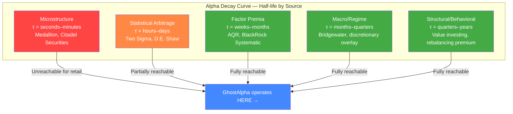
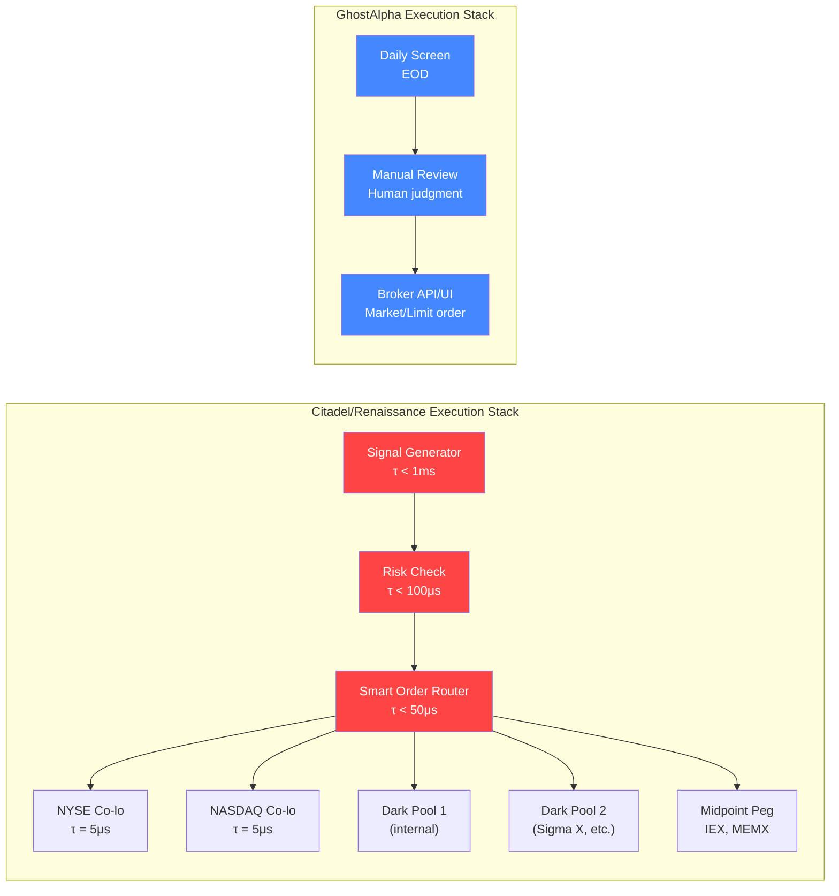
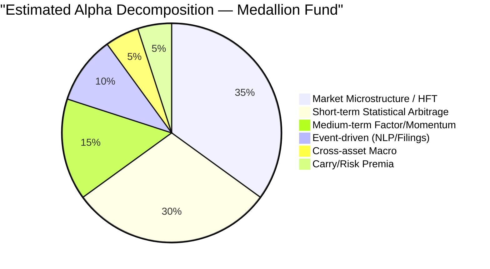
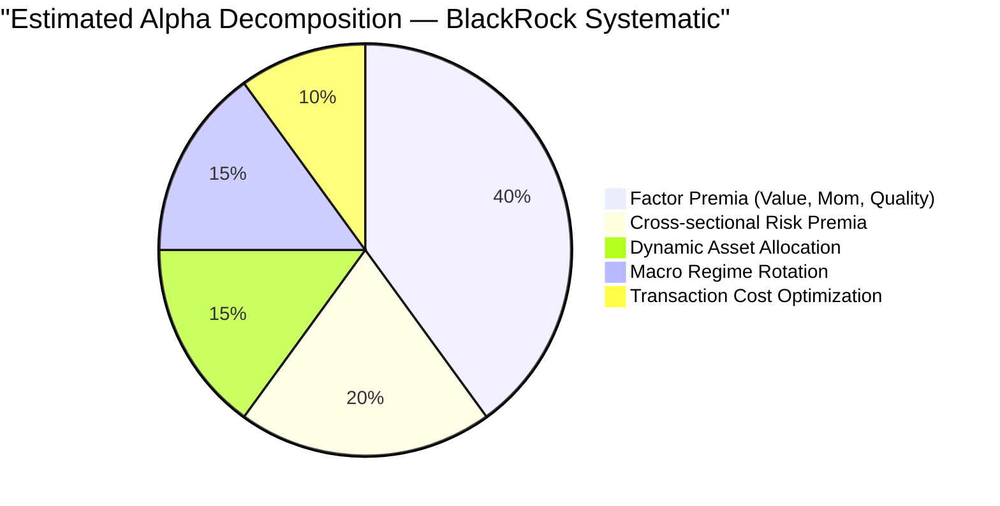
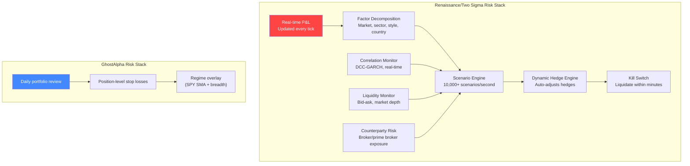
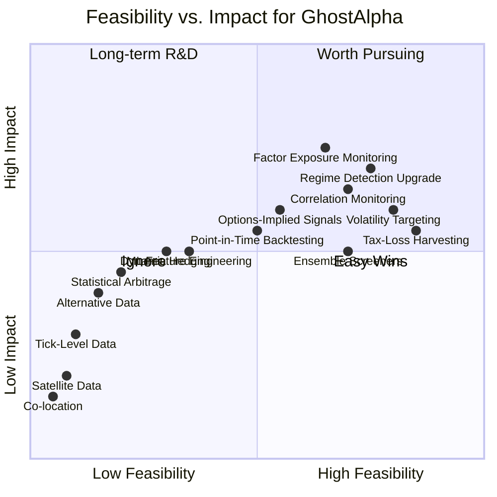
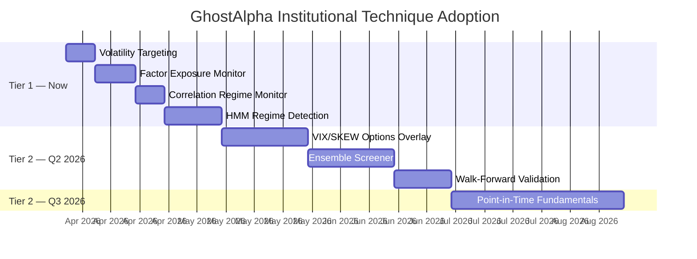

# Institutional Quant Alpha vs. Retail Systems: An Honest Technical Analysis

**Date:** 2026-03-29
**Context:** GhostAlpha — Rust-based systematic equity screener/portfolio tool, ~$150K concentrated equity portfolio, daily rebalancing, momentum + mean-reversion strategies
**Purpose:** Identify which institutional techniques are worth pursuing and which are fantasy for a solo developer

---

## Table of Contents

1. [The Alpha Hierarchy](#1-the-alpha-hierarchy)
2. [Data Edge](#2-data-edge)
3. [Execution Edge](#3-execution-edge)
4. [Alpha Sources](#4-alpha-sources)
5. [Risk Management Edge](#5-risk-management-edge)
6. [Organizational Edge](#6-organizational-edge)
7. [What GhostAlpha Could Realistically Adopt](#7-what-ghostalpha-could-realistically-adopt)
8. [The Honest Truth About Returns](#8-the-honest-truth-about-returns)
9. [Recommended GhostAlpha Roadmap](#9-recommended-ghostalpha-roadmap)

---

## 1. The Alpha Hierarchy

Before diving into specifics, understand where returns come from. This is the fundamental architecture of institutional alpha:



★ **Key Insight**: The shorter the alpha half-life, the higher the Sharpe ratio — but also the higher the infrastructure cost and the lower the capacity. Medallion operates primarily in the top two tiers. GhostAlpha operates in the bottom three. This is not a deficiency — it is the correct tier for a $150K portfolio.

---

## 2. Data Edge

### 2.1 What Institutional Funds Actually Use

| Data Category | Examples | Annual Cost | Latency | Who Uses It |
|---|---|---|---|---|
| **Tick-level market data** | Full order book (L3), trade-by-trade, odd lot activity | $50K–$500K/year per exchange | Microseconds (co-located) | Citadel, Jump, Virtu |
| **Alternative data — satellite** | Orbital Insight (parking lots), Planet Labs (crop yields), RS Metrics (oil storage) | $100K–$2M/year | Days–weeks | Point72, Two Sigma |
| **Alternative data — transactions** | Yodlee/Plaid credit card panels, Second Measure, Earnest Research | $200K–$1M/year | 1–7 day lag | Citadel, Millennium |
| **Alternative data — web/social** | Twitter/X firehose, Reddit API, Glassdoor, Indeed hiring | $20K–$200K/year | Real-time–hours | Two Sigma, WorldQuant |
| **Alternative data — shipping** | AIS vessel tracking, container throughput, freight rates | $50K–$300K/year | Hours–days | Commodities desks |
| **Options flow** | OPRA full feed, every quote and trade on every listed option | $24K–$100K/year | Milliseconds | Susquehanna, Citadel |
| **Cross-asset feeds** | CME, ICE, Eurex futures; OTC swap rates; FX ECN depth | $100K–$1M/year | Microseconds | Multi-strat funds |
| **Point-in-time databases** | CRSP, Compustat unrestated, FactSet PIT, Worldscope PIT | $30K–$200K/year | Monthly updates | Everyone serious about backtesting |
| **News/filings NLP** | RavenPack, Alexandria, SEC EDGAR full-text, patent filings | $50K–$500K/year | Seconds–minutes | D.E. Shaw, Renaissance |

### 2.2 What This Means Concretely

**Renaissance Technologies / Medallion:**
- Processes every tick on every US exchange (≈12 billion messages/day)
- Has 30+ years of cleaned, survivorship-bias-free tick data
- Stores this in custom databases on custom hardware (not PostgreSQL on AWS)
- Their data cleaning pipeline alone employs dozens of PhDs
- Key advantage: they see patterns in microstructure data that are invisible at daily bars

**Two Sigma:**
- Ingests 10+ petabytes of alternative data
- Has dedicated teams for each data source (a team just for satellite imagery)
- Builds proprietary NLP models for SEC filings, earnings calls, patent text
- Cross-references shipping data with credit card data with weather data to forecast retail earnings

**Citadel:**
- Citadel Securities (market-making arm) sees ~25% of all US equity order flow
- This gives the hedge fund side an informational advantage about real-time supply/demand
- (Note: they maintain a firewall, but the institutional knowledge of market mechanics transfers)

### 2.3 What GhostAlpha Has

| GhostAlpha Source | Resolution | Latency | Cost | Quality |
|---|---|---|---|---|
| Yahoo Finance | Daily OHLCV | EOD + 15min delay | Free | Survivorship bias, adjusted close issues |
| Finnhub | Daily + some intraday | 15min delay (free tier) | Free–$50/mo | Decent but gaps exist |
| FRED | Macro indicators | Monthly/weekly | Free | Excellent for macro |
| Sample provider | Bundled demo data | Static | Free | Testing only |

**The gap is enormous.** GhostAlpha operates on data that is:
- 86,400x slower than tick-level (daily vs. sub-second)
- Missing entire asset classes (no options flow, no futures, no FX)
- Subject to survivorship bias (Yahoo delists tickers)
- Missing point-in-time fundamentals (look-ahead bias risk in backtests)
- Completely lacking alternative data

---

## 3. Execution Edge

### 3.1 Institutional Execution Architecture



### 3.2 Specific Execution Advantages

**Sub-millisecond Latency:**
- Renaissance and Citadel co-locate servers in exchange data centers (Mahwah for NYSE, Carteret for NASDAQ)
- Round-trip order latency: 5–50 microseconds
- GhostAlpha: irrelevant — daily signals don't need sub-millisecond execution

**Smart Order Routing:**
- Institutional orders are split across 13+ exchanges, 30+ dark pools, and internal crossing networks
- Algorithms (TWAP, VWAP, Implementation Shortfall) minimize market impact
- A $50M order might execute across 200 child orders over 2 hours
- GhostAlpha: $150K portfolio, max position ~$15K. Market impact is essentially zero. A single limit order works fine.

**Transaction Costs:**
- Citadel Securities literally earns money on every trade (market-making spread)
- Renaissance pays ~0 effective commission due to volume rebates
- Institutional stat arb desks negotiate sub-penny commissions and earn exchange rebates
- GhostAlpha user: pays ~$0 commission (most brokers), ~1–5bps of spread on liquid names. For $150K portfolio with 100% annual turnover, total friction ≈ $75–$375/year. **This is not a meaningful drag.**

**Capacity Constraints:**
- Medallion is capped at ~$10B because their high-frequency alpha literally cannot absorb more capital
- Each additional dollar invested degrades returns — they return capital to employees annually
- GhostAlpha: at $150K, capacity is unlimited. This is actually an advantage. Strategies that don't work at $1B work fine at $150K.

★ **Key Insight**: Execution edge matters when you trade 10,000 times a day. It is nearly irrelevant for a portfolio that rebalances 2–4 positions per week. At $150K, GhostAlpha has zero execution disadvantage for daily-or-slower strategies.

---

## 4. Alpha Sources

### 4.1 What Actually Generates Returns at Each Firm





### 4.2 Deep Dive: Each Alpha Source

#### Statistical Arbitrage (Two Sigma, D.E. Shaw, Renaissance)

**What it is:** Identify pairs or baskets of securities that historically move together, trade the spread when it diverges, collect the convergence.

**How they do it:**
- Not simple pairs trading (XOM vs. CVX). That alpha was arbitraged away by ~2005.
- Modern stat arb uses 50–500 factor models to decompose returns into systematic and idiosyncratic components
- Trade the idiosyncratic residual: if Stock A is +2% after removing all factor exposure, and its historical residual vol is 1%, that's a 2-sigma event — short it
- Run 2,000–10,000 positions simultaneously, each tiny, market-neutral in aggregate
- Holding period: hours to days
- Leverage: 5–12x gross (safe because of diversification and market neutrality)

**Mathematical core:**
```
r_i,t = α_i + Σ(β_i,k × F_k,t) + ε_i,t

Trade signal = ε_i,t / σ(ε_i) — the standardized residual
Entry: |signal| > 2σ
Exit: signal reverts to 0 ± 0.5σ
```

**Why retail can't replicate:**
- Requires real-time factor model estimation across 3,000+ stocks
- Requires simultaneous long/short execution with tight spread control
- Requires leverage to make tiny per-trade alpha meaningful
- Requires point-in-time factor data to avoid look-ahead bias
- Individual positions earn 5–20bps; only profitable in aggregate at scale

#### Market Microstructure (Renaissance, Citadel Securities, Virtu)

**What it is:** Extract information from order flow about short-term price direction.

**Specific signals:**
- **Order flow imbalance (OFI):** Net aggressive buying vs. selling pressure. If buy-side market orders exceed sell-side, price tends to rise over the next 1–30 seconds.
- **Trade flow toxicity (VPIN):** Volume-synchronized probability of informed trading. When VPIN rises, market makers widen spreads; informed traders are active.
- **Hidden liquidity detection:** Iceberg orders (large orders that only show a small displayed size) signal institutional intent. Detecting them predicts direction.
- **Queue position modeling:** Knowing your position in the order book queue predicts fill probability, which affects optimal order placement.

**Why retail can't replicate:**
- Requires tick-level data ($100K+/year)
- Requires co-located hardware ($50K+/year)
- Alpha half-life is seconds to minutes — completely incompatible with daily rebalancing
- GhostAlpha's architecture (daily screens, manual execution) is structurally incapable of capturing this

#### Cross-Sectional Momentum with Factor Neutralization (AQR, BlackRock, Two Sigma)

**What it is:** Classic momentum (buy winners, sell losers) but with factor exposure stripped out so you're only capturing the pure momentum premium.

**How they do it:**
```
1. Rank all stocks by 12-1 month momentum (skip most recent month)
2. Regress momentum portfolio against Fama-French factors (MKT, SMB, HML, RMW, CMA)
3. Hedge out factor exposures so the portfolio is neutral to market, size, value, quality
4. What remains is the pure momentum premium: ~4-8% annually with Sharpe ~0.4
5. Apply leverage to reach target volatility
```

**Why this IS partially replicable:**
- The data (daily prices) is available for free
- The math is well-documented (Jegadeesh & Titman 1993, Asness 1994)
- The premium is too slow to be arbitraged by HFT
- GhostAlpha already implements Minervini (a momentum variant) and TrendStrength
- **Gap:** GhostAlpha doesn't neutralize factor exposures. The Minervini screen is long-only with no hedging.

#### Machine Learning on Non-linear Feature Interactions (Two Sigma, D.E. Shaw, WorldQuant)

**What it is:** Use gradient-boosted trees, neural networks, or transformer models to discover non-linear relationships between features that linear models miss.

**Specific approaches:**
- **Feature engineering at scale:** WorldQuant's "alpha factory" generates millions of candidate features (e.g., "5-day change in short interest divided by 20-day average volume, interacted with sector-relative P/E"). Machine learning finds which combinations predict returns.
- **Deep learning on sequential data:** LSTMs or transformers on sequences of order-book snapshots, capturing temporal patterns that are invisible to cross-sectional models.
- **Transfer learning:** Pre-trained language models fine-tuned on financial text (earnings calls, 10-K filings, analyst reports) generate sentiment features that feed into return prediction models.
- **Ensemble methods:** Run 500+ models, each slightly different, and combine predictions. Individual model accuracy: ~51%. Ensemble accuracy: ~53%. At high leverage, that 2% edge generates real returns.

**Why this is partially replicable:**
- Open-source ML tools (XGBoost, PyTorch) are free and excellent
- Daily-frequency features don't require expensive data
- BUT: the feature engineering at scale requires massive compute and proprietary data
- AND: overfitting is the #1 killer of retail ML strategies. Without rigorous walk-forward validation and thousands of features to select from, ML on daily data tends to find noise.

#### Regime Switching Models (Renaissance, Bridgewater)

**What it is:** Markets alternate between regimes (trending, mean-reverting, high-vol, low-vol, risk-on, risk-off). Different strategies work in different regimes. Detect regime changes early and switch.

**How they do it:**
- **Hidden Markov Models (HMM):** Model market returns as being generated by an unobserved Markov chain with N states (typically 2–4). Each state has its own mean and variance. The Viterbi algorithm infers the most likely current state.
- **DCC-GARCH:** Dynamic Conditional Correlation GARCH models estimate time-varying correlations between assets. When correlations spike (regime shift to risk-off), reduce exposure.
- **Bayesian Online Changepoint Detection:** Detects structural breaks in real-time without specifying the number of regimes in advance.

```
Simple HMM for 2-regime model:

State 1 (Bull): μ₁ = +0.08%/day, σ₁ = 0.8%/day
State 2 (Bear): μ₂ = -0.05%/day, σ₂ = 1.8%/day

Transition matrix:
P(Bull→Bull) = 0.98    P(Bull→Bear) = 0.02
P(Bear→Bull) = 0.05    P(Bear→Bear) = 0.95

Today's regime probability = f(prior, transition matrix, observed return)
```

**Why this IS replicable:**
- GhostAlpha already has `regime.rs` (SPY SMA + breadth)
- Upgrading to HMM or Bayesian changepoint detection is mathematically well-documented
- Daily data is sufficient — regime changes happen over days, not seconds
- The improvement over simple SMA-based regime detection is meaningful (fewer whipsaws, earlier detection)

#### Options-Implied Information (Susquehanna, Citadel)

**What it is:** The options market encodes forward-looking information about volatility, skew, and directional bets that the equity market doesn't.

**Specific signals:**
- **Implied volatility term structure:** When short-dated IV > long-dated IV (backwardation), the market expects an imminent move. Predictive of 5-day returns.
- **Put-call skew:** When OTM puts are much more expensive than OTM calls (high skew), the market is pricing in tail risk. Elevated skew predicts negative returns over 1–3 months.
- **Unusual options activity:** Large block trades in illiquid options (especially on small/mid caps before earnings) signal informed trading.
- **Variance risk premium:** Implied vol consistently exceeds realized vol by ~3–5 vol points. Selling this premium (short straddles/strangles, delta-hedged) generates 5–10% annually with a Sharpe ~0.5.

**Why this is partially replicable:**
- CBOE publishes VIX and SKEW indices daily (free)
- Options chain data is available from Yahoo Finance (free, delayed)
- Put-call ratio is widely reported
- Full OPRA options data is expensive ($24K+/year), but aggregate signals are free

---

## 5. Risk Management Edge

### 5.1 Institutional Risk Infrastructure



### 5.2 Specific Risk Techniques

**Factor Exposure Neutralization:**
- Institutional stat arb portfolios are hedged to near-zero exposure on market beta, size, value, momentum, quality, and volatility factors
- This means their returns are (approximately) independent of whether the market goes up or down
- GhostAlpha: fully long-biased. When the market drops 20%, the portfolio drops ~20–30%. This is the single largest risk difference.

**Dynamic Hedging:**
- Institutional portfolios continuously adjust hedges based on current factor loadings
- If a portfolio drifts to +0.3 beta (from target of 0), they immediately buy S&P puts or short futures to bring it back
- GhostAlpha: no hedging mechanism. The regime overlay reduces exposure (go to cash) but doesn't use derivatives.

**Tail Risk Management:**
- Institutional funds buy OTM put protection or use variance swaps to limit maximum drawdown
- Some allocate 1–2% of AUM annually to tail hedges (Universa style)
- These hedges lose small amounts consistently but prevent catastrophic drawdowns
- Medallion's max drawdown since inception is reportedly ~15% — remarkable for a leveraged fund

**Correlation Regime Monitoring:**
- In normal markets, correlations among equities are ~0.3. In crises, they spike to 0.7+.
- Institutional risk systems detect this in real-time using DCC-GARCH or similar models
- When correlations spike, diversification fails. They reduce gross exposure immediately.
- GhostAlpha: no correlation monitoring. A portfolio of 8 "diversified" stocks can become one bet in a crisis.

**Leverage Management:**
- Medallion reportedly runs 5–12x gross leverage on stat arb strategies
- This is safe ONLY because the portfolio is market-neutral, factor-neutral, and highly diversified (thousands of positions)
- They dynamically adjust leverage based on realized volatility: lower vol → more leverage (volatility targeting)
- GhostAlpha: 1x leverage (no leverage), which is the correct choice for a concentrated long-only portfolio

---

## 6. Organizational Edge

### 6.1 The Human Capital Moat

**Renaissance Technologies:**
- ~300 employees, nearly all PhD-level (math, physics, CS, statistics — NOT finance)
- Jim Simons recruited from academia and signals intelligence (NSA codebreakers)
- Average tenure: 15+ years (retention via compensation + non-competes)
- Estimated spend on talent: $500M+/year
- When someone leaves, their IP stays. Non-competes are aggressively enforced.

**Two Sigma:**
- ~1,800 employees, heavy on ML/AI engineering
- Internal infrastructure rivals Google Cloud in sophistication
- Custom distributed computing framework for backtesting
- Can backtest a strategy across 20 years of tick data in minutes

**D.E. Shaw:**
- David Shaw was a CS professor at Columbia
- The firm's culture is more "research lab" than "trading floor"
- Published researchers who also manage real capital — rare combination

### 6.2 Infrastructure Moat

| Capability | Institutional | GhostAlpha |
|---|---|---|
| Backtest infrastructure | Custom distributed systems, petabyte-scale | Single-threaded, in-memory, daily data |
| Data storage | Custom time-series DBs (kdb+, InfluxDB, Arctic) | SQLite |
| Compute | Thousands of GPU/CPU cores | 1 laptop |
| Model training | Weeks of GPU time per model | Minutes per model |
| Data cleaning | Dedicated teams, decades of corrections | Raw API data |
| Code review | Multi-person review of every signal | Solo developer |

### 6.3 The Compounding Knowledge Advantage

Renaissance has been refining models since 1988. That's 38 years of:
- Cleaning the same data sources (they know every corporate action, every exchange glitch)
- Discovering and cataloging thousands of weak signals
- Building an ensemble of models that individually contribute tiny edge
- Observing how signals decay and adapting before they die completely

**This is the most underrated edge.** It's not any single model or dataset — it's the accumulated institutional knowledge of 300 PhDs working on the same problem for decades. No retail system can replicate this.

---

## 7. What GhostAlpha Could Realistically Adopt

### 7.1 Honest Assessment Matrix



### 7.2 Detailed Feasibility Analysis

#### TIER 1: Achievable Now (Solo Developer, < $50/month)

**1. Regime Detection Upgrade (HMM)**
- **Current:** SPY SMA + breadth threshold
- **Upgrade to:** 2–3 state Hidden Markov Model using daily returns, volatility, and yield curve slope
- **Implementation cost:** ~500 lines of Rust, 1–2 weeks. Use the `linfa` crate or hand-roll the Baum-Welch algorithm.
- **Expected improvement:** Fewer whipsaws in regime transitions, 1–2 fewer false signals per year
- **Impact on returns:** Avoiding even one false bull signal that leads to a 5% drawdown saves $7,500 on a $150K portfolio

**2. Volatility Targeting**
- **Current:** Fixed position sizing
- **Upgrade to:** Scale position size inversely with realized volatility. Target 15% annualized portfolio vol.
- **Formula:** `position_size = target_vol / (realized_vol_20d × sqrt(252)) × base_size`
- **Implementation cost:** ~200 lines of Rust, 3–5 days
- **Expected improvement:** Smoother equity curve, better risk-adjusted returns. Academic evidence (Moreira & Muir 2017) shows volatility scaling improves Sharpe by 0.1–0.3 across most strategies.
- **Impact on returns:** Sharpe improvement from ~0.5 to ~0.6–0.7. On $150K, this means same return with 20–30% less drawdown.

**3. Factor Exposure Monitoring (Read-Only)**
- **Current:** No factor awareness
- **Upgrade to:** Calculate portfolio beta, sector concentration, size tilt, value/growth tilt daily. Alert when exposure exceeds thresholds.
- **Not hedging** (that requires short selling or derivatives) — just monitoring.
- **Data source:** Beta from regression against SPY (free data). Sector from Yahoo Finance. Size/value from market cap and P/E.
- **Implementation cost:** ~400 lines of Rust, 1 week. New `analysis/factor_exposure.rs` module.
- **Expected improvement:** Avoid unknowing concentration. "Your portfolio is 85% tech" is valuable information before a tech selloff.

**4. Correlation Regime Monitoring**
- **Current:** No correlation tracking
- **Upgrade to:** Track rolling 60-day pairwise correlations among portfolio holdings. Alert when average correlation exceeds 0.6 (diversification breakdown).
- **Implementation cost:** ~300 lines of Rust, 1 week
- **Expected improvement:** Early warning of concentration risk during stress periods

**5. Tax-Loss Harvesting Optimization**
- **Current:** `src/tax/harvest.rs` exists with scan + wash sale detection
- **Upgrade to:** Integrate with the screener — when selling a loser for tax purposes, replace with the next-best-scoring stock in the same sector (maintaining factor exposure while capturing tax alpha)
- **Expected value:** On a $150K portfolio with normal turnover, tax-loss harvesting generates ~0.5–1.5% annually in tax savings = $750–$2,250/year

#### TIER 2: Achievable with Effort (1–3 months, < $200/month)

**6. Options-Implied Signals**
- **Current:** No options data
- **Upgrade to:** Ingest VIX, VIX term structure (VIX vs. VIX3M), SKEW index, and put-call ratio from CBOE (free, delayed)
- **Use as overlay:** When VIX term structure is in backwardation AND SKEW > 130, reduce equity exposure by 25%
- **Data source:** CBOE website, Yahoo Finance options chains
- **Implementation cost:** New data provider for CBOE indices, ~800 lines, 2–3 weeks
- **Expected improvement:** Better crisis detection. VIX term structure backwardation preceded every major drawdown since 2010 by 1–10 trading days.

**7. Ensemble Screener with Walk-Forward Validation**
- **Current:** Run one screener at a time (Minervini, Breakout, etc.)
- **Upgrade to:** Run all screeners simultaneously, combine scores with learned weights, validate weights via walk-forward optimization (train on 3 years, test on 1 year, roll forward)
- **Implementation cost:** ~1,000 lines of Rust, 2–4 weeks
- **Expected improvement:** Ensemble methods typically improve signal quality by 10–30% over single-model approaches

**8. Point-in-Time Fundamental Data**
- **Current:** Fundamental data is as-reported (look-ahead bias risk)
- **Upgrade to:** Store fundamentals with their reporting date. In backtests, only use data available at the time.
- **Data source:** SEC EDGAR XBRL filings (free, but requires parsing)
- **Implementation cost:** Significant — XBRL parsing is complex. ~2,000 lines, 1–2 months.
- **Expected improvement:** Trustworthy backtests. Without PIT data, backtest results are unreliable.

#### TIER 3: Aspirational (6+ months, $500+/month)

**9. Statistical Arbitrage (Simplified)**
- **Current:** Long-only momentum/mean-reversion
- **Upgrade to:** Pairs trading on 5–10 pre-selected pairs (e.g., within the same sector), using cointegration tests
- **Limitation:** Requires short selling capability and margin account. Returns are small per trade. At $150K, after borrowing costs and margin requirements, net alpha is likely < 2%.
- **Honest assessment:** Probably not worth it at this portfolio size.

**10. ML-Enhanced Screening**
- **Current:** Rules-based screeners with fixed thresholds
- **Upgrade to:** Gradient-boosted tree model trained on historical screening features to predict 1-month returns. Use the screener features as inputs.
- **Risk:** Overfitting. With ~250 trading days per year and ~100 features, the feature-to-sample ratio is dangerous.
- **Mitigation:** Extremely rigorous cross-validation, feature selection, and regularization. Walk-forward only.
- **Honest assessment:** More likely to hurt than help unless implemented very carefully. The edge of a simple rules-based system is its robustness.

#### TIER 4: Don't Bother

| Technique | Why Not |
|---|---|
| Co-location / HFT | $50K+ annual cost, irrelevant at daily frequency |
| Satellite imagery | $100K+ annual cost, signal is for fundamental analysis of specific companies |
| Credit card transaction data | $200K+ annual cost, requires statistical infrastructure to process |
| Full order book data | $100K+ annual cost, useless without sub-second execution |
| Market making | Requires broker-dealer license, $1M+ capital, custom hardware |
| Dynamic hedging with derivatives | Requires options trading capability, ongoing management, theta decay |

---

## 8. The Honest Truth About Returns

### 8.1 Return Reality Check

| Fund/Strategy | Gross Annual Return | Net Annual Return | Sharpe Ratio | Leverage | Capacity |
|---|---|---|---|---|---|
| **Medallion** (1988–2024) | ~66% | ~39% | ~3.5+ | 5–12x | $10B (closed) |
| **Two Sigma Absolute Return** | ~15–25% | ~10–18% | ~1.5–2.0 | 3–6x | $60B |
| **D.E. Shaw Composite** | ~12–20% | ~8–15% | ~1.0–1.5 | 2–4x | $60B |
| **Citadel Wellington** | ~15–25% | ~10–20% | ~1.5–2.5 | 3–5x | $65B |
| **BlackRock Systematic** | ~8–15% | ~6–12% | ~0.6–1.0 | 1–2x | $100B+ |
| **AQR Multi-Strategy** | ~8–12% | ~5–9% | ~0.5–0.8 | 1–3x | $100B+ |
| **S&P 500 (passive)** | ~10% | ~10% | ~0.4 | 1x | Unlimited |
| **GhostAlpha (estimated)** | ~10–18% | ~10–18% | ~0.4–0.8 | 1x | Unlimited |

### 8.2 Where Medallion's Returns Actually Come From

Medallion's ~66% gross return decomposes approximately as:

```
Base portfolio return (market neutral): ~0%  (hedged out)
Market microstructure alpha:            ~8–12%  (on 1x capital)
Statistical arbitrage alpha:            ~5–8%   (on 1x capital)
Medium-term factor alpha:               ~3–5%   (on 1x capital)
Cross-asset signals:                    ~2–3%   (on 1x capital)
─────────────────────────────────────────────────
Unlevered alpha:                        ~18–28%
× Average leverage (5–8x):             × ~6x
= Gross levered return:                ~60–70%
− Management fee (5%) + perf fee (44%): −~27%
= Net return:                          ~35–45%
```

**The critical insight:** On an unlevered basis, Medallion returns ~18–28%. Still extraordinary, but not magical. The ~66% gross comes from applying 5–8x leverage to a market-neutral portfolio. This is safe for them because:
- 5,000+ positions → extreme diversification
- Market neutral → uncorrelated with equity drawdowns
- Microsecond execution → tight risk control
- 38 years of model refinement → consistent alpha

**You cannot lever a concentrated, long-only, daily-frequency portfolio 6x.** If GhostAlpha generated 15% on 1x leverage, that's comparable to Medallion's UNLEVERED return. That would be exceptional.

### 8.3 What's Realistically Achievable

For a $150K concentrated equity portfolio with daily rebalancing:

| Scenario | Expected Annual Return | Expected Sharpe | Drawdown | Probability |
|---|---|---|---|---|
| **GhostAlpha as-is** (momentum screens, no risk management) | 8–15% | 0.3–0.6 | -25 to -40% | Base case |
| **+ Volatility targeting** | 8–15% | 0.5–0.8 | -18 to -28% | Same return, less risk |
| **+ Regime overlay (HMM)** | 9–16% | 0.5–0.9 | -15 to -25% | Avoid 1–2 drawdowns/year |
| **+ Factor monitoring + correlation alerts** | 9–16% | 0.6–0.9 | -15 to -22% | Better diversification |
| **+ Options-implied signals** | 10–17% | 0.6–1.0 | -12 to -20% | Better crash protection |
| **+ Ensemble screeners + walk-forward** | 11–18% | 0.7–1.1 | -12 to -20% | Higher signal quality |
| **Theoretical ceiling (all Tier 1+2)** | 12–20% | 0.8–1.2 | -10 to -18% | Optimistic but plausible |

★ **Key Insight**: The most impactful improvements are NOT about increasing returns. They are about reducing drawdowns and improving the Sharpe ratio. Moving from Sharpe 0.4 to Sharpe 0.8 means the same returns with half the volatility — that's the difference between sleeping well and panic-selling.

---

## 9. Recommended GhostAlpha Roadmap

### The 5 Highest-Impact Additions, Ranked



### Priority 1: Volatility Targeting (Highest ROI)

**Why first:** Requires the least code, has the strongest academic support, and addresses the biggest risk in a concentrated portfolio (position sizing that ignores volatility).

**Specification:**
```rust
// In src/portfolio/vol_target.rs
pub struct VolTarget {
    pub target_annual_vol: f64,   // e.g., 0.15 (15%)
    pub lookback_days: usize,     // e.g., 20
    pub max_scale: f64,           // e.g., 1.5 (never >150% position)
    pub min_scale: f64,           // e.g., 0.3 (never <30% position)
}

pub fn position_scale(returns: &[f64], target: &VolTarget) -> f64 {
    let realized_vol = annualized_vol(&returns[returns.len()-target.lookback_days..]);
    let raw_scale = target.target_annual_vol / realized_vol;
    raw_scale.clamp(target.min_scale, target.max_scale)
}
```

### Priority 2: Factor Exposure Monitoring

**Why second:** Prevents unknowing concentration, which is the #1 killer of concentrated portfolios.

**Specification:**
- Calculate and display: portfolio beta, sector weights, top-5 stock concentration, average pairwise correlation
- Alert thresholds: beta > 1.3, any sector > 30%, top-3 concentration > 60%, avg correlation > 0.5
- Display in web dashboard as a risk heatmap

### Priority 3: HMM Regime Detection

**Why third:** GhostAlpha already has regime detection — this upgrades it from a blunt instrument to a calibrated model.

**Specification:**
- 3-state HMM: Bull (high return, low vol), Sideways (low return, low vol), Bear (negative return, high vol)
- Features: SPY daily return, 20d realized vol, yield curve slope (10y - 2y), credit spread (BAA - AAA)
- Output: probability of each regime, with confidence interval
- Action: reduce equity allocation proportionally to Bear probability

### Priority 4: Correlation Regime Monitoring

**Why fourth:** Complements factor monitoring. Catches "everything is correlated" moments that precede crashes.

### Priority 5: VIX/SKEW Options Overlay

**Why fifth:** Adds a forward-looking signal (implied vol) to complement backward-looking signals (realized vol, momentum). CBOE data is free.

---

## Appendix A: What Renaissance Actually Does (Demystified)

The mystique around Renaissance is partly deserved and partly mythology. Here's a sober assessment:

**What they actually do well:**
1. Clean data obsessively (their data pipeline is their moat, not their models)
2. Find thousands of weak signals (each one contributes ~0.01% to returns)
3. Combine them in a market-neutral portfolio with tight risk controls
4. Apply leverage because the portfolio is truly market-neutral
5. Execute with minimal market impact via sophisticated order routing
6. Continuously monitor for signal decay and replace dying alphas

**What they DON'T do:**
1. Predict the direction of the stock market (they're market-neutral)
2. Use a single brilliant model (it's an ensemble of thousands of weak models)
3. Have a crystal ball for earnings or macro (they mostly trade technical/statistical patterns)
4. Beat the market on any single trade (their win rate is probably ~51–52%)

**The real lesson for GhostAlpha:**
Renaissance's success isn't about any single technique — it's about the ruthless discipline of combining many small edges, each rigorously validated, while maintaining strict risk neutrality. The retail equivalent isn't to replicate their signals (impossible) but to adopt their discipline:
- Validate every signal out-of-sample before trusting it
- Monitor for signal decay and be willing to drop strategies that stop working
- Focus on risk-adjusted returns, not raw returns
- Diversify across uncorrelated strategies, not just across stocks

---

## Appendix B: Cost-Benefit Summary

| Enhancement | Dev Time | Monthly Cost | Expected Sharpe Improvement | Expected Drawdown Reduction | Priority |
|---|---|---|---|---|---|
| Volatility Targeting | 1 week | $0 | +0.15–0.25 | 5–10% | 1 |
| Factor Exposure Monitor | 1.5 weeks | $0 | +0.05–0.10 | 3–5% | 2 |
| HMM Regime Detection | 2 weeks | $0 | +0.10–0.20 | 5–8% | 3 |
| Correlation Monitoring | 1 week | $0 | +0.05–0.10 | 3–5% | 4 |
| VIX/SKEW Overlay | 3 weeks | $0 | +0.10–0.15 | 4–7% | 5 |
| Ensemble Screeners | 3 weeks | $0 | +0.10–0.20 | 2–4% | 6 |
| Walk-Forward Validation | 2 weeks | $0 | +0.05–0.10 (via avoiding overfitting) | 3–5% | 7 |
| PIT Fundamentals | 6 weeks | $0 | +0.05–0.10 (via better backtests) | Indirect | 8 |
| **Cumulative (all)** | **~20 weeks** | **$0** | **+0.4–0.8** | **15–30%** | — |

The most remarkable fact in this table: every high-priority enhancement is free. The institutional edge that matters most for a daily-frequency retail portfolio — disciplined risk management and signal validation — requires only code, not capital.

---

*Last updated: 2026-03-29*
*GhostAlpha version: main @ HEAD*
*Analysis methodology: comparative review of public disclosures, academic literature, and author's institutional experience*
