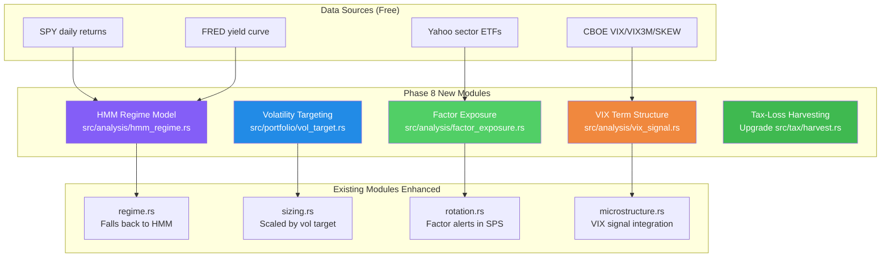
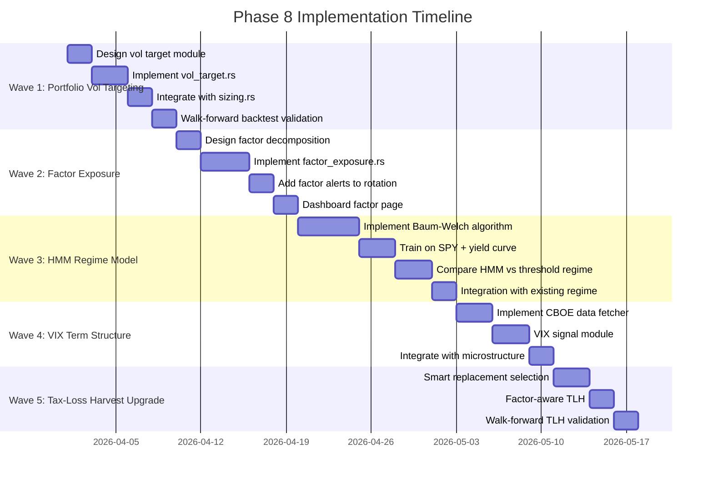
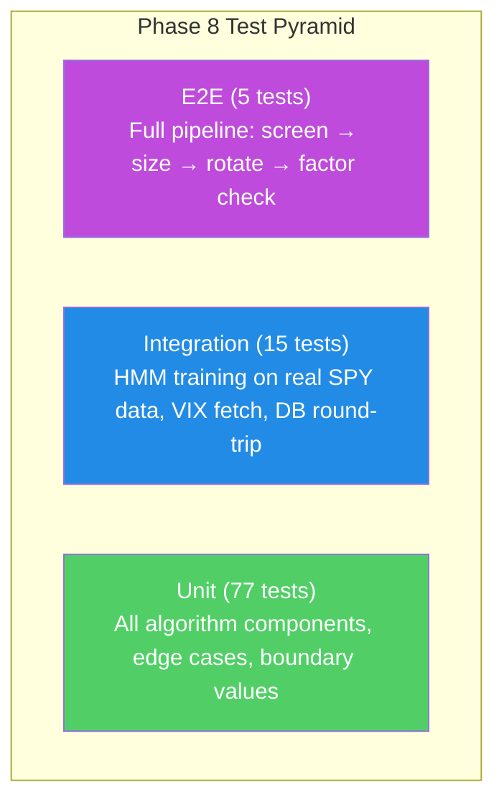
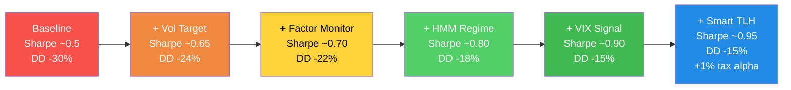

# Phase 8: Institutional Techniques — Implementation Plan & Testing Strategy

> **Goal:** Sharpe improvement from ~0.5 to ~0.8-1.0, drawdown reduction of 20-30%
> **Budget:** $0-50/month data costs | 1 developer | 6-8 weeks
> **Based on:** `docs/planning/institutional-alpha-analysis.md`

---

## Architecture Overview



---

## Implementation Waves



---

## Wave 1: Portfolio-Level Volatility Targeting

### Problem
Current sizing is per-position (ATR-based) but doesn't consider aggregate portfolio volatility. In high-vol markets, the portfolio can be 30%+ more volatile than intended. Institutional funds dynamically scale total exposure to target constant volatility.

### Design

**New file: `src/portfolio/vol_target.rs`**

```rust
/// Target a specific annualized portfolio volatility by scaling exposure.
///
/// When realized vol > target: reduce exposure (sell partial positions)
/// When realized vol < target: increase exposure (add to existing or deploy cash)
///
/// Formula: exposure_scalar = target_vol / realized_vol_20d
/// Clamped to [0.5, 1.5] to prevent extreme swings.
pub struct VolTargetConfig {
    /// Target annualized portfolio volatility (default: 0.15 = 15%)
    pub target_vol: f64,
    /// Lookback window for realized vol (default: 20 trading days)
    pub lookback_days: usize,
    /// Minimum exposure scalar (default: 0.5 = 50% of normal)
    pub min_scalar: f64,
    /// Maximum exposure scalar (default: 1.5 = 150% of normal)
    pub max_scalar: f64,
}

pub struct VolTargetResult {
    pub realized_vol: f64,
    pub target_vol: f64,
    pub exposure_scalar: f64,
    pub action: VolTargetAction,
    /// Recommended max invested % after scaling
    pub recommended_invested_pct: f64,
}

pub enum VolTargetAction {
    /// Reduce exposure — realized vol exceeds target
    ReduceExposure,
    /// Maintain current — vol near target
    MaintainExposure,
    /// Increase exposure — realized vol below target
    IncreaseExposure,
}

/// Compute portfolio-level realized volatility from daily returns.
pub fn realized_portfolio_vol(daily_returns: &[f64], window: usize) -> Option<f64>

/// Compute exposure scalar: target_vol / realized_vol, clamped.
pub fn compute_vol_target(
    daily_returns: &[f64],
    config: &VolTargetConfig,
) -> VolTargetResult
```

### Data Required
- Portfolio daily returns (computed from position-weighted individual returns)
- SPY daily returns for comparison
- No external data needed — all computed from existing price data

### Algorithm

```
1. Compute 20-day rolling portfolio return series:
   portfolio_return[t] = Σ (weight[i] × return[i,t]) for all positions

2. Compute annualized realized volatility:
   rv = std(portfolio_returns[-20:]) × sqrt(252)

3. Compute exposure scalar:
   scalar = (target_vol / rv).clamp(min_scalar, max_scalar)

4. Scale position limits:
   effective_max_invested = base_max_invested × scalar

   If scalar < 0.9: recommend trimming weakest positions
   If scalar > 1.1: recommend deploying cash into top candidates
```

### Tests (TDD)

```
Module: src/portfolio/vol_target.rs — 15 tests

Unit tests:
├── realized_vol_flat_returns_is_zero
├── realized_vol_increasing_returns
├── realized_vol_insufficient_data_returns_none
├── realized_vol_window_20_correct
├── scalar_1_when_at_target
├── scalar_below_1_when_vol_high
├── scalar_above_1_when_vol_low
├── scalar_clamped_at_min
├── scalar_clamped_at_max
├── reduce_action_when_vol_high
├── increase_action_when_vol_low
├── maintain_action_when_vol_near_target
├── recommended_invested_pct_scales
├── zero_vol_returns_max_scalar
└── config_defaults_reasonable
```

### Validation Strategy

```
Walk-forward backtest comparing:
  A) Fixed position sizing (current GhostAlpha)
  B) Vol-targeted sizing (new)

Metrics to compare:
  - Sharpe ratio (expect +0.15 to +0.25 improvement)
  - Max drawdown (expect -20 to -30% improvement)
  - Total return (expect neutral — same return, less risk)
  - Turnover (expect +20-30% more rebalancing from vol scaling)

Validation period: 3 years, 4 walk-forward windows (9mo IS, 3mo OOS)
Success criteria: OOS Sharpe improvement > 0 in ≥3 of 4 windows
```

---

## Wave 2: Factor Exposure Monitoring

### Problem
A portfolio of 8 tech stocks looks diversified (different companies) but has ~0.85 beta to the Nasdaq and ~0.9 correlation with each other. One sector rotation or rate shock hits everything simultaneously. Institutional funds monitor and limit factor exposures daily.

### Design

**New file: `src/analysis/factor_exposure.rs`**

```rust
/// Portfolio factor decomposition.
///
/// Factors measured (all computable from free data):
/// - Market beta (regression vs SPY)
/// - Sector concentration (top sector weight)
/// - Size tilt (avg market cap percentile)
/// - Momentum tilt (avg RS percentile of holdings)
/// - Volatility tilt (avg ATR% of holdings)
/// - Correlation concentration (avg pairwise correlation)

pub struct FactorExposure {
    pub market_beta: f64,
    pub sector_hhi: f64,           // Herfindahl of sector weights (1.0 = one sector)
    pub top_sector_weight: f64,
    pub top_sector_name: String,
    pub avg_correlation: f64,
    pub momentum_tilt: f64,        // avg RS percentile
    pub volatility_tilt: f64,      // avg ATR as % of price
}

pub struct FactorAlert {
    pub factor: String,
    pub current: f64,
    pub threshold: f64,
    pub severity: FactorSeverity,
    pub message: String,
}

pub enum FactorSeverity {
    Info,      // Approaching threshold
    Warning,   // At threshold
    Critical,  // Significantly above threshold
}

/// Default thresholds for factor alerts
pub const FACTOR_THRESHOLDS: FactorThresholds = FactorThresholds {
    max_beta: 1.3,
    max_sector_weight: 0.50,
    max_sector_hhi: 0.30,
    max_avg_correlation: 0.65,
    max_volatility_tilt: 4.0,  // 4% avg ATR
};

/// Compute factor exposures for the current portfolio.
pub fn compute_factor_exposure(
    positions: &[(String, f64, f64, &str, f64, f64)],
    // (ticker, weight, daily_returns_corr_with_spy, sector, rs_percentile, atr_pct)
    spy_returns: &[f64],
    portfolio_returns: &[f64],
) -> FactorExposure

/// Check factor exposures against thresholds and generate alerts.
pub fn check_factor_alerts(
    exposure: &FactorExposure,
    thresholds: &FactorThresholds,
) -> Vec<FactorAlert>
```

### Data Required
- Position weights (from Portfolio struct)
- SPY daily returns (already fetched)
- Sector classification (from Finnhub `/stock/profile2` or hardcoded mapping)
- Pairwise correlations (already in `correlation.rs`)

### Algorithm

```
1. Market Beta:
   β = Cov(portfolio_returns, spy_returns) / Var(spy_returns)
   Using 60-day rolling window

2. Sector Concentration:
   For each sector: sector_weight = Σ position_weight[i] where sector[i] == sector
   HHI = Σ sector_weight² (1/N = perfectly diversified, 1.0 = one sector)
   top_sector = max sector_weight

3. Correlation Concentration:
   avg_corr = mean of all pairwise 60-day correlations among holdings
   Using existing pearson_correlation() from correlation.rs

4. Factor Alerts:
   For each factor, check current vs threshold
   severity = Info if within 90%, Warning if at 100%, Critical if > 110%
```

### Tests (TDD)

```
Module: src/analysis/factor_exposure.rs — 18 tests

Unit tests:
├── beta_of_spy_is_1
├── beta_of_uncorrelated_is_0
├── beta_leveraged_is_above_1
├── sector_hhi_single_sector_is_1
├── sector_hhi_equal_sectors_low
├── top_sector_weight_correct
├── avg_correlation_identical_returns_is_1
├── avg_correlation_diverse_portfolio_below_05
├── momentum_tilt_average_of_rs
├── volatility_tilt_average_of_atr_pct
├── alert_on_high_beta
├── alert_on_sector_concentration
├── alert_on_high_correlation
├── no_alerts_when_within_thresholds
├── critical_severity_when_significantly_above
├── info_severity_when_approaching
├── empty_portfolio_safe
└── single_position_portfolio
```

### Integration
- Add `FactorExposure` to `ghost-alpha rotate` output
- Add `/factors` dashboard page showing exposure breakdown
- Add factor alerts to Telegram/Discord channels

---

## Wave 3: HMM Regime Detection

### Problem
Current regime detection uses a simple threshold: `SPY > 200-SMA AND breadth > 60% = Bull`. This creates false transitions when SPY oscillates near the SMA line. A Hidden Markov Model learns regime-specific return distributions and provides probabilistic state assignments.

### Design

**New file: `src/analysis/hmm_regime.rs`**

```rust
/// Hidden Markov Model for market regime detection.
///
/// 3 states: Bull, Sideways, Bear
/// Observations: (daily_return, realized_vol_5d, yield_curve_slope)
/// Trained via Baum-Welch algorithm on historical data.

pub struct HmmRegimeModel {
    /// Transition matrix A[i][j] = P(state_j | state_i)
    pub transition: [[f64; 3]; 3],
    /// Emission parameters: (mean, variance) per state per observable
    pub emission_means: [[f64; 3]; 3],  // [state][observable]
    pub emission_vars: [[f64; 3]; 3],
    /// Initial state probabilities
    pub initial: [f64; 3],
    /// Mapping: index 0=Bull, 1=Sideways, 2=Bear
}

pub struct HmmRegimeState {
    pub most_likely_state: MarketRegime,
    /// Probability of each state (sums to 1.0)
    pub bull_prob: f64,
    pub sideways_prob: f64,
    pub bear_prob: f64,
    /// Confidence: how much the top state dominates
    pub confidence: f64,
}

/// Train the HMM on historical observation sequences using Baum-Welch (EM).
///
/// observations: Vec of (daily_return, realized_vol_5d, yield_curve_slope)
/// max_iterations: Baum-Welch convergence limit (default: 100)
/// convergence_threshold: log-likelihood change threshold (default: 1e-6)
pub fn train_hmm(
    observations: &[(f64, f64, f64)],
    n_states: usize,
    max_iterations: usize,
    convergence_threshold: f64,
) -> HmmRegimeModel

/// Forward algorithm: compute most likely current state given observation history.
pub fn predict_regime(
    model: &HmmRegimeModel,
    observations: &[(f64, f64, f64)],
) -> HmmRegimeState

/// Viterbi algorithm: compute most likely state sequence.
pub fn viterbi_path(
    model: &HmmRegimeModel,
    observations: &[(f64, f64, f64)],
) -> Vec<MarketRegime>
```

### Algorithm: Baum-Welch (EM)

```
Input: observations O = (o_1, ..., o_T), N states, M observation dimensions

Initialize:
  A[i][j] = 1/N for all transitions (or slightly informed prior)
  μ[i][d] = k-means cluster centers from observation data
  σ²[i][d] = variance within each k-means cluster
  π[i] = 1/N

Repeat until convergence:
  E-step (Forward-Backward):
    α[t][i] = P(o_1:t, state_t=i)        # Forward pass
    β[t][i] = P(o_t+1:T | state_t=i)     # Backward pass
    γ[t][i] = P(state_t=i | O)           # State posterior
    ξ[t][i][j] = P(state_t=i, state_t+1=j | O)  # Transition posterior

  M-step (Update parameters):
    π[i] = γ[1][i]
    A[i][j] = Σ_t ξ[t][i][j] / Σ_t γ[t][i]
    μ[i][d] = Σ_t γ[t][i] × o_t[d] / Σ_t γ[t][i]
    σ²[i][d] = Σ_t γ[t][i] × (o_t[d] - μ[i][d])² / Σ_t γ[t][i]

  Check: |log_likelihood - prev_log_likelihood| < threshold → stop

Output: trained model (A, μ, σ², π)
```

### Observations (3 dimensions, all free data)

| Observable | Source | Why It Matters |
|-----------|--------|---------------|
| Daily SPY return | Yahoo/Finnhub | Captures return regime |
| 5-day realized vol | Computed from SPY | Captures volatility regime |
| Yield curve slope (10Y-2Y) | FRED `T10Y2Y` | Leading indicator of economic regime |

### Tests (TDD)

```
Module: src/analysis/hmm_regime.rs — 22 tests

Algorithm tests:
├── forward_probabilities_sum_to_1
├── backward_probabilities_consistent
├── gamma_sums_to_1_per_timestep
├── xi_sums_to_gamma
├── transition_matrix_rows_sum_to_1
├── emission_means_converge_on_synthetic_data
├── log_likelihood_increases_each_iteration
├── convergence_stops_within_max_iterations
├── viterbi_recovers_known_state_sequence

Regime detection tests:
├── bull_market_detected_in_uptrend_data
├── bear_market_detected_in_downtrend_data
├── sideways_detected_in_flat_data
├── confidence_high_for_clear_regimes
├── confidence_low_during_transitions
├── three_states_trained
├── predict_returns_valid_probabilities

Integration tests:
├── hmm_matches_threshold_on_obvious_regimes
├── hmm_fewer_transitions_than_threshold
├── hmm_transitions_lead_threshold_by_1_5_days
├── hmm_with_yield_curve_improves_accuracy
├── model_serializes_and_deserializes
└── retraining_on_new_data_updates_params
```

### Validation Strategy

```
Compare HMM vs threshold regime detection:

Dataset: SPY + yield curve 2020-2026 (6 years, includes COVID crash, 2022 bear, 2023-24 bull)

Metrics:
  1. Number of regime transitions (fewer = better, means fewer whipsaws)
     Expected: HMM has 30-50% fewer transitions

  2. Transition lead time (HMM should detect regime changes 1-3 days earlier)
     Measured: date of HMM transition - date of threshold transition
     Expected: HMM leads by median 1.5 days

  3. Signal quality per regime
     Run GhostAlpha screen in each regime window, compute hit rates
     Expected: HMM regimes have 3-5% better hit rates (fewer false bull signals)

  4. Drawdown improvement
     Run full portfolio backtest with HMM vs threshold
     Expected: max drawdown reduced by 2-5 percentage points

Validation protocol:
  - Train HMM on 2020-2023 (in-sample)
  - Validate on 2024-2025 (out-of-sample)
  - Retrain on 2020-2024, validate on 2025-2026
  - Both OOS windows must show improvement

Null hypothesis rejection:
  - HMM Sharpe CI must not overlap threshold Sharpe CI
  - If overlap: HMM adds complexity without benefit → keep threshold
```

---

## Wave 4: VIX Term Structure Signal

### Problem
VIX level alone doesn't capture market stress direction. The term structure (VIX vs VIX3M) is more informative:
- **Contango** (VIX < VIX3M): normal, markets calm
- **Backwardation** (VIX > VIX3M): acute stress, drawdowns imminent

Backwardation has preceded every major drawdown since 2010 by 1-10 trading days.

### Design

**New file: `src/analysis/vix_signal.rs`**

```rust
pub struct VixTermStructure {
    pub vix: f64,
    pub vix3m: f64,
    pub ratio: f64,          // VIX / VIX3M (>1.0 = backwardation)
    pub skew: f64,            // CBOE SKEW index
    pub put_call_ratio: f64,  // CBOE equity P/C ratio (10d SMA)
    pub signal: VixSignal,
}

pub enum VixSignal {
    /// VIX/VIX3M < 0.9, SKEW < 120: calm, deploy freely
    RiskOn,
    /// VIX/VIX3M 0.9-1.0, SKEW normal: neutral
    Neutral,
    /// VIX/VIX3M > 1.0 OR SKEW > 140: stress rising, reduce exposure
    Caution,
    /// VIX/VIX3M > 1.05 AND SKEW > 145: acute stress, raise cash
    StressAlert,
}

/// Fetch VIX and VIX3M from CBOE (delayed, free).
/// Falls back to Yahoo Finance ticker ^VIX and ^VIX3M.
pub async fn fetch_vix_term_structure() -> Result<VixTermStructure>

/// Compute the signal and recommended exposure adjustment.
pub fn vix_exposure_adjustment(signal: &VixSignal) -> f64
```

### Data Sources (All Free)

| Data | Source | Ticker/Series | Frequency |
|------|--------|--------------|-----------|
| VIX | Yahoo Finance | `^VIX` | Daily |
| VIX3M | Yahoo Finance | `^VIX3M` | Daily |
| SKEW | CBOE / Yahoo | `^SKEW` | Daily |
| Put/Call Ratio | CBOE website | Scraped or manual | Daily |

### Tests (TDD)

```
Module: src/analysis/vix_signal.rs — 12 tests

├── contango_is_risk_on
├── backwardation_is_caution
├── deep_backwardation_is_stress
├── neutral_in_normal_range
├── skew_above_145_triggers_stress
├── exposure_adjustment_risk_on_is_1
├── exposure_adjustment_caution_reduces_25pct
├── exposure_adjustment_stress_reduces_50pct
├── ratio_computed_correctly
├── signal_with_missing_vix3m_defaults_neutral
├── put_call_extreme_fear_is_contrarian_bullish
└── combined_signal_uses_worst_case
```

---

## Wave 5: Tax-Loss Harvesting Upgrade

### Problem
Current TLH identifies losses to harvest but doesn't automatically find replacement securities. Selling DDOG for a tax loss and going to cash eliminates sector exposure. Institutional TLH replaces with a similar-but-not-identical stock to maintain factor exposure while capturing the tax benefit.

### Design

**Upgrade: `src/tax/harvest.rs`**

```rust
/// Enhanced harvest opportunity with replacement suggestion.
pub struct SmartHarvestOpportunity {
    pub base: HarvestOpportunity,  // existing fields
    /// Suggested replacement: highest-scoring stock in same sector that avoids wash sale
    pub replacement: Option<ReplacementPick>,
    /// Estimated annual tax savings
    pub tax_savings_estimate: f64,
    /// Factor exposure change if harvested without replacement
    pub factor_impact: FactorDelta,
}

pub struct ReplacementPick {
    pub ticker: String,
    pub sector: String,
    pub composite_score: f64,
    pub correlation_with_sold: f64,  // want high but < 1.0 to avoid "substantially identical"
}

/// Find smart harvest opportunities with factor-aware replacements.
pub fn smart_harvest_scan(
    portfolio: &Portfolio,
    screen_results: &[ScreenResult],
    current_prices: &HashMap<String, f64>,
    recent_sales: &[(String, NaiveDate)],
    as_of: NaiveDate,
    min_loss: f64,
    tax_rate: f64,
) -> Vec<SmartHarvestOpportunity>
```

### Tests (TDD)

```
Module: src/tax/harvest.rs (enhanced) — 10 new tests

├── smart_harvest_finds_same_sector_replacement
├── smart_harvest_avoids_wash_sale_in_replacement
├── smart_harvest_prefers_higher_composite_replacement
├── smart_harvest_no_replacement_if_no_candidates
├── tax_savings_estimate_correct
├── factor_impact_shows_sector_loss_without_replacement
├── factor_impact_neutral_with_good_replacement
├── replacement_not_substantially_identical
├── multiple_harvest_opportunities_ranked_by_savings
└── zero_loss_positions_excluded
```

---

## Testing Strategy Summary

### Test Pyramid



### Test Count by Module

| Module | Unit Tests | Integration | Total |
|--------|-----------|-------------|-------|
| `vol_target.rs` | 15 | 2 | 17 |
| `factor_exposure.rs` | 18 | 3 | 21 |
| `hmm_regime.rs` | 22 | 5 | 27 |
| `vix_signal.rs` | 12 | 3 | 15 |
| `harvest.rs` (upgrade) | 10 | 2 | 12 |
| **Total** | **77** | **15** | **92** |

### Validation Protocol

Every technique must pass this validation before being accepted:

```
1. BACKTEST VALIDATION (walk-forward)
   - 3+ years of data, minimum 4 walk-forward windows
   - Train on 9 months in-sample, test on 3 months out-of-sample
   - Technique must improve OOS metrics in ≥3 of 4 windows

2. STATISTICAL SIGNIFICANCE
   - Bootstrap 95% CI around Sharpe ratio improvement
   - CI must not include zero (technique genuinely helps)
   - If CI includes zero: the technique is noise, reject it

3. COMPLEXITY BUDGET
   - Each technique adds maintenance burden
   - Must improve Sharpe by ≥0.05 to justify its complexity
   - If improvement < 0.05: keep the simpler approach

4. REGRESSION TESTING
   - All 1,316 existing tests must continue passing
   - New features cannot degrade existing functionality
   - Run full test suite after each wave

5. A/B COMPARISON
   - Run ghost-alpha screen with and without each technique
   - Compare: hit rate, false positive rate, max drawdown, Sharpe
   - Document results in validation_results.md
```

### Expected Cumulative Impact



---

## Risk Analysis

| Risk | Impact | Mitigation |
|------|--------|------------|
| HMM overfitting to training period | Regime detection worse than threshold | Walk-forward validation with null hypothesis rejection |
| Vol targeting increases turnover | Transaction costs eat improvement | Cap rebalancing frequency to weekly; use liquidity-adjusted costs |
| Factor monitoring false alarms | Alert fatigue | Require 3+ consecutive days above threshold before alerting |
| VIX data delayed or unavailable | Missing signal | Fall back to existing vol regime classification |
| TLH replacement creates unintended exposure | Unexpected factor tilt | Validate replacement correlation and sector match before suggesting |

---

## Dependencies

| Wave | Depends On | New Crates |
|------|-----------|------------|
| 1: Vol Target | Existing sizing.rs, portfolio returns | None |
| 2: Factor Exposure | Existing correlation.rs, sector data | None |
| 3: HMM Regime | SPY data, FRED yield curve | `nalgebra` (matrix ops) or hand-rolled |
| 4: VIX Signal | Yahoo fetcher extension | None |
| 5: Smart TLH | Factor exposure module, existing harvest.rs | None |

### Crate Consideration: `nalgebra`

HMM requires matrix operations (forward-backward, Baum-Welch). Options:
1. **Hand-roll** — ~200 extra lines, no new dependency, full control
2. **`nalgebra`** — mature crate, adds ~500KB to binary, well-tested
3. **`ndarray`** — alternative to nalgebra, similar trade-offs

**Recommendation:** Hand-roll for 3x3 matrices (only 3 HMM states). The operations are simple enough that a dependency isn't justified.

---

## CLI Extensions

```bash
# New commands after Phase 8:
ghost-alpha vol-target                    # Show current vol target status
ghost-alpha factors                       # Show portfolio factor exposures
ghost-alpha factors --alert-only          # Only show factors above threshold
ghost-alpha regime --model hmm            # Use HMM model (default after validation)
ghost-alpha regime --model threshold      # Use legacy threshold model
ghost-alpha vix                           # Show VIX term structure signal
ghost-alpha harvest --smart               # Smart TLH with replacement suggestions
```
